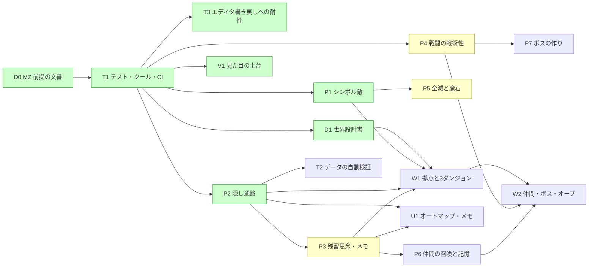

# ROADMAP — 灰の王国（Fanastasis 系 探索RPG、RPGツクールMZ）

[VISION.md](../VISION.md) の核を、並行して動く子セッションに配るための分け方。
子は **このファイルのチェックを編集しない**（まとめは配り役が起動する D レーンの子が行う）。

## 現在地
- エンジンは **RPGツクールMZ**（2026-10-10 に持ち主が決定。画面品質のため）。
- MZ プロジェクト本体（`Game.rmmzproject`、`index.html`、`js/`、`data/`、`img/`、`audio/`、`css/`、`fonts/`、`effects/`、`icon/`）は
  持ち主が PC 側のセッションでリポジトリ直下に push する。試作の `index.html`（自前エンジン）はそのとき `prototype/` に移すか消す（持ち主が行う）。
- テスト・CI は整った（T1。必須チェックは **`CI result`**）。マージ済み：D0・T1・D1・P1・P2・T3・V1。PR 待ち：P4（#27）・P3（#31）・P5（#33）。

## 誰が何をするか
- **子セッション（クラウド）**：MZ のエディタを開けない。触れるのは `js/plugins/*.js`、`js/plugins.js`（追記だけ）、`data/*.json`、`tools/`、`tests/`、`.github/`、`docs/`。
  プラグインとデータを書き、Playwright で Web 実行を確かめる。
- **持ち主の PC 側セッション**：MZ のエディタでの確認と仕上げ（マップの見た目、イベントの位置、素材の選定、戦闘の手触り）。
  `Game.rmmzproject`、`js/rmmz_*.js`・`js/main.js`・`js/libs/`（コアスクリプト）、`img/`・`audio/`・`css/`・`fonts/`・`effects/`・`icon/`、`index.html` は持ち主だけが触る。
- 子の PR には「エディタでの確認（持ち主の PC 側）」の章を付け、持ち主がエディタで見る所を箇条書きにする。

### エディタとクラウドの行き来の約束
- エディタで保存すると `data/*.json` と `js/plugins.js` がエディタの持っている内容で書き戻される。
  **持ち主はエディタを閉じてから `git pull` し、pull のあとに開き直す。** エディタを開いたまま pull しない（子の変更が消える）。
- エディタで直したものは、持ち主が小さなコミット（題の頭に `editor:`）で main に入れる。子の PR の枝には push しない。
- 持ち主がエディタで仕上げたマップは `docs/maps.md`（W1 が作る。追記だけ）に「仕上げ済み」と書く。仕上げ済みのマップの JSON を子が書き換えるときは、
  タイル層（`data`）を作り直さず、イベントと欄だけを変える（文字マップから作り直さない。#5）。
- **T3（#23）で決まったこと**：
  - エディタの保存で変わる `System.json` の `editMapId`・`versionId`、`MapInfos.json` の `scrollX`・`scrollY` はエディタの状態で、データの検査は落とさない。
  - リポジトリ直下の `package.json` は MZ の物（エディタが書き戻す）。テストの npm 設定は `tests/package.json`（`npm ci --ignore-scripts --prefix tests`）。
  - `.gitattributes` で改行を LF に固定する（エディタの書き戻しで差分が改行だらけにならないように）。
  - 持ち主は `git add data js` で `editor:` コミットを作る。

## レーン（並行作業の単位）
| 記号 | レーン | 書き換えてよいところ | 触らないところ |
|---|---|---|---|
| T | ツール・CI・テスト | `tools/`、`tests/`、`.github/`、`package.json`、`package-lock.json`、`.gitignore`（追記）、`js/plugins/Hai_TestHooks.js` | ゲームの仕組みとデータ |
| P | プラグイン（仕組み） | 自分の issue で作る `js/plugins/Hai_<名前>.js`、`js/plugins.js`（追記だけ）、P の ID 帯のデータ、`tests/p_*.mjs`、`docs/plugins/<名前>.md` | 他の issue が作ったプラグイン（直すときは PR の説明に書いて小さく）、W の帯のデータ |
| W | データ（世界） | `data/Map<W の帯>.json`、`data/MapInfos.json`（追記だけ）、W の ID 帯の `data/Actors.json` `Classes.json` `Skills.json` `Items.json` `Weapons.json` `Armors.json` `Enemies.json` `Troops.json` `States.json` `CommonEvents.json`、`data/System.json` の `switches`・`variables` の W の帯の名前、`tools/maps/src/`（文字マップ）、`tests/w_*.mjs`、`docs/maps.md`（追記） | プラグインのコード（要るなら P に issue）、`System.json` のほかの欄（W1 だけ `startMapId`・`startX`・`startY`・`partyMembers` を変えてよい） |
| V | 見た目・音 | `data/Tilesets.json`、`data/Animations.json`（V の帯）、自分の issue で作る `js/plugins/Hai_<名前>.js`、`docs/look.md` | `img/`・`audio/`（素材の選定は持ち主。子は候補を `docs/look.md` に書く）、マップのタイル層 |
| U | UI（プラグイン） | 自分の issue で作る `js/plugins/Hai_<名前>.js`、`js/plugins.js`（追記だけ）、U の帯のデータ、`tests/u_*.mjs` | P のプラグインの中身（読むだけ。足りない窓口は P に issue か、PR の説明に書いて小さく足す） |
| D | 設計書・まとめ | `docs/*`、`VISION.md`（追記）、`CLAUDE.md`、`README.md` | コードとデータ |

同じレーンの中は順番に（前の PR がマージされてから次）、別のレーンは同時に。
**プラグインのファイルは、それを作った issue のもの。** 後の issue が手を入れるときは PR の説明に書き、変更を小さくする。

## 共有ファイルと衝突を避けるための約束
- **`js/plugins.js` は追記だけ**（配列の最後に 1 行足す）。並び順に依存があるときだけ途中に入れ、PR の説明に書く。2 本が同時に足したら後から入る側が取り込んで直す。
  現在の並び順は `Hai_TestHooks` → `Hai_SymbolEnemy` → `Hai_HiddenPassage` → `Hai_MapTone` → `Hai_Battle` → `Hai_Thoughts` → `Hai_Defeat` → 以後は追記順（`Hai_Battle`・`Hai_Thoughts`・`Hai_Defeat` は P4・P3・P5 の PR 待ちで、まだ `js/plugins.js` に無い）。
- **`data/MapInfos.json` は追記だけ**。自分の帯の番号の要素だけを足す（隙間は `null`）。`order` は既存の最大の次から。
- **`data/System.json`** は `switches`・`variables` の自分の帯の名前だけを書く。長さが足りなければ `""` で伸ばす。ほかの欄（タイトル・用語・音・初期パーティなど）は持ち主（W1 の例外は上の表）。
- **データベースの表**は自分の帯の ID だけを書く。帯の先頭まで配列を伸ばすときは空の項目で埋める（[docs/mz-data.md](mz-data.md) の 1）。2 本が同じ表を伸ばしてぶつかったら、後から入る側が取り込んで直す。
- **プラグインの名前**：ファイル名・プラグイン名は `Hai_<PascalCase>`。グローバルは `window.Hai.<名前>` だけ。メモ欄のタグは `<hai_<名前>:…>`、プラグインコマンドはそのプラグインの名前で登録する。
- **プラグインの状態**は `$gameSystem` の `_hai.<名前>` に置く（自動でセーブに入る）。古いセーブで欄が無ければ読むときに初期値を入れる。セーブの版の番号は持たない。
- **イベントごとの状態**（開けた宝箱・読んだ残留思念）はセルフスイッチで持つ。全体のスイッチは筋の大きな旗だけ。
- **キーの割り当て**（`Input.keyMapper` に足すもの）は `docs/plugins/keys.md`（最初に足す子が作る。追記だけ）に書く。同じキーを 2 本が取ったら後から入る側が変える。
- **テスト**：`tests/run.mjs` と共有の起動部分（静的サーバー・ブラウザの起動・`window.__game`）は T だけが触る。各レーンは `tests/<レーン>_*.mjs` を足す。
- **コアスクリプト**（`js/rmmz_*.js`）は誰も書き換えない。変えたい所はプラグインで alias する。

### ID の帯
「issue ごと」の欄は配り役が issue を立てるときに割り当て、下の「割り当て表」に追記する。帯を使い切りそうなら PR の説明に書いて配り役に頼む。

**スイッチ・変数**（`System.json` の `switches` / `variables`。どちらも同じ帯）
| 番号 | 使う所 |
|---|---|
| 1–20 | 持ち主（エディタでの試し） |
| 21–100 | P（issue ごとに 10 ずつ） |
| 101–200 | W 全体（筋の旗：オーブ・仲間の加入・拠点の施設。名前は D1 が決める） |
| 201–900 | W（issue ごとに 100 か 50 ずつ） |
| 901–950 | U・V |
| 951–999 | T（テスト専用。製品のイベントから使わない） |

**マップ**（`MapNNN.json` と `MapInfos.json`）
| 番号 | 使う所 |
|---|---|
| 1–9 | 持ち主（エディタでの試し、MZ が最初に作る Map001） |
| 10–19 | 拠点「牢獄の間」とその周り |
| 20–899 | ダンジョン（issue ごと） |
| 900–949 | T（テスト用の小さなマップ。製品のマップから行けないようにする） |

**データベースの表**（`Skills` `Items` `Weapons` `Armors` `Enemies` `Troops` `States` `CommonEvents` `Animations`）
| 番号 | 使う所 |
|---|---|
| 1–100 | 持ち主・MZ の既定データ（Skills 1 攻撃・2 防御、States 1 戦闘不能はコアが番号で使う） |
| 101–200 | P（仕組みに付く技・状態・コモンイベント。issue ごとに 20 ずつ） |
| 201–800 | W（issue ごと） |
| 801–900 | V（`Animations` と演出用のコモンイベント） |
| 901–950 | U |
| 951–999 | T（テスト用。製品から使わない） |

**リージョン**（マップのリージョン ID）
| 番号 | 使う所 |
|---|---|
| 250–259 | P2（隠し通路。251–254 を使用） |
| それ以外 | W（issue ごと） |

**Actors・Classes**：1–4 は主人公と既定（持ち主）、5–49 は仲間（W。D1 の一覧の順）、90–99 は T。
**Tilesets**：1–10 は MZ の既定（持ち主）、11–30 は V。

**割り当て表**（配り役が issue を立てるときに追記する）
| issue | スイッチ・変数 | マップ | データベース | コモンイベント |
|---|---|---|---|---|
| T1 | 951–960 | 900–909（Map900 を使用） | 951–960 | 951–960 |
| P1 | 21–30 | Map901 | 101–120（Troops 101–103） | 101–110 |
| P2 | 31–40 | Map902（リージョン 250–259、251–254 を使用） | — | 111–120 |
| V1 | — | Map903 | Tilesets 11–14（15–21 予約） | — |
| P3（PR 待ち #31） | 41–50 | Map904 | 121–140（Items 121） | 121–130 |
| P4（PR 待ち #27） | 51–60 | — | 141–180（Skills 158–170・179–180。141–157・171–178 は MZ 既定スキルのため避けた。States 141–147・Items 141–144・Weapons 141–142・Armors 141–144・Enemies/Troops 141–146・161） | 131–140 |
| P5（PR 待ち #33） | 61–70 | Map905 | 181–190（Enemies/Troops 181） | 141–150 |
| W1 | 201–300 | 10–19、20–49 | 201–300 | 201–240 |

## 項目（ID は `<レーン><番号>`）

### 波0 — 土台（単独。持ち主の MZ プロジェクトが main に入り、D0 がマージされてから起動。T1 がマージされるまで他を起動しない）
- [x] **D0** MZ 前提に ROADMAP・CLAUDE.md・T1 を書き直す（#3、PR #7）。
- [x] **T3** エディタの保存で `package.json` が書き戻されても壊れないように（テスト設定を `tests/` へ退避、`.gitattributes`、エディタ状態の許容。#15、PR #23）。
- [x] **T1** テスト・ツール・CI の土台（#9）。
  - `tests/package.json`（devDependencies は `playwright` 1.56.1 だけ。`npm ci --ignore-scripts --prefix tests` で入る。`tests/package-lock.json` もコミット。直下の `package.json` は MZ の物。T3）。
  - `tests/serve.mjs`：依存なしの静的サーバー（Node の `http`）でリポジトリ直下を配る（MZ は `file://` では動かない）。
  - `js/plugins/Hai_TestHooks.js`：URL に `?hai_test` があるときだけ `window.__game` を公開する（今のシーン名、マップ ID・座標、移動、戦闘の開始と勝たせる、セーブとロード）。
    `js/plugins.js` に 1 行足す。
  - `tests/run.mjs`：Playwright（クラウドでは `/opt/pw-browsers/chromium`。`playwright install` はしない）で `index.html?hai_test` を開き、
    起動 → ニューゲーム → 移動 → `window.__game` で戦闘 → 勝利 → セーブ → タイトル → ロードで同じ場所に戻る。`pageerror` と console の error がゼロ。
    スクリーンショットを `tests/out/` に出す（コミットしない）。各レーンの `tests/<レーン>_*.mjs` を拾って走らせる仕組み。
  - `tools/maps/`：文字マップ（1 文字＝1 タイル。試作の書き方）→ `data/MapNNN.json` の変換ツール。凡例（文字 → タイルセットの kind・B〜E のタイル・通行・リージョン）は
    `tools/maps/legend.json`（追記だけ）。オートタイルの shape の計算（[docs/mz-data.md](mz-data.md) の 2.3）、影の層、イベントの最小限の配置（場所移動・調べると文章）。
    エディタの作ったマップを読み戻して shape を計算し直し、一致するかを確かめるテスト。
  - `tools/data/`：データベースの JSON を読む・空の項目で伸ばす・エディタと同じ書式で書く、の小さな関数と、整合の検査（0 番目が `null`、`id` が添字と同じ、
    `MapInfos.json` と `MapNNN.json` の対応、イベントの `list` が `code: 0` で終わる、`indent` の対応）。`node tests/run.mjs` から走らせる。
  - `.github/workflows/ci.yml`：`test` ジョブ（Ubuntu。CI では `npx playwright install --with-deps chromium` を使う）と、必須チェック **`CI result`**
    （`needs: [test]`、`if: always()`、needs のどれかが failure か cancelled なら落ちる）。third-party Actions は full SHA で固定。
  - [docs/mz-data.md](mz-data.md) の「要確認」を実ファイルで確かめて直す。CLAUDE.md の検証手順を実態に合わせる。
  - ヘッドレス Chromium で MZ の WebGL が動くか（`--use-angle=swiftshader` などが要るか）を確かめ、要る引数を `tests/run.mjs` に入れる。

### 波1 — 核の仕組み（T1 のあと、3 本まで同時）
- [x] **P1**（#19） シンボル敵。マップ上の敵イベント（メモ欄 `<hai_enemy:troopId,強さ>`）が単純に巡回し、近づくと弱く追う。接触で戦闘（301）。強さで色を変える（赤が最強）。
  勝てば消え、逃げたら数秒すり抜ける。ランダムエンカウントは使わない。テスト用マップで「避けられる」「接触で戦闘」を確かめる。
- [x] **P2**（#18） 隠し通路。見えない通路（壁に見えて通れる）、隠し扉（調べると開く）、片側からだけ開く扉、隠し階段。手がかりの描き分け（一マスだけ違う床・影の無い壁・くぼみ）を
  どのタイルとリージョンで表すかの規則を決め、[docs/mz-data.md](mz-data.md) の 2.4 に追記。見つけたらセルフスイッチで覚える。
- [x] **D1**（#14） 世界設計書 `docs/world.md`。国・主人公・案内役・拠点・第1段階の 3 ダンジョンの構成図（つながり・隠し通路・赤い宝箱・遺骸・残留思念の一覧・ボス）、
  4 つのオーブの置き場所と順不同の筋、仲間 5 人（役割・固有技・記憶 4 断片の場所）、結末の分岐、筋の旗（スイッチ 101–200）の名前の表。ネタ元の固有名詞は使わない。
- [x] **V1**（#25） 見た目の土台。MZ 同梱のタイルセットから廃墟・地下・森の組み合わせを選び（候補を `docs/look.md` に書き、持ち主がエディタで決める）、
  `data/Tilesets.json` の通行設定を整える。マップごとの色調・遠景をメモ欄 `<hai_tone:…>` で指定するプラグイン。画面サイズは #4 に従う。

### 波2 — 第1段階を遊べる形に（前提が済んだものから）
- [ ] **P3**（PR 待ち #31）残留思念と自動メモ（前提 P2）。調べると読める文章の既読、手がかり（鍵の番号・隠し扉の示唆）をメモに自動で残す窓口。
- [ ] **P4**（PR 待ち #27）戦闘の戦術性（前提 T1）。SP（回復・強技の資源）と MP の分離、状態異常（毒・眠り・氷・混乱・狂乱・沈黙）、属性と耐性、物理軽減、
  敵の行動の型（3〜4 種、MZ の行動パターンで足りない分だけプラグイン）、逃走（ボスからも可）、オートバトル。
- [ ] **P5**（PR 待ち #33）全滅時に魔石を落として拠点へ戻り、戻れば拾える（前提 P1）。ゲームオーバー画面にしない。
- [ ] **W1** 拠点「牢獄の間」と最初の 3 ダンジョン（前提 D1・P1・P2・P3）。文字マップから変換し、残留思念・赤い宝箱・鍵と施錠扉・シンボル敵を置く。
  `docs/maps.md` を作る。
- [ ] **U1** オートマップとメモの画面（前提 P2・P3）。通った所と見つけた隠し通路を描く。入手ログ。
- [ ] **T2** データの自動検証（前提 T1・P2）。全マップの到達性（隠し通路込み）、宝箱・遺骸・残留思念が到達できるか、ID が帯に収まっているか、場所移動の行き先が在るか。

### 波3 — 第1段階の仕上げ
- [ ] **P6** 仲間の遺骸 → 拠点で召喚、控え、仲間の記憶 4 断片と完全体（前提 P3）。
- [ ] **W2** 仲間 1 人の遺骸と記憶、ボス 1 体、オーブ 1 個（前提 W1・P4・P6）。
- [ ] **P7** ボスの作り（耐性の穴、複数行動、形態変化。前提 P4）。
- [ ] **U2** スマホ操作の整理（MZ のタッチ操作の上に、メニュー・調べるのボタン）。

### 波4 — 第2段階へ（VISION.md から切り出す）
- [ ] **P8** 拠点施設（魂の間・創作者の厨房・保管ゲート・理知の間）と叡智のオーブ。
- [ ] **W3〜W5** 残りのダンジョン、仲間 5 人、オーブ 4 個、エンディング 1 つ。
- [ ] **P9** 装備の一点もの・所持上限・合成。
- [ ] **U3** 設定（早送り・瞬間表示）、転送結界、セーブ地点。
- [ ] **D2** 複数エンディングと第3段階の設計。

### 前提と波の表

緑＝マージ済み、黄＝PR 待ち（P3 #31・P4 #27・P5 #33）。

| 波 | 項目 | 条件 |
|---|---|---|
| 0 | D0 → T1（→ T3） | 持ち主の MZ プロジェクトが main に入ってから T1。T1 は単独。T3 は T1 の後始末（済） |
| 1 | P1, P2, D1, V1（すべて済） | T1 のあと。同時に 3 本まで |
| 2 | P3（PR 待ち）, P4（PR 待ち）, P5（PR 待ち）, W1, U1, T2 | 前提が済んだものから |
| 3 | P6, W2, P7, U2 | 前提が済んだものから |
| 4 | VISION.md から切り出す | |

## 決定待ちの issue
（`needs-decision` ラベルの issue を配り役がここに列挙する。推しの案で実装を進めてよい）

**決定済み**
- #4 画面の大きさ → 1280×720（V1 で反映）
- #5 マップの正本 → 仕上げ後は JSON が正本、文字マップは下書き
- #6 MZ 同梱素材 → リポジトリに含める
- #8 壁の厚み → 壁 2 マス

**開いている**（推しの案。どれも実装済みか、後から直せる。持ち主が決めたら閉じる）
- #13 タイトル・主人公の既定名・暗さ・仲間の名前・結末の数（D1）— 推し：`docs/world.md` の案のまま（名前はオルド・ザザ・ノクス・ルメ・シオン）。P6・W2 の前までに
- #16 シンボル敵の手触り（追う距離・速さ・色・復活・すり抜けの長さ）— 推し：P1 の既定値のまま。W1 が敵を置く前に、Map901 で触って決める
- #17 隠し通路をシンボル敵も通るか — 推し：A（プレイヤーだけが通れる。P2 はこれで実装）
- #22 エディタの状態だけの `System.json` の差分をコミットするか — 推し：A（コミットしない。`git checkout data/System.json` で戻す）
- #24 V1 のタイルセットの組み合わせ・色調と暗がりの数値・戦闘背景 — 推し：V1 の作った値のまま（`docs/look.md`。`docs/world.md` 4 章のタイルセット番号は決まれば 12・13・14 に直す）
- #26 P4 の戦闘の数値・SP の全快の場所・Skills の帯 — 推し：実装のまま（Skills は 158–170・179–180。SP の全快は拠点の宿でプラグインコマンド `recoverSp`）。PR 待ち（#27）
- #30 P3 の既読の印・メモの知らせ方 — 推し：実装のまま（既読は本文頭に灰色の「（読んだ）」、メモは本文の後の 1 ページと SE）。PR 待ち（#31）
- #32 P5 の全滅で落とす額・前の魔石 — 推し：実装のまま（全額を落とす。前の魔石は消える）。PR 待ち（#33）
