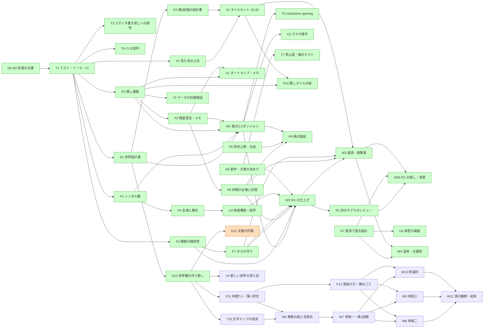

# ROADMAP — 最後の鐘（Fanastasis 系 探索RPG、RPGツクールMZ。前の題は「灰の王国」）

[VISION.md](../VISION.md) の核を、並行して動く子セッションに配るための分け方。
子は **このファイルのチェックを編集しない**（まとめは配り役が起動する D レーンの子が行う）。

## 現在地
- エンジンは **RPGツクールMZ**（2026-10-10 に持ち主が決定。画面品質のため）。
- MZ プロジェクト本体（`Game.rmmzproject`、`index.html`、`js/`、`data/`、`img/`、`audio/`、`css/`、`fonts/`、`effects/`、`icon/`）は
  持ち主が PC 側のセッションでリポジトリ直下に入れ、**main に入っている**。
- テスト・CI は整った（T1。必須チェックは **`CI result`**。T4・T6 で 4 シャードの並列）。
- **仕組みはそろっている**：戦闘の戦術性（P4）、オートマップとメモ（U1）、仲間の召喚（P6）、隠しタイルの絵（P10）、快適機能と結界（U3）、所持上限と合成（P9）、
  ボスの作り（P7）、拠点施設（P8）、来歴を読む画面（U4）、タッチボタン（U2 の続き #115）、静かな入手（U5 #131）、BGM・BGS（V3 #128）。創作・文章の決まり（D5 `docs/knowhow.md`）と文章の癖のテスト（T7）も入った。CI は 6 シャード（T9 #124）。
- **前の世界「灰の王国」の第1・第2段階の途中まで作った**：W1・W2（#92）・W3（#101）・W4（#119。湿地・古書院）・W2b（#122。R1 の直しと来歴の差し替え）がマージ済み。
  R1（#113）のレビューは `docs/reviews/2026-10-11-r1.md`。W5（#120）は**取り止め**（枝 `claude/w5-stage2e` は形だけ参考）。前の世界の設計は [docs/old/](old/) に控えとして置いた。
- **世界観を作り直した（D10 #130、2026-10-12）**：新しい世界は「**最後の鐘**」。設計書は [docs/world.md](world.md)、マップの作り方は [docs/mapdesign.md](mapdesign.md)。
  後回しにできる判断は決定待ちの #129。**D11（#132。この文書の同期）はこの PR**。次は**波6**（下）：T10・P11 から。
- **マージ済み**：D0・T1・T3・P1・P2・D1・V1・P3・P5・T2・D2 の設計・U2・T4・W1・D3・V2・D4（#70）・T6（#74）・P4（#27）・U1（#42）・P6（#51）・P10（#66）・T5（#68）・U3（#61）・P9（#63）・D5（#78）・T7（#81）・P7（#72）・P8（#87）・D6（#86）・W2（#92）・T8（#90）・D7（#97）・W3（#101）・R1（#113）・U4（#111）・眠りの直し（#114）・U2 の続き（#115）・D8（#118）・W4（#119）・T9（#124）・W2b（#122）・V3（#128）・U5（#131）・D10（#130）。

## 誰が何をするか
- **子セッション（クラウド）**：MZ のエディタを開けない。触れるのは `js/plugins/*.js`、`js/plugins.js`（追記だけ）、`data/*.json`、`tools/`、`tests/`、`.github/`、`docs/`。
  プラグインとデータを書き、Playwright で Web 実行を確かめる。
- **持ち主の PC 側セッション**：MZ のエディタでの確認と仕上げ（マップの見た目、イベントの位置、素材の選定、戦闘の手触り）。
  `Game.rmmzproject`、`js/rmmz_*.js`・`js/main.js`・`js/libs/`（コアスクリプト）、`img/`・`audio/`・`css/`・`fonts/`・`effects/`・`icon/`、`index.html` は持ち主だけが触る。
- 子の PR には「エディタでの確認（持ち主の PC 側）」の章を付け、持ち主がエディタで見る所を箇条書きにする。

### エディタとクラウドの行き来の約束
- エディタで保存すると `data/*.json` と `js/plugins.js` がエディタの持っている内容で書き戻される。
  **持ち主はエディタを閉じてから `git pull` し、pull のあとに開き直す。** エディタを開いたまま pull しない（子の変更が消える）。
- エディタで直したものは、持ち主が小さなコミット（題の頭に `editor:`）で main に入れる。子の PR の枝には push しない。
- 持ち主がエディタで仕上げたマップは `docs/maps.md`（W1 が作る。追記だけ）に「仕上げ済み」と書く。仕上げ済みのマップの JSON を子が書き換えるときは、
  タイル層（`data`）を作り直さず、イベントと欄だけを変える（文字マップから作り直さない。#5）。
- **T3（#23）で決まったこと**：
  - エディタの保存で変わる `System.json` の `editMapId`・`versionId`、`MapInfos.json` の `scrollX`・`scrollY` はエディタの状態で、データの検査は落とさない。
  - リポジトリ直下の `package.json` は MZ の物（エディタが書き戻す）。テストの npm 設定は `tests/package.json`（`npm ci --ignore-scripts --prefix tests`）。
  - `.gitattributes` で改行を LF に固定する（エディタの書き戻しで差分が改行だらけにならないように）。
  - 持ち主は `git add data js` で `editor:` コミットを作る。

## レーン（並行作業の単位）
| 記号 | レーン | 書き換えてよいところ | 触らないところ |
|---|---|---|---|
| T | ツール・CI・テスト | `tools/`、`tests/`、`.github/`、`package.json`、`package-lock.json`、`.gitignore`（追記）、`js/plugins/Hai_TestHooks.js` | ゲームの仕組みとデータ |
| P | プラグイン（仕組み） | 自分の issue で作る `js/plugins/Hai_<名前>.js`、`js/plugins.js`（追記だけ）、P の ID 帯のデータ、`tests/p_*.mjs`、`docs/plugins/<名前>.md` | 他の issue が作ったプラグイン（直すときは PR の説明に書いて小さく）、W の帯のデータ |
| W | データ（世界） | `data/Map<W の帯>.json`、`data/MapInfos.json`（追記だけ）、W の ID 帯の `data/Actors.json` `Classes.json` `Skills.json` `Items.json` `Weapons.json` `Armors.json` `Enemies.json` `Troops.json` `States.json` `CommonEvents.json`、`data/System.json` の `switches`・`variables` の W の帯の名前、`tools/maps/src/`（文字マップ）、`tests/w_*.mjs`、`docs/maps.md`（追記） | プラグインのコード（要るなら P に issue）、`System.json` のほかの欄（W1 だけ `startMapId`・`startX`・`startY`・`partyMembers` を変えてよい） |
| V | 見た目・音 | `data/Tilesets.json`、`data/Animations.json`（V の帯）、自分の issue で作る `js/plugins/Hai_<名前>.js`、`docs/look.md` | `img/`・`audio/`（素材の選定は持ち主。子は候補を `docs/look.md` に書く）、マップのタイル層 |
| U | UI（プラグイン） | 自分の issue で作る `js/plugins/Hai_<名前>.js`、`js/plugins.js`（追記だけ）、U の帯のデータ、`tests/u_*.mjs` | P のプラグインの中身（読むだけ。足りない窓口は P に issue か、PR の説明に書いて小さく足す） |
| D | 設計書・まとめ | `docs/*`、`VISION.md`（追記）、`CLAUDE.md`、`README.md` | コードとデータ |
| R | レビュー | `docs/reviews/`（結果の文書）、見つけたことの issue | コードとデータ（直すのは P・W・U などの別の issue） |

**R レーン**：作ったのと別のモデルが遊んで確かめ、`docs/reviews/` に結果を書いて issue を立てる（流れ・難度・文・画面・セーブ・設定との食い違い）。直すのは別の issue。

同じレーンの中は順番に（前の PR がマージされてから次）、別のレーンは同時に。
**プラグインのファイルは、それを作った issue のもの。** 後の issue が手を入れるときは PR の説明に書き、変更を小さくする。

## 共有ファイルと衝突を避けるための約束
- **`js/plugins.js` は追記だけ**（配列の最後に 1 行足す）。並び順に依存があるときだけ途中に入れ、PR の説明に書く。2 本が同時に足したら後から入る側が取り込んで直す。
  並び順の正本は `js/plugins.js` と `tools/data/check.mjs` の `PLUGIN_ORDER`（T2 が検査する）。`Hai_Battle` は P4（#27）で入った（`Hai_Thoughts` の前）。`Hai_Lore` は U4（#111）で入った（`Hai_Notes` の後）。
- **`data/MapInfos.json` は追記だけ**。自分の帯の番号の要素だけを足す（隙間は `null`）。`order` は既存の最大の次から。
- **`data/System.json`** は `switches`・`variables` の自分の帯の名前だけを書く。長さが足りなければ `""` で伸ばす。ほかの欄（タイトル・用語・音・初期パーティなど）は持ち主（W1 の例外は上の表）。
- **データベースの表**は自分の帯の ID だけを書く。帯の先頭まで配列を伸ばすときは空の項目で埋める（[docs/mz-data.md](mz-data.md) の 1）。2 本が同じ表を伸ばしてぶつかったら、後から入る側が取り込んで直す。
- **プラグインの名前**：ファイル名・プラグイン名は `Hai_<PascalCase>`。グローバルは `window.Hai.<名前>` だけ。メモ欄のタグは `<hai_<名前>:…>`、プラグインコマンドはそのプラグインの名前で登録する。
- **プラグインの状態**は `$gameSystem` の `_hai.<名前>` に置く（自動でセーブに入る）。古いセーブで欄が無ければ読むときに初期値を入れる。セーブの版の番号は持たない。
- **イベントごとの状態**（開けた宝箱・読んだ残留思念）はセルフスイッチで持つ。全体のスイッチは筋の大きな旗だけ。
- **キーの割り当て**（`Input.keyMapper` に足すもの）は `docs/plugins/keys.md`（最初に足す子が作る。追記だけ）に書く。同じキーを 2 本が取ったら後から入る側が変える。
- **テスト**：`tests/run.mjs` と共有の起動部分（静的サーバー・ブラウザの起動・`window.__game`）は T だけが触る。各レーンは `tests/<レーン>_*.mjs` を足す。
- **コアスクリプト**（`js/rmmz_*.js`）は誰も書き換えない。変えたい所はプラグインで alias する。
- **マージの条件**：ルールセットは `CI result` 緑と、枝が main に最新であることを要求する。配り役が update で合わせ、衝突するものは子を起こす（1 本ずつ進む）。
- **CI は 6 シャード**（`node tests/run.mjs --shard i/6`。`tests/durations.json` の所要時間で均す。配り分けは `--plan 6`）。1 シャード 10 分以内を守る（長いテストは分ける）。
- **ブラウザのテストは 1 本 2〜5 分**。新しいテストは 1 レーン 1 本にまとめる。

### ID の帯
「issue ごと」の欄は配り役が issue を立てるときに割り当て、下の「割り当て表」に追記する。帯を使い切りそうなら PR の説明に書いて配り役に頼む。

**スイッチ・変数**（`System.json` の `switches` / `variables`。どちらも同じ帯）
| 番号 | 使う所 |
|---|---|
| 1–20 | 持ち主（エディタでの試し） |
| 21–100 | P（issue ごとに 10 ずつ） |
| 101–200 | W 全体（筋の旗：オーブ・仲間の加入・拠点の施設。名前は D1 が決める） |
| 201–900 | W（issue ごとに 100 か 50 ずつ） |
| 901–950 | U・V |
| 951–999 | T（テスト専用。製品のイベントから使わない） |

**マップ**（`MapNNN.json` と `MapInfos.json`）
| 番号 | 使う所 |
|---|---|
| 1–9 | 持ち主（エディタでの試し、MZ が最初に作る Map001） |
| 10–19 | 拠点（新しい世界は黒鉄の砦。前の世界は牢獄の間） |
| 20–899 | ダンジョン（issue ごと） |
| 900–949 | T（テスト用の小さなマップ。製品のマップから行けないようにする） |

**データベースの表**（`Skills` `Items` `Weapons` `Armors` `Enemies` `Troops` `States` `CommonEvents` `Animations`）
| 番号 | 使う所 |
|---|---|
| 1–100 | 持ち主・MZ の既定データ（Skills 1 攻撃・2 防御、States 1 戦闘不能はコアが番号で使う） |
| 101–200 | P（仕組みに付く技・状態・コモンイベント。issue ごとに 20 ずつ） |
| 201–800 | W（issue ごと） |
| 801–900 | V（`Animations` と演出用のコモンイベント） |
| 901–950 | U |
| 951–999 | T（テスト用。製品から使わない） |

**リージョン**（マップのリージョン ID）
| 番号 | 使う所 |
|---|---|
| 250–259 | P2（隠し通路。251–254 を使用） |
| それ以外 | W（issue ごと） |

**Actors・Classes**：1–4 は主人公と既定（持ち主）、5–49 は仲間（W。D1 の一覧の順）、90–99 は T。
**Tilesets**：1–10 は MZ の既定（持ち主）、11–30 は V。

**割り当て表**（配り役が issue を立てるときに追記する）
| issue | スイッチ・変数 | マップ | データベース | コモンイベント |
|---|---|---|---|---|
| T1 | 951–960 | 900–909（Map900 を使用） | 951–960 | 951–960 |
| P1 | 21–30 | Map901 | 101–120（Troops 101–103） | 101–110 |
| P2 | 31–40 | Map902（リージョン 250–259、251–254 を使用） | — | 111–120 |
| V1 | — | Map903 | Tilesets 11–14（15–21 予約） | — |
| P3 | 41–50 | Map904 | 121–140（Items 121） | 121–130 |
| P4（#27） | 51–60 | — | 141–180（Skills 158–170・179–180。141–157・171–178 は MZ 既定スキルのため避けた。States 141–147・Items 141–144・Weapons 141–142・Armors 141–144・Enemies/Troops 141–146・161） | 131–140 |
| P5 | 61–70 | Map905 | 181–190（Enemies/Troops 181） | 141–150 |
| W1 | 201–300 | 10–19、20–49 | 201–300 | 201–240 |
| W3（#101） | 301–400 | 021・023・026・027・033 への追加と 050–053、060–064 | 221–222（鍵の Items）、301–400（敵グループ 301–311） | 301–340 |
| W4（#102、PR #119。前の世界） | 401–500 | 070–073、080–084 と 022 への追加 | 401–500（敵グループ 401–412） | 401–440 |
| W5（取り止め #120） | — | — | — | — |
| T10 | — | — | — | — |
| P11（波6） | 131–150（world.md 5.6・6 章。W 全体の帯 101–200 の中の例外。P の帯は使い切り） | — | P の帯の空き（Actors 5–11） | P の帯の空き |
| P12（波6） | 161–170（同じく例外） | — | P の帯の空き | P の帯の空き |
| W6（波6） | 101–130・151–160・171–200（world.md 4.4 の旗。131–150 は P11、161–170 は P12） | 010–019 | 201–300 | 201–300 |
| W7（波6） | 301–400 | 020–049 | 301–400 | 301–400 |
| W8（波6） | 401–500 | 060–064・080–084 | 401–500 | 401–500 |
| W9（波6） | 501–600 | 070–074・100–105 | 501–600 | 501–600 |
| W10（波6） | 601–700 | 050–054・090–094 | 601–700 | 601–700 |
| W11（波6） | 701–800 | 015 | 701–800 | 701–800 |
| V4（波6） | — | — | V の帯（Tilesets 11–30 ほか） | — |
| U1（#42） | 911–920 | Map906 | 901–950 | — |
| U2 | 921–930 | Map908 | — | — |
| V2 | — | — | Tilesets 15–20 | — |
| P6（#51） | 71–80 | Map907 | 191–200（Skills 191–195。Actors 5–9 は名前・職業・レベルだけ） | 151–160 |
| U3（#61） | 931–940 | Map909 | — | — |
| P9（#63） | 81–90 | Map910 | Items/Weapons/Armors 196–200 | 171–180 |
| P10（#66） | — | Map911 | — | — |
| P7（#72） | 91–100 | Map912 | Enemies/Troops 196–197（Skills/States 196–200 は使わない。#71） | 161–170 |
| P8（#87） | 121–130（world.md 8 章の施設の旗。P の帯 21–100 は使い切り） | 011–014・913 | Items 171–178 | 181–190 |
| W2（#92） | W1 の帯をそのまま使う（201–300 ほか） | W1 のマップ（10–49） | W1 の帯（201–300） | 201–240 |
| U4（#111） | 941–950 | Map914 | 941–945 | — |
| T7 | — | — | — | — |

T4（CI の並列）・T5（#68）・T6（CI の均し）・T7（#81）・T8（#90）・T9（#124）・D5（#78）・D6〜D8・D10・D11・R1（#113）・W2b（#112。W1 の帯の続き）・U5・V3 は帯を使わない。
波6 の帯は D11（#132）が足した（`tools/data/bands.json` の `issues` も同じ）。前の世界の W の帯（W1〜W4。201–500 など）にある古いデータは、新しい W が自分の帯で上書きする（帯の中は持ち主が同じ）。
P6 の Skills 191–195、P9 の Items 196–200、P7 の Enemies/Troops 196–197 は重ならない。P8 のスイッチ・変数 121–130、P11 の 131–150、P12 の 161–170 は「W 全体」の帯（101–200）の中で、P の帯を使い切ったための例外（W6 は 131–150・161–170 を除く 101–130・151–160・171–200 を使う。121–130 は P8 の施設の旗で、W6 は読み替えるだけ〔world.md 4.4〕）。

## 項目（ID は `<レーン><番号>`）

### 波0 — 土台（単独。持ち主の MZ プロジェクトが main に入り、D0 がマージされてから起動。T1 がマージされるまで他を起動しない）
- [x] **D0** MZ 前提に ROADMAP・CLAUDE.md・T1 を書き直す（#3、PR #7）。
- [x] **T3** エディタの保存で `package.json` が書き戻されても壊れないように（テスト設定を `tests/` へ退避、`.gitattributes`、エディタ状態の許容。#15、PR #23）。
- [x] **T1** テスト・ツール・CI の土台（#9）。
  - `tests/package.json`（devDependencies は `playwright` 1.56.1 だけ。`npm ci --ignore-scripts --prefix tests` で入る。`tests/package-lock.json` もコミット。直下の `package.json` は MZ の物。T3）。
  - `tests/serve.mjs`：依存なしの静的サーバー（Node の `http`）でリポジトリ直下を配る（MZ は `file://` では動かない）。
  - `js/plugins/Hai_TestHooks.js`：URL に `?hai_test` があるときだけ `window.__game` を公開する（今のシーン名、マップ ID・座標、移動、戦闘の開始と勝たせる、セーブとロード）。
    `js/plugins.js` に 1 行足す。
  - `tests/run.mjs`：Playwright（クラウドでは `/opt/pw-browsers/chromium`。`playwright install` はしない）で `index.html?hai_test` を開き、
    起動 → ニューゲーム → 移動 → `window.__game` で戦闘 → 勝利 → セーブ → タイトル → ロードで同じ場所に戻る。`pageerror` と console の error がゼロ。
    スクリーンショットを `tests/out/` に出す（コミットしない）。各レーンの `tests/<レーン>_*.mjs` を拾って走らせる仕組み。
  - `tools/maps/`：文字マップ（1 文字＝1 タイル。試作の書き方）→ `data/MapNNN.json` の変換ツール。凡例（文字 → タイルセットの kind・B〜E のタイル・通行・リージョン）は
    `tools/maps/legend.json`（追記だけ）。オートタイルの shape の計算（[docs/mz-data.md](mz-data.md) の 2.3）、影の層、イベントの最小限の配置（場所移動・調べると文章）。
    エディタの作ったマップを読み戻して shape を計算し直し、一致するかを確かめるテスト。
  - `tools/data/`：データベースの JSON を読む・空の項目で伸ばす・エディタと同じ書式で書く、の小さな関数と、整合の検査（0 番目が `null`、`id` が添字と同じ、
    `MapInfos.json` と `MapNNN.json` の対応、イベントの `list` が `code: 0` で終わる、`indent` の対応）。`node tests/run.mjs` から走らせる。
  - `.github/workflows/ci.yml`：`test` ジョブ（Ubuntu。CI では `npx playwright install --with-deps chromium` を使う）と、必須チェック **`CI result`**
    （`needs: [test]`、`if: always()`、needs のどれかが failure か cancelled なら落ちる）。third-party Actions は full SHA で固定。
  - [docs/mz-data.md](mz-data.md) の「要確認」を実ファイルで確かめて直す。CLAUDE.md の検証手順を実態に合わせる。
  - ヘッドレス Chromium で MZ の WebGL が動くか（`--use-angle=swiftshader` などが要るか）を確かめ、要る引数を `tests/run.mjs` に入れる。

### 波1 — 核の仕組み（T1 のあと、3 本まで同時）
- [x] **P1**（#19） シンボル敵。マップ上の敵イベント（メモ欄 `<hai_enemy:troopId,強さ>`）が単純に巡回し、近づくと弱く追う。接触で戦闘（301）。強さで色を変える（赤が最強）。
  勝てば消え、逃げたら数秒すり抜ける。ランダムエンカウントは使わない。テスト用マップで「避けられる」「接触で戦闘」を確かめる。
- [x] **P2**（#18） 隠し通路。見えない通路（壁に見えて通れる）、隠し扉（調べると開く）、片側からだけ開く扉、隠し階段。手がかりの描き分け（一マスだけ違う床・影の無い壁・くぼみ）を
  どのタイルとリージョンで表すかの規則を決め、[docs/mz-data.md](mz-data.md) の 2.4 に追記。見つけたらセルフスイッチで覚える。
- [x] **D1**（#14） 世界設計書 `docs/world.md`。国・主人公・案内役・拠点・第1段階の 3 ダンジョンの構成図（つながり・隠し通路・赤い宝箱・遺骸・残留思念の一覧・ボス）、
  4 つのオーブの置き場所と順不同の筋、仲間 5 人（役割・固有技・記憶 4 断片の場所）、結末の分岐、筋の旗（スイッチ 101–200）の名前の表。ネタ元の固有名詞は使わない。
- [x] **V1**（#25） 見た目の土台。MZ 同梱のタイルセットから廃墟・地下・森の組み合わせを選び（候補を `docs/look.md` に書き、持ち主がエディタで決める）、
  `data/Tilesets.json` の通行設定を整える。マップごとの色調・遠景をメモ欄 `<hai_tone:…>` で指定するプラグイン。画面サイズは #4 に従う。

### 波2 — 第1段階を遊べる形に（前提が済んだものから）
- [x] **P3**（#28、PR #31）残留思念と自動メモ（前提 P2）。調べると読める文章の既読、手がかり（鍵の番号・隠し扉の示唆）をメモに自動で残す窓口。
- [x] **P4**（#21、PR #27）戦闘の戦術性（前提 T1）。SP（回復・強技の資源）と MP の分離、状態異常（毒・眠り・氷・混乱・狂乱・沈黙）、属性と耐性、物理軽減、
  敵の行動の型（3〜4 種、MZ の行動パターンで足りない分だけプラグイン）、逃走（ボスからも可）、オートバトル。
- [x] **P5**（#29、PR #33）全滅時に魔石を落として拠点へ戻り、戻れば拾える（前提 P1）。ゲームオーバー画面にしない。
- [x] **W1**（#39、PR #44）拠点「牢獄の間」と最初の 3 ダンジョン（前提 D1・P1・P2・P3）。文字マップから変換し、残留思念・赤い宝箱・鍵と施錠扉・シンボル敵を置く。
  `docs/maps.md` を作る。
- [x] **U1**（#40、PR #42）オートマップとメモの画面（前提 P2・P3）。通った所と見つけた隠し通路を描く。入手ログ。
- [x] **T2**（#35、PR #38）データの自動検証（前提 T1・P2）。全マップの到達性（隠し通路込み）、宝箱・遺骸・残留思念が到達できるか、ID が帯に収まっているか、場所移動の行き先が在るか。

### 波3 — 第1段階の仕上げ
- [x] **P6**（#45、PR #51）仲間の遺骸 → 拠点で召喚、控え、仲間の記憶 4 断片と完全体（前提 P3）。
- [x] **W2**（#83、PR #92）W1 の仕上げ（前提 W1・P4・P6・P7・U3・D5）。看守長グラウを P7 で本物のボスにし、オルドの召喚を P6 で本物にし、
  `w1_data.mjs` を P4 の状態異常で走らせ直し、結界（U3）を拠点と 3 ダンジョンに置き、`docs/rewrite.md` の文を差し替え、`tests/w_stage1*.mjs` を足す。
  Map010 の 4 つの施設の扉のイベントは P8 が書き直すので触らない。
- [x] **P7**（#67、PR #72）ボスの作り（耐性の穴、複数行動、形態変化、固定ドロップ。前提 P4）。
- [x] **U2**（#47）スマホ操作の整理（MZ のタッチ操作の上に、メニュー・調べるのボタン）。

### 波4 — 第2段階の仕組みと最初のダンジョン（VISION.md と `docs/world2.md` から）
- [x] **D3**（#50、PR #55）第2段階の設計書 `docs/world2.md`（6 ダンジョン・仲間 4 人・オーブ 2〜4 個目・ボス 6 体・結末 B）。
- [x] **V2**（#56、PR #58）第2段階のタイルセット 15–20 と場所ごとの色調の推し（`docs/look.md` 2.4）。
- [x] **T4**（#52、PR #53）CI を 3 シャードに分けて並列に走らせる（20 分切れを直す。のちに T6 で 4 シャード）。
- [x] **T5**（#65、PR #68）`newGame({ opening })` で目覚めの場面を飛ばし、Map010 からテスト用の分岐を外す。
- [x] **P9**（#60、PR #63）所持上限と倉庫への自動転送、一点ものの装備、ドロップの決まり、素材からの合成（`Hai_Items`・`Hai_Craft`）。
- [x] **P10**（#64、PR #66）P2 の続き。隠し扉・隠し階段の絵をタイルセットごとに変える（タグ `<hai_hidden_tiles:…>`）。
- [x] **U3**（#49、PR #61）快適機能（瞬間表示・早送り）、セーブ地点の結界と転送。
- [x] **P8**（#82、PR #87）拠点施設（魂の間・創作者の厨房・保管ゲート・理知の間）と叡智のオーブ（前提 P6・P9・W1）。
- [x] **W3**（#94、PR #101）巨人の崖道・異端者の廃集落・看取りの小屋と第1段階への追加、仲間ザザ・シオン・オルドの記憶、ボス 2 体。
  マップ 023・050–053・060–064 と 021・026・027・033 への追加。帯 301–400。前提 W2・P6・P7（`docs/world2.md` 17 章）。

- [x] **D5**（#75、PR #78）創作・文章・キャラの決まり `docs/knowhow.md`、段階の印と禁止語・口調の表、既存の文の点検（`docs/rewrite.md`）。
- [x] **T7**（#79、PR #81）禁止語の表と文章の癖のテスト（`t_words`。前提 D5）。
- [x] **T6**（#73、PR #74）CI のシャードを所要時間で均す（4 シャード、`tests/durations.json`、`--plan`）。
- [x] **D4**（#69、PR #70）ROADMAP の整理。**D6**（#85、PR #86）ROADMAP の整理。**D8**（#117）ROADMAP の同期（この PR）。
- [x] **T8**（#88、PR #90）CI の使う分数を減らす（main への push と文書だけの PR はブラウザなしのテストだけ。続きの判断は #91）。
- [x] **D7**（#95、PR #97）道具で語る設計 `docs/lore.md`（アイテムの配置と説明文で真相を語る。W2b・W4・W5 への申し送り）。
- [x] **U4**（#96、PR #111）アイテムの来歴を読む画面と「遺物の記録」（`Hai_Lore`）。
- [x] **R1**（#76、PR #113）第1段階のレビュー（別のモデル）。結果は `docs/reviews/2026-10-11-r1.md`、指摘は issue #103〜#110。
- [x] 眠りのダメージ解除を 100% → 40%（PR #114。R1 の #105）。
- [x] **U2 の続き**（PR #115）タッチボタンを画面に見えている所に置く（R1 の #110）。
- [x] **W2b**（#112、PR #122）R1 の #103 #104 #106〜#109 の直しと、第1段階のアイテムの説明・来歴の差し替え（D7）。

### 波5 — 前の世界の第2段階の仕上げ（D10 で世界を作り直したため、ここで止めた。新しい世界は波6）
- [x] **W4**（#102、PR #119）魚人の湿地・古書院、オーブ「聖灰」、仲間ルメ・ノクス・シオンの記憶 1、ボス 2 体。マップ 070–073・080–084 と 022 への追加。帯 401–500。前提 W3。
- ~~**W5** 蘇生師の研究所・王都の下水道・王都の門、オーブ「契約」「封印」、結末 B、010 の螺旋階段、ボス 2 体。マップ 090–094・100–104・015 と 010・027・035 への追加。帯 501–（予約）。前提 W3・W4。
  （取り止めの理由：D10 #127 で持ち主が世界観を作り直したため。前の世界の研究所・下水道・門・結末 B は新しい世界の波6 に作り替えて入る。枝 `claude/w5-stage2e`〔#120〕は形だけ参考）~~
- ~~**D2** 複数エンディングと第3段階の設計（前提 D3。第2段階の W が済んでから）。~~ 取り止め：結末は新しい world.md の 9 章（二つ）に置き換わった。第3段階の設計は波6 が済んでから D の issue を立て直す。

### 波6 — 新しい世界の作り直し（D10 #130 のあと。設計書は [world.md](world.md)・[mapdesign.md](mapdesign.md)）
| 項目 | 中身 | 前提 | 帯 |
|---|---|---|---|
| D11 | 文書を新しい世界に合わせる（この PR。#132） | D10 | なし |
| T10 | 文字マップの道具に足す物（mapdesign.md 6.3：重ね書き・スタンプ・散らし・段差・建物・置き物の密度の報告） | D10 | なし |
| P11 | 仲間を 7 人に（`Hai_Companions`）、会話できない薄い思念、施設をオーブなしで開く、名前の欄（world.md 5.6・6 章・4.3） | D10 | スイッチ 131–150（W の帯の中の例外。P の帯は使い切り）、Actors 5–11、データベースは P の帯の空き |
| P12 | 使徒の力と「呑まれ」・呼びかけ、弱い化け物のためらい、頼みごとの一覧（world.md 3.1・3.2・3.7・7.3） | P11 | スイッチ 161–170（同じく例外）、データベースは P の帯の空き |
| W6 | 黒鉄の砦 010–019 の作り直しと目覚めの数分（world.md 3.4・4 章） | T10・P11 | スイッチ・変数 101–130・151–160・171–200 のうち world.md 4.4 の旗、マップ 010–019、データベース 201–300 |
| W7 | 地域一：霧の森・鉄の坑道・営倉（020–037）、営倉の鐘、ブルーノ、第1段階を通しで遊べる形に | W6 | 301–400、マップ 020–049 |
| W8 | 地域二：焼けた村・記録院（060–064・080–084）、記録院の鐘 | W7・P12 | 401–500 |
| W9 | 地域三：霧の湖・地下水道と地下都市（070–074・100–105）、水底の鐘 | W7・P12 | 501–600 |
| W10 | 地域四：境山の古道・鋳物場と研究所（050–054・090–094）、鋳物場の鐘 | W7・P12 | 601–700 |
| W11 | 頂の鐘楼（015）・最後の地域の山場・結末 | W8〜W10 | 701–800 |
| V4 | 新しい世界の見た目（look.md：地域ごとの色調・タイルセットの候補、灰・霧の表現） | D10 | V の帯 |

- [ ] **D11**（#132）この PR。
- [ ] **T10**
- [ ] **P11**
- [ ] **P12**
- [ ] **W6**
- [ ] **W7**
- [ ] **W8**
- [ ] **W9**
- [ ] **W10**
- [ ] **W11**
- [ ] **V4**
- W8〜W10 は好きな順で回れる作りなので、前提が済めば並べて進めてよい。
- 前の世界の W の帯（201–500 など）にある古いデータは、新しい W が自分の帯で上書きする（帯の中は持ち主が同じなので）。

### 前提と波の表

緑＝マージ済み、橙＝着手中（D11 #132）、無色＝未着手。前の世界の W5・D2 は取り止めたので図から外した（波5 の項）。波6 の W6〜W11 は新しい世界のもの。

| 波 | 項目 | 条件 |
|---|---|---|
| 0 | D0 → T1（→ T3） | 持ち主の MZ プロジェクトが main に入ってから T1。T1 は単独。T3 は T1 の後始末（済） |
| 1 | P1, P2, D1, V1（すべて済） | T1 のあと。同時に 3 本まで |
| 2 | P3, P4, P5, W1, U1, T2（すべて済） | 前提が済んだものから |
| 3 | P6, W2, P7, U2（すべて済。U2 の続き #115 も済） | 前提が済んだものから |
| 4 | P8, W3, D7, U4, T8（すべて済） | W3 まで入った |
| 5 | R1, W2b, W4（すべて済）。W5・D2 は取り止め | 前の世界。D10 で世界を作り直したので止めた |
| 6 | D11（この PR）, T10, P11, V4 → P12, W6 → W7 → W8・W9・W10（並べて可）→ W11 | D10 のあと。表は「波6」の項 |

## 決定待ちの issue
（`needs-decision` ラベルの issue を配り役がここに列挙する。推しの案で実装を進めてよい）

**決定済み**
- #4 画面の大きさ → 1280×720（V1 で反映）
- #5 マップの正本 → 仕上げ後は JSON が正本、文字マップは下書き
- #6 MZ 同梱素材 → リポジトリに含める
- #8 壁の厚み → 壁 2 マス

**新しい世界（D10）の決定待ち**
- #129 D10 の推しの案 — 勢力と思惑・二度目の夜の原因（決め手は分からないまま）・黄昏の時代の試みと割り当て・地域三四の作り替え（地下水道と地下都市・研究所）・今の勢力の人・頼みごとの筋 6 本・頂の夕べの会・主人公の糸の出し方・仲間の立場 7 人・人物の絵・眠りと記憶・記憶の戻し方・門叩き・書き付けを彫った人・名前の扱い・結末で主人公が行く所・結末の数 2 つ・題「最後の鐘」・主人公「ルカ」・昔の国と使徒の名前・生き残り 7 人・新しい 3 部屋・通貨（鉄くず）— 推し：`docs/world.md` 12 章のまま。困る時期：多くは第1段階の W（W6・W7）の前、頂の項目は W11 の前

**前の世界の決定待ち**（D10 で世界を作り直したので、世界設定に関わるものは新しい W が自分の帯で上書きすれば要らなくなる。仕組み・UI に関わるものは今も有効）
**開いている**（`needs-decision`。推しの案で実装済みか、後から直せる。持ち主が決めたら閉じる）
（下の表は番号順。新しい #91 #93 #98 #99 #100 #116 は末尾。#13・#54・#57・#99・#116・#98・#77 などの世界設定の話は**前の世界**のもの）
- #13 タイトル・主人公の既定名・暗さ・仲間の名前・結末の数（D1）— 推し：`docs/world.md` の案のまま（名前はオルド・ザザ・ノクス・ルメ・シオン）。困る時期：W2 の前（P6 の台詞は仮で入っている）
- #16 シンボル敵の手触り（追う距離・速さ・色・復活・すり抜けの長さ）— 推し：P1 の既定値のまま。困る時期：W2 が敵を増やす前に、Map901 で触って決める
- #17 隠し通路をシンボル敵も通るか — 推し：A（プレイヤーだけが通れる。P2 はこれで実装）。困る時期：なし（後から直せる）
- #22 エディタの状態だけの `System.json` の差分をコミットするか — 推し：A（コミットしない。`git checkout data/System.json` で戻す）。困る時期：持ち主が次に `editor:` コミットを作るとき
- #24 V1 のタイルセットの組み合わせ・色調と暗がりの数値・戦闘背景 — 推し：V1 の作った値のまま（`docs/look.md`）。困る時期：W3 の前（第2段階の色調は V2 の推しに続く）
- #26 P4 の戦闘の数値・SP の全快の場所・Skills の帯 — 推し：実装のまま（Skills は 158–170・179–180。SP の全快は拠点の宿でプラグインコマンド `recoverSp`）。P4 はマージ済み。困る時期：W2 が敵の数値を直す前
- #30 P3 の既読の印・メモの知らせ方 — 推し：実装のまま（既読は本文頭に灰色の「（読んだ）」、メモは本文の後の 1 ページと SE）。P3 はマージ済み。困る時期：W2 の前
- #32 P5 の全滅で落とす額・前の魔石 — 推し：実装のまま（全額を落とす。前の魔石は消える）。P5 はマージ済み。困る時期：テストプレイの後
- #37 到達性の検査で「スイッチで開く扉」をどう数えるか（T2）— 推し：A（どこかのページで通れるイベントは最初から通れる扱い。施錠扉だけ厳密）。困る時期：W3 以降が仕掛けの扉を増やして見逃しが困るようになったら（B へ）
- #41 U1 の地図の色・キー・入手ログの件数と文言 — 推し：実装のまま（キー M、50 件）。U1 はマージ済み。困る時期：テストプレイの後（急がない）
- #43 W1 の敵の数値と絵・宝箱の中身・キャラの絵・森の道の色 — 推し：W1 の入れた値のまま。困る時期：P4・P7 の数値の規則が入った後、W2 で調整するとき
- #48 P6 の目覚めの一言・編成の操作・人数・職業 — 推し：実装のまま（戦闘に出る人数 4、主人公は外せない）。P6 はマージ済み。困る時期：W2 が遺骸を本物にする前（台詞）
- #54 D3 の推しの案（ダンジョンの数 6・新しい固有名詞・王都の門への道・結末 B のあと）— 推し：`docs/world2.md` 18 章のまま。困る時期：W3 の前（ダンジョンの数・看守長の鍵束の扉・ザザの場所）、W5 の前（門・結末）
- #57 V2 の古書院 16 の床の画像と外のタイルセットの隠し扉・隠し階段の絵 — 推し：古書院は案 A（`Dungeon_A2`）、隠し扉は案 A（P10 #66 で対応）。困る時期：W4（古書院）の前、W3 が外に隠し扉を置く前（P10 が入れば済む）
- #59 メニューからの「どこでもセーブ」を止めるか（U3）— 推し：A（残す。U3 はこれで実装）。U3 はマージ済み。困る時期：W2 が結界を置く前
- #62 P9 の所持上限の既定・倉庫の知らせの文・ザコのドロップの扱い — 推し：実装のまま（消耗品の上限 5、ザコは装備を落とさない）。P9 はマージ済み。困る時期：P8（拠点施設）の前
- #71 P7 のボスの作り（名前の出し方・ヒントの回数と線・状態異常の穴のヒント・形態変化の演出・呼び出しはバトルイベントで）— 推し：実装のまま。P7 はマージ済み。困る時期：W2 が看守長を作る前（状態異常の穴のヒントは要るなら P の小さな issue）
- #77 D5 の口調の推しと禁止語の範囲（セレスを最後まで「悪魔」と呼ばない・〔進〕の語はマップ単位で許す・語は 20）— 推し：`docs/world.md` 10・11 章の表のまま。困る時期：W2 が台詞を差し替える前
- #80 T7 の閾値・ぼかし語・窓の幅の数え方（「……」は 1 ページ 3 つ以上、読点は 1 文 4 つ以上、ぼかし語 6 語、報告だけで CI は落とさない）— 推し：実装のまま。困る時期：報告の件数が多すぎる・少なすぎると感じたとき
- #84 P8 の推しの案（魂の増え方・魂の間の上限・施設の画面・理知の間の中身・施設のタイルセット）— 推し：実装のまま。P8 はマージ済み。困る時期：W3 が第2段階の敵を置く前（魂の増え方）、W4 の前（理知の間の中身）
- #91 T8 の続き（ルールセットの「枝が main に最新」をやめるか・main で全部を走らせる頻度・シャードの偏り）— 推し：今のまま。困る時期：待ち時間が気になるとき
- #93 W2 の看守長の点呼の番犬・結界の場所と名前 — 推し：実装のまま（番犬は強いまま、結界は 010・021・027・034）。W2 はマージ済み。困る時期：持ち主がエディタでマップを仕上げるとき
- #98 D7 の道具で語る設計の推し（来歴の長さ 3〜6 行・店は置かない・敵の図鑑は広げない・P4/P9 の物を製品に置く・初期装備は MZ の既定・赤い宝箱を 1 つ足す）— 推し：`docs/lore.md` 5 章のまま。困る時期：W2b・W3 の前（P4/P9 の物と初期装備は第2段階を遊ぶ前）
- #99 W3 の判断待ち（岩背負い・ハルトの絵、弱点を突く消耗品、ザザの父の剣の武器タイプ、数値、鍵の Items 番号、告発の狙い）— 推し：W3 の入れたまま。W3 はマージ済み。困る時期：W4 の前（消耗品）、W5 が 223 を足す前（鍵の番号）、第2段階の通しのレビューの前
- #100 U4 の後回しにできる判断（来歴を読むキー R・遺物の記録はメモの画面の 4 つ目・知らせの文・1 ページ 4 行・一覧の印・記録の並び）— 推し：実装のまま。U4 はマージ済み。困る時期：テストプレイの後（急がない）
- #116 W4 の推しの判断（071 の浅瀬・歌の錠・沼主と紙魚の王の仕掛け・炎の穴・数値・絵・W5 との境）— 推し：W4 の入れた形。W4 は作業中。困る時期：第2段階を遊ぶ前、W5 の前（排水口）
