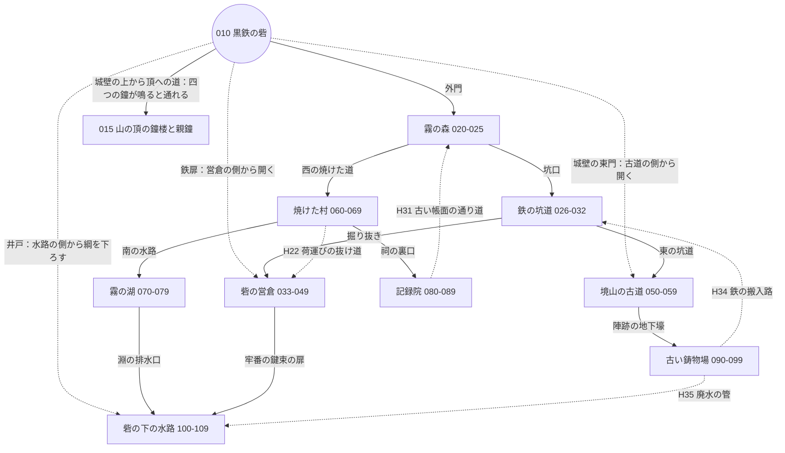
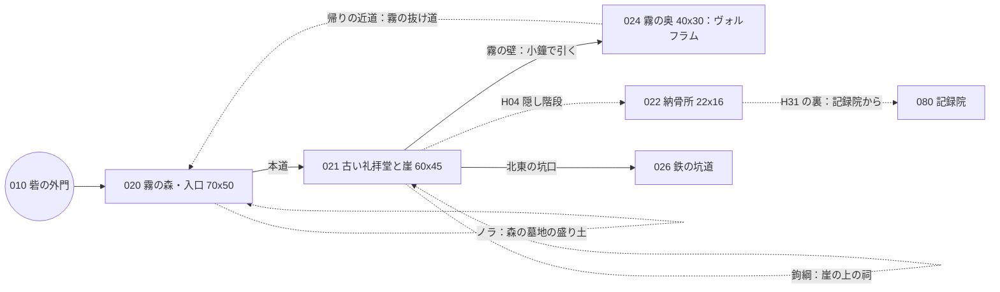
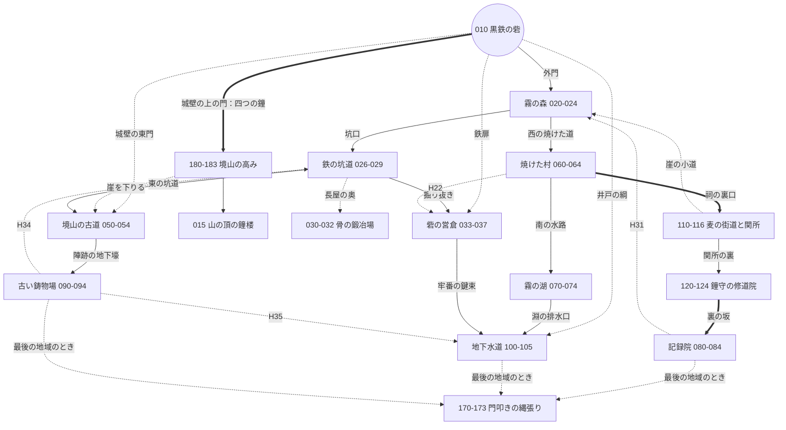

# マップの作り方 — 最後の鐘（D10）

W（マップとイベント）・V（見た目）・P（仕組み）の子が、**新しい世界のマップを描く前に読む**ファイル。
どこに何があるか（筋・人・鐘）は [docs/world.md](world.md) の 5 章、データの形は [docs/mz-data.md](mz-data.md)、文字マップは [tools/maps/README.md](../tools/maps/README.md)。

持ち主の方針（#130 への追加の依頼）：「マップデザインはもっと Fanastasis を参考にしてほしい」。取り入れるのは次の 4 つ。**手触りだけ**を取り、手本の固有名詞・地図の形・部屋の並びは写さない。

| | 取り入れること | この章 |
|---|---|---|
| 1 | **つながり方**：マップどうしが網の目のようにつながる。近道を開けると拠点へ戻りやすくなる。後で手に入れた物で、前の場所の先へ行ける | [2](#2-網の目拠点からのつながり)・[3](#3-近道の数と場所)・[4](#4-後の物で開く道) |
| 2 | **広さと探索の密度**：1 枚が広い。脇道の先に宝箱・隠し通路・思念・来歴つきの物。寄り道が報われる | [1](#1-1-枚の大きさ)・[5](#5-脇道と置く物の密度) |
| 3 | **見た目の作り込み**：壊れた家具・骨・草・瓦礫・高低差を、細かい置き物と層で重ね、「終わった場所」に見せる | [6](#6-置き物と層) |
| 4 | **仕掛けと敵の配置**：シンボル敵の動きを読んで抜ける道、レバーや扉の謎、強い敵を避ける回り道 | [7](#7-敵の置き方の型)・[8](#8-仕掛けの型) |

- 前の世界のマップ（010–084、W5 の枝の 015・090–104）は、**形をそのまま使う前提をやめる**。この網に合わせて作り直す。使い回すのは ID の帯と、遠い所がつながる 4 つ（H22・H31・H34・H35）の考え方、それに形の合う小部屋だけ（[world.md 5.2](world.md#52-使えるマップと作り直すマップ)）。
- **D14（#168）で遊ぶ時間をいったん約 15 時間に組み直した。** 新しい地域五（麦の街道と鐘守の修道院）・骨の鍛冶場・門叩きの縄張り・終盤の網、大きさの目安、帯、40 時間へ広げる余地は [10 章](#10-15-時間の大きさと新しい網40-時間への余地)。今あるマップ（W6〜W10）は作り直さず、出入口の行き先だけ差し替える。
- 敵の色と迂回路の約束（緑・黄・赤、赤は持ち場から出ない、入口から追い始める距離＋2 マス以上）は前の世界のまま（[old/world.md 4.0](old/world.md#40-全体)）。

---

## 1. 1 枚の大きさ
画面は横 26.7 × 縦 15 マス（1280×720、1 マス 48px）。「1 画面」＝ 27 × 15 で数える。

| 種類 | 大きさの目安 | 画面の数 | 中身 |
|---|---|---|---|
| 外の広い場所（森・湖・焼けた村・古道） | 60 × 45 〜 80 × 60 | 6〜12 画面 | 本道 1 本＋脇道 4〜6 本＋近道 1〜2 本。高低差（崖・段）で 2〜3 段に分ける |
| 中の迷い場所（坑道・営倉・記録院・鋳物場・水路） | 50 × 40 〜 70 × 50 | 5〜8 画面 | 部屋 8〜14 と、つなぐ廊下。輪（ぐるりと回れる道）を 2 つ以上 |
| 拠点（砦の内郭） | 50 × 40 前後 | 5 画面 | 大広間・墓所・名の壁・炉・部屋の扉 9 つ・城壁へ上る階段・井戸・営倉への鉄扉 |
| 小部屋（ボス・鐘の間・遺骸の部屋・施設） | 17 × 13 〜 27 × 19 | 1〜2 画面 | 1 つのことに絞る |

- **1 つのダンジョンは 3〜5 枚**（広い 1〜2 枚＋小部屋 2〜3 枚）。前の世界の 1 ダンジョン 3〜4 枚より 1 枚あたりを広くし、枚数は増やさない。**D14 以降の新しい本筋のダンジョンは 4〜5 枚**（広い 1〜2 枚＋中 1〜2 枚＋小部屋 1〜2 枚。[10 章](#10-15-時間の大きさと新しい網40-時間への余地)）。寄り道のダンジョンは 2〜3 枚。
- 1 枚に**本道で通り抜けて 2〜3 分、隅まで探して 8〜12 分**。新しい本筋のダンジョンも同じ目安（広い 1 枚は 70 × 50 まで。80 × 60 は今ある湖と古道だけ）。
- MZ の上限は 256 × 256。重さの目安は**イベント 1 枚 120 まで**、動くシンボル敵は**12 体まで**（`Hai_SymbolEnemy` が毎フレーム追う判定をするため）。
- 暗がり（`<hai_dark>`）のマップは広げすぎない（50 × 40 まで）。暗い所で 80 マス迷わせない。

---

## 2. 網の目：拠点からのつながり
拠点の砦を真ん中に、ダンジョンを**放射と輪**でつなぐ。どのダンジョンも、奥から**別の道で砦か隣のダンジョンへ抜ける**。

- 実線＝ふつうの道。点線＝**近道か隠し**（たいてい片側から開ける）。
- 砦から直接出る道は 5 本：外門（初めから）・営倉の鉄扉・城壁の東門・井戸（3 つは**向こう側から開ける近道**）・城壁の上から山の頂の鐘楼への道（最後。四つの鐘が鳴ると通れる）。
- 輪は 5 つ：森→坑道→営倉→砦／坑道→古道→城壁→砦／森→村→営倉→砦／村→湖→水路→井戸→砦／古道→鋳物場→水路（または坑道）。
- 「遠いと思っていた場所が実は隣」は、近道を開けたときに分かる（VISION 核 1）。前の世界の 4 つ（H22・H31・H34・H35）はこの図でも残す。

### 2.1 ID の帯（前の世界の帯をそのまま使う）
| 帯 | 場所 | 使い方の案 |
|---|---|---|
| 010–019 | 砦 | 010 内郭、011–014・016–018 部屋、015 山の頂の鐘楼、019 城壁の上（新） |
| 020–025 | 霧の森 | 020 入口の広い森、021 礼拝堂と崖の上、022 納骨所、023 療養小屋、024 霧の奥、025 予備 |
| 026–032 | 鉄の坑道 | 026 上層（広い）、027 下層（暗い）、028 坑道の門、029 坑夫の詰め所、030–032 予備 |
| 033–049 | 砦の営倉と下層 | 033 監房（広い）、034 廊下、035 牢番、036 預かり棚、037 井戸の底へ続く通路、038–049 予備 |
| 050–059 | 境山の古道 | 050 尾根道（広い・段が 3 つ）、051 陣跡、052 吊り橋と烽火台、053 骨拾いの洞、054 城壁の東門の外 |
| 060–069 | 焼けた村 | 060 入口、061 広場（広い）、062 見張り台、063 祠、064 抜け道 |
| 070–079 | 霧の湖 | 070 葦原（広い・舟）、071 湖の家、072 沈んだ桟橋、073 淵、074 小島 |
| 080–089 | 記録院 | 080 前庭、081 書架（広い）、082 古言の棚、083 紙魚の王、084 銘の写し |
| 090–099 | 古い鋳物場 | 090 搬入口、091 型の間（広い）、092 銘の型、093 炉の間、094 冠の型 |
| 100–109 | 砦の下の水路 | 100 上流、101 水門（広い）、102 鐘楼の真下、103 騎士長、104 水の底、105 井戸の縦穴 |

帯は配り役が [ROADMAP.md](ROADMAP.md) で割り当てる。上は推し。D14 で足した帯（030–032・110–124・170–173・180–183）と 40 時間のために空けた帯は [10.3](#103-帯d14-で足した分正本は-roadmapmd)。

---

## 3. 近道の数と場所
### 3.1 数
| 単位 | 近道の数 |
|---|---|
| 1 枚の広いマップ | 1〜2（その枚の奥から入口のそばへ戻る） |
| 1 つのダンジョン | 2〜3（うち 1 つは**砦か、砦に近い所へ戻る**） |
| 第1段階（森・坑道・営倉） | 6〜8 |
| 新しい地域（五・終盤。各 1〜2 ダンジョン） | 地域ごとに 3〜5 |
| 全体（D14 の 15 時間版。五つの地域＋縄張り＋終盤） | 28〜35 |

### 3.2 置き場所の決め方
1. **一番つらい所を抜けた直後**に置く（ボスの手前の控え、赤い敵の回り道の出口、暗い区間の出口）。抜けた者だけが開けられる。
2. **表側から先に見せる**：開ける前に、閉じた閂・上がった梯子・向こうの見える鉄格子を、入口のそばで見せておく（「これはどこから開くのか」）。オートマップでは施錠扉の印（`<hai_locked>`）で残す。
3. 開ける手段は 5 つ。どれもプレイヤーだけに効き、開いたら開きっぱなし。
   | 手段 | 仕組み | 例 |
   |---|---|---|
   | 片側扉 | `Hai_HiddenPassage` のリージョン 253＋`<hai_oneway>` | 営倉の鉄扉（033→010） |
   | 閂・梯子を下ろす | イベントを調べるとセルフスイッチ A。表の側のイベントも同じスイッチ（全体のスイッチ）を見る | 城壁の東門（054→019）、井戸の綱（105→010） |
   | 昇降機 | スイッチで場所移動のイベントを有効にする（前の世界の 026 の昇降機と同じ） | 坑道の上層と下層 |
   | 隠し通路 | リージョン 251・252・254 | 記録院→納骨所（H31） |
   | 近道の扉の鍵 | 鍵（大事なもの）を持っていれば開く | 牢番の鍵束で営倉→水路 |
4. **近道を開けたら一言**：「閂を外した。向こうは砦の中庭だ」のように、どこへつながったかを物で言う（地名で説明しない）。
5. 転送の結界（`Hai_Warp`）は**ダンジョンの入口と、ボスの控えにだけ**置く（1 ダンジョンに 2 つまで）。結界を多くすると、近道を開ける喜びが消える。

---

## 4. 後の物で開く道
前に通った場所に「今は越えられない所」を残し、後で手に入る物か仲間で越える。越えた先には**必ず見返り**（赤い宝箱・仲間の記憶・近道・生き残り）を置く。
本道（四つの鐘・頂に要る道）で要るのは、このうち鍵束・角灯・小鐘の 3 つだけ。ほかは寄り道。

| 越えられない所 | 越える物・仲間 | 手に入る所 | 開く所（例） | MZ での作り方 |
|---|---|---|---|---|
| **霧の壁**（白く濃い霧で先が見えず、入ると入口に戻される） | **見張り塔の小鐘**を鳴らす（霧が引く） | 020 倒れた塔の根元 | 021 礼拝堂の北（ヴォルフラム）、024 霧の奥、070 湖の霧の道 | 霧のマスに「調べる／触れる」イベント。小鐘を持っていれば選択肢「鳴らす」→ セルフスイッチで霧のイベント（`Fog` の遠景か、☆の霧タイルのイベント）を消す。持っていなければ「霧に押し戻された」で入口へ場所移動 |
| **暗がり**（手がかりが見えない、道が分からない） | **鐘番の角灯**（暗がりの半径を広げる） | 029 坑夫の詰め所 | 027 坑道・下層の奥、082 古言の棚、102 鐘楼の真下 | マップのメモ欄 `<hai_dark:1.5>`。角灯を持って入ると `Hai_MapTone` の `dark`（半径 5）を自動実行で呼ぶ |
| **施錠扉** | **牢番の鍵束** | 035 牢番の固定ドロップ | 033 監房の宝の部屋 2 つ、035 西の扉→100 水路 | 条件分岐（アイテム）＋セルフスイッチ。`<hai_locked>` でオートマップに印 |
| **高い段**（崖の上、壊れた階段の上） | **鉤綱**（綱を掛けて上る） | 051 援軍の陣跡 | 021 崖の上の祠、050 尾根の上段、061 見張り台の屋根 | 段の下に「綱を掛ける」イベント → 上の段へ場所移動。以後は梯子（通行 0x20 のタイル）の絵を z=3 に重ねる（P の小さな足し） |
| **水** | **櫂**（舟に乗れる） | 072 沈んだ桟橋（ゼリナの遺骸の脇） | 070 葦原の向こう岸、074 小島（赤い宝箱）、100 水路の下り | MZ の乗り物「小型船」。乗り場のイベントで「乗り物の位置設定」（202）→ 乗る。水のタイルは小型船だけ通れる（0x200 を立てない） |
| **錆びた鉄格子** | **鉄切り鋏**（鍛冶場で作る） | 017 鍛冶場（アンネリーゼが来たあと） | 026 坑道の格子の奥、033 営倉の格子、091 鋳物場の型置き場 | 条件分岐（アイテム）→ 格子のイベントを消す |
| **重い扉・倒れた柱** | 仲間**ブルーノ**（押す）／**トゥーラ**（担いでどける） | 仲間に加える | 027 坑道の大扉、061 広場の倒れた梁、091 型の間 | 条件分岐（アクターがパーティにいる＝`111` の 4 番、`[4, アクター ID, 0]`）。いなければ「一人では動かない。もっと力のある者なら」 |
| **盛り土・埋まった物** | 仲間**ノラ**（匂いで掘る） | 仲間に加える | 020 森の墓地、060 村の入口の畑 | 同上 |
| **古言の碑で閉じた扉** | 仲間**ディル**（読む） | 仲間に加える | 080 記録院の奥の扉、092 銘の型の部屋 | 同上。ディルの一言で開く（文は読めても訳さない） |
| **骨の塔**（使徒の縄張り） | 砦の**名札**を 3 つ渡す（取り引き） | 各地の遺体・思念の脇 | 053 骨拾いの洞（ベルトランの剣） | 変数「名札の数」。骨拾いと話す |
| **水位** | 101 の**水門**の切り替え | 101 水門の間 | 100・102 の通れる所が変わる | 水門のスイッチで、通れなくするイベント（`block`）のページを替える。タイルは描き替えない（2 つの状態を両方描いた絵にする） |
| **関所の門**（D14） | **通行の札**（街道で拾う。本道） | 110 飢えの列の捨てた荷 | 112 関所の塔の門 | 条件分岐（アイテム）＋セルフスイッチ。札が無いと収税吏の声「一握りを」で押し戻される |
| **崖を下りる**（D14） | 近道（物は要らない。崖の上から下りる片道） | ― | 116 崖の上の見晴らし→020、180 灰の斜面→054 | 近道の片側扉と同じ扱い（3.2 の「閂・梯子を下ろす」。下りたら以後は 020・054 の側に綱の絵） |

- 越えられない所は、**初めて見たときに「何が要るか」が分かる**ように書く：「綱を掛ければ、上れそうだ」「暗くて、一歩先も見えない」。物の名は言わない。
- 一つの物で開く所は **3 か所以上**（物を手に入れたとき、「あそこへ戻ろう」が浮かぶように）。開く所は、取る前に通る場所に 2 か所、取った後に行く場所に 1 か所。
- 仲間で開く所は、**その仲間を呼ばなくても本道は進める**ようにする。

---

## 5. 脇道と置く物の密度
### 5.1 1 枚の広いマップに置く物（目安）
| 物 | 数 | 決まり |
|---|---|---|
| 宝箱 | 4〜6 | うち**赤い宝箱（一点もの）0〜1**。赤い宝箱は隠し通路か後の物の先だけ |
| 残留思念（`<hai_thought>`） | 3〜5 | 1 つは道の上、残りは脇道の先。手がかりの思念は手がかりの**手前**に |
| 来歴つきの物（[world.md 8.3](world.md#83-アイテムの説明と来歴)） | 1〜2 | 持ち主の居た所か、手放した理由の見える所 |
| 隠し要素（リージョン 251〜254） | 2〜3 | 手がかりは必ず付ける（一マスだけ違う床・影の無い壁・くぼんだ壁）。1 つは初めての人にも分かりやすく |
| 拾える物（素材・回復） | 3〜5 | 光る点（`!Other1` などの絵）か、調べる物の脇。回復は本道の外 |
| 調べると一行出る物（壊れた家具・骨・張り紙） | 8〜15 | 「物の様子＋分かること」を一行。何も無いものは書かない |
| 遺骸・生き残り・近道 | ダンジョンに 1〜2 | どれかが、その枚の一番奥 |

### 5.2 脇道の作り方
- **行き止まりを空にしない。** 行き止まりには必ず何か（宝箱・思念・隠し通路の手がかり・近道の裏・景色の一行）を置く。
- 脇道の長さは **10〜25 歩**。長い脇道（30 歩以上）の先は赤い宝箱か仲間の遺骸に限る。
- **見えているのに行けない所**を 1 枚に 1〜2 つ（段の上の宝箱、格子の向こうの思念）。行き方は同じ枚の中の回り道か、後の物（4 章）。
- 1 画面（27 × 15）に**一つは「見つける物」**がある。何もない画面が 2 つ続かないようにする。
- 本道と脇道は見た目で分ける：本道は踏み固めた道（A2 の道の種類）か、明かりのある廊下。脇道は草・瓦礫・暗がりに入る。

---

## 6. 置き物と層
「終わった場所」に見せる。**何もない床を 3 × 3 マス以上続けない**（広場・湖・霧のように、わざと空けた所は除く）。

### 6.1 MZ の層の使い方
| 層 | MZ での中身 | この作品で置くもの |
|---|---|---|
| z=0（A） | 地面・壁・水 | 床、壁（A4）、水（A1）、地面（A2） |
| z=1（A の重ね） | A1・A2 の上に重ねる地面 | 苔・ひび・灰だまり・草地のまだら（隠し通路の手がかり「一マスだけ違う床」もここ） |
| z=2（B〜E の 1 枚目） | 置き物 | 壊れた家具・樽・木箱・骨・瓦礫・倒れた柱・墓標・草むら・枯れ木の根 |
| z=3（B〜E の 2 枚目） | 置き物の上に重ねる物 | 床の瓦礫の上の骨、机の上の蝋燭、木の葉（☆で上に描く）、梁、天井から垂れた鎖。**隠し扉・片側扉・隠し階段のマスは空ける**（`Hai_HiddenPassage` が描く） |
| 影（z=4） | 壁の影 | 自動。隠し通路の手がかり「影の無い壁」は `shadow: false` |
| リージョン（z=5） | 番号 | 251〜254 は隠し通路。ほかの番号は使わない（使うときは ROADMAP の帯に足す） |
| イベント | 動く・調べる物 | 調べると一行出る物、光る点、扉、敵 |

- 置き物の割合の目安：**床のマスの 15〜25% に z=2 か z=3 の何か**。部屋の隅と壁ぎわに多く、通り道は空ける。
- **高低差**：外の場所は崖（A4 の壁を外の崖に読み替え）と段で 2〜3 段に分ける。上の段は 4 章の鉤綱か、回り道の坂で上る。中の場所は、穴（下の階へ落ちる）と吹き抜けで縦を見せる。
- 置き物で「何があったか」を語る：倒れた椅子が戸口に向いている（逃げた）、食卓に皿が並んだまま（食事の途中）、内側から打ち付けた戸板（門叩きに答えなかった家）。思念と同じく、一つの部屋に一つの小さな話。
- 色調（`<hai_tone>`）と遠景（`<hai_parallax>`）は [look.md 3 章](look.md#3-マップごとの色調遠景暗がり推し) のまま、場所ごとに変える。

### 6.2 文字マップ（`tools/maps`）で今できること
| したいこと | 今の書き方 | できる・できない |
|---|---|---|
| 床・壁・水 | 凡例の文字（`legend.json`） | できる |
| 床の上に置き物を 1 つ | 設定の `chars` で文字を足し、`"as": "."` と `"tiles": [null, null, "B:41"]` | できる。ただし**床の種類ごとに文字が要る**（草の上の骨と、石の上の骨は別の文字） |
| 置き物の上にもう一つ（z=3） | 同上で `tiles` の 4 つ目 | できる。組み合わせの数だけ文字が要る |
| 文字が足りない | 全角の文字も 1 マス（「骨」「樽」「瓦」「机」など） | できる。全角で置き物の文字を作るのを推す（読みやすい） |
| 2 マス以上の大きな置き物（寝台・倒れた大鐘・荷車） | マスごとに別の文字 | できるが手間。ずれやすい |
| 置き物を散らす（草・小石・灰だまり） | 1 つずつ書く | 手間 |
| 段差・高台（壁の上面を歩く床） | ― | **できない**（README の「未対応」） |
| 建物（A3 の屋根と壁の組み立て） | 層ごとに `tiles` | 形の計算はされるが、屋根の下に壁を置く組み立てはしない |
| 通行だけ変える | `block`、リージョン | できる |

### 6.3 ツールに足すもの（T か V の issue）
| 足すもの | 中身 | 効き目 |
|---|---|---|
| **重ね書きの文字マップ**（済。T10） | `<名前>.deco.txt`：同じ大きさの 2 枚目の文字マップで、z=2・z=3 だけを書く（`.` は「何も置かない」）。凡例は `deco` の組 | 床と置き物を別々に描ける。床の種類ごとに文字を作らなくてよい |
| **スタンプ**（済。T10） | 設定に `stamps`：`{"at": "寝", "tiles": [["B:80","B:81"]]}` のように、左上の 1 文字で 2 × 1・3 × 3 などをまとめて置く | 大きな置き物（寝台・荷車・倒れた大鐘・崩れた柱）が楽に置ける |
| **散らし**（済。T10） | 設定に `scatter`：`{"on": ".", "tiles": ["B:16","B:17","D:40"], "rate": 0.08, "seed": 12}`。種付きの乱数で、何度走らせても同じ | 草・小石・灰だまり・骨の散らかり |
| **段差**（済。T10） | 凡例に `ledge` の型：A4 の上面を歩ける床として扱い、下の行に崖の側面を自動で付ける。上り下りは坂の文字か梯子 | 外の高低差が描ける |
| **建物の組み立て**（済。T10） | A3 の屋根と壁を、屋根の文字の下に壁を自動で付ける | 焼けた村・湖の家 |
| **置き物の密度の報告**（済。T10） | `tests/t_maps.mjs` に、1 画面ごとの z=2・z=3 の数と、空の 3 × 3 の数を報告（落とさない） | 6.1 の目安を数で見られる |
| **見本の地図** | 霧の森 020 を、上を全部使って作り直した見本（W の最初の issue に含めてよい） | 子が真似できる |

- 足すまでの間は、**骨組み（床・壁・道・イベント）を文字マップで作り、置き物の仕上げは持ち主がエディタで描く**（仕上げたら JSON が正本。以後はイベントだけ直す）。PR の説明の「エディタでの確認」に、仕上げてほしい部屋を書く。

---

## 7. 敵の置き方の型
シンボル敵（`Hai_SymbolEnemy`）は見て避けられるのが前提。**1 枚に 6〜12 体、赤は 2 体まで**。どの型も、入口から追い始める距離＋2 マス以上離す。

| 型 | 動き（MZ の設定） | 置く所 | 抜け方 |
|---|---|---|---|
| **番兵** | 固定、向きだけ決める。追う距離 2〜3 | 狭い通り（1〜2 マス幅）の前 | 回り道か、隠し通路。赤の番兵には必ず回り道 |
| **往復** | 移動ルート（繰り返し）で一本道を往復 | 長い廊下 | 廊下の脇に**待てる窪み**（1 マス）を作り、すれ違う |
| **輪** | 柱や池の周りを回る移動ルート | 大部屋の真ん中の柱、池 | 反対回りで追いかけて抜ける |
| **群れ** | 緑 3 体、ランダム移動、追う距離 3 | 広場 | 1 体ずつ引きはがす。戦ってもよい弱い群れ |
| **寝ている** | 追う距離 0。近づいたら（2 マス）起きて追う（P に小さな足し：`<hai_enemy_wake:2>`） | 宝箱の前、思念の脇 | 足音を立てない回り道（草むらの通り） |
| **宝の番** | 黄か赤の番兵。宝箱から 3 マス以内 | 脇道の先の宝箱 | 倒すか、隠し通路で宝箱の裏へ |
| **追ってくる** | 追う距離 5〜6、足は遅め | 開けた外の場所 | 扉・隠し通路・段（敵はタイルどおりで、隠し通路を通らない）へ逃げ込む |
| **声だけの影**（D14。門叩きの縄張りと最後の地域） | 姿が薄い（不透明度を下げる）。追わない。触れると戦闘。倒すと一行の声を残す | 170–173 の廊下、最後の地域の鐘の間の手前 | すり抜けられない幅の所に置き、隠し通路か回り道で避ける。P13 で `<hai_enemy_shade>` |

- 赤は**持ち場から出ない**（固定か、持ち場の中の移動ルート）。赤の向こうの物は、回り道の先にも同じくらいの物を置く。
- ボスの前の控えには敵を置かない（結界と回復を置く）。
- 近道を開けたあとの帰り道は、敵が少ない道になるようにする（行きは本道で戦い、帰りは近道で抜ける）。

---

## 8. 仕掛けの型
どの仕掛けにも**導線を 2 本**（[knowhow.md 2.4](knowhow.md#24-出来事への導線)）：残留思念・張り紙・置き物の様子・仲間の一言のうち 2 つ。

| 型 | 中身 | MZ での作り方 | 例 |
|---|---|---|---|
| **離れたレバー** | レバーを引くと、離れた所の扉・昇降機・橋が動く | 全体のスイッチ。動いた先を一瞬見せる（画面のスクロール 204 か、音だけ） | 坑道の昇降機、鋳物場の搬入路の扉 |
| **二つで一つ** | 二か所の仕掛けを両方動かすと開く | スイッチ 2 つを条件分岐で見る | 水路の水門（上流と下流の弁） |
| **番号錠** | 思念や物に散った数を合わせる | 数値入力（103）と変数 | 記録院の書架（数は来歴か思念から） |
| **水位・霧** | 切り替えで通れる所が変わる | 4 章の霧の壁・水門 | 101 水門、021 礼拝堂の霧 |
| **重さ** | 押す・担ぐ（仲間） | 4 章の仲間の条件分岐 | 027 坑道の大扉 |
| **見張りの読み** | 敵の往復の間を抜けると、その先にレバー | 7 章の往復の型＋レバー | 営倉の廊下 034 |
| **夕べの数** | 鐘の数（三十）や、数え歌の数を答える | 選択肢か数値入力 | 礼拝堂の鐘を抱く女の像の台、砦の名の壁 |

- 解けなくても本道は止めない（仕掛けの先は寄り道か近道）。本道の仕掛けは、レバーと鍵と霧の壁だけ。
- 仕掛けを解いたら一言（「どこかで鎖の鳴る音がした」は書かない。「中庭の方で、閂の落ちる音」のように場所を言う）。

---

## 9. 見本：霧の森（020–025）の網
第1段階の最初のダンジョンで、1〜8 章を全部使う見本。W の最初の issue で作る。

| 枚 | 大きさ | 置く物（5 章の目安） | 敵（7 章の型） | 近道・後の物 |
|---|---|---|---|---|
| 020 入口 | 70 × 50 | 宝箱 5（赤 0）、思念 4、来歴つき 1（見張り塔の小鐘・戸板の盾）、隠し 2、拾える物 4 | 群れ（灰犬の緑 3）、往復（灰鴉の黄 1）、番兵（迷い人の黄 1） | 倒れた塔の脇道で小鐘。森の墓地の盛り土（ノラ） |
| 021 礼拝堂と崖 | 60 × 45 | 宝箱 4（赤 1：崖の上の祠、鉤綱）、思念 5、隠し 3（H04 を含む） | 輪（礼拝堂の柱）、宝の番（赤の迷い人の群れ 1）、寝ている（黄） | 霧の壁（小鐘）→ 024。崖の上（鉤綱） |
| 024 霧の奥 | 40 × 30 | ヴォルフラム、思念 3、拾える物 3 | 追ってくる（迷い人、足は遅め） | 奥から入口 020 の北へ抜ける霧の抜け道（帰りの近道） |
| 022 納骨所 | 22 × 16 | 名札の棚（名札 1）、ブルーノの記憶 1、宝箱 2 | なし | H31 の裏（記録院から来ると開く） |

- 遊ぶ時間：本道だけで 8 分、寄り道を全部で 20 分。
- 置き物：倒れた見張り塔の石組み（スタンプ）、灰の積もった道、鐘を抱く女の像、崩れた礼拝堂の長椅子、霧の中の人影（イベント、近づくと消える）。

---

## 10. 15 時間の大きさと新しい網（40 時間への余地）
D14（#168）で、遊ぶ時間を**いったん約 15 時間（本筋 8・寄り道 5・終盤 2）**に組み直した（持ち主の決め。理由は「テストが大変なので」）。配分表と地域ごとの中身は [world.md 5.7](world.md#57-15-時間の配分表)・[5.1](world.md#51-五つの地域と終盤鐘滅びの前のドラマ)・[5.2](world.md#52-使えるマップと作り直すマップ)、確かめる手間を減らす作りは [world.md 5.10](world.md#510-確かめる手間を減らす作り)。ここは**マップの大きさ・枚数・網・帯**だけ。

### 10.1 大きさの目安（新しいダンジョン）
| 種類 | 枚数 | 1 枚の大きさ | 本道／隅まで（1 枚） | 1 ダンジョンの本道 |
|---|---|---|---|---|
| 本筋のダンジョン（街道と関所・修道院） | 4〜5 | 広い外 70 × 50 を 1 枚、中 50 × 40〜60 × 45、小部屋 27 × 19 | 2〜3 分／8〜12 分 | 0.8〜1 時間（ボス・読む物・戦闘を含む） |
| 寄り道のダンジョン（骨の鍛冶場・崖の小道） | 2〜3 | 広い 1 枚（40 × 30〜50 × 40）＋小部屋 1〜2 | 同上 | 隅まで 0.4〜0.8 時間（隠しボス・赤い宝箱） |
| 門叩きの縄張り | 4 | 暗がり 2 枚（50 × 40）＋小部屋 2 | 同上 | 0.8 時間 |
| 終盤（境山の高み） | 4 | 広い外 70 × 50 を 1 枚、中 50 × 40、小部屋 2 | 同上 | 1.3 時間（頂は別） |
| 今あるダンジョン（W6〜W10） | 作り直さない | ― | ― | 本道 0.5〜0.6 時間（5.7 の表） |

- 1 枚の上限は 1 章のまま（イベント 120・動くシンボル敵 12 体・暗がりは 50 × 40 まで）。
- 置く物の密度は 5 章のまま。来歴つきの物は 1 ダンジョン 2〜3、思念は 6〜10、隠し要素は 4〜6。
- 結界は 1 ダンジョン 2 つまで（入口とボスの控え）。
- 新しい地域の 1 枚目は「広い外」、2 枚目は「集落か中」、ボスの前に「暗がりか縦」の順にして、同じ手触りを続けない（world.md 5.8 の 6）。

### 10.2 新しい網
今ある網（2 章）に、地域五と寄り道と縄張りと終盤を足す。太い矢印（==>）は**今あるマップの出入口の行き先を差し替える所**（イベントの行き先だけ。タイル層は触らない）。

- 砦から直接出る道は 5 本のまま。地域五へは焼けた村の祠から入る。
- 輪は 5 つから 6 つに：森→村→街道（崖の小道）→森。
- D14 で足す「遠い所が実は隣」は 2 つ（崖の小道→霧の森、灰の斜面→東門の外）。意味は [world.md 5.2](world.md#52-使えるマップと作り直すマップ) の末尾。
- 今あるマップで**行き先を差し替える出入口**は 3 つだけ：063 祠の裏口（080 → 110）、080 南の坂（063 → 124）、019 頂への門（015 → 180）。足すイベントは 1 つ：027 長屋の奥（→ 030）。それに三つの鐘の間の手前の霧の戸口（084・094・104 → 170。W11）と、020 の西の崖・054 の崖の上の近道の出口（片側）。

### 10.3 帯（D14 で足した分。正本は [ROADMAP.md](ROADMAP.md)）
| 帯 | 場所 | 使い方 |
|---|---|---|
| 030–032 | 骨の鍛冶場（寄り道。W13） | 030 炉の間（暗がり）、031 骨置き場（隠しボス）、032 狩人の寝床（近道→026）。W13（#193）で作った。隠しボス 狩人の頭の名は「オスヴァル」（仮） |
| 110–116 | 麦の街道と関所（地域五。W12） | 110 関所の道（広い）、111 麦の村、112 関所の塔（ボス）、113 街道の祠、115 崖の小道（寄り道）、116 見晴らし（近道→020）。114・117–119 は予備 |
| 120–124 | 鐘守の修道院（地域五。W12） | 120 前庭と回廊（広い）、121 写本室と食堂、122 鐘守の塔（ボス）、123 納骨堂と石工の工房（暗がり）、124 裏の坂（→080）。125–129 は予備 |
| 170–173 | 門叩きの縄張り（最後の地域。W11） | 170 縄張りの縁、171 喰われた者の廊下、172 塊の間（ボス）、173 戻りの戸口。174–179 は予備。W11（#194）で作った。戸口は 084・094・104 の鐘の間の口の 3 マスを霧でふさぐ形 |
| 180–183 | 境山の高み（終盤。W14） | 180 灰の斜面（広い）、181 鐘守の宿坊（氷室を含む）、182 足場の番（ボス）、183 鐘楼の根（→015）。184–186 は 40 時間の骨の塔のために空ける |
| 015 | 山の頂の鐘楼 | 作り直す（W14） |
| 065–067・075–077・095–097 | 40 時間の寄り道のダンジョン | 空けておく（10.4） |
| 130–169 | 40 時間の地域六・七 | 空けておく（10.4） |
| 200–899 | 予備 | 新しい地域を足すときに配り役が割り当てる |

### 10.4 40 時間へ広げる余地（差し込み口と帯）
中身は [world.md 5.9](world.md#59-40-時間へ広げる余地)。ここはマップの側の差し込み口だけ。**15 時間版では、差し込み口に何も置かない**（イベントも注釈も要らない。足すときに新しいイベントを 1 つ置けば済む形にしておく）。
| 足す物 | 帯 | 差し込み口（15 時間版の網のどこに付くか） | 差し替える出入口 |
|---|---|---|---|
| 地域六 雪の峠と帝国の国境（2 本筋＋護送路の寄り道） | 130–144 | 026 東の坑道 → 130 → 050。護送路 143 → 090 帳場の奥（片側） | 026 東の坑道（050 → 130）、050 西の坑口（026 → 138） |
| 地域七 歌の森（寄り道。真の結末の鍵） | 150–154 | 074 小島の森の水門（W9）→ 150。154 → 071 湖の家の裏（片側） | 074 の水門のイベントの 2 ページ目 |
| 寄り道 生贄の山道・舟の着いた岸・研究所の下層 | 065–067・075–077・095–097 | 063 の西の山道の口、074 の向こう岸の舟着き、093 の下層への階段 | 新しいイベント 1 つずつ |
| 終盤の続き 骨の塔 | 184–186 | 180 の塔の根の脇道 | 新しいイベント 1 つ |
| 各地域の 3 本目の本筋のダンジョン（本筋を 20 に伸ばすとき） | 各地域の帯の予備（038–049・055–059・085–089・106–109・117–119・125–129） | その地域の二つのダンジョンの間に挟む | 出入口 2 つずつ |

- 広げるときの大きさは 10.1 の一段上（本筋のダンジョン 4〜6 枚、広い 80 × 60 を 2 枚以上、1 ダンジョン 1〜1.5 時間）。
- 広げるときも「今あるマップは作り直さない」。差し替えるのは出入口の行き先だけ。
