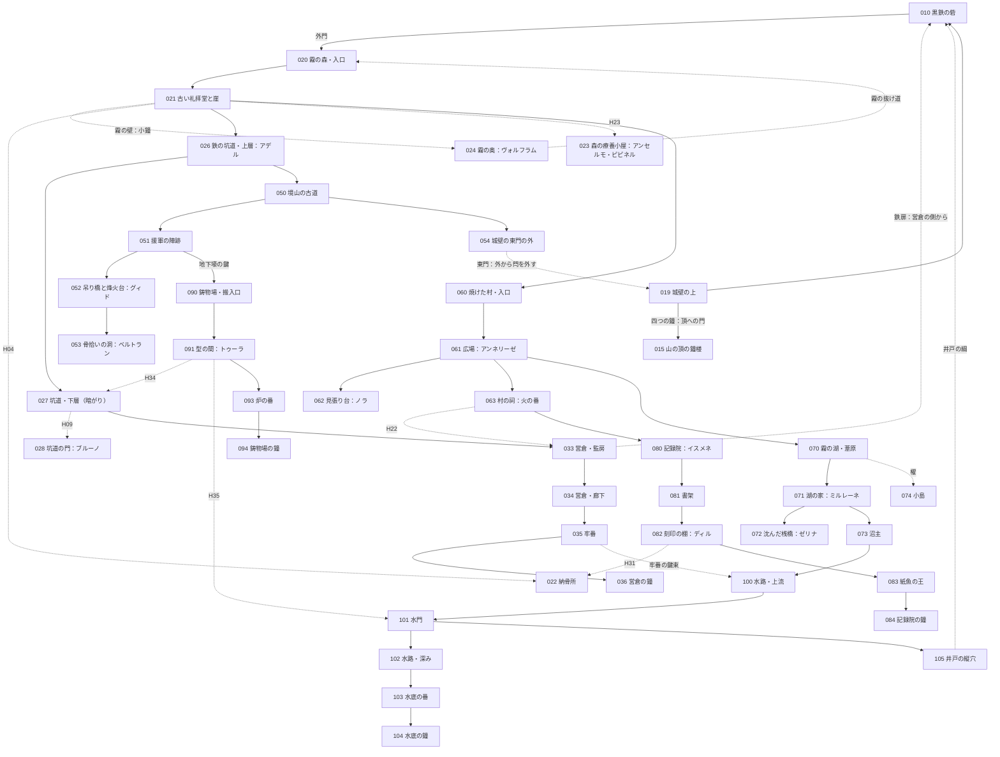

# 世界設計書 — 最後の鐘（仮題、D10）

W・P・V レーンがこのファイルを見て、新しい世界の拠点・ダンジョン・仲間・生き残り・鐘・結末を作るための設計書。
持ち主が世界観を**全部作り直す**と決めた（2026-10-12、#127）。前の世界「灰の王国」の設計は控えとして [docs/old/](old/) に移した。
筋は 2026-10-12 に持ち主と配り役が決め直した（主人公は**死者の思いを取り込める使徒**で人の味方。**鐘の力と主人公の力は関係ない**。**正体を知らないのはプレイヤーと主人公だけ**で、誰も主人公を責めない。正体のあとも山場と謎が続く）。
マップの作り方は [docs/mapdesign.md](mapdesign.md)、ID の帯は [docs/ROADMAP.md](ROADMAP.md)、データの形は [docs/mz-data.md](mz-data.md)、文の書き方は [docs/knowhow.md](knowhow.md)（決まりはそのまま。例は前の世界のもの）。

- 世界の手触りは、持ち主の別の作品 Morsveld の世界観を**参考にしただけ**。国・町・使徒の名前と出来事は新しく作った。人物は Morsveld の人物を**スターシステム**で使う（性格・口調・癖だけを写し、経歴・立場・この世界での生き死には新しく作った。[5 章](#5-仲間)・[6 章](#6-生き残り)）。
- 手本（Fanastasis）の遊びの構造はそのまま。固有名詞・台詞・地名・人物は使っていない。
- 名前・題・細部は推しで書いた。決定待ちは [9 章](#9-決定待ち) と `needs-decision` の issue #129。決まったら置き換える（筋は変わらない）。
- 段階の印〔知〕〔噂〕〔進〕〔秘〕の意味は [knowhow.md 2.1](knowhow.md#21-設定の段階の印)。禁止語は [10 章](#10-禁止語の表)、口調は [11 章](#11-口調の表)。

### 持ち主が決めたこと（変えない）
| 項目 | 決めたこと |
|---|---|
| 雰囲気 | もの悲しいが温かい |
| 語り方 | 目的ははっきり、真相は断片。アイテムの配置と説明文・碑文・日記・墓標で少しずつ |
| 始まり | 目覚めると、荒れ果てた終わった世界。主人公は何も分からないまま冒険する。**案内役はいない** |
| 目的 | 各地域にある **4 つの鐘を鳴らして、山の頂の鐘楼へ行く**。目的は序盤で分かる |
| 真相の見せ方 | 敵やボスに襲われながら、アイテム・日記・碑文で、何が起きたのか・主人公は何者なのかの片鱗が少しずつ見える |
| 残留思念 | 各地に、無念のまま死んだ人の残留思念がある。並べると、物語の輪郭がなんとなく分かる |
| 仲間 | 残留思念のうち**意志の強いもの**が、仲間として一緒に冒険する |
| 主人公の正体 | **使徒で、人間の味方をしていた**。衝撃的で、しかも納得がいくこと |
| 主人公の力 | **鐘の力とは関係ない。** 残留思念を見られる・仲間にできるのが、使徒に由来する力 |
| 正体を知らない者 | **プレイヤーと主人公だけ。** 仲間はみな知っていて、そのうえで一緒にいた。真実が分かったあと、**誰も主人公を非難しない** |
| 正体が分かる時 | **3 つ目の鐘のあと**。分かったあとも**山場と謎が続く**（4 つ目の地域と山の頂） |
| 結末 | 目的を果たして**静かな希望**を感じる終わり。しんみり、少し救い。主人公が失うのは**仲間との別れだけ**（主人公は生きて朝を迎える） |
| 世界 | 終わってしまった世界。約 200 年前、使徒によって終わった |
| 人物 | Morsveld の人物をスターシステムで使う（性格・口調は写し、立場は新しく） |
| 骨組み | 拠点＋ダンジョン巡り・仲間を呼ぶ・集める物は一部変える。シンボル敵・隠し通路・施設・合成・来歴・召喚・ボスの仕組みは使い回す |

### 前の世界から変わらない前提
- 画面 1280×720、1 マス 48px（横 26.7 × 縦 15 マス）。壁の側面は 2 マスで、**部屋の縦は「床の行数＋2」**。部屋の大きさは床の広さで書く。
- マップは仕上げ後は JSON が正本。持ち主がエディタで仕上げたら、以後はイベントだけを直す。
- 敵の色（緑・黄・赤）、赤は必ず迂回路がある・持ち場から出ない、入口から追い始める距離＋2 マス以上離す（[old/world.md 4.0](old/world.md#40-全体) の約束のまま。型は [mapdesign.md 7 章](mapdesign.md#7-敵の置き方の型)）。

---

## 1. 世界と年表

### 1.1 骨子（10 行）
1. ここは**終わったあとの世界**。約 200 年前の「**二度目の夜**」に、使徒がいっせいに境山を越え、三つの国は一夜で終わった。〔知〕
2. 昔、人は古言の銘で**鐘**を鋳た。鐘の鳴る所に使徒は入らない（昔の取り決め）。四つの地域の鐘と、山の頂の**親鐘**。〔知〕（鐘の鳴る所に使徒は来ない）〔進〕（取り決めと親鐘）
3. 主人公は**死者の思いを見て、取り込める使徒**。同じ型の使徒は取り込んだ思いを喰う。主人公は喰わずに、思いを生きている人へ届けていた。人の姿で黒鉄の砦の**墓守**をしていた。〔進：3 つ目の鐘〕
4. 砦の仲間たちは、墓守が使徒だと**知っていた**。知っていて、一緒に暮らした。〔進：3 つ目の鐘〕
5. 二度目の夜、四つの鐘は同じ夜に黙った。同じ型の使徒「**喰い手**」が、死者の声で人に戸を開けさせた。狙いは、たくさんの死と、その思いを喰うこと。そして墓守を「こちら側」に戻すこと。〔噂〕同じ夜に黙った／〔進：4 つ目の地域〕喰い手の狙い（墓守のせいではない、と一文で言うことは〔秘〕）
6. あれほどの死に囲まれれば、墓守は使徒の性分に呑まれ、親しい者の思いまで喰ってしまう。喰わないために、墓守は**自分の記憶を、死んでいく仲間たちに分けて預けた**。喰う「自分」がいなくなるように。そして墓所で、死者の思いが薄れるまで眠った。それが 200 年。〔進：3 つ目の鐘〕
7. 仲間の残留思念が 200 年残っていたのは、無念だけでなく、**預かった記憶を返す約束**があったから。だから意志が強く、預けた相手の主人公だけが仲間にできる。〔知〕（呼べること）〔進：3 つ目の鐘〕（約束）
8. 墓所の壁に「**四つの鐘を鳴らして。それから、山の頂の鐘楼へ**」。刻んだのは、墓守に一番近かった**アンセルモ**。喰い手に喰われる前に刻んだ。〔知〕（刻み）〔進：4 つ目の地域〕（刻んだ人）
9. 3 つ目の鐘のあと、喰い手の声が初めて届き、仲間は「**やっと言える**」と本当のことを話す。誰も責めない。そのあとも、四つ目の地域で喰い手の縄張りと、頂で二度目の夜の再来が待つ。〔進〕
10. 頂で、二度目の夜に死んだ人たちの残りの思いが一斉に集まる。今度は眠らない。仲間が記憶を全部返し、最後に**名前**を呼ぶ。全部を取り戻した主人公は、それでも喰わず、思いを受け止め、親鐘を鳴らして送り出す。灰が止み、仲間は一人ずつ去る。静かな朝。〔進：015〕

### 1.2 昔の大陸（旧暦の時代）
旧暦は「一度目の夜」（使徒が初めて現れた夜）を元年に数えた暦。今の人は旧暦をほとんど使わない。

| 項目 | 中身 | 段階 |
|---|---|---|
| 三つの国 | 西の**アルメリア王国**（麦と川）、北の**グラーデン帝国**（雪と鉄）、東寄りの**エリンデ共和国**（森と湖。エルフが多い）。名は墓標・碑文・古い札で出る | 〔知〕国があったこと／〔噂〕名（読める者が少ない） |
| 種族 | 人間・エルフ・獣人。エルフは長命で、200 年前を覚えている者がまだいる | 〔知〕 |
| 使徒 | 人の言葉を解する化け物（1.4） | 〔知〕 |
| 境山（さかいやま） | 人の地の東の端の山並み。向こう側が使徒の地。いちばん高い頂に**鐘楼**と**親鐘** | 〔知〕 |
| 鐘 | 人が古言の銘で鋳た鐘。**鳴る所に使徒は入らない**。四つの地域に一つずつ（**営倉の鐘・記録院の鐘・水底の鐘・鋳物場の鐘**）と、頂の**親鐘**。夕べに、親鐘に合わせて四つが鳴った | 〔知〕鐘で使徒が来ない／〔噂〕なぜ効くか（「神さまの音」と人ごとに違う）／〔進：084〕取り決めの銘 |
| 取り決め | 一度目の夜のあと、人と使徒が古言で結んだ約束。「鐘の鳴る所へは入らない。ただし、内から戸を開けた所はこの限りでない」。銘に刻まれている | 〔進：084〕銘であること／〔進：4 つ目の地域〕戸の一文 |
| 親鐘と四つの鐘 | 四つの鐘は親鐘に合わせて鳴る。親鐘が黙れば、四つも黙る | 〔進：084・092〕 |
| 黒鉄の砦 | 境山を越える唯一の道を塞ぐ、人の最前線。頂の鐘楼へ上る道の麓。三国の兵が詰めた | 〔知〕 |
| 墓守 | 砦の墓所の番と弔いをする役。死んだ人の言い残しを家族に届けた | 〔知〕墓守がいた／〔噂〕「墓守さまは死んだ人の声を聞く」 |
| 夕べの数 | 夕べの鐘を三十まで数える祈り。指で鐘の形を切る | 〔知〕 |
| 古言（ふること） | 口にした通りに、物ごとを一つだけ動かす古い言葉。使うたびに、話した者から何かが欠ける。教会は禁じた。使徒の名の刻印も古言で書かれている。文には片仮名の短い音で出し、訳を付けない | 〔噂〕禁じられた言葉があった／〔進〕主人公だけが読める |

### 1.3 年表
| いつ | できごと | どこで断片が分かるか | 段階 |
|---|---|---|---|
| 旧暦 元年 | 一度目の夜。使徒が現れ、古い国が潰れる | 礼拝堂の碑文（021）、記録院（080） | 〔知〕 |
| 旧暦 数十年 | 人と使徒が古言で取り決めを結ぶ。人が頂の親鐘と四つの鐘を鋳る | 記録院の古い記録（081）、銘（084） | 〔知〕鐘を鋳た／〔進〕取り決め |
| 旧暦 数百年 | 三つの国ができる。黒鉄の砦。思いを取り込む型の使徒の一体が、人の姿で砦の墓守になる。名と顔を少しずつ変えながら居つづける。砦の者の何人かは、それを知っている | 墓守の帳面（022）、名の壁 | 〔知〕墓守がいた／〔噂〕〜〔進：2 つ目の鐘〕年を取らない／〔進：3 つ目の鐘〕使徒だった |
| 約 200 年前・二度目の夜 | 喰い手が、死んだ娘の声で頂の鐘楼の戸を三度叩く。頂の鐘番が戸を開ける。喰い手は親鐘の舌を抜いて持ち去る。親鐘が黙り、四つの鐘も同じ夜に黙る。使徒がいっせいに境山を越える | 四つの札、頂の鐘番の日誌（015） | 〔噂〕同じ夜に黙った／〔進：015〕戸を開けた人 |
| 同じ夜 | 砦の人の多くが死ぬ。墓守は呑まれかけ、自分の記憶を死んでいく仲間たちに分けて預ける。アンセルモは墓所の壁に書き付けを刻み、その直後に喰い手に喰われる。墓守は墓所で眠る | 3 つ目の鐘のあとの仲間の話、仲間の記憶の断片、4 つ目の地域 | 〔進〕 |
| 夜のあと | 三つの国は終わる。生き残りは灰と霧のあいだに散る。人々は「鐘喰い」が鐘を食べたと言う | 集落の人の話 | 〔知〕〔噂〕 |
| 夜から数えて約 200 年 | 今。死者の思いが薄れ、主人公は墓所で目を覚ます | 目覚め（010） | 〔知〕 |

- 今の人の暦は「**夜から数えて**」。墓標や札の年はこの数え方（例：「夜から百十二年」）。旧暦の年は古い墓標だけに出る。
- 今、四つの鐘はただの鐘。親鐘が黙っているので、鳴らしても遠くへは届かない（[7.1](#71-四つの鐘)）。

### 1.4 使徒（この世界の型）
- **人の言葉を解する化け物**。誰もが「使徒」と呼び、土地の呼び名を添える。名（古い刻印の読み）は碑文と記録院の写しにだけ出る。〔知〕呼び名／〔進〕名
- **縄張りを持ち、互いの縄張りに入らない。** 縄張りの中は霧や灰が濃く、人は長くいられない。**使徒は使徒の縄張りを歩ける**。〔知〕人は縄張りに入れない／〔進：3 つ目の鐘〕主人公が歩けた理由
- 自分から動く理由は、それぞれの性分だけ。筋のために動かさない。人は正面からは勝てない（格三。[knowhow.md 2.3](knowhow.md#23-敵や大きな存在の格)）。
- **使徒とは戦わない。** ボスは使徒の連れか、使徒ではない化け物か、留まりすぎた魂か、喰い手が抱えた思いの塊（[4.4](#44-ボスの一覧)）。

| 呼び名／名 | 姿と性分 | 縄張り・出る所 | 人との関わり | 段階 |
|---|---|---|---|---|
| **墓守**（主人公） | 死者の思いを見て、取り込める型の使徒。取り込んだ思いを喰わず、生きている人へ届けた | 縄張りを持たない（死者のいる所を歩く） | 人の姿で砦の墓守をしていた | 〔噂〕墓守さまは死んだ人の声を聞く／〔進：3 つ目の鐘〕使徒だということ |
| **門叩き**＝**喰い手**／ヴァルナ | 主人公と同じ型の使徒。取り込んだ思いを喰う。喰った死者の声で話す。夜、戸を**三度叩き**、死んだ身内の声で「入れておくれ」と言う。内から開けられた所にだけ入れる | 今は四つ目の地域（[4.0](#40-全体)） | 今の人は夜の戸に答えない。砦の外門と頂の鐘楼の戸に、拳ほどの凹みが三つ。主人公を「**同胞**」と呼ぶ | 〔知〕門叩きと夜の戸の習い／〔進：3 つ目の鐘〕声が届く／〔進：4 つ目の地域〕同じ型であることと狙い |
| **霧の羊飼い**／ウルメ | 霧そのもの。霧で迷った者を群れに入れて連れて歩く。殺さないが帰さない | 森（020–025）と湖（070–074）の霧 | 霧の中の人影（敵「迷い人」）は群れの者 | 〔知〕霧に入るな／〔噂〕霧の中の人影は昔の人 |
| **灰の母**／セナルカ | 境山の向こうに横たわる大きな女の形と言われる。息をすると灰が降る | 境山の向こう。灰は東から来る | 灰が降る日は外に出ない | 〔知〕灰は東から来る／〔噂〕女の形 |
| **骨拾い**／ネムト | 痩せた鳥の頭の長い姿。死者の骨を拾って塔に積む。生きている者には丁寧で、取り引きをする | 境山の古道（053 の洞） | 主人公にだけ、最初から丁寧（頭を深く下げ、取り引きの値を一つ負ける） | 〔噂〕骨を返してくれる化け物がいる／〔進：3 つ目の鐘〕丁寧だった理由 |
| （**鐘喰い**） | 鐘を食べたと言われる使徒。**いない**（人が鐘の沈黙に付けた説明） | ― | 鐘喰いの護符 | 〔噂〕いる／〔秘〕いない（「いない」とは書かない） |

- 喰い手は**倒さない**（使徒とは戦わない）。4 つ目の地域で、喰い手が抱えた思いの塊を越え、喰われていた思いを解き放つ（[4.4](#44-ボスの一覧)）。
- 敵（ふつうの化け物）：灰犬・灰鴉（灰の地の獣）、迷い人（霧の群れ）、坑道の獣、記録院の紙魚、留まりすぎた魂、喰い手の縄張りの「声だけの影」。名前と色は W が決める。

### 1.5 「誰が悪いか」を決めない・誰も責めない
- 頂の鐘番は、死んだ娘の声に戸を開けた。墓守は狙われていたが、夜を起こしたのは墓守ではない。喰い手は性分どおりに動いた。〔秘〕（誰が悪いかは誰にも判定させない）
- **誰も主人公を責めない。** 仲間も、生き残りも、ミルレーネも。正体が分かったあとの場面は「やっと言える」で温かく書く。怯える思念・責める思念は置かない。
- 断片は食い違わせる：「鐘喰いが食べた」「鐘が古くなった」「頂の鐘番が裏切った」「使徒どうしの取り決めが切れた」。どれが本当かは書かない。

### 1.6 今の暮らし
- 集落は 20〜40 人ほど。井戸と畑と、夜に灯す灯。**夜の戸に答えない**（門叩きの習い）。〔知〕
- 通貨は**鉄くず**（`Hai_Defeat` が落とす所持金。古い釘・蝶番・鎧の板。集落どうしで重さで量る）。〔知〕
- 祈りは「夕べの数」：夕べに指で鐘の形を切り、三十まで数える。鐘を知らない子もする。〔知〕
- 言い習わし「**墓守さまに言い残す**」：死ぬ前の言葉を墓に向かって言うと、いつか家族に届く。今は誰も届けていない。〔知〕
- 今の人は使徒の名も、古言も、鐘の取り決めも知らない。知っているのは習いと言い伝えだけ（[knowhow.md 2.2](knowhow.md#22-説明役に語らせない)）。

### 1.7 前から見えている手がかり
3 つ目の鐘のあとで「だからか」と思えるように、最初から置いておく。どれも**説明しない**。一つでは答えにならない。
**いちばん大きな手がかりは、ゲームの仕組みそのもの**：残留思念が見えて、仲間にできること。誰も「なぜ見えるのか」を言わない。

| 手がかり | 見える所 | 見せ方 |
|---|---|---|
| 残留思念が見え、仲間にできる | どこでも | 生き残りには思念が見えない（シャノ「誰と話してんの？」）。名の壁で呼んだ仲間も、生き残りには見えない（食堂の席は空いて見える） |
| 仲間が名前を呼ばない | 仲間の台詞すべて | 仲間は主人公を「墓守」「あんた」「兄貴」と呼び、名前を一度も言わない。名前の欄は「墓守」のまま（2.1） |
| 仲間が何かを知っている顔をする | 名の壁の前 | 呼ばれたとき、何人かは一瞬黙る。ディル「……起きたか。いや、いい。今はいい」 |
| 年を取らない | 名の壁、墓守の帳面 | 名の壁の「墓守」の欄だけ、名前が削られ、何度も彫り直した跡がある |
| 古言と使徒の名の刻印が読める | 礼拝堂の碑文、記録院の刻印の写し | 主人公が調べると、ほかの人には読めない行が一行だけ読める（訳は出さない） |
| 縄張りの中で平気 | 霧の壁・灰の吹き溜まり | 生き残りは「ここから先は息ができない」と止まる。主人公だけ入れる |
| 弱い化け物がためらう | 第1段階の緑の敵 | 主人公を見て一瞬止まる（P の小さな足し：`<hai_enemy_hesitate>`） |
| 人の言葉を話す使徒が丁寧 | 骨拾い（053） | 頭を深く下げる。取り引きの値を一つ負ける。理由は言わない |
| 呼べない遺骸 | 023 森の療養小屋 | アンセルモの遺骸には思いが無い。胸の上に黒い染み。名の壁に置いても何も起きない（謎 2・3 の入口） |
| 墓守の言い伝え | 集落の人、子どもの思念 | 「墓守さまは死んだ人の声を聞く」「墓守さまに言い残す」 |

### 1.8 正体のあとに残す謎
3 つ目の鐘の時点では答えない。4 つ目の地域と頂で解く。
| 謎 | 答え | 解ける所 |
|---|---|---|
| 四つの鐘は、なぜ同じ夜に黙ったのか | 喰い手が死者の声で頂の鐘楼の戸を開けさせ、親鐘の舌を持ち去った。狙いは死と思いと、墓守 | 4 つ目の地域（喰い手の言葉）・頂（鐘番の日誌） |
| 最後の記憶の欠片は誰が持っているか | 仲間を全部呼んでも一つ足りない。預けた一人（アンセルモ）の思いを、喰い手が喰って抱えている | 4 つ目の地域の山場 |
| 壁の書き付けは誰が刻んだか | アンセルモ。喰われる前に刻んだ | 同上 |
| 主人公の名前 | 仲間は最後まで預かっていて呼ばない（名前に記憶が宿るから）。頂で、全員で返す | 頂 |

---

## 2. 主人公

### 2.1 主人公
| 項目 | 内容 |
|---|---|
| 名前 | **ルカ**（推し。性別を決めない名）。**頂まで出さない**。名前の欄は最初から「墓守」（仲間が呼ぶ呼び名）。頂で仲間に名前を返されたとき、名前の変更（320）で「ルカ」にする |
| 性別 | 決めない（推し）。台詞で一人称を使わない。見た目は持ち主が素材から選ぶ |
| 肩書き | 墓守（`Actors.json` の `nickname`） |
| 正体 | 死者の思いを見て取り込める型の使徒。喰わずに、生きている人へ届けた。人の姿で砦の墓守をしていた。〔進：3 つ目の鐘〕 |
| 力 | 残留思念が見える・聞ける。意志の強い思念（記憶を預けた仲間）を連れて歩ける。使徒の縄張りを歩ける。**鐘とは関係ない** |
| Actors / Classes | Actors 1 番（持ち主の帯）。職業は今の Classes 10 を「墓守」に読み替える（技は W・P の後の issue で入れ替える） |
| 戦い方の案 | 剣と弔いの技。4 つ目の地域で、**使徒の力**を自分の意志で使えるようになる（取り込んだ思いを力にする。強いが、使うたびに「呑まれ」が溜まり、溜まりきると数ターン操作できない。仲間が呼びかけると戻る。仕組みは P の後の issue） |
| 性格 | 口数が少ない。台詞は一行で、事実か問い。記憶が戻るほど、言うことがはっきりする。感想・教訓は言わせない |

### 2.2 失ったもの
| 失ったもの | 今どこにあるか | 戻る時 | 段階 |
|---|---|---|---|
| 記憶 | **仲間たちに分けて預けてある**（一人に一つ。7 人分） | 仲間の記憶の断片を読むたびに、そこに混ぜた主人公の記憶の一行が戻る（5.4）。全部は頂で | 〔知〕記憶がない／〔進：3 つ目の鐘〕預けたこと |
| 名前 | 仲間全員で預かっている | 頂 | 〔進：015〕 |
| 最後の欠片 | アンセルモに預けた分。アンセルモの思いごと喰い手が抱えている | 4 つ目の地域の山場 | 〔進：4 つ目の地域〕 |
| （失わないもの） | 思いを見る力、年を取らない体、古言を読む目、縄張りを歩ける体 | ― | 〔進：3 つ目の鐘〕 |

### 2.3 目覚めと最初の数分（案内役なし・主人公の台詞なし）
**狙い**：誰にも説明されずに、最初の数分で「ここは崩れた砦」「四つの鐘を鳴らして山の頂へ行く」「まず砦の下と霧の森」「死んだ人の思いが見える」が分かる。
すべて**調べると分かる物**と、最初の生き残りシャノの用事の一言と、最初の残留思念で示す。

1. **墓所**（010 の西。前の世界の目覚めの独房の位置）。画面は黒から始め、棺の並ぶ石の部屋の床で目を開ける。自動で 1 行だけ。
   ```
   床の小さな鈴が、まだ揺れている。
   ```
   扉は開いている。床の灰に、小さな足跡が外へ続く（調べると「灰に、裸足の小さな足跡。外へ駆けていった」）。
2. **最初の残留思念**（墓所の棺の一つ）。棺の上に、薄い人の影が座っている（主人公にだけ見える）。調べると思念（一つの無念）。
   ```
   娘の婚礼の歌を、まだ半分しか覚えていない。
   墓守さん、続きを聞いといてくれ。
   ```
   これで「死んだ人の思いが見える・聞ける」ことを最初に見せる。説明はしない。
3. **墓所の壁の書き付け**。棺の正面の壁。調べると：
   ```
   壁に、刃物で刻んだ字がある。
   「四つの鐘を鳴らして。それから、山の頂の鐘楼へ」
   最後の一画が、途中で止まっている。
   ```
   選択肢なし。読むと `Hai_Thoughts` のメモに「四つの鐘を鳴らす。それから山の頂の鐘楼へ（墓所の壁）」が残る。**これが目的**。
4. **炉**（大広間の北の壁）。調べると「炉は冷えている。脇に、乾いた薪が積んである」→「火を入れる／やめる」。入れると「炉に火が入った」。
   以後、炉は**回復と記録**。`Hai_Defeat` の戻り先と `Hai_Warp` の拠点の結界もここ。
5. **シャノ**（最初の生き残り）。炉に火を入れたあと、柱の陰から出てくる。
   ```
   シャノ「……火、つけたの、あんた？」
   シャノ「おれ、鉄を拾いに来ただけ。鈴、蹴っちゃった。ごめん」
   シャノ「名前は？　……ないの。ふうん。さっき誰と話してたの？」
   シャノ「鐘？　この砦の地下の牢に、一つ吊ってあるって。鉄の扉は開かないけど」
   シャノ「あと、外の森で炊き出しの爺さんが三日帰ってない。霧の中」
   シャノ「おれは霧、だめなんだ。息ができなくなる。……ここ、ちょっといていい？」
   ```
   主人公は答えない（選択肢なし）。シャノは大広間に残り、**倉**が開く（[3.3](#33-部屋が開く順と条件)）。メモに「鐘：砦の地下の牢（シャノ）」「炊き出しの爺さん：外の森の霧（シャノ）」。
6. **中庭**。中庭から東の空を調べると「雲の上に、塔の影が一つ。山の頂だ」。〔知〕
7. **外門**（010 の北）。門の内側を調べると「門の板に、拳ほどの凹みが三つ。縦に並んでいる」。〔知〕（門叩きの習い）門の外が霧の森（020）。
8. **営倉への鉄扉**（010 の南）。調べると「錆びついて動かない。向こう側に閂があるようだ」。
   → 森から坑道を抜けて営倉へ回り、内側から開けると拠点への近道になる（[mapdesign.md 3 章](mapdesign.md#3-近道の数と場所)）。

- 目覚めの場面は**主人公の台詞なし・説明の語りなし**。名前・世界・正体を誰も言わない。
- 迷ったときの戻り道：炉の前で「休む」と、メモの最新の行がもう一度出る（`Hai_Notes` の画面を開くだけ）。

### 2.4 主人公の一言（記憶が戻るたび）
仲間の記憶の断片で主人公の記憶が一行戻ったとき（5.4）、主人公が一行だけ言う。事実か問い。一人称を使わない。戻った数で決まる（例）：
| 戻った数 | 一言 |
|---|---|
| 1 | 「……覚えている。この人の葬式を出した」 |
| 4 | 「墓守の帳面。全部、同じ手だ」 |
| 7 | 「預けた。……喰わないために」（アンセルモの欠片なので、4 つ目の地域の山場のあと） |
| 頂 | 名前を返されたあと、名前を一度だけ口にする |

### 2.5 3 つ目の鐘のあと（正体が分かる・「やっと言える」）
1. 3 つ目の鐘を鳴らすと、遠くから声が届く。鐘の間の思念ではない。主人公にだけ聞こえる。
   ```
   ……同胞よ。起きたのだな。
   ```
   喰い手の声（〔進：3 つ目の鐘〕。名は出さない）。
2. 転送陣で砦へ戻ると、名の壁の前に、呼んである仲間が全員そろって待っている（自動の場面）。仲間は**目を見合わせて、本当のことを話す**。一人一行〜二行。責める者はいない。
   | 仲間 | 一言 |
   |---|---|
   | ディル | 「あの声が届いたなら、もう隠せない。……やっと言える」 |
   | ブルーノ | 「墓守さんは、使徒です。僕ら、みんな知ってました。知ってて、一緒にいました」 |
   | ノラ | 「怖いと思ったこと、一回もないよ。あたし、足だけは正直だから！」 |
   | ゼリナ | 「つけは帳消しにせえへんで。使徒でも払ってもらう」 |
   | ベルトラン | 「顔が変わらねえのを、二十年冗談にしてた。……冗談で済んでよかったんだ」 |
   | トゥーラ | 「兄貴は兄貴だろ。飯、食ったのかよ」 |
   | ディル（続けて） | 「あの夜、あんたは記憶を俺たちに分けた。喰わないために。返すのが約束だ」 |
3. 主人公の一言「……そうか。預けたのか」。仲間の記憶の断片の ※ の行が読めるようになる（5.4）。
4. 仲間は**名前だけはまだ返さない**（「名前は、最後だ。全部返してから」）。
5. 生き残りの反応は変えない（生き残りは昔を知らない。シャノだけが「だから、誰もいない所と話してたのか」と言う）。誰も主人公を責めない。

### 2.6 4 つ目の地域の山場（喰い手の縄張り）
- 3 つ目の鐘のあと、喰い手は**まだ鳴っていない最後の鐘の地域**に縄張りを広げて待つ（受動の理由：同胞が必ず来る所で待つ）。その地域の色調が暗くなり、「声だけの影」の敵が増える。
- 鐘の間の手前の広間で、喰い手の声が主人公を誘う（姿は見せない。死者の声を次々に替えて話す）。
  ```
  同胞よ。拾ったものは、喰うものだ。
  あの夜、鐘を黙らせたのは、お前を呼ぶためだった。
  喰えば、全部思い出せる。預けたものも、いらない。
  ```
- **喰い手が抱えた思いの塊**（ボス）。この戦いで、主人公は初めて**使徒の力**を自分の意志で使う（2.1）。呑まれが溜まると、仲間が名を呼ばずに呼びかける（「墓守！」「兄貴！」「あんた！」）。呼びかけで戻る。
- 塊を崩すと、**喰われていたアンセルモの思い**が解き放たれる。アンセルモが最後の仲間になる。
  ```
  アンセルモ「おう。遅かったの、お前さん」
  アンセルモ「壁の字は読んだか。最後まで彫れんかった」
  アンセルモ「お前さんの欠片、ちゃんと持っとるよ。喰われても、離さんかった」
  ```
  謎 2・3（1.8）がここで解ける。そのあと、その地域の鐘を鳴らす（4 つ目）。喰い手は退くが、倒れない（使徒とは戦わない）。

---

## 3. 拠点 黒鉄の砦（マップ 010–019）

### 3.1 砦の今の姿
- 境山の麓、頂の鐘楼へ上る道を塞ぐ石の砦。外壁の半分は崩れ、中庭は灰に埋まっている。〔知〕
- 200 年、誰も住まなかった。使徒の縄張りではない（喰い手は夜のあと境山の向こうへ去った）。だから生き残りが住める。〔知〕（住めること）〔秘〕（理由は書かない）
- 部屋を一つずつ**直していく**：生き残りが来るたびに一部屋が開き、炉の火・食堂の皿・寝台の数が増える。
- 頂への道は、城壁の上（019）の東の端の門から続く。門の先の道は灰と霧が濃く（使徒の縄張り）、**四つの鐘が鳴るまで**通れない。〔知〕

### 3.2 マップの割り当て
| マップ | 新しい名前 | 前の世界 | 大きさ | タイルセット |
|---|---|---|---|---|
| 010 | 黒鉄の砦・内郭 | 牢獄の間（作り直す） | 50 × 40 前後 | 11 |
| 011 | 稽古場 | 魂の間 | 17 × 13 | 11 |
| 012 | 食堂 | 創作者の厨房 | 17 × 13 | 11 |
| 013 | 倉 | 保管ゲート | 17 × 13 | 11 |
| 014 | 書庫 | 理知の間 | 17 × 13 | 11 |
| 015 | 山の頂の鐘楼 | 王都の門（W5 の枝。作り直す） | 40 × 30 前後 | 2 外観 |
| 016 | 療養所（新） | ― | 17 × 13 | 11 |
| 017 | 鍛冶場（新） | ― | 17 × 13 | 11 |
| 018 | 見張り台（新） | ― | 17 × 13 | 2 外観 |
| 019 | 城壁の上（新） | ― | 45 × 15 前後 | 2 外観 |

010 の部屋（010 は網に合わせて広げて作り直す。下の表は、前の世界の部屋が新しい何に当たるかの対応。大きさと形は [mapdesign.md 1 章](mapdesign.md#1-1-枚の大きさ)）：
| 前の世界の部屋 | 新しい部屋 | 置くもの |
|---|---|---|
| 目覚めの独房（西） | 墓所 | 棺の並ぶ石の部屋（開始位置は床）、小さな鈴、**壁の書き付け**、最初の残留思念、墓守の外套掛け（空） |
| 中央の広間 | 大広間 | **炉**（回復と記録）、食卓（生き残りの数で人が増える）、空の鐘架（砦の小鐘は無い） |
| 召喚陣の間（東） | 名の壁 | 砦の兵の名を刻んだ壁。足元に輪。**形見か遺骸を置くと残留思念を呼べる**（`Hai_Companions` の `summonMenu`・`partyMenu`）。「墓守」の欄だけ、名前が何度も彫り直してある |
| 出口の階段（北） | 外門への階段 | 門の内側に三つの凹み |
| 4 つの施設の扉 | 稽古場・食堂・倉・書庫の扉 | 叡智のオーブの台座の代わりに、**崩れた扉**。調べると「中は瓦礫で埋まっている」。生き残りが来ると片付いて開く |
| 開かない鉄の扉（南） | 営倉への鉄扉 | 営倉の側から閂を外す近道 |
| 塞がった螺旋階段の跡 | 城壁へ上る階段 | 019 城壁の上へ。東の端に頂への門 |
| （新）療養所・鍛冶場・見張り台の扉 | 010 の空いた壁に足す | 同上（崩れた扉） |
| （新）井戸 | 中庭の井戸 | 調べると「底は暗い。綱は切れている」。水路の側（105）から綱を下ろすと近道になる |

### 3.3 部屋が開く順と条件
**叡智のオーブはやめる**（Items 171 は使わない）。部屋は**生き残りが砦に来ると開く**。どの順で会ってもよい。
開けるのは `Hai_Facilities` のプラグインコマンド `open`（オーブなしで開く）。開いたら今の施設のスイッチ（121〜124）を ON。新しい 3 部屋は新しい仕組みが要る（P の後の issue）。

| 部屋 | マップ | 開く人（[6 章](#6-生き残り)） | 会う所 | できること（使い回す仕組み） | 段階 |
|---|---|---|---|---|---|
| 炉 | 010 | 主人公（最初に火を入れる） | ― | 回復・記録・全滅の戻り先（`Hai_Defeat`・`Hai_Warp`） | 第1段階 |
| 名の壁 | 010 | 最初の遺骸か形見を見つける | ― | 残留思念を呼ぶ・並び替え（`Hai_Companions`） | 第1段階 |
| 倉 | 013 | シャノ | 010（目覚めの直後） | 倉庫（`Hai_Items`） | 第1段階 |
| 食堂 | 012 | ヴォルフラム | 024 霧の奥 | 合成（`Hai_Craft`）。生き残りの数で食卓の人と、ヴォルフラムの鍋の一言が変わる | 第1段階 |
| 稽古場 | 011 | アデル | 026 鉄の坑道・上層 | 控えの仲間を育てる（`Hai_Facilities` の「魂」を「稽古」と読み替え） | 第1段階 |
| 書庫 | 014 | イスメネ | 080 記録院 | 倒したボス・読んだ思念・刻印の写し | 第2段階 |
| 療養所 | 016（新） | ピピネル | 023 森の療養小屋 | 案：状態異常を治す・消耗品の所持上限を 1 つ増やす（新しい仕組み） | 第2段階 |
| 見張り台 | 018（新） | グィド | 052 吊り橋と烽火台 | 案：オートマップの全図、転送の行き先に各ダンジョンの入口を足す | 第2段階 |
| 鍛冶場 | 017（新） | アンネリーゼ | 061 焼けた村 | 案：一点ものの装備を鍛え直す。鉄切り鋏（[mapdesign.md 4 章](mapdesign.md#4-後の物で開く道)） | 第2段階 |

- **食堂がにぎやかになる**：変数「生き残りの数」（0〜7）で、大広間の食卓のイベントのページが替わる（座る人が増える）。7 人揃うと、ヴォルフラムが「皿が足りん」と言う。〔知〕
- 開いた部屋の入口に、生き残りの一言（[6 章](#6-生き残り)）。

### 3.4 旗の読み替えの案
番号の帯は配り役が [ROADMAP.md](ROADMAP.md) で決める。ここは今の旗（[old/world.md 8 章](old/world.md#8-筋の旗の表スイッチ変数-101200)）をどう読み替えるかの案だけ。

| 今の旗 | 新しい意味 |
|---|---|
| スイッチ 101〜104（オーブ 4 つ） | 鐘を鳴らした：営倉の鐘・記録院の鐘・水底の鐘・鋳物場の鐘 |
| スイッチ 105・変数 101（オーブの数） | 四つ鳴った・鳴らした鐘の数（0〜4。場面と一言はこの数で決める） |
| スイッチ 106・107 | 正体が分かった（3 つ目の場面のあと）・ミルレーネに会った |
| スイッチ 108〜110（予備） | 喰い手の山場を越えた（アンセルモが加わった）・頂への門が開いた・名前を返された |
| スイッチ 111〜113 | 目覚めた・炉に火を入れた・名の壁を教わった（最初の遺骸） |
| スイッチ 114 | 営倉の鉄扉を開けた |
| スイッチ 115 | 山の頂に着いた |
| スイッチ 121〜124 | 稽古場・食堂・倉・書庫が開いた |
| スイッチ 131〜145（遺骸・加入・完全体 ×5） | 仲間が 7 人になるので、帯を広げる（P6 の窓口も 7 人に。P の後の issue） |
| スイッチ 151〜155（ボス） | 牢番・紙魚の王・水底の番・炉の番・頂の鐘番ほか（[4.4](#44-ボスの一覧)） |
| スイッチ 181〜184（結末） | 結末・真の結末の条件 |
| 変数 102（仲間の数） | そのまま（0〜7） |
| 変数 103（叡智のオーブの数） | 生き残りの数（0〜7） |

---

## 4. 地図と段階

### 4.0 全体
砦を真ん中に、北に霧の森、北東の山に鉄の坑道、砦の下に営倉。東の尾根に**境山の古道**、西の谷に**焼けた村**、南西の低地に**霧の湖**、北西の丘に**記録院**、山の根の下に**古い鋳物場**、砦の真下に**砦の下の水路**。いちばん東の高みに**山の頂の鐘楼**。
マップは**網の目**につなぎ、1 枚を広くし、近道と「後の物で開く道」で前の場所へ戻らせる。作り方の決まりは [docs/mapdesign.md](mapdesign.md)。
前の世界のマップは**形をそのまま使う前提をやめ**、この網に合わせて作り直す。使い回すのは ID の帯と、遠い所がつながる 4 つ（H22・H31・H34・H35）の考え方、それに形の合う小部屋だけ（4.1）。

**四つの地域と鐘**
| 地域 | ダンジョン | 鐘（吊ってある所） | 守り | 段階 |
|---|---|---|---|---|
| 一 砦の下 | 霧の森（020–025）・鉄の坑道（026–032）・砦の営倉（033–049） | **営倉の鐘**（036） | 牢番 | 第1段階（必ず 1 つ目） |
| 二 西の谷 | 焼けた村（060–069）・記録院（080–089） | **記録院の鐘**（084） | 紙魚の王 | 第2段階 |
| 三 南の水 | 霧の湖（070–079）・砦の下の水路（100–109） | **水底の鐘**（104） | 水底の番 | 第2段階 |
| 四 東の山 | 境山の古道（050–059）・古い鋳物場（090–099） | **鋳物場の鐘**（094） | 炉の番 | 第2段階 |
| 頂 | 山の頂の鐘楼（015） | **親鐘**（舌が無い） | 二度目の夜の思いの群れ（耐える戦い） | 終盤 |

| 段階 | 鐘 | 仲間 | 生き残り | 遊ぶ時間 |
|---|---|---|---|---|
| 第1段階 | 営倉の鐘 | ブルーノ | シャノ・ヴォルフラム・アデル | 45 分前後（本道だけなら 25 分） |
| 第2段階 | 記録院・水底・鋳物場の鐘（好きな順。**3 つ目を鳴らしたとき正体が分かる。最後の地域が喰い手の縄張りになる**） | ノラ・ディル・ゼリナ・アンセルモ・ベルトラン・トゥーラ | イスメネ・ピピネル・グィド・アンネリーゼ、ミルレーネ（生きて会う） | 4 時間前後 |
| 終盤 | 親鐘 | ― | ― | 結末 |

- 地域二〜四は**好きな順**で回れる。正体は**鳴らした数**が 3 になったときに分かる（どの鐘でも）。3 つ目のあと、喰い手は**まだ鳴っていない最後の地域**に縄張りを広げて待つ。その地域の鐘の間の守りは、喰い手が抱えた思いの塊に替わる（[2.6](#26-4-つ目の地域の山場喰い手の縄張り)）。どの地域が最後になってもよいよう、三つの地域の鐘の間の手前に、山場の場面の置き場所を作っておく。
  - 記録院の鐘：森 → 焼けた村 →（火の番）→ 記録院。
  - 鋳物場の鐘：坑道 → 境山の古道 →（陣跡の地下壕の鍵）→ 古い鋳物場。
  - 水底の鐘：森 → 焼けた村 → 霧の湖 →（沼主）→ 砦の下の水路、**または** 営倉 →（牢番の鍵束）→ 水路。
- 本道で要る「後の物」は、牢番の鍵束・鐘番の角灯・見張り塔の小鐘の 3 つだけ。ほかの物と仲間で開く道は寄り道（[mapdesign.md 4 章](mapdesign.md#4-後の物で開く道)）。
- ボスの強さは鳴らした鐘の数で変えない。

### 4.1 使えるマップと作り直すマップ
「使える」＝前の世界のマップの**形（タイル層）をそのまま使い**、置く物・文・敵・色調・飾りを替える小部屋。「作り直す」＝ [mapdesign.md 1 章](mapdesign.md#1-1-枚の大きさ) の大きさで描き直す。「新」＝新しく作る。
番号は前の世界の帯のまま（[mapdesign.md 2.1](mapdesign.md#21-id-の帯前の世界の帯をそのまま使う)）。W5 の枝 `claude/w5-stage2e` のマップ（015・090–104）は main に入っていない。

**砦と地域一（第1段階）**
| マップ | 前の世界 | 新しい名前 | 判定 | 中身 |
|---|---|---|---|---|
| 010 | 牢獄の間（33 × 27） | 黒鉄の砦・内郭 | 作り直す（50 × 40 前後） | 3.2 |
| 011–014 | 魂の間・厨房・保管ゲート・理知の間 | 稽古場・食堂・倉・書庫 | 使える | 台座をやめ、生き残りの置き物に替える |
| 016–018 | ― | 療養所・鍛冶場・見張り台 | 新 | 3.3 |
| 019 | ― | 城壁の上 | 新 | 東門（古道の側から開く近道）、頂への門（四つの鐘が鳴ると通れる） |
| 020 | 巡礼の森・入口 | 霧の森・入口 | 作り直す（70 × 50） | 倒れた見張り塔（小鐘）、森の墓地 |
| 021 | 巡礼の森・奥 | 古い礼拝堂と崖 | 作り直す（60 × 45） | 鐘を抱く像と碑文、霧の壁、崖の上の祠、北東の坑口 |
| 022 | 礼拝堂の地下納骨所 | 納骨所 | 使える | H04・H31 の裏、名札の棚 |
| 024 | ― | 霧の奥 | 新（40 × 30） | ヴォルフラム、入口へ抜ける霧の抜け道 |
| 026 | 廃坑・上層 | 鉄の坑道・上層 | 作り直す（60 × 45） | アデル、昇降機、鉄格子の奥（鉄切り鋏）、東の坑道→古道 |
| 027 | 廃坑・下層 | 鉄の坑道・下層 | 作り直す（50 × 40、暗がり） | 大扉（ブルーノ・トゥーラ）、掘り抜き→営倉 |
| 028 | 崩落の間 | 坑道の門 | 使える | ブルーノの遺骸 |
| 029 | ― | 坑夫の詰め所 | 新 | 鐘番の角灯 |
| 033 | 地下牢・監房区 | 営倉・監房 | 作り直す（60 × 45） | 施錠扉（鍵束）、鉄扉→砦（近道）、牢番の思念 |
| 034 | 地下牢・更生の廊下 | 営倉・廊下 | 作り直す | 往復の番の獣とレバー（mapdesign 8 章「見張りの読み」） |
| 035 | 拷問の間 | 牢番の詰め所 | 使える | ボス 牢番、西の扉→水路（鍵束） |
| 036 | オーブの間 | 営倉の鐘の間 | 使える | **営倉の鐘**、四つの札（一枚目）、鐘番の思念 |
| 037 | ― | 井戸の底への通路 | 新 | 水路 105 へ（第2段階で開く） |

**地域二〜四（第2段階）と頂**
| マップ | 前の世界 | 新しい名前 | 判定 | 中身 |
|---|---|---|---|---|
| 023 | 看取りの小屋 | 森の療養小屋 | 使える | アンセルモの遺骸、ピピネル |
| 050 | 崖道・下の道 | 境山の古道・尾根道 | 作り直す（80 × 60、段が 3 つ） | 倒れた子鐘の塔、上段（鉤綱） |
| 051 | 帝国の陣跡 | 援軍の陣跡 | 作り直す | 鉤綱、地下壕の鍵→鋳物場 |
| 052 | 巨人の吊り橋と門 | 吊り橋と烽火台 | 作り直す | グィド、岩背負い（任意） |
| 053 | 見張りの洞 | 骨拾いの洞 | 使える | 骨拾い、ベルトランの形見 |
| 054 | ― | 城壁の東門の外 | 新 | 東門の閂（019 への近道） |
| 060 | 焼け野の入口 | 焼けた村・入口 | 作り直す | 戸板の盾、配給札、盛り土（ノラ） |
| 061 | 廃集落・広場 | 焼けた村・広場 | 作り直す（70 × 50） | アンネリーゼ、倒れた梁（トゥーラ） |
| 062 | 焼けた見張り台 | 村の見張り台 | 使える | ノラの遺骸、屋根（鉤綱） |
| 063 | 焚刑の教会 | 村の祠 | 使える | ボス 火の番、裏口→記録院 |
| 064 | 地下の護送路 | 荷運びの抜け道 | 使える | H22（村→営倉） |
| 070 | 湿地・葦原 | 霧の湖・葦原 | 作り直す（80 × 60、舟） | 霧の道（小鐘）、向こう岸（櫂） |
| 071 | 水上集落の跡 | 湖の家 | 作り直す | ミルレーネ、湖の灯の帳面 |
| 072 | 沈んだ舞台 | 沈んだ桟橋 | 使える | ゼリナの遺骸、櫂、酒保のつけ帳 |
| 073 | 沼主の淵 | 湖の淵 | 使える | ボス 沼主、排水口→水路 |
| 074 | ― | 小島 | 新 | 赤い宝箱（舟で） |
| 080 | 古書院・前庭と閲覧室 | 記録院・前庭 | 作り直す | イスメネ、古言の碑の扉（ディル） |
| 081 | 書架の迷路 | 記録院・書架 | 作り直す（60 × 45） | 番号錠、鐘の列の古い記録 |
| 082 | 禁書庫 | 刻印の棚 | 作り直す（暗がり） | ディルの遺骸、刻印の写し、H31 |
| 083 | 紙魚の王の間 | 紙魚の王の間 | 使える | ボス 紙魚の王 |
| 084 | オーブの間「聖灰」 | 記録院の鐘の間 | 使える | **記録院の鐘** |
| 090 | 研究所・搬入口（枝） | 鋳物場・搬入口 | 作り直す | トゥーラの記憶 3 |
| 091 | 実験棟（枝） | 鋳物場・型の間 | 作り直す（60 × 45） | トゥーラの遺骸、H34・H35、鉄格子（鋏） |
| 092 | 契約の写し室（枝） | 鐘の型の部屋 | 使える | 親鐘と四つの鐘の型が並ぶ、古言の碑の扉（ディル） |
| 093 | 番人の間（枝） | 炉の間 | 使える | ボス 炉の番 |
| 094 | オーブの間「契約」（枝） | 鋳物場の鐘の間 | 使える | **鋳物場の鐘**、調律師の音叉 |
| 100 | 下水道・上流（枝） | 水路・上流 | 作り直す | 舟で下る |
| 101 | 水門の間（枝） | 水路・水門 | 作り直す（60 × 45） | 二つの弁（水位の切り替え） |
| 102 | 結界の真下（枝） | 水路・深み | 作り直す（暗がり） | アンセルモの記憶 3 |
| 103 | 灰の騎士の間（枝） | 水底の番の間 | 使える | ボス 水底の番 |
| 104 | オーブの間「封印」（枝） | 水底の鐘の間 | 使える | **水底の鐘**、鐘番の思念 |
| 105 | ― | 井戸の縦穴 | 新 | 綱を下ろす（010 の井戸への近道） |
| 015 | 王都の門（枝） | 山の頂の鐘楼 | 作り直す（40 × 30 前後） | 舌の無い親鐘、頂の鐘番、日誌・髪紐・小刀（8 章） |

- 遠い所が実は隣（VISION 核 1）の 4 つ（H22・H31・H34・H35）は残す。意味だけ読み替える：村は営倉へ荷を運んだ／記録院の古い帳面は納骨所に移した／鋳物場の鉄は坑道から来た／鋳物場の水は砦の水路へ流れた。
- 砦へ戻る近道は 4 つ：営倉の鉄扉（033）・城壁の東門（054→019）・井戸の綱（105→010）・霧の抜け道（024→020）。

### 4.2 つながり図
網の全体は [mapdesign.md 2 章](mapdesign.md#2-網の目拠点からのつながり)。ここは人と鐘の置き場所を足した図。点線は近道か隠しか、後の物で開く道。



### 4.3 生き残りと仲間の置き場所（まとめ）
| 地域 | ダンジョン | 仲間の遺骸・形見 | 生き残り | 生きて会う人 |
|---|---|---|---|---|
| ― | 砦（010） | ― | シャノ | ― |
| 一 | 霧の森（020–025） | ― | ヴォルフラム（024） | ― |
| 一 | 鉄の坑道（026–032） | ブルーノ（028） | アデル | ― |
| 一 | 砦の営倉（033–049） | ― | ― | ― |
| 二（森の脇） | 森の療養小屋（023） | アンセルモの遺骸（呼べない。最後の地域の山場で加わる） | ピピネル | ― |
| 二 | 焼けた村（060–069） | ノラ（062） | アンネリーゼ（061） | ― |
| 二 | 記録院（080–089） | ディル（082） | イスメネ（080） | ― |
| 三 | 霧の湖（070–079） | ゼリナ（072） | ― | ミルレーネ（071） |
| 三 | 砦の下の水路（100–109） | ― | ― | ― |
| 四 | 境山の古道（050–059） | ベルトラン（053） | グィド（052） | （骨拾い） |
| 四 | 古い鋳物場（090–099） | トゥーラ（091） | ― | ― |

### 4.4 ボスの一覧
ボスは「必須はボスだけ・ボスからも逃げられる」（`Hai_Boss`）。**使徒はボスにしない。**
砦の人の成れの果てのボスは、命令を守り続けているだけ。倒すと静かに崩れ、形見が一つ残る（留まりすぎた魂。そうとは書かない）。

| ボス | マップ | 正体 | 受動の理由（なぜそこにいる） | 弱みの手がかり | 段階 |
|---|---|---|---|---|---|
| 牢番 | 035 | 砦の営倉の牢番 | 夜に「鐘の綱に誰も触れさせるな」と言われ、営倉の鐘の前を守り続けている。目が見えず、近づく者を誰でも止める | 帳面の「火を嫌う。灯を持って来るな」 | 第1段階 |
| 岩背負い | 052 | 境山の大きな獣（任意の門番） | 橋のたもとを寝床にしている | 背の岩の割れ目 | 第2段階 |
| 火の番 | 063 | 焼けた村の夜番 | 鐘の代わりの火を絶やすなと言われ、まだ燃やしている | 祠の水瓶 | 第2段階 |
| 沼主 | 073 | 湖の主の化け物（霧の羊飼いの連れ） | 淵を寝床にしている | 葦の刈り跡 | 第2段階 |
| 紙魚の王 | 083 | 記録院の紙を食う化け物 | 古い紙のある所に湧く。記録院の鐘の前の帳面の山を巣にした | 閲覧の札「乾いた砂を撒くこと」 | 第2段階 |
| 水底の番 | 103 | 水路の深みに沈んだ鐘の番の化け物 | 鐘の唸りを好み、水底の鐘に巻きついている | 水門の弁（水を抜くと弱る） | 第2段階 |
| 炉の番 | 093 | 鋳物場の親方 | 親鐘の替えを鋳る炉を落とすなと言われ、空の炉を守っている | 型の間の冷えた水桶 | 第2段階 |
| 喰い手が抱えた思いの塊 | 最後の地域の鐘の間の手前（084・094・104 のどれか） | 喰い手が二度目の夜に喰った思いの固まり。中にアンセルモ | 喰い手が同胞を待つ所に置いた | 仲間の呼びかけ（使徒の力の呑まれを戻す） | 第2段階（4 つ目） |
| 夜の思い | 015 | 二度目の夜に死んだ人たちの残りの思いの群れ | 親鐘に舌が吊られると集まる | 倒す戦いではない。決まったターンを耐える。仲間が記憶を返すたびに強くなる（8.2） | 終盤 |

### 4.5 使い回す仕組み
| 仕組み（[docs/plugins/](plugins/)） | 新しい世界での使い方 | 足すもの |
|---|---|---|
| `Hai_SymbolEnemy` | 灰の獣・迷い人・留まりすぎた魂。色と迂回路の約束はそのまま | 弱い化け物のためらい（1.7） |
| `Hai_HiddenPassage` | 隠し通路・片側扉・隠し階段 | なし |
| `Hai_Thoughts`・`Hai_Notes` | 残留思念（無念のまま死んだ人）、墓所の壁の書き付け、シャノの話のメモ。主人公にしか見えない（生き残りには見えない）。3 つ目の鐘のあとにだけ読める思念 | 読める条件（スイッチ）の付け方は今のイベントの出現条件で足りる |
| `Hai_Companions` | 意志の強い残留思念を、遺骸か形見で名の壁に呼ぶ・記憶 4 断片（◆で主人公の記憶も戻る）・完全体。アンセルモの遺骸は呼べない（スイッチで解く） | 7 人にする（今は 5 人）。呼べない遺骸の印 |
| `Hai_Facilities` | 稽古場・食堂・倉・書庫。生き残りが来たら `open` で開く。台座はやめる | 新しい 3 部屋（療養所・見張り台・鍛冶場） |
| `Hai_Craft`・`Hai_Items` | 食堂の合成、倉の出し入れ、赤い宝箱の一点もの | なし |
| `Hai_Lore` | 7.3 の来歴 | なし |
| `Hai_Boss`・`Hai_Battle` | 4.4 のボス。使徒の力（代償つき）。頂の耐える戦い | 「呑まれ」の状態と、仲間の呼びかけで戻す仕組み（P） |
| `Hai_Defeat` | 全滅で鉄くずを落とし、炉に戻る | 通貨の名（`System.json`、持ち主） |
| `Hai_Warp`・`Hai_AutoMap` | 転送の結界、地図 | 見張り台で入口を足す（案） |
| `Hai_MapTone`・`Hai_Comfort`・`Hai_TouchUI` | そのまま（霧の森は白く、湖は青く、水の底は暗く、頂は白く明るく） | なし |

---

## 5. 仲間

### 5.1 仲間の決まり
- 各地に、**無念のまま死んだ人の残留思念**がある（`Hai_Thoughts`）。たいていはその場で、一つの無念をくり返すだけ。〔知〕
- そのうち**意志の強いもの**は、遺骸か形見を名の壁に置くと**呼べる**。仲間として一緒に歩き、戦う（`Hai_Companions`）。〔知〕
- 意志が強いのは、無念だけでなく、**墓守から預かった記憶を返す約束**があるから。だから墓守にしか呼べない。〔進：3 つ目の鐘〕
- **仲間は主人公にしか見えない**。生き残りには見えず、声も聞こえない（食堂の席は空いて見える。1.7）。〔知〕
- 仲間はみな二度目の夜に死んだ砦の人で、**墓守が使徒だと知っていて、一緒にいた**。覚えていないのは主人公だけ。3 つ目の鐘までは、知っていることを言わない（約束：「全部返すのは、喰わずにいられると分かってから」）。
- **仲間は主人公を名前で呼ばない**（名前に記憶が宿るので、全員で預かっている）。呼ぶときは「墓守」「墓守さん」「あんた」「お前」「兄貴」。名前は頂で返す。
- 仲間が知っているのは**自分が見たことだけ**。仲間に真相をまとめて説明させない。**誰も主人公を責めない**。
- 記憶は 4 断片（生い立ち・転機・罪か誇り・臨終）。4 つ揃うと完全体で強技（今の仕組みのまま）。**どの仲間も、4 断片のどれか一つに主人公の記憶が一行混ざっている**（5.4 の ◆）。〔進〕
- 仲間それぞれに**無念**と、思いを届けたい**生きている人**がいる（たいていは、その人の子孫の生き残り）。頂で記憶を返し終えたあと、届けて去る（8 章）。
- 人物は Morsveld の人物のスターシステム。**性格の芯・口調・癖・好き嫌い**を写し、経歴・家族・国・年はこの世界で新しく作った。絵は Morsveld の素材集の同じ人物のものを使える（人物の id が同じ）。

### 5.2 7 人の一覧（Actors 5–11）
今の Actors 5–9 の役割（タンク・ファイター・メイジ・サポート・ヒーラー）と固有の立ち回りをそのまま受け、10・11 を足す。

| Actor | 名前（スター） | 役割 | 生前（新しい立場） | 無念 | 届けたい人（生き残り） | 固有の立ち回り | 完全体の強技（案） | 主人公の呼び方 |
|---|---|---|---|---|---|---|---|---|
| 5 | **ブルーノ** | タンク | 砦の門番。巨漢の臆病者。夜は怖いのに、門の番だけは代わらなかった | 坑道の門を閉めきれたか、確かめられなかった | アデル（逃がした坑夫の子孫） | かばう＋反撃（今の鉄の誓い） | 「閂」：3 ターン味方全員の盾になり、受けるたびに反撃 | 「墓守さん」 |
| 6 | **ノラ**（ノラミ） | ファイター | 砦の伝令。犬の獣人。足が速く、明るいあほ。弓は下手 | 村の家族に、逃げろと伝えるのが間に合わなかった | アンネリーゼ（村の生き残りの子孫） | 2 回行動。HP が半分を切ると、勢いが上がって止まらない | 「伝令走り」：敵全体に 4 回のランダム攻撃 | 「あんた」 |
| 7 | **ディル** | メイジ | 砦の書記。本好きで悪知恵。古言と刻印を読めた | 刻印の写しの続きを、誰にも読ませられなかった | イスメネ（記録院の書庫番） | 沈黙と即死。HP は低い | 「頁を伏せる」：敵全体に沈黙＋低い率の即死 | 「墓守」「あんた」 |
| 8 | **ゼリナ** | サポート | 砦の酒保の娘。関西言葉、金が好き、子どもが好き | 子どもを舟で逃がしたが、向こう岸に着いたか見届けられなかった | ヴォルフラム（舟の子の一人の孫の孫） | 味方全体強化と回避盾。戦闘の後の鉄くずが増える（案） | 「勘定合わせ」：味方全体の HP と SP を少し回復し、状態異常を防ぐ壁 | 「あんた」「墓守はん」 |
| 9 | **アンセルモ** | ヒーラー | 砦の従軍司祭。墓掘り。下品で陽気。歌うと聞く者が泣く。墓守に一番近かった相棒 | 書き付けを最後まで彫れなかった。喰い手に喰われた | ピピネル（今の療養小屋の主） | 回復と SP の受け渡し。蘇生ができる唯一の仲間 | 「弔いの歌」：味方全体の戦闘不能を回復し HP を半分まで | 「お前さん」 |
| 10 | **ベルトラン** | ファイター（受け流し） | 砦の剣の教官。だらしない絵描きのおじさん。抜くと桁が違う | 最後の一枚の絵を描き終えられなかった | シャノ（字は読めないが、絵は見る） | 受け流しと反撃。挑発で狙いを引き、物理を返す | 「一筆」：敵 1 体に大きな一撃、確実に当たる | 「お前」 |
| 11 | **トゥーラ** | ファイター（力） | 墓所の小間使い。熊の獣人の子（14）。口が悪く、世話焼き | 弟妹に「帰りは軽い」と言いに帰れなかった | グィド（弟の子孫） | 力が強い。味方へのアイテムの効き目を上げる（案） | 「担ぎ出し」：戦闘不能の味方 1 人を起こし、自分が狙われる | 「兄貴」（主人公の性別によらず） |

- 第1段階で実装するのは**ブルーノだけ**（遺骸と記憶 4「臨終」は 028）。
- **アンセルモは最後に加わる**：遺骸は 023 にあるが、思いが無く呼べない（胸に黒い染み。1.7）。4 つ目の地域の山場で解き放たれて加わる（2.6）。
- 届けたい生き残りが砦にいないと、その仲間の別れ（8 章）は短くなる（届け先を探して去る）。
- 7 人の帯（スイッチ・アクター・強技）は今の P6 の帯（5 人分）を超える。帯は配り役が決め、P6 の窓口を 7 人にする P の issue が要る（[9 章](#9-決定待ち)）。

### 5.3 遺骸と形見の置き場所
| 仲間 | 呼ぶもの | 置き場所 | 置き場所が語ること |
|---|---|---|---|
| ブルーノ | 遺骸 | 028 坑道の門（H09 の先） | 門の閂に両手を掛けたまま。門の向こうは崩れて、坑夫が逃げた跡がある |
| ノラ | 遺骸 | 062 村の見張り台 | 薪の山の前。火打ち石を握っている。鐘が黙ったので、火で知らせた |
| ディル | 遺骸 | 082 記録院・刻印の棚 | 刻印の写しの棚の前で、一枚を抱えて座っている |
| ゼリナ | 遺骸 | 072 沈んだ桟橋 | 桟橋の端。舟を出した綱が切ってある |
| アンセルモ | 遺骸（呼べない）→ 4 つ目の地域で解き放たれる | 023 森の療養小屋 | 寝台の並ぶ部屋の真ん中の椅子。手に彫り刀。胸に黒い染み |
| ベルトラン | 形見（剣） | 053 骨拾いの洞 | 遺骸は骨拾いの塔に積まれている。骨拾いに砦の名札を三つ渡すと、剣を返してくれる（戦わない取り引き） |
| トゥーラ | 遺骸 | 091 鋳物場・型の間 | 背負子を背負ったまま、型の間の出口でうずくまっている。背負子に**親鐘の替えの舌**（結末に要る。7.1） |

### 5.4 記憶 4 断片
記憶の中身はすべて〔進〕（その断片を読んで初めて分かる）。◆の断片には、**主人公の記憶が一行**混ざる（仲間の独白のあとに、地の文の主語「自分」で一行。読むと主人公の記憶が一つ戻り、2.4 の一言）。
※の断片は、正体に触れるので **3 つ目の鐘のあとでないと読めない**（出現条件をスイッチ「正体が分かった」に）。

**ブルーノ（タンク）**
| 断片 | 内容 | 場所 |
|---|---|---|
| 生い立ち | 粉屋の大きな末っ子。体が大きいから、と兵に出された。何を見ても怖かった | 022 納骨所（家族の名の札の棚） |
| 転機 ◆ | 門番に回される。夜の番を誰も代わらず、自分だけが残った。墓守に、怖いときは数えるといいと教わった。（自分の一行：門番の背中に、数え方を教えた夜がある） | 033 営倉・監房（門番の詰め所の写し） |
| 罪か誇り ※ | 門の前で、化け物の群れが墓守を避けて道を開けたのを見た。それでも隣に立ちつづけた（誇り） | 050 古道（門番の交代の札） |
| 臨終 | 下の本文 | 028（遺骸と同じ所） |

ブルーノの記憶 4「臨終」（遺骸を調べたとき。5 行。顔なし）
```
門の向こうで、坑夫の足音が遠くなっていく。
こっちの門を叩く音は、三つ。また、三つ。
答えちゃだめだ。閂を押さえる。手が震える。
数える。いち、に、さん。……閉めました。
墓守さん。預かった分、ちゃんと持ってますよ。
```
（最後の行は 3 つ目の鐘の前に読むと意味が分からない。それでよい）

**ノラ（ファイター）**：生い立ち＝境山の麓の獣人の村で、狩りの追い込みだけ上手かった（060 焼けた村の家の跡）／転機 ◆＝伝令に取られる。墓守と駆けっこをして負ける（自分の一行：勝たせてやればよかった、と思った日。050 古道の伝令の小屋）／
罪か誇り＝鐘が黙った夜、騎士長の命令を待たずに村へ走って逃げろと触れ回った。家族の家には最後に着いた（誇りと悔い。061 広場の触れ書き）／臨終＝見張り台で火を上げ、村の灯が山の方へ動いていくのを見ていた（遺骸の場所）。

**ディル（メイジ）**：生い立ち＝字も勘定も捨てられた本で覚えた港の子（080 前庭の書見台）／転機＝砦の書記になり、古言と刻印を読めることを隠した（081 書架）／
罪か誇り ※◆＝刻印の写しの中に、墓守と同じ型の使徒の印を見つけた。墓守に見せると、墓守は笑って「黙っていてくれ」と言った。黙った（誇り。自分の一行：書記に、黙っていてくれと頼んだ。084 の手前の写字台）／臨終＝写しの続きを書きかけて、刻印の棚の前で夜を迎えた（遺骸の場所）。

**ゼリナ（サポート）**：生い立ち＝商いの家の娘。最初の商いで騙されて全部なくした（071 湖の家の帳場の跡）／転機 ◆＝砦の酒保を一人で回すようになり、兵に「つけ」を許した。最初につけを許した客は墓守（自分の一行：酒保の帳面の一番上に、自分の呼び名がある。012 食堂の古い勘定台）／
罪か誇り＝夜に、砦の子ども十四人を舟に乗せた。舟は一艘で、自分の乗る場所はなかった（誇り。070 葦原の舟着き）／臨終＝桟橋で舟の灯が見えなくなるまで数を数えていた（遺骸の場所）。

**アンセルモ（ヒーラー）**：生い立ち＝聖歌隊を酒で追い出された（022 納骨所の古い楽譜）／転機 ◆＝砦の従軍司祭になり、墓守と組んで弔いをした。墓守が届けた言い残しを、人には「司祭が預かった」と言って、墓守を隠した（自分の一行：司祭の背中に隠れて、言い残しを届けた。033 営倉の没収品の棚）／
罪か誇り ※＝墓守が使徒だと最初に気づいた。気づいた夜、二人で飲んで、何も言わなかった（誇り。102 水路・深みの弔いの帳面）／臨終＝墓所の壁に書き付けを彫り、最後の一画の途中で戸を叩く音を聞いた（4 つ目の地域で解き放たれたあとに読める）。

**ベルトラン（受け流し）**：生い立ち＝絵描きになりたかったが、剣のほうが上手かった（051 陣跡の天幕）／転機 ◆＝砦の剣の教官になる。弟子に墓守がいた。何年たっても弟子の顔が変わらないのを、冗談にしていた（自分の一行：剣は下手なまま、二十年習った。011 稽古場の壁の落書き）／
罪か誇り＝夜、鋳物場から逃げる子らを通すため、吊り橋に一人で残った（誇り。052 橋のたもと）／臨終＝橋の上で筆を出し、最後の一枚に何かを描こうとした。描けたのは線が一本（053 骨拾いの塔の、形見の剣の鞘の中）。

**トゥーラ（力）**：生い立ち＝坑夫の家の長女。弟妹のぶんまで働いた（027 坑道・下層の長屋）／転機 ◆＝墓所の小間使いになり、墓守を「兄貴」と呼ぶ（自分の一行：背比べの刻みを、毎年つけてやった。010 墓所の壁の背比べの刻み）／
罪か誇り＝鐘が黙った夜、「頂の鐘の舌が無くなった」と聞いて、鋳物場にしまってあった親鐘の替えの舌を背負って出た。大人の兵は途中で倒れたが、自分は鋳物場まで着いた（誇り。090 搬入口）／臨終＝替えの舌を背負って型の間を出ようとしたところで夜が来た。「かえりは かるい」と背負子に彫った（遺骸の場所）。

### 5.5 目覚めの一言（`<hai_wake>`）
一行。死ぬ直前の続きか、主人公との縁。自己紹介しない。**名前を呼ばない。**
| 仲間 | 一言 |
|---|---|
| ブルーノ | 「門は、閉めました。……あ、墓守さん。お、起きたんですね」 |
| ノラ | 「火、上げたよ！　……あれ。村の灯、どっち行った？」 |
| ディル | 「……あんたか。起きるのが遅いんだよ、墓守」 |
| ゼリナ | 「舟は？　あの子ら、みんな向こう岸に着いたんか」 |
| アンセルモ | （呼んで加わるのではない。2.6 の場面の三行） |
| ベルトラン | 「よう。剣、ちゃんと振ってたか。……振ってねえな、その顔は」 |
| トゥーラ | 「兄貴！　重いの、ちゃんと届けたからな！」 |

### 5.6 仲間どうしの関係（掛け合いの種）
主人公抜きで話す場面（名の壁の前、食堂、ボスの控え）を作る（[knowhow.md 3.4](knowhow.md#34-掛け合いで深める)）。
| 組 | 関係 |
|---|---|
| ディル と ゼリナ | 書記と酒保。しょっちゅう喧嘩。ディルのつけは一番長い |
| トゥーラ と ブルーノ | 小さいトゥーラが大きいブルーノに飯と寝る時間を言いつける。ブルーノは逆らえない |
| ゼリナ と トゥーラ | ゼリナはトゥーラを甘やかす。トゥーラは「子ども扱いすんな」と怒る |
| ノラ と トゥーラ | どちらも獣人の「あたし」。鼻と力を張り合う |
| ベルトラン と アンセルモ | 飲み仲間。どちらが先に酔うかの賭けは 200 年まえから決着していない（アンセルモが加わってから再開） |
| ベルトラン と ディル | 剣を教えようとして諦めた。ディルは本を盾にする |
| 全員 | 3 つ目の鐘の前、主人公が眠ったあとの名の壁で、「まだ言うな」「いつ言う」と小声で揉める（主人公が近づくと黙る。1.7 の手がかり） |
| 全員 と アンセルモ | アンセルモが加わった夜、食堂で 200 年ぶりの弔いの歌。生き残りには歌だけが聞こえる（一人だけ泣く） |

### 5.7 生きて会う人：ミルレーネ
| 項目 | 内容 | 段階 |
|---|---|---|
| スター | ミルレーネ（エルフ。おっとりして騙されやすいが、一度決めたら引かない） | ― |
| 昔 | エリンデの、鐘の音を合わせる家の者。黒鉄の砦に親鐘と四つの鐘の調律に来ていた。墓守と仲が良く、正体を知っていた | 〔進：071〕仲が良かった／〔進：3 つ目の鐘〕知っていた |
| 夜のあと | 墓所で眠る墓守を見つけた。壁の書き付けが途中で止まっているのを見て、続きを彫らずに残した（「彫った人の字を消したくなかった」）。湖へ去った | 〔進：4 つ目の地域〕 |
| 今 | 霧の湖の水上の家で、湖の灯を毎晩灯している（ゼリナの舟が子どもを渡した道の灯）。200 年、一晩も欠かしていない | 〔知〕 |
| 主人公に | 呼び名で呼ぶ（「墓守さん」）。名前は知っているが、仲間と同じく呼ばない。会えたことを喜ぶが、泣かない。正体のことは、3 つ目の鐘のあとに会えば「わたしも、知っていたの」とだけ言う。責めない | 〔噂〕〜〔進〕 |
| 頂へは | 鐘を 3 つ鳴らしたあとで湖の家で話すと「灯を誰かに頼めたら」と言う。グィドかシャノに灯を頼むと（選択肢）、砦に来る（真の結末の条件の一つ） | 〔知〕 |
| 案内役ではない | 鐘の在りかも、使い方も教えない。湖の外のことは 200 年見ていない | ― |

## 6. 生き残り
砦に来る、今を生きている人。7 人。スターシステムで、性格・口調・癖を写し、今の暮らしを新しく作った。
**世界を説明しない。** 自分の暮らしと用事の途中で口にしたことだけが手がかりになる（[knowhow.md 1.3](knowhow.md#1-創作の原則)）。

| 名前（スター） | 今の暮らし | 好きなもの・癖 | 会う所と砦に来る条件 | 開く部屋 | 砦での一言（開いたとき） |
|---|---|---|---|---|---|
| **シャノ** | 廃墟の高い所に登って鉄くずを拾う拾い屋。猫の獣人。綱や梁の上では大胆、地面では猫背で人見知り。字が読めない | 高い所、乾いた寝床。水と霧が大嫌い。「見てた？」 | 010（炉に火を入れると出てくる） | 倉 | 「拾った物、ここに置いとく。数は数えてない」 |
| **ヴォルフラム** | 集落の炊き出し番の爺さん。大声で短い命令形。銭勘定ができず、道に迷う。いざとなると誰より早く決める | 大鍋、腹から笑うこと | 024 霧の奥（迷い人の群れの端で三日迷っている）。話すと砦までついて来る | 食堂 | 「鍋だ。水だ。火はあるな。よし、食え」 |
| **アデル** | 坑道の鉄を一人で掘っている自称「先輩」。教えることはだいたい間違い。槍は本物 | 「いい？」と前置きして教える。筆記の試しに七回落ちた話 | 026 坑道・上層の西の詰め所。話すと「後輩の面倒を見る」と言って砦に来る | 稽古場 | 「いい？　稽古は毎日。先輩の言うことは聞く」 |
| **イスメネ** | 記録院でただ一人、書庫番を続けているエルフ。知らないことを知るのが何より好き | 「記録します」「知りません。まだ」 | 080 記録院・前庭。紙魚の王を倒すと「ここの本は読み終えた」と言って砦に来る | 書庫 | 「書庫を開けます。記録の続きはここで」 |
| **ピピネル** | 森の療養小屋に住みついた、小さな女の子の姿のエルフ。自分を「婆」と呼ばせる。人の子の怪我と腹具合にうるさい | 薬草、昼寝 | 023 森の療養小屋。アンセルモの遺骸を見つけたあと話すと砦に来る（「あの坊主の続きは婆がやる」） | 療養所 | 「傷を見せい。腹はどうじゃ。ほれ、座れ」 |
| **グィド** | 境山の烽火台で灯を守る爺さん。何でも明日にするが、灯の油と山の数だけは間違えない | 「まあ、明日にしよう」「わからんよ」 | 052 吊り橋と烽火台。岩背負いを倒すか迂回して烽火台に着くと、「灯は孫に任せた」と言って砦に来る | 見張り台 | 「ここからなら、灯が全部見える。数えるのは明日だ」 |
| **アンネリーゼ** | 焼けた村の焼け残った鍛冶小屋で、昔の鉄を打ち直している兎の獣人。姉御肌で、足し算を間違える | べらんめえ。父の最後の剣の話 | 061 焼けた村・広場。火の番を倒すと「炉が要る。砦の炉、借りるよ」と砦に来る | 鍛冶場 | 「あたいの炉だ。後輩、鉄持ってきな」 |

- **会えないと困る人を作らない**：どの生き残りも、いなくても鐘は鳴らせ、結末まで行ける。
- 7 人の組で掛け合いの種：アデル と アンネリーゼ（どちらも主人公を「後輩」と呼び、どちらが先輩かで張り合う）／ピピネル と シャノ（婆さまが拾い屋の濡れた足を叱る）／ヴォルフラム と グィド（爺さん二人。どちらも道を間違える）／イスメネ と ディル（ディルが加わったあと：ディルの写しを読んで「この人の字は嘘をつきません」）。
- 生き残りは昔の砦を知らない（ミルレーネとピピネルのほかは 200 年前に生まれていない。ピピネルは森にいて砦を知らない）。

---

## 7. 集める物と真相の出し方

### 7.1 四つの鐘
今の「記憶のオーブ 4 つ」の代わり。鐘は**持ち帰る物ではなく、鳴らす場所**。鐘の間でボスを越え、鐘の綱を引くと鳴る。
**鐘の力は主人公と関係ない。** 鳴らすと鐘の近くの縄張りが少し退き、頂の鐘楼の扉の閂が一つ外れる（銘の決まり：親鐘の戸は、四つが鳴ると開く）。
**記憶は鐘からは戻らない。** 主人公の記憶は、仲間に預けてある（2.2）。仲間を呼び、記憶の断片を読むことが、主人公の記憶を取り戻すことになる（5.4 の ◆）。

| 鐘 | 地域 | 置き場所 | 守り | 鳴らすと | 段階 |
|---|---|---|---|---|---|
| 営倉の鐘 | 一 砦の下 | 036 | 牢番 | 地域一の赤い敵が減る（縄張りが退く）。頂の閂が一つ外れる | 〔知〕 |
| 記録院の鐘 | 二 西の谷 | 084 | 紙魚の王（4 つ目なら、喰い手が抱えた思いの塊） | 同上（地域二） | 〔知〕 |
| 水底の鐘 | 三 南の水 | 104 | 水底の番（同上） | 同上（地域三） | 〔知〕 |
| 鋳物場の鐘 | 四 東の山 | 094 | 炉の番（同上） | 同上（地域四） | 〔知〕 |
| 親鐘 | 頂 | 015 | 二度目の夜の思いの群れ（耐える戦い。8 章） | 結末。**舌が無い**。091 のトゥーラの遺骸の背負子にある**親鐘の替えの舌**が要る | 〔知〕舌が無い／〔進：015〕なぜ無いか |

- **親鐘の替えの舌**（大事なもの）：091 のトゥーラの遺骸を調べると手に入る（トゥーラを仲間に呼ばなくても拾える）。結末に要る唯一の物。
- 鳴らした数で変わること（どの鐘かによらない）：
  | 数 | 変わること |
  |---|---|
  | 1 | 砦の中庭から見える頂の塔の影に、灯が一つ点く（閂が一つ外れた） |
  | 2 | 灰が少し薄くなる（色調を変える）。墓守の帳面の古い頁が読めるようになる |
  | 3 | 喰い手の声が届く。正体が分かる（2.5）。喰い手が最後の地域に縄張りを広げる（2.6）。ミルレーネが砦に来られるようになる |
  | 4 | 頂への道が開く（019 の東の端の門）。灰がもう一段薄くなる |

### 7.2 記憶が戻る場面
主人公の記憶は、仲間の記憶の断片の ◆ の一行で少しずつ戻る（5.4）。大きな場面は次の三つだけ。画面を暗くし、文章だけ。7〜10 行。地の文の主語は「自分」、昔の主人公の台詞は一人称を使わない。

7.2.1 最初の ◆（第1段階・ブルーノの転機）に添える場面：弔いの日（本文。第1段階で作る）
```
夕べ。墓所の前の土が、まだ柔らかい。
兵の母親が、墓標の前に膝をついている。
自分は、墓に耳を寄せる。聞こえた言葉を、そのまま言う。
「春になったら、屋根を直す。約束を守れなくてすまない」
母親は、しばらく何も言わなかった。
それから指で鐘の形を切って、三十まで数えた。
頂の鐘が、ちょうど三十で鳴りやんだ。
```
（主人公の一言：「……覚えている。この人の葬式を出した」）

7.2.2 3 つ目の鐘のあと（2.5 の場面の終わり）：二度目の夜の墓所（案）：鐘が黙る。墓所の中に、死んでいく人の思いが次々に流れ込んでくる。一つ取り込むたびに、喰いたくなる。仲間が一人ずつ墓所に入ってくる。自分は一人に一つずつ、自分の記憶を渡していく。門番には数え方の夜を、書記には黙っていてくれと頼んだ夜を。渡すたびに、喰いたい「自分」が薄くなる。最後に名前を、全員に少しずつ。相棒の司祭が壁に何かを彫りはじめる。目を閉じる。〔進：3 つ目の鐘〕
（「墓守は使徒」「記憶を預け」などの語は、この場面から出してよい。10 章）

7.2.3 頂（8 章）：名前を返される場面と、200 年前にできなかった送り出し。

### 7.3 真相の段とアイテム
前の世界の [old/lore.md](old/lore.md) の形のまま：**段ごとに 2〜4 品**、説明 2 行（1 行目は効果か何か、2 行目は来歴の一行）、来歴 3〜6 行（メモ欄 `<hai_lore>`）。1 行は全角 40 字まで。
アイテムはどのマップでも読めるので、**禁止語は全部使わない**（マップ限定の語も）。〔進〕を書いてよいのは、その分かる所で手に入る物だけ。段 4〜6 の物は、3 つ目の鐘のあとに現れるか、4 つ目の地域・頂で手に入れる。ID は各 W の帯で決める。

| 段 | 分かること | 段階 | 品 |
|---|---|---|---|
| 1 | 世界は終わった。鐘の鳴る所に使徒は来なかった | 〔知〕 | 見張り塔の小鐘・戸板の盾 |
| 2 | 四つの鐘は同じ夜に黙った | 〔噂〕 | 四つの札・鐘喰いの護符 |
| 3 | 墓守は年を取らず、死者の言い残しを届けた | 〔噂〕〜〔進：2 つ目〕 | 墓守の帳面・届いた言い残し |
| 4 | 思いを拾う型の使徒がいる。拾った思いを喰う | 〔進：3 つ目〕 | 刻印の写し・黒い染みの石 |
| 5 | 頂の鐘楼の戸を開けた人がいた。開けさせた声があった | 〔進：015〕 | 頂の鐘番の日誌・娘の髪紐 |
| 6 | 誰が書き付けを彫り、誰が待っていたか | 〔進：071・4 つ目の地域〕 | 湖の灯の帳面・刃の欠けた彫り刀 |
| ― | 親鐘の替えの舌 | 〔知〕 | 7.1 |

**並べると分かる組**（一つだけでは答えにならない）
| 組 | 並べると分かること |
|---|---|
| 四つの札（036・084・094・104）＋頂の鐘番の日誌（015） | 四つの鐘の札の「鳴らず」の日付が、頂の日誌の最後の日と同じ |
| 墓守の帳面（022）＋刻印の写し（082） | 帳面の墓守の印と、刻印の写しの一つの印が同じ形 |
| 届いた言い残し（060）＋鐘の間の場面 1 | 言い残しを届けたのは、司祭ではなく墓守 |
| 刃の欠けた彫り刀（4 つ目の地域）＋墓所の壁の書き付け（010） | 刃の欠けかたと、書き付けの最後の一画の止まりかた |

#### 段 1〔知〕
**見張り塔の小鐘**（装飾品・020 の倒れた塔の根元）
- 説明：「眠りを防ぐ。」／「境山の見張り塔に吊ってあった、手のひらほどの鐘。」
- 来歴：
  ```
  塔の梁に、同じ形の鉤が七つ並んでいた。
  鐘が残っていたのは、この一つだけ。
  内側に煤で数が書いてある。夕べの数らしい。
  最後の数は千と九十一。その次の行は無い。
  ```
- 霧の壁を払う物でもある（[mapdesign.md 4 章](mapdesign.md#4-後の物で開く道)）。

**戸板の盾**（防具・060 焼けた村の入口の家）
- 説明：「物理の傷を少し減らす。」／「村の戸を外して、取っ手を付けた盾。」
- 来歴：
  ```
  表に、拳ほどの凹みが三つ縦に並ぶ。
  裏には子どもの字で「こたえない」。
  取っ手の革は新しい。戸のほうは古い。
  ```

#### 段 2〔噂〕
**四つの札**（大事なもの・四つの鐘の間で一枚ずつ。一枚目で手に入り、残りは足されていく）
- 説明：「鐘の当番の札。鐘の間ごとに一枚。」／「どれも同じ日付で、書き付けが止まっている。」
- 来歴：
  ```
  営倉の札「夕べ、三十。頂の鐘、鳴らず」。
  記録院の札「頂の鐘、鳴らず。こちらも鳴らず」。
  水底の札は日付だけ。鋳物場の札は字が流れている。
  四枚とも、同じ日。
  ```

**鐘喰いの護符**（装飾品・ヴォルフラムに話すと一つくれる）
- 説明：「沈黙を防ぐ。」／「鐘の形に削った骨。紐に結び目が三つ。」
- 来歴：
  ```
  夜のあとに生まれた子に、親が持たせた。
  鐘の形をしているが、振っても鳴らない。
  骨は牛のもの。削り跡は大人の手。
  子の名の焼き印が、裏で二度押し直してある。
  ```

#### 段 3〔噂〕〜〔進：2 つ目〕
**墓守の帳面**（大事なもの・022 納骨所の棚。2 つ目の鐘のあとで古い頁が読める）
- 説明：「砦の墓所の帳面。死んだ人の名と言い残し。」／「墓守の欄だけ、印が一つ添えてある。」
- 来歴：
  ```
  帳面は五冊を綴じ直してある。いちばん古い冊は黒い。
  五冊とも、書いた手は同じ。
  言い残しの欄の横に、届けた日と、届けた相手。
  墓守の印は、耳の形を一本の線で囲んだもの。
  ```

**届いた言い残し**（大事なもの・060 焼けた村の家の箱の底）
- 説明：「古い紙。死んだ兵の言い残しが書いてある。」／「添え書きは『司祭さまより』。」
- 来歴：
  ```
  「屋根は春に直す。約束を守れなくてすまない」。
  紙の端に、受け取った母親の字で「確かに」。
  添え書きの字は、司祭の字ではない。
  ```

#### 段 4〔進：3 つ目〕
**刻印の写し**（大事なもの・082 ディルの遺骸の膝の上。3 つ目の鐘のあとに伏せた一枚が開く）
- 説明：「古い刻印を写した紙の束。」／「一枚だけ、伏せて綴じてある。」
- 来歴：
  ```
  刻印は七十二。どれも見たことのない形。
  伏せた一枚の印は、耳の形を一本の線で囲む。
  横に書記の字で「拾う。拾ったものを、喰う」。
  その下に、別の行で「あの人は、喰わない」。
  ```

**黒い染みの石**（素材・050 古道の思念が消えた跡。3 つ目の鐘のあとに拾える）
- 説明：「黒く染みた平たい石。」／「残留思念が消えた跡に落ちていた。」
- 来歴：
  ```
  握ると、冷たいのに乾いている。
  染みは、人が座った形に広がっている。
  周りの石には、何も残っていない。
  ```

#### 段 5〔進：015〕
**頂の鐘番の日誌**（大事なもの・015 頂の鐘楼、頂の鐘番を越えたあと）
- 説明：「頂の鐘番の日誌。」／「最後の頁だけ、字が揺れている。」
- 来歴：
  ```
  毎日、夕べの数と天気が一行ずつ。
  娘の葬式の日だけ、数の欄が空いている。
  最後の頁「戸を叩く音。三つ。娘の声で、入れてと」。
  その下に、閂を外した、とだけ。
  ```

**娘の髪紐**（装飾品・015 鐘楼の戸の内側の釘）
- 説明：「魅了を防ぐ。」／「色の抜けた、子どもの髪紐。」
- 来歴：
  ```
  戸の内側の釘に、結んで掛けてあった。
  結び目は大人の手。ほどいた跡は無い。
  ```

#### 段 6〔進：071・4 つ目の地域〕
**湖の灯の帳面**（大事なもの・071 ミルレーネの家。話したあと、灯の台の脇で拾える）
- 説明：「湖の家の、灯の帳面。」／「一晩に一つ、点が打ってある。」
- 来歴：
  ```
  点は十ずつ束ね、千で頁を替えてある。
  頁の数は七十三。
  どの頁の端にも、同じ墓所の扉の絵。
  ```

**刃の欠けた彫り刀**（武器・4 つ目の地域の山場のあと、解き放たれたアンセルモが渡す）
- 説明：「墓掘りの使う、短い彫り刀。」／「刃の先が欠けている。」
- 来歴：
  ```
  柄に、酒の染みと、蝋の跡。
  刃の欠けは新しくない。石を彫った跡だ。
  柄の革の巻き方は、司祭の結び方。
  ```

---

## 8. 結末

### 8.1 頂へ
- 四つの鐘を鳴らすと、城壁の上（019）の東の端の門の先、頂への道が通れるようになる（縄張りが退き、灰の吹き溜まりが崩れる）。頂の鐘楼の扉の閂が四つとも外れている。
- 鐘楼の戸の内側の釘に、娘の髪紐。床に頂の鐘番の日誌（段 5）。頂の鐘番の思念は、戸の前で「開けてしまった」とだけくり返す。主人公はこの思いも取り込み、喰わない。〔進：015〕
- 親鐘には舌が無い。**親鐘の替えの舌**（7.1）を吊る。

### 8.2 頂の山場：二度目の夜の再来
1. 舌を吊ると、境山じゅうから、二度目の夜に死んだ人たちの**残りの思い**が一斉に集まってくる（拾いきれなかった思い。そうとは書かない）。200 年前と同じ状況。
2. **耐える戦い**（ボス「夜の思い」）。倒す戦いではない。決まった数のターンを耐える。ターンごとに、仲間が一人ずつ前に出て、**預かっていた記憶を返す**（その仲間の ◆ の一行と、まだ返していなかった分）。返されるたびに主人公は強くなり、呑まれは溜まりにくくなる（「今度は眠らない」）。
3. 最後のターン、仲間全員で**名前**を呼ぶ。
   ```
   ブルーノ「……ルカさん」
   トゥーラ「ルカ兄貴！」
   アンセルモ「ほれ、ルカ。全部、返したぞ」
   ```
   （呼んでいる仲間だけ。名前の欄をここで「ルカ」にする）
4. 全部を取り戻した主人公は、それでも喰わない。集まった思いを全部受け止め、綱を引く。
5. 親鐘が三十打つ。夕べの鐘であり、弔いの鐘。思いは一つずつ鐘の音に乗って去る。200 年前にできなかった送り出しを、今度はやり遂げる。

### 8.3 結末
| 結末 | 名前 | 条件 | 中身 | 段階 |
|---|---|---|---|---|
| 一 | 夕べの数 | 親鐘を鳴らす | 四つの地域の鐘が一つずつ応える。使徒は境山の向こうへ退き、灰が止む。喰い手の声は遠ざかる（倒れない）。仲間は一人ずつ、思いを届けたい生き残り（5.2）のもとへ行き、届け終えて去る（生き残りには見えないが、その人が何かに気づく一行）。主人公は名前を持って山を下り、砦の墓守に戻る。夕べ、中庭で子どもが三十まで数える。最後は静かな朝の砦と、炉の火 | 〔進：015〕 |
| 真 | 遠い鐘 | 仲間 7 人が完全体＋生き残り 7 人＋ミルレーネが砦にいる（条件は〔秘〕） | 一に足す：主人公とミルレーネが一緒に綱を引く。墓所の壁の書き付けの、止まっていた最後の一画を、主人公が彫り足す。鳴らし終えたあと、境山の向こうの遠い山から、**知らない鐘が一つ応える**（ほかにも生き残りがいる） | 〔秘〕（条件と名前は結末のあとまで書かない） |

- 主人公が失うのは**仲間との別れだけ**。主人公は生きて朝を迎え、名前を取り戻す。
- 頂の鐘番を責める文、主人公を責める文は、どの結末でも書かない。〔秘〕
- 山を下りずに頂に残る案もある（9 章）。結末を分けない案（一だけ）もある。

---

## 9. 決定待ち
推しで書いた。どれも後から名前・文の置き換えで済み、W・P を止めない。`needs-decision` の issue #129 にまとめる。

| 何を | 案 | 推し | 決まらないと困る時期 |
|---|---|---|---|
| 主人公の使徒の型 | A 死者の思いを見て取り込める使徒（呼び名は「墓守」のまま。使徒としての名は刻印の読みだけ）／B 呼び名を別に付ける（「聞き手」など） | A | 最初の W の前 |
| 主人公の昔の立場 | A 砦の墓守（弔い人）／B 従軍の司祭の下働き | A | 最初の W の前 |
| 眠りと記憶 | A 喰わないために、自分の記憶を死んでいく仲間に分けて預け、思いが薄れるまで眠った（仲間の思いが残ったのは返す約束があったから）／B 別の理由 | A | 第1段階の W の前（ブルーノの ◆） |
| 主人公の記憶の戻し方 | A 仲間の記憶の断片に一行ずつ混ぜる（◆）＋3 つ目のあと＋頂で全部／B 仲間ごとに一場面 | A | 第1段階の W の前 |
| 正体を言う時の合図 | A 3 つ目の鐘で喰い手の声が届き、仲間が「やっと言える」／B 3 つ目の鐘の間の思念 | A | 第2段階の W の前 |
| 四つの鐘が同じ夜に黙った理由 | A 喰い手（同じ型の使徒）が死者の声で頂の鐘番に戸を開けさせ、親鐘の舌を持ち去った。狙いは死と思いと、墓守／B 見せない | A | 第2段階の W の前 |
| 喰い手の呼び名 | A 人は「門叩き」と呼ぶ。同じ型と分かってから「喰い手」／B 別の名 | A | 第2段階の W の前 |
| 喰われた一人（書き付けを彫った人） | A アンセルモ（墓守の相棒の司祭。遺骸は呼べず、4 つ目の地域で解き放たれて最後の仲間）／B 新しい 8 人目／C ミルレーネが彫った（喰われた一人は別） | A | 第2段階の W の前 |
| 名前の扱い | A 仲間は名前を呼ばない。名前の欄は「墓守」。頂で全員で返す／B 最初から名前を出す | A | 最初の W の前（目覚めの一言） |
| 4 つ目の地域の山場 | A 喰い手が最後の地域に縄張りを広げ、思いの塊がボス。使徒の力を初めて使い、仲間の呼びかけで戻る／B 地域を固定する（例：鋳物場を必ず最後に） | A（好きな順を保つ） | 第2段階の W の前 |
| 頂の山場 | A 二度目の夜の思いの群れを耐える戦い。仲間が記憶を返し、最後に名前／B ボスを置く | A | 頂の W の前 |
| 結末で主人公が行く所 | A 名前を持って山を下り、砦の墓守に戻る／B 頂の鐘楼に残って夕べに親鐘を鳴らす | A | 頂の W の前 |
| 結末の数 | A 二つ（夕べの数・遠い鐘）／B 一つ | A | 頂の W の前 |
| 親鐘の舌 | A 鋳物場の替えの舌をトゥーラが運んでいた（091）／B 頂に替えがある | A | 第2段階の W の前 |
| 地域と鐘の置き場所 | 砦の下（036）・西の谷（084）・南の水（104）・東の山（094）、頂（015） | このまま | 第2段階の W の前 |
| 題 | A「最後の鐘」／B「夕べの数」／C「墓守」 | A | 配布の前 |
| 主人公の性別 | A 決めない（一人称を使わない台詞）／B 男／C 女 | A | 最初の W の前 |
| 主人公の名前 | A「ルカ」／B 別の名前 | A | 頂の W の前 |
| 昔の国と使徒の名前 | A 新しい名／B Morsveld の名をそのまま | A | 最初の W の前 |
| 仲間の人選と数 | ブルーノ・ノラ・ディル・ゼリナ・アンセルモ・ベルトラン・トゥーラ（7 人）／6 人／8 人 | 7 人のまま | P6 の 7 人化の前 |
| 生き残りの人選 | シャノ・ヴォルフラム・アデル・イスメネ・ピピネル・グィド・アンネリーゼ（7 人。仲間の思いの届け先も兼ねる） | このまま | 最初の W の前 |
| 新しい 3 部屋 | 療養所・見張り台・鍛冶場を作る／作らない | 作る（後回しでよい） | 第2段階の P の前 |
| 通貨 | A 鉄くず／B 魔石のまま | A | 最初の W の前 |

---

## 10. 禁止語の表
〔秘〕の真相と、〔進〕の真相を分かる所より前に**直接示す語**。プレイヤーに見える文（Map の「文章の表示」401・選択肢 102、`Actors.json` の `nickname`・`profile`・`<hai_wake>`、アイテム・スキル・敵の名前と説明・来歴、メモの一行）に書かない。
段階の印の決まりは [docs/knowhow.md](knowhow.md) 2.1。T7（`tests/t_words.mjs`）がこの表を読んでテストにする。

- 1 行 1 語。「語」は部分一致で数える（前後に何が付いても当たる）。
- 「使ってよい所」はマップ番号（3 桁、`,` で区切る）か `なし`。`なし` の語はどこにも書かない。アイテムの文は、マップ限定の語も使わない。
- 正体の語は「3 つ目の鐘のあと」にだけ出してよい。3 つ目がどの鐘になるか決まらないので、四つの鐘の間（036・084・094・104）・砦（010）・頂（015）を許し、**3 つ目より前に出さないことは人が見る**（イベントの出現条件をスイッチ「正体が分かった」に）。喰い手の語は、4 つ目の地域がどこになるか決まらないので、四つの地域の鐘の間の手前と頂を許し、人が見る。
- **主人公の名前（ルカ）は頂（015）だけ**。`\N[1]` も画面に出る形で数えるので、名前の欄を「ルカ」にしたあとは、頂のほかで `\N[1]` を使わない。
- 設計書（`docs/`）とイベントの名前・注釈（エディタだけに出る所）は対象外。
- 語を足すときは、この表に行を足してから文を書く。この章には、この表のほかに表を置かない（T7 が章の中の表を全部読むため）。

| 語 | 段階 | 使ってよい所 | 理由 |
|---|---|---|---|
| 墓守のせい | 〔秘〕 | なし | 二度目の夜は墓守のせいではない。誰も責めない（1.5） |
| 夜を招いた | 〔秘〕 | なし | 誰が悪いかを決めない（1.5） |
| 誰が悪い | 〔秘〕 | なし | 同上 |
| 拾いきれなかった | 〔秘〕 | なし | 頂に集まる思いが拾いきれなかった分だと一文で言わない（8.2） |
| 鐘喰いはいない | 〔秘〕 | なし | 鐘喰いは人が付けた説明。「いない」と書かない（1.4） |
| 遠い鐘が応え | 〔秘〕 | なし | 真の結末の中身。結末のあとまで書かない（8.3） |
| ルカ | 〔進〕 | 015 | 主人公の名前。頂で返されるまで出さない（2.1） |
| 墓守は使徒 | 〔進〕 | 036,084,094,104,010,015 | 主人公の正体。3 つ目の鐘のあとだけ（2.5） |
| 墓守さんは、使徒 | 〔進〕 | 036,084,094,104,010,015 | 同上 |
| 記憶を預け | 〔進〕 | 036,084,094,104,010,015 | 眠りと記憶の理由。3 つ目の鐘のあと（7.2.2） |
| 預かった記憶 | 〔進〕 | 036,084,094,104,010,015 | 同上 |
| 思いを喰う | 〔進〕 | 036,084,094,104,010,015 | 同じ型の使徒の性分。3 つ目のあと |
| 同胞 | 〔進〕 | 036,084,094,104,080,081,082,083,090,091,092,093,100,101,102,103,015 | 喰い手の呼びかけ。3 つ目の鐘と 4 つ目の地域の山場と頂 |
| 喰い手 | 〔進〕 | 036,084,094,104,080,081,082,083,090,091,092,093,100,101,102,103,010,015 | 門叩きの正体。3 つ目の鐘のあと。地名のように使わない |
| 鐘を黙らせた | 〔進〕 | 080,081,082,083,084,090,091,092,093,094,100,101,102,103,104,015 | 喰い手の狙い。4 つ目の地域の山場と頂 |
| 書き付けを彫 | 〔進〕 | 084,094,104,010,015 | 書き付けを彫った人。4 つ目の地域で解ける |
| 娘の声で | 〔進〕 | 015 | 頂の鐘番が戸を開けた理由。頂だけ。「閂を外した」は近道のふつうの文に使うので禁止にしない |
| 戸を開けた鐘番 | 〔進〕 | 015 | 同上 |

## 11. 口調の表
名のある人物の一人称・相手の呼び方・語尾を固定する。**全員でこの表を守る**（[docs/knowhow.md](knowhow.md) 3.2）。
スターの人物は、Morsveld の口調表（一人称・呼び方・語尾）を写した。主人公の呼び方は、この世界の昔の縁に合わせて決めた（※は推し）。

### 11.1 名のある人物
| 人物 | 立場 | 一人称 | 主人公の呼び方 | ほかの人の呼び方 | 語尾・話し方 | くだけ方 |
|---|---|---|---|---|---|---|
| ルカ（主人公） | 墓守 | 使わない（※） | ― | 仲間・生き残り→名前の呼び捨て（※） | 一行。事実か問い。「……」はためらいにだけ | 記憶が戻るほど「……」が減る |
| ブルーノ | 仲間・門番 | 僕 | 「墓守さん」 | 仲間→さん付け／子ども→「〜ちゃん」（※） | 丁寧語「すみません」。怖いと声が裏返る | 仲間が倒れると、震えながら短く言い切る |
| ノラ | 仲間・伝令 | あたし | 「あんた」 | 呼び捨て | 明るく短い、「！」が多い | 沈むときは急に短くなる |
| ディル | 仲間・書記 | 俺 | 「あんた」「墓守」 | 呼び捨て | だるそうな「〜だろ」「〜だよ」 | 褒められると居心地が悪い。からかいには乗る |
| ゼリナ | 仲間・酒保の娘 | うち | 「あんた」 | 呼び捨て。子ども→名前に「ちゃん」（※） | 関西言葉「〜や」「〜へん」「〜で」 | 子どもの前では声がやわらかい |
| アンセルモ | 仲間・従軍司祭 | わし | 「お前さん」 | 呼び捨て | 陽気で下品な酒場言葉。祈りの文句を冗談に使う | 弔いのときだけ、冗談を言わない |
| ベルトラン | 仲間・剣の教官 | 俺 | 「お前」 | 呼び捨て | 間延びしたおじさん「〜だ」「〜な」「〜じゃねえ」 | 剣を抜くと口数が減る |
| トゥーラ | 仲間・鐘楼の小間使い | あたし | 「兄貴」（主人公の性別によらず） | 年上→「兄貴」「姉貴」 | 「〜だろ」「〜じゃねえ」「馬鹿」。飯と寝る時間には母親の小言 | 怒りながら世話を焼く |
| ミルレーネ | 生きて会う・調律師 | わたし | 「墓守さん」（名前は知っているが呼ばない） | さん付け | おっとりした丁寧語「〜の」「〜わ」「〜かしら」（「〜ですわ」は使わない） | 一度決めたことは、同じ調子のまま引かない |
| シャノ | 生き残り・拾い屋 | おれ | 「あんた」 | 呼び捨て | 「〜だろ？」「〜じゃん」「見てた？」 | 高い所では大胆、地面では言葉が減る |
| ヴォルフラム | 生き残り・炊き出し番 | わし | 「お前」 | 呼び捨て | 大声で短い命令形。腹から笑う | 迷ったときも、言い方は命令形のまま |
| アデル | 生き残り・坑道の先輩 | 私 | 「後輩」 | 年上も後輩あつかい | 「いい？」と前置き | 間違いを指摘されると「……今のは試し」 |
| イスメネ | 生き残り・書庫番 | わたし | 「あなた」 | 呼び捨て | 丁寧語「〜です」「記録します」「知りません。まだ」 | くだけない。知らないことを聞くと速くなる |
| ピピネル | 生き残り・森の婆さま | 婆 | 「おぬし」「人の子」 | 若い男→「坊」、若い女→「嬢」 | 「〜じゃ」「〜のう」 | 怒ると短くなる |
| グィド | 生き残り・灯守 | わし | 「あんた」 | 呼び捨て | 「〜だな」「まあ、明日にしよう」「わからんよ」 | 灯と山の数の話だけ、明日にしない |
| アンネリーゼ | 生き残り・鍛冶 | あたい | 「あんた」「後輩」 | 後輩あつかい | べらんめえ調 | 計算の話になると声が小さくなる |
| 牢番 | ボス | 私（※） | 「誰だ」（※） | ― | 命令を読み上げる体言止め（「綱に、触れさせぬ。」）。同じ文をくり返す | くり返しが止まるときだけ崩れる |
| 頂の鐘番 | 頂の思念 | 私（※） | ― | ― | ※「開けてしまった」をくり返す。日誌は淡々とした一行ずつ | なし |
| 喰い手 | 使徒（姿を見せない） | ― | 「同胞」 | ― | 喰った死者の声を次々に替えて話す。丁寧で、急がない | なし |
| 骨拾い | 使徒 | ※わたくし | ※「生きておられる方」 | ― | ※ひどく丁寧。数を正確に言う | なし |

### 11.2 名の無い思念の声の型
| 立場 | 一人称 | 語尾・話し方 | 例の場所 |
|---|---|---|---|
| 砦の兵（昔） | 俺／自分 | 短い報告。命令の言い回しが残る | 営倉・古道・水路 |
| 騎士長の触れ書き（昔） | ― | 硬い書き言葉、体言止め（「頂の鐘、鳴らず。灯を倍に。」） | 010・033 |
| 坑夫（昔） | 俺 | 荒い言葉。数と重さで話す | 坑道 |
| 子ども（昔・今） | ぼく／あたし | ひらがなが多い。「〜って」「〜んだよ」 | 礼拝堂・湖・焼けた村 |
| 集落の人（今） | わし／あたし | 用事の途中の一言。夜の戸の習いが口癖に出る | 霧の森・焼けた村 |
| 記録院の写字生（昔） | 私 | 丁寧な書き言葉。言い訳が混ざる | 記録院 |

### 11.3 似すぎの点検
| 組 | 似ている所 | 分け方 |
|---|---|---|
| ノラ と トゥーラ | どちらも獣人の「あたし」 | ノラは明るく短い「！」、主人公は「あんた」。トゥーラは口が悪く「兄貴」「馬鹿」、母親の小言 |
| ディル と ベルトラン | どちらも「俺」でだるそう | ディルは若く皮肉「〜だろ」、本の話。ベルトランは間延びしたおじさん「〜じゃねえ」、剣と絵の話 |
| アンセルモ・ヴォルフラム・グィド | 三人とも「わし」の年寄り | アンセルモは下品な冗談と祈り、ヴォルフラムは大声の命令形、グィドは「明日にしよう」 |
| アデル と アンネリーゼ | どちらも主人公を「後輩」 | 張り合いを掛け合いにする。アデルは「私」「いい？」、アンネリーゼは「あたい」べらんめえ |
| ミルレーネ と イスメネ | どちらもエルフの丁寧な女 | ミルレーネは「〜の」「〜かしら」、名前で呼ぶ。イスメネは「〜です」「記録します」、「あなた」 |
| ピピネル と ミルレーネ | どちらも長命のエルフ | ピピネルは小さな女の子の姿の「婆」、「〜じゃ」。ミルレーネは大人の姿、丁寧語 |
