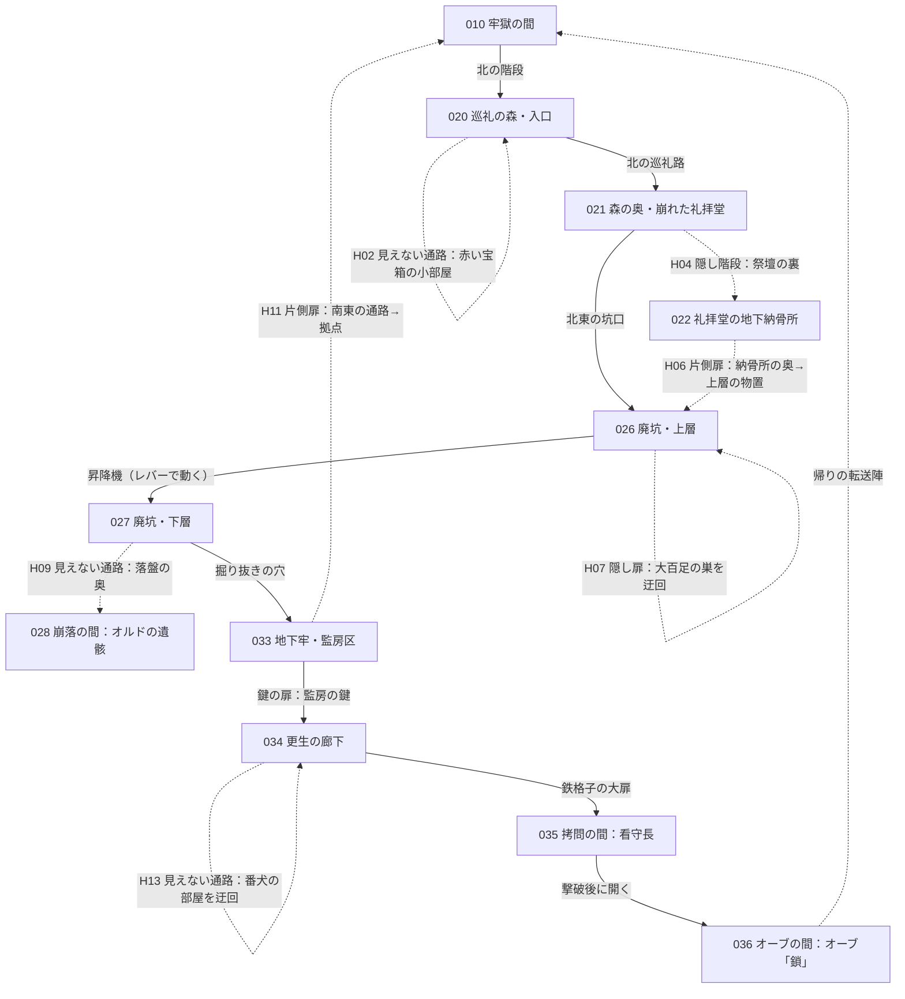

# 世界設計書 — 灰の王国（D1）

W・P・V レーンがこのファイルを見て、拠点と第1段階の 3 ダンジョンを作るための設計書。
[VISION.md](../VISION.md) の「世界設定の種」を固めたもの。ID の帯は [docs/ROADMAP.md](ROADMAP.md)、データの形は [docs/mz-data.md](mz-data.md)、
文字マップは [tools/maps/README.md](../tools/maps/README.md)。

- 手本（Fanastasis）の固有名詞・台詞・地名・人物は使っていない。ここに出る名前と文章はすべて自作。
- 名前（タイトル・主人公・仲間）と暗さは推しの案で書いてある。持ち主の決定待ちは [9 章](#9-決定待ち) と issue #13。決まったら名前を置き換える（筋は変わらない）。
- 「第1段階」と書いた所は W1・W2 がすぐ作る。「第2段階」「第3段階」と書いた所は案で、後の issue で詰める。

### 前提（持ち主が決めたこと）
- 画面 1280×720（#4）。1 マス 48px なので、画面に見えるのは **横 26.7 × 縦 15 マス**。これより小さいマップは画面の中央に黒い縁つきで出る（`Game_Map.setDisplayPos`）。
- マップは仕上げ後は JSON が正本（#5）。W1 は文字マップから作り、持ち主がエディタで仕上げたら以後はイベントだけを直す。
- 壁の側面は 2 マス（#8）。**部屋の縦は「床の行数＋2」** 必要。下の部屋の大きさは床の広さで書く（壁の行は含まない）。

---

## 1. 世界と物語の骨子

### 1.1 国と今の姿
- **ヴェルム王国**（通称「灰の王国」）。山に囲まれた小国。魔石の鉱脈で栄えた。〔知〕
- 王都ヴェルムは**白い結界で封鎖**されて十年。中に入った者も出てきた者もいない。主人公は王都に入れない（結界が主人公を拒む。理由は 1.4）。〔知〕（拒む理由は〔進：R49・オーブ「封印」〕）
- 王国の民は「灰化」にかかった。魂が少しずつ灰になり、最後は心を失って魔物になる。人間はほとんど残っていない。〔知〕
  残っているのは灰化しにくい**異種族**（獣人・魚人・巨人の末裔）と、狂って魔物になった**元人間**、そして骨。〔噂〕（人間だけがかかることは噂。R19・R25・R32）
- 拠点「牢獄の間」は王都の**地下**、結界の外側の縁にある古い牢。〔知〕

### 1.2 滅びの経緯（年表）
| いつ | できごと | どのダンジョンで断片が分かるか | 段階 |
|---|---|---|---|
| 約 200 年前 | 流行り病を「灰の聖女」が鎮めたとされ、**聖灰教会**ができる。聖女の遺灰が病を治すと説く（実際には効かない） | 巡礼の森、古書院（第2段階） | 〔知〕教会と聖女の話／〔進：R04・R06・R35〕遺灰が効かない |
| 約 40 年前 | 東の**ガルヴァ帝国**が魔石の鉱脈を狙って侵攻。山の砦が次々に落ちる | 廃坑（帝国の捕虜が掘らされた） | 〔知〕 |
| 約 30 年前 | 教会の孤児院出の若者**ユエル**が宮廷の「蘇生師」になる。死者を一時だけ動かす術を、**更生牢の囚人**で試して完成させる | 地下牢（オーブ「鎖」） | 〔進：R15・オーブ「鎖」〕 |
| 約 25 年前 | 王都まで攻め込まれ、王はユエルに命じて**悪魔と契約**させる。死者の兵が帝国軍を押し返す。代価は「王国の民の魂の灰」 | 研究所（オーブ「契約」、第2段階） | 〔知〕死者の兵が帝国を押し返した／〔噂〕王が何かと取引した（R20・R32）／〔進：R43・オーブ「契約」〕相手と代価 |
| 約 25〜10 年前 | 生きている民の魂が灰になり始める（灰化）。教会は「異種族の呪い」と説き、**異種族を迫害**し、異端者の集落を焼く | 異端者の廃集落、魚人の湿地（第2段階） | 〔知〕灰化と異端狩り／〔進：R43・オーブ「封印」〕灰化が代価の取り立てだったこと |
| 約 10 年前 | ユエルは灰化が契約の代価の取り立てだと知る。契約の祭壇がある王都を結界で封じ、**自分の魂を結界の錠**にして死ぬ。魂は 4 つに割れて散る | 王都の門・下水道（オーブ「封印」、第2段階） | 〔知〕王都が封じられた／〔進：R46・R49・オーブ「封印」〕封じたのがユエルで、錠になったこと |
| 今 | 赤い目の女**セレス**が、ユエルの抜け殻を牢獄の間で蘇らせる | 牢獄の間（目覚め） | 〔知〕 |

### 1.3 「神はいない」という姿勢
- 聖女の奇跡は**嘘**で、祈りに答える者はいない。教会の聖職者もそれを薄々知りながら、民を落ち着かせるために説き続けた。〔進：R04・R05・R06〕（「神はいない」とは誰にも言わせない。〔秘〕）
- 悪魔は「神の敵」ではなく、契約に従って取り立てるだけの存在。超自然の力はあるが、救いも罰も与えない。〔秘〕（書き手の決め事。文には書かない）
- 誰が悪いかを物語は決めない。王は国を守ろうとし、教会は民を鎮めようとし、帝国兵は命令に従い、異種族は逃げ、囚人は生き延びようとした。〔秘〕（誰が悪いかは、誰にも判定させない）
  残留思念は「その人がどう懸命に生きて、どう死んだか」だけを書く。説教しない。

### 1.4 最後に一つにつながる真相
- 主人公ユエルは、**王国を救うために悪魔と契約し、その代価で王国を灰にした張本人**。そして契約を止めるために王都ごと自分を封じた人。〔秘〕（一文では言わない。部分は〔進〕：契約＝オーブ「契約」、封印＝オーブ「封印」）
- 4 つのオーブは割れた魂の 4 片で、それぞれが過去の一場面を見せる（[5 章](#5-4-つの記憶のオーブ)）。どの順で集めても、4 つ揃うと上の一本の線になる。〔知〕（魂が割れてオーブになったことはセレスが最初に言う）
- **セレスの正体は契約の悪魔**。契約は「蘇生師が完全な魂で祭壇に立ったとき履行される」。履行されると王都に封じた民の魂も灰として取り立てられ、セレスは契約から自由になる。〔進：オーブ「契約」で相手と条件、門の前 15.4 で民の魂の行き先〕（セレスを「悪魔」と呼ぶことは〔秘〕）
  セレスも契約に縛られて何百年も取り立てを続けてきた者で、自由になりたいだけ。悪意はない（[2.3](#23-案内役セレス)）。〔秘〕（悪意がないことは言わせない。気づかう態度で見せる）
- 主人公が王都に入れないのは、主人公自身が結界の錠だから。門に近づくと錠が外れかけ、結界が押し返す。〔進：R49・オーブ「封印」〕

---

## 2. 主人公と案内役

### 2.1 主人公
| 項目 | 内容 |
|---|---|
| 既定名 | **ユエル**（名前の入力で変えられる。推し：入力させず固定。[9 章](#9-決定待ち)） |
| 肩書き | 蘇生師（`Actors.json` の `nickname`） |
| Actors / Classes | 1 番（持ち主の帯。W1 が名前と職業だけを書く。初期パーティはユエル 1 人） |
| 見た目 | 灰色の外套、顔は前髪で半分隠れる。同梱の素材から持ち主が選ぶ |
| 戦い方 | 物理と魔法の中間。固有技「灰火」（火の単体攻撃、SP を使う）と「魂吸い」（敵 1 体から HP を吸う）。第1段階はこの 2 つと通常攻撃・防御 |
| 性格 | 口数が少ない。台詞は短く、ためらいがある。記憶が戻るほど言葉がはっきりする |

### 2.2 目覚めの場面（Map010 の目覚めの独房。自動実行、1 回だけ）
画面は黒から始め、フェードインして独房の寝台にユエルが横たわっている。セレスが格子の外に立つ。名前の欄はイベントで `\N[1]` を使う。

```
セレス「……起きた。三度目でようやく、ね」
ユエル「……ここは」
セレス「牢獄の間。王都の下にある、古い牢よ」
セレス「あなたは一度死んで、私が呼び戻した。名前は \N[1]。覚えていないでしょう」
ユエル「……何も」
セレス「魂が四つに割れて、王国のどこかに散ったの。記憶の珠、オーブになって」
セレス「四つ全部取り戻せば、あなたは元に戻る。王都の封鎖も解ける」
セレス「この国を救えるのは、あなただけ。……行って。灰が降りやむ前に」
```
（8 行。最後の 2 行がセレスの嘘の芯：「元に戻る」は本当、「救える」は半分嘘）

その後の操作：セルフスイッチではなく**スイッチ 111「目覚めた」**を ON（拠点の他の部屋が見るため）。独房の扉が開く。

### 2.3 案内役セレス
| 項目 | 内容 |
|---|---|
| 立場 | 牢獄の間に住む赤い目の女。主人公を蘇らせ、オーブを集めるよう勧める。戦闘には加わらない |
| 本当の姿 | 契約の悪魔。約 25 年前にユエルと契約した相手 |
| つく嘘 | 「記憶を戻せば王都の封鎖が解け、国を救える」。本当は、記憶を戻して祭壇に立つと契約が履行され、王都の民の魂が取り立てられる |
| 隠していること | 自分が悪魔であること。自分も契約に縛られていて、履行されれば自由になること |
| 嘘でないこと | 主人公を気づかうのは本心。仲間を呼び戻す召喚陣の使い方、オーブの在りかの手がかりは正直に教える |
| 牢獄の間での役目 | 話しかけると、オーブの数に応じた一言（[2.4](#24-セレスの一言オーブの数で変わる)）。仲間の召喚の説明（初回だけ） |
| 正体の手がかり | 鏡に映らない（拠点の姿見を調べると、背後に誰もいない）。帝国兵の残留思念に「赤い目の女が王の横にいた」。オーブ「契約」で決定的になる |

### 2.4 セレスの一言（オーブの数で変わる）
変数 101「オーブの数」で分岐する（111 の変数の分岐）。
| オーブ | 一言 |
|---|---|
| 0 | 「まずは外へ。階段を上がると巡礼の森よ。森は迷うけれど、壁ばかり見ていないで、足元も見なさい」 |
| 1 | 「一つ目。……何か思い出した？　言わなくていい。顔に出てる」 |
| 2 | 「半分ね。あなた、少しずつ昔の話し方になってる」 |
| 3 | 「あと一つ。……ねえ、全部戻っても、私を恨まないでね」 |
| 4 | 「おかえりなさい、\N[1]。門で待ってる」（第2段階） |

---

## 3. 拠点「牢獄の間」（マップ 10–19）

### 3.1 マップの割り当て
| マップ | 名前 | 段階 | 大きさ | タイルセット |
|---|---|---|---|---|
| 010 | 牢獄の間 | 第1段階 | 33 × 27 | 4 ダンジョン（煉瓦の壁 `=`、石の床 `.`） |
| 011 | 魂の間 | 第2段階以降（P8） | 17 × 13 | 4 ダンジョン |
| 012 | 創作者の厨房 | 第2段階以降（P8） | 17 × 13 | 3 内装 |
| 013 | 保管ゲート | 第2段階以降（P8） | 17 × 13 | 4 ダンジョン |
| 014 | 理知の間 | 第2段階以降（P8） | 17 × 13 | 3 内装 |
| 015 | 王都の門（結界の前） | 第2段階 | 27 × 20 | 2 外観 |
| 016–019 | 予備 | | | |

第2段階のマップ（015 王都の門の中身、023、050–109）は [world2.md](world2.md)。

### 3.2 Map010 牢獄の間の部屋
中央の広間を十字の廊下が囲む形。部屋の大きさは床のマス（壁の 2 行を足すこと）。位置はおおよそで、W1 が文字マップで整えてよい。

```
          [北] 出口の階段（→ Map020 巡礼の森）
                  |
 [魂の間の扉]—— 北の廊下 ——[創作者の厨房の扉]
       |                         |
 [目覚めの独房]—— 中央の広間 ——[召喚陣の間]
       |        (セレス・泉・書見台)  |
 [保管ゲートの扉]—— 南の廊下 ——[理知の間の扉]
                  |
           [南] 開かない鉄の扉（→ Map033 地下牢。片側扉の表）
```

| 部屋 | 床の広さ | 置くもの | 最初から使えるか |
|---|---|---|---|
| 目覚めの独房（西） | 5 × 4 | 寝台（ユエルの開始位置）、格子の扉（スイッチ 111 で開く） | ○ |
| 中央の広間 | 11 × 7 | セレス（立ち絵の NPC）、**灰の泉**（調べると全回復 314）、**記録の書見台**（調べるとセーブ 352）、姿見（セレスの正体の手がかり） | ○ |
| 召喚陣の間（東） | 7 × 5 | **召喚陣**（遺骸を見つけた仲間を呼び戻す。P6 が作る。W1 は調べると「まだ呼び戻せる魂がない」と出す仮のイベント） | ○（中身は P6） |
| 出口の階段（北） | 3 × 3 | 上り階段 → Map020 の南端 | ○ |
| 魂の間の扉（北西） | 扉 1 マス | 台座の付いた石の扉。調べると碑文（3.3） | ×（第2段階以降） |
| 創作者の厨房の扉（北東） | 扉 1 マス | 同上 | × |
| 保管ゲートの扉（南西） | 扉 1 マス | 同上 | × |
| 理知の間の扉（南東） | 扉 1 マス | 同上 | × |
| 開かない鉄の扉（南） | 扉 1 マス | 調べると「錆びついて動かない。向こう側に閂があるようだ」。スイッチ 114 が ON なら開いていて、踏むと Map033 の監房区の南東へ | ×（地下牢の側から開ける） |

- 開始位置：`System.json` の `startMapId` = 10、独房の寝台の上（W1 が決める）。最初の自動実行で 2.2 の場面。
- 広間の床の真ん中に、上の王都へ続く**塞がった螺旋階段**の跡（上層の装飾だけ。調べると「上は白い光で塞がれている」）。王都に入れないことを最初に見せる。
- BGM：無音でよい（音は後回し）。色調は少し青く暗く（V1 の `<hai_tone:…>` が入ったら付ける）。

### 3.3 施設が開く順と条件（P8・第2段階以降）
施設は**叡智のオーブ**（記憶のオーブとは別物。古代の賢者の知恵が固まった珠）を扉の台座にはめると開く。どれも必須ではない。
叡智のオーブは第2段階のダンジョンに 1 つずつ置く（第1段階には置かない）。持っている数で、次の順に開く。

| 順 | 施設 | 扉 | 条件 | できること | 碑文（第1段階から調べられる） |
|---|---|---|---|---|---|
| 1 | 魂の間 | 北西 | 叡智のオーブ 1 個 | 倒した敵の魂で控えの仲間を育てる | 「魂は量れる。量れるものは、与えることもできる」 |
| 2 | 創作者の厨房 | 北東 | 2 個 | 素材から消耗品を作る | 「火と塩と根。生きるための術は、いつも台所から」 |
| 3 | 保管ゲート | 南西 | 3 個 | 所持上限を超えた物の倉庫。自動転送 | 「持ちきれぬものは、置いていけ。門が覚えている」 |
| 4 | 理知の間 | 南東 | 4 個 | 古代語の解読、王国全図、倒したボスの情報 | 「読めぬ文字は、まだ出会っていない言葉にすぎない」 |

開いたらスイッチ 121〜124 を ON。どの扉の台座にはめても、開くのは上の順（1 個目は必ず魂の間）。

---

## 4. 第1段階の 3 ダンジョン（マップ 20–49）

### 4.0 全体
**巡礼の森 → 廃坑 → 地下牢** の順に深くなる。地下牢は牢獄の間のすぐ隣（王都の地下の同じ岩盤）で、地下牢の奥から拠点へ戻る片側扉が開くと「遠いと思っていた場所が実は隣だった」と分かる。

| マップ | 名前 | 大きさ | タイルセット | 凡例 |
|---|---|---|---|---|
| 020 | 巡礼の森・入口 | 40 × 30 | 2 外観 | `forest`（W1 が `legend.json` に追記） |
| 021 | 巡礼の森・奥（崩れた礼拝堂） | 40 × 32 | 2 外観 | `forest` |
| 022 | 礼拝堂の地下納骨所 | 22 × 16 | 4 ダンジョン | `dungeon` |
| 023–025 | 予備（森） | | | |
| 026 | 廃坑・上層 | 44 × 34 | 4 ダンジョン | `dungeon`（土の床 `,`、岩の壁 `#`） |
| 027 | 廃坑・下層 | 44 × 34 | 4 ダンジョン | `dungeon` |
| 028 | 崩落の間（隠し） | 18 × 13 | 4 ダンジョン | `dungeon` |
| 029–032 | 予備（廃坑） | | | |
| 033 | 地下牢・監房区 | 44 × 34 | 4 ダンジョン | `dungeon`（煉瓦の壁 `=`、石の床 `.`） |
| 034 | 地下牢・更生の廊下 | 40 × 26 | 4 ダンジョン | `dungeon` |
| 035 | 拷問の間（ボス） | 27 × 17 | 4 ダンジョン | `dungeon` |
| 036 | オーブの間 | 17 × 13 | 4 ダンジョン | `dungeon` |
| 037–049 | 予備（地下牢と第1段階の追加） | | | |

- 森のタイルは `Outside_A2`（草地・森）と `Outside_B`（木・切り株・墓石）。木の幹は B の通れないタイル、木の葉は ☆。森の「壁」は木の列で作る（A4 の壁はない）。
- 遊ぶ時間の目安：森 8 分、廃坑 10 分、地下牢 12 分（隠し要素を半分見つけて 30 分）。
- 敵の色：**緑**＝弱い（そのまま勝てる）、**黄**＝並（準備すれば勝てる）、**赤**＝強い（避けるのが基本。隠し要素の装備か仲間がいれば勝てる）。
  P1 のメモ欄 `<hai_enemy:troopId,green|yellow|red>`。赤は**必ず迂回路がある**（隠し通路か遠回り）。
- 敵グループ（Troops）は W1 の帯 201– を使う（下の番号は推し）。敵（Enemies）も同じ番号でそろえるとよい。

### 4.1 つながり図
実線＝ふつうの道、点線＝隠し要素（番号は 4.5 の表）、`-.->` は片道。



### 4.2 巡礼の森（020–022）
**見どころ**：霧の中の巡礼路。道標と墓標が並び、灰をかぶった巡礼者の遺体があちこちに倒れている。崩れた礼拝堂の中に聖女像。
隠し通路の**教え役**：最初の隠し（H01）は手がかりが最も分かりやすく、残留思念（R02）が答えを言う。

**仕掛け**
- 霧：色調を白っぽく、遠景なし。見通しが悪いので敵の色が近くまで分からない雰囲気（実際の判定は P1 のまま）。
- 道標：分かれ道ごとに「巡礼の道はこちら」と矢印の看板（調べると文章）。片方は行き止まり（隠し通路あり）。
- 聖女像（021）：調べると「祈りますか？」の選択肢。祈っても何も起きない（「……何も起きなかった。」）。3 回祈ると R05 が読める（神はいないことを最初に示す）。

**Map020 巡礼の森・入口（40×30）**
| 区画 | 床の広さ | 中身 |
|---|---|---|
| 南の広場（入口） | 10 × 6 | 牢獄の間への下り階段（南端中央）。灰の泉の小さな湧き水（全回復。森の唯一の回復） |
| 巡礼路（南→北へうねる道） | 幅 3、長さ 30 前後 | 道標 2 つ、緑の敵 3 体 |
| 西の行き止まり | 6 × 5 | 巡礼者の遺体（R01）。H01 の入口 |
| 東の墓地 | 8 × 6 | 墓標が並ぶ。黄の敵 1 体。R02 |
| 隠し小部屋（北西） | 4 × 3 | 赤い宝箱（H02 の先） |
| 北の出口 | 幅 3 | → Map021 の南端 |

**Map021 森の奥・崩れた礼拝堂（40×32）**
| 区画 | 床の広さ | 中身 |
|---|---|---|
| 南の入口 | 幅 3 | ← Map020 |
| 苔の小道 | 幅 2〜3 | 緑の敵 2 体、黄の敵 1 体 |
| 祈りの群れの広場（中央） | 12 × 8 | **赤**「祈りの群れ」。礼拝堂へ行くにはここを通るか、西の茂みの H03 で迂回 |
| 崩れた礼拝堂（北） | 11 × 9 | 聖女像、祭壇（裏に H04 の隠し階段）、R03・R04 |
| 北東の坑口 | 3 × 3 | → Map026 の西端（廃坑・上層の入口）。坑口の前に木の柵（調べると押し開ける） |

**Map022 礼拝堂の地下納骨所（22×16）**
| 区画 | 床の広さ | 中身 |
|---|---|---|
| 階段の下 | 4 × 3 | ← Map021 の祭壇裏（隠し階段で降りる） |
| 骨の棚の通路 | 幅 2、長さ 14 | 緑の敵「迷い蛾」2 体 |
| 聖女の棺の部屋 | 6 × 4 | 空の棺（聖女の遺灰はなかった。R06）。東の壁に H05 の隠し扉（奥に赤い宝箱） |
| 奥の扉 | 1 マス | H06 片側扉の**裏**。ここから押すと開いて Map026 の物置へ抜ける（廃坑側から来ると壁） |

**敵（森）**
| 色 | 名前 | 敵グループ（推し） | 数 | 特徴 |
|---|---|---|---|---|
| 緑 | 迷い蛾 | 201 | 020 に 2、021 に 1、022 に 2 | 弱い。たまに眠りの鱗粉 |
| 緑 | 根喰い | 202 | 020 に 1、021 に 1 | 動かない（巡回しない）。毒 |
| 黄 | 灰の巡礼者 | 203 | 020 に 1、021 に 1 | 狂った元人間。HP が高い |
| 赤 | 祈りの群れ | 204（灰の巡礼者 3 体） | 021 の広場に 1 | 3 体で囲む。避けるのが基本 |

### 4.3 廃坑（026–028）
**見どころ**：帝国の捕虜が魔石を掘らされた坑道。打ち捨てられた鶴嘴とトロッコ、帝国の言葉の落書き、数を刻んだ壁（日数）。
暗い（色調を暗く）。昇降機で上層と下層を行き来する。

**仕掛け**
- **昇降機**：上層の北の「昇降機の小屋」にレバー。動かすとスイッチ 153「廃坑の昇降機」が ON になり、昇降機（上層・下層の両方にある場所移動のイベント）が使える。
  レバーは上層の南東の機械室にあり、そこへは**坑道の鍵**が要る。
- **坑道の鍵**（大事なもの）：上層の西の詰め所の机（宝箱）。机の横に R08。
- **落盤**：下層の南。岩で塞がっている（見た目の岩＋通れない）。調べると「崩せそうにない」。ここは**見えない通路 H09** で岩の脇を抜ける（隠しの答え）。
- **番号の手がかり**：下層の R10（捕虜の落書き）が、地下牢の番号錠の答え「413」を示す（ダンジョンをまたぐ手がかり。P3 の自動メモに残す）。

**Map026 廃坑・上層（44×34）**
| 区画 | 床の広さ | 中身 |
|---|---|---|
| 西の坑口 | 4 × 4 | ← Map021 の坑口 |
| 西の詰め所 | 6 × 4 | 机の上の宝箱（坑道の鍵）、帝国兵の遺体 R08 |
| 中央の坑道（東西に長い） | 幅 2〜3、長さ 30 | 緑の敵 3 体、黄の敵 1 体。トロッコの線路（飾り） |
| 大百足の巣（中央北） | 10 × 6 | **赤**「大百足」。北の昇降機の小屋へ最短。H07 の隠し扉で巣の西側を迂回 |
| 物置（北西） | 4 × 3 | H06 の片側扉の**表**（ここからは壁）。赤い宝箱 |
| 昇降機の小屋（北） | 5 × 4 | 昇降機（スイッチ 153 で動く）→ Map027 の北 |
| 機械室（南東） | 5 × 4 | 鍵の扉（坑道の鍵）。中にレバー。R07 |

**Map027 廃坑・下層（44×34）**
| 区画 | 床の広さ | 中身 |
|---|---|---|
| 昇降機の下（北） | 5 × 4 | ← Map026 の昇降機 |
| 魔石の採掘場（中央） | 14 × 8 | 光る魔石の壁（飾り）。黄の敵 2 体。R09 |
| 捕虜の寝床（西） | 8 × 5 | 藁の寝床が並ぶ。R10（番号の手がかり）。赤い宝箱へ続く H08 |
| 落盤（南） | 岩の山 | H09 の見えない通路 → Map028 崩落の間 |
| 掘り抜きの穴（東） | 3 × 3 | 岩壁に掘られた穴。→ Map033 の北西（地下牢の監房の壁を内側から破った跡）。R11 |

**Map028 崩落の間（18×13）**
| 区画 | 床の広さ | 中身 |
|---|---|---|
| 崩れた坑道の行き止まり | 10 × 6 | **オルドの遺骸**（仲間 1 人目。調べるとスイッチ 131 ON、「まだ温かい魂が残っている。拠点の召喚陣で呼べそうだ」）、オルドの記憶 1「臨終」（R12） |

**敵（廃坑）**
| 色 | 名前 | 敵グループ（推し） | 数 | 特徴 |
|---|---|---|---|---|
| 緑 | 坑道鼠 | 205 | 026 に 3、027 に 1 | 群れる（2 匹で 1 組） |
| 黄 | 石喰い | 206 | 026 に 1、027 に 1 | 物理に強い。火に弱い（ユエルの「灰火」を教える） |
| 黄 | 灯なし坑夫 | 207 | 027 に 1 | 元人間の坑夫。鶴嘴の強打 |
| 赤 | 大百足 | 208 | 026 の巣に 1 | 毒と 2 回攻撃。避けるのが基本。火に弱い |

### 4.4 地下牢（033–036）
**見どころ**：「更生」を名目にした拷問牢。鉄格子の監房が並び、骨が積まれ、壁には囚人の爪痕。看守の詰め所は几帳面に片付いている。
ユエルが若いころ囚人で術を試した場所（オーブ「鎖」）。ここを抜けると拠点が隣にあったと分かる。

**仕掛け**
- **監房の鍵**（大事なもの）：監房区の北の看守の詰め所の**番号錠の箱**に入っている。番号は **413**（廃坑の R10 が手がかり。数値入力 103 で 3 桁を入れ、変数に入れて 111 で比べる）。
  間違えると「違うようだ」。何度でもやり直せる。
- **足が遅くなる廊下**（Map034）：床の魔法陣の区画（幅 3、長さ 12）に入るとプレイヤーの移動速度が 4→2 になり、出ると戻る（区画の入口と出口にプレイヤー接触のイベントで移動ルートの設定 205、「速度」を変える）。
  中を**番犬**が巡回する。遅い間に追いつかれないよう、番犬の巡回の切れ目を見て渡る。H13 の見えない通路で廊下そのものを迂回できる。
- **火炎の噴き口**：第2段階以降（W1 では置かない）。
- **拠点への片側扉 H11**：監房区の南東の通路の突き当たり。こちら側（地下牢）から調べると閂を外して開き、スイッチ 114 を ON。牢獄の間の南の鉄の扉とつながる。

**Map033 地下牢・監房区（44×34）**
| 区画 | 床の広さ | 中身 |
|---|---|---|
| 北西の破れた監房 | 4 × 4 | ← Map027 の掘り抜きの穴。壁に穴 |
| 監房の列（西・東） | 監房 3 × 3 が 10 室（廊下の両側） | 骨の囚人（緑）。監房のうち 3 室に残留思念（R13・R14・R15）。1 室は H10 の隠し扉の先 |
| 看守の詰め所（北） | 7 × 5 | 番号錠の箱（413 → 監房の鍵）、看守の日誌（R16） |
| 中央の点呼の広場 | 10 × 6 | 黄の敵 2 体。南へ鍵の扉（監房の鍵）→ Map034 |
| 南東の通路 | 幅 2、長さ 10 | 突き当たりが H11 の片側扉（裏）→ 牢獄の間 |

**Map034 更生の廊下（40×26）**
| 区画 | 床の広さ | 中身 |
|---|---|---|
| 北の入口 | 4 × 3 | ← Map033 の鍵の扉 |
| 足が遅くなる廊下 | 3 × 12（南北） | 魔法陣の床。番犬（赤）が往復 |
| 番犬の部屋（東） | 8 × 6 | 番犬（赤）がもう 1 体。赤い宝箱（H12 の先の奥） |
| 迂回路（西の壁の中） | 幅 1、長さ 14 | H13 の見えない通路（影なし壁が手がかり） |
| 南の控え室 | 6 × 4 | 灰の泉（全回復）、記録の書見台（セーブ）。ボスの前の休憩所。R17 |
| 鉄格子の大扉（南） | 2 マス | → Map035 |

**Map035 拷問の間（27×17）**
| 区画 | 床の広さ | 中身 |
|---|---|---|
| 拷問の間 | 15 × 9 | 鎖と吊り籠。**看守長**（ボス。決定ボタンで話しかけると戦闘。逃走可。`<hai_enemy_once>`）。撃破でスイッチ 151 ON、北の扉が開く |
| 北の扉 | 1 マス | → Map036 |

**Map036 オーブの間（17×13）**
| 区画 | 床の広さ | 中身 |
|---|---|---|
| 小さな礼拝室 | 7 × 5 | 台座の上に**オーブ「鎖」**（調べるとスイッチ 101 ON、変数 101 に 1 を足す、記憶の場面 5.1 を流す）。帰りの転送陣（牢獄の間の広間へ） |

**敵（地下牢）**
| 色 | 名前 | 敵グループ（推し） | 数 | 特徴 |
|---|---|---|---|---|
| 緑 | 骨の囚人 | 209 | 033 に 4 | 監房の中をうろつく |
| 黄 | 獄卒 | 210 | 033 に 2、034 に 1 | 元看守。眠りの棍棒 |
| 赤 | 番犬 | 211 | 034 に 2 | 足が速く追う距離が長い（P1 の上限の範囲で）。2 回攻撃 |
| ボス | 看守長グラウ | 212（看守長＋番犬 0 体。呼び出しで増える） | 035 に 1 | 下の表 |

#### ボス：看守長グラウ（第1段階の唯一のボス）
更生牢の最後の看守長。囚人を「更生」させることが正しいと信じ続け、灰化してもまだ点呼を取っている。

| 項目 | 内容 |
|---|---|
| HP の目安 | ユエル＋オルドのレベル 5 前後で 6〜8 ターン |
| 耐性 | 物理 50% 軽減、雷 無効、毒 無効 |
| **耐性の穴** | **火 200%**、**眠り が効く**（入りやすい） |
| 行動 | ① 毎ターン「鉄鞭」（単体の物理）か「鎖縛り」（1 人を 2 ターン行動不能）<br>② 3 ターンごとに「更生の号令」（全体に小ダメージ＋**沈黙**）<br>③ HP 50% で 1 回だけ「点呼」：番犬を 2 体呼ぶ<br>④ HP 25% で「狂乱」：攻撃が 2 回になり、防御が下がる |
| 倒し方の手順 | 1. 沈黙対策：地下牢の赤い宝箱「沈黙除けの首輪」（H12）をユエルに付ける（「灰火」が封じられない）<br>2. 序盤：オルドが「かばう」でユエルを守り、ユエルが「灰火」を当てる（火 200%）<br>3. 眠り：森の赤い宝箱の「眠り香」（消耗品）か迷い蛾の鱗粉で眠らせると「鎖縛り」が止まる<br>4. 点呼の番犬は放っておいて看守長に集中（看守長を倒すと番犬も逃げる）<br>5. 25% からの狂乱は防御が下がるので、SP を残しておいて一気に削る |
| レベルを上げずに勝つ道 | 首輪＋眠り香＋オルド加入で、レベル 3 でも勝てる設計にする（P4・P7 の数値調整で確かめる） |
| ドロップ（固定） | 「看守長の鍵束」（大事なもの。第2段階で地下牢の奥の扉を開ける）、魔石 多め |
| 逃げたら | 控え室に戻される（場所移動）。看守長は HP が全快して残る |

### 4.5 隠し要素の一覧
表し方は P2（#11）の推しに合わせる。P2 の `docs/plugins/Hai_HiddenPassage.md` が入ったら、そちらの書き方（文字マップの文字）に従う。

| リージョン | 種類 | ふるまい |
|---|---|---|
| 251 | 見えない通路 | 壁に見えるが通れる |
| 252 | 隠し扉 | 調べると開き、以後通れる |
| 253 | 片側扉 | 裏（指定の向き）から入ると開く。表からは壁 |
| 254 | 隠し階段 | 調べると現れる。行き先は同じ座標のイベントのメモ欄 `<hai_stairs:mapId,x,y>` |

手がかりの種類（P2 の規則）：**植生**＝一マスだけ違う床（第 2 層に別のタイル）、**影なし**＝側面に影が無い壁（影の層を 0）、**くぼみ**＝別の A4 の壁、
**逆側**＝裏から来て初めて開く、**思念**＝残留思念の示唆、**見える**＝隣が見えるのに行けない。

| 番号 | マップ | 場所 | 種類 | 手がかり | 見返り |
|---|---|---|---|---|---|
| H01 | 020 | 西の行き止まりの北の木の列 | 251 見えない通路 | 植生（木の根元に一マスだけ白い花）＋思念（R01「白い花の木の間を」） | 南の広場への近道（教え役） |
| H02 | 020 | 北西の隠し小部屋の入口（巡礼路の西の茂み） | 251 見えない通路 | 見える（巡礼路から小部屋の宝箱が木越しに見える） | 赤い宝箱「巡礼者の外套」（防具。魔法 20% 軽減） |
| H03 | 021 | 中央の広場の西の茂み | 251 見えない通路 | 植生（茂みの中に踏み分け道の土が一マス） | **赤「祈りの群れ」の迂回** |
| H04 | 021 | 礼拝堂の祭壇の裏の床 | 254 隠し階段 | 思念（R04「聖女さまの足元に」）＋祭壇の後ろだけ床石の色が違う | Map022 地下納骨所へ |
| H05 | 022 | 聖女の棺の部屋の東の壁 | 252 隠し扉 | くぼみ | 赤い宝箱「眠り香 ×2」（消耗品。ボスに効く） |
| H06 | 022→026 | 納骨所の奥の扉（裏）／廃坑・上層の物置の北壁（表） | 253 片側扉 | 逆側（納骨所の側からだけ開く） | **森から廃坑・上層の奥への近道**（坑口と大百足を通らずに物置へ）。物置の赤い宝箱「坑夫の鶴嘴」（武器。石喰いと大百足に特効） |
| H07 | 026 | 大百足の巣の西の岩壁 | 252 隠し扉 | 影なし＋くぼみ | **赤「大百足」の迂回**（坑道から昇降機の小屋へ） |
| H08 | 027 | 捕虜の寝床の南の壁 | 252 隠し扉 | 思念（R10 の 2 枚目「寝床の下の壁は柔らかい」） | 赤い宝箱「灯火の指輪」（装飾。暗闇と眠りを防ぐ） |
| H09 | 027→028 | 南の落盤の東の脇 | 251 見えない通路 | 影なし（落盤の脇の壁だけ影が無い）＋見える（岩の隙間から奥が見える） | Map028 崩落の間へ：**オルドの遺骸**（仲間 1 人目） |
| H10 | 033 | 西の監房の列の 5 室目の奥の壁 | 252 隠し扉 | 思念（R14「五つ目の部屋の壁を叩け」）＋くぼみ | 隠し監房：R15（オーブ「鎖」の手がかり）、魔石 |
| H11 | 033→010 | 南東の通路の突き当たり（裏）／牢獄の間の南の鉄の扉（表） | 253 片側扉 | 逆側（地下牢の側からだけ）。拠点の側は「向こう側に閂がある」と言うだけ | **地下牢と拠点の近道**（以後、拠点から地下牢の監房区へ直行）。スイッチ 114 |
| H12 | 034 | 番犬の部屋の北東の角の壁 | 252 隠し扉 | 植生（床に一マスだけ鎖の跡） | 赤い宝箱「沈黙除けの首輪」（装飾。沈黙を防ぐ。ボス戦の鍵） |
| H13 | 034 | 足が遅くなる廊下の西の壁の中（南北 14 マス） | 251 見えない通路 | 影なし（西の壁の側面だけ影が無い列）＋思念（R17） | **赤「番犬」の廊下の迂回**（入口から控え室へ） |

- 赤い宝箱は 5 個（H02・H05・H06・H08・H12 の先）。中身は一点もの。ザコは装備を落とさないので、装備はこれと買えない初期装備だけ。
- 赤い宝箱の見た目は同梱の宝箱の赤（`!Chest` の赤い列）。開けたらセルフスイッチ A。
- 入手物の推し ID（W1 の帯 201– の中で W1 が決めてよい）：武器「坑夫の鶴嘴」、防具「巡礼者の外套」、装飾「灯火の指輪」「沈黙除けの首輪」、アイテム「眠り香」、大事なもの「坑道の鍵」「監房の鍵」「看守長の鍵束」。

### 4.6 残留思念の一覧
調べると読める（P3 の既読・自動メモ）。見た目は遺体・日記・壁の落書きなど。「手がかり」欄が ○ のものは P3 の自動メモに残す（メモの一行も書いた）。
本文は 1 ページ 4 行まで（1280×720 の文章ウインドウ）。5 行以上は 2 ページに分ける。

| 番号 | マップ | 場所 | 見た目 | 誰の思念か | 手がかり |
|---|---|---|---|---|---|
| R01 | 020 | 西の行き止まり | 巡礼者の遺体 | 足を痛めた老巡礼者 | ○ H01 |
| R02 | 020 | 東の墓地 | 墓標 | 墓守の少年 | ○ 隠し通路の見つけ方 |
| R03 | 021 | 礼拝堂の入口 | 壁の落書き | 盗賊団「夜鴉」の見張り | — |
| R04 | 021 | 礼拝堂の聖女像の下 | 日記 | 礼拝堂の老司祭 | ○ H04 |
| R05 | 021 | 聖女像（3 回祈る） | 像そのもの | 聖女像に祈り続けた母親 | — |
| R06 | 022 | 聖女の棺 | 棺の内側の刻み | 棺を開けた盗賊団の頭 | — |
| R07 | 026 | 機械室 | 帝国兵の遺体 | 昇降機の番をした帝国の工兵 | — |
| R08 | 026 | 西の詰め所 | 日誌 | 捕虜を見張った帝国の下士官 | ○ 坑道の鍵の在りか |
| R09 | 027 | 魔石の採掘場 | 壁の刻み | 捕虜の坑夫（日数を刻んだ） | — |
| R10 | 027 | 捕虜の寝床 | 壁の落書き（2 ページ） | 脱走を企てた捕虜 | ○ 番号錠 413、H08 |
| R11 | 027 | 掘り抜きの穴 | 鶴嘴 | 穴を掘り抜いた捕虜 | — |
| R12 | 028 | 崩落の間 | オルドの遺骸 | オルド（仲間の記憶 1「臨終」） | — |
| R13 | 033 | 東の監房の 2 室目 | 壁の爪痕 | 異種族（獣人）の囚人 | — |
| R14 | 033 | 西の監房の 3 室目 | 囚人の遺体 | 隣の部屋と壁越しに話した囚人 | ○ H10 |
| R15 | 033 | 隠し監房（H10 の先） | 遺体と記録の紙 | 実験の記録をつけた助手 | ○ オーブ「鎖」の在りか |
| R16 | 033 | 看守の詰め所 | 看守の日誌 | 看守長グラウ | ○ ボスの弱点（火） |
| R17 | 034 | 南の控え室 | 壁の落書き | 番犬から逃げ切った囚人 | ○ H13 |

**本文**（`\N[1]` は主人公の名前。行の頭の「」は付けない。地の文として出す）

**R01** 巡礼者の遺体（老巡礼者）
```
足がもう動かぬ。聖女さまの礼拝堂は、すぐそこだというのに。
若い衆は先へ行った。白い花の咲く木の間を抜ければ近いと言っていたが、
わしにはもう、その木まで這う力もない。
……灰が、降ってきた。
```
メモ：「白い花の咲く木の間を抜けられるらしい（巡礼の森・入口）」

**R02** 墓標（墓守の少年）
```
父さんが言ってた。森の木は、ちゃんと見ると一本ずつ違うって。
根元に変な花が咲いてたり、葉っぱの影がなかったりする木は、木じゃないんだって。
ぼくはもう見分けられる。だから父さんの墓も、ぼくが掘った。
```
メモ：「様子の違う木や壁は、通り抜けられることがある」

**R03** 壁の落書き（盗賊団の見張り）
```
夜鴉団、ここに参上。礼拝堂の聖女さまのお宝は、おれたちがいただく。
……と書いてから三日。頭が地下から戻らない。
下から、骨を擦るような音がする。
```

**R04** 日記（老司祭）
```
信徒には言えぬことを、ここに書く。
聖女さまの遺灰が病を治したという記録は、どこにもない。
それでも民は祈りに来る。祈る場所がなければ、民はもっと早く壊れるだろう。
私は嘘の番人だ。聖女さまの足元に、その嘘をしまってある。
```
メモ：「聖女像の足元（祭壇の裏）に何かがしまってある」

**R05** 聖女像（3 回祈ったあと）
```
お願いします。お願いします。息子の熱を下げてください。
お祈りは毎日しました。灰も毎日飲ませました。
……どうして何も言ってくださらないのですか。
どうして。
```

**R06** 棺の内側の刻み（盗賊団の頭）
```
開けてみりゃ空っぽだ。遺灰なんざ一粒もねえ。
二百年、みんな空っぽの箱を拝んでたってわけだ。
笑えるぜ。……笑えねえ。出口がねえ。奥の扉は向こうからしか開かねえ造りだ。
```

**R07** 帝国兵の遺体（工兵）
```
昇降機の油が切れた。補給はもう来ない。本国はこの坑道を忘れた。
捕虜を下に残したまま、上の連中は撤退した。
レバーを引けば籠は動く。だが鍵は下士官殿が持っていった。
俺はここで籠の番をする。命令の取り消しは、まだ来ていない。
```

**R08** 日誌（帝国の下士官）
```
撤退の命令が出た。捕虜は置いていけとのことだ。
機械室の鍵はこの詰め所の机にしまっておく。誰かが来て、下の連中を出してやれるように。
私にはそれを命じる権限がない。
……これは命令違反ではない。置き忘れだ。
```
メモ：「坑道の鍵は西の詰め所の机にある（廃坑・上層）」

**R09** 壁の刻み（捕虜の坑夫）
```
（壁一面に、四本の縦線と一本の斜線の組が並んでいる）
（数えると、千と少しある）
（最後の組だけ、縦線が三本で終わっている）
```

**R10** 壁の落書き（脱走を企てた捕虜）— 2 ページ
```
看守の箱の番号を盗み見た。四、一、三。
地下牢の看守どもは、鍵を番号の箱にしまう。帝国の兵より几帳面だ。
この穴が向こうへ抜けたら、俺たちは箱を開けて、あの廊下を抜ける。
```
```
寝床の下の壁は、ほかより柔らかい。道具はそこに隠してある。
もし俺が戻らなかったら、次の誰かが使え。
```
メモ：「地下牢の看守の箱の番号は 4・1・3」「捕虜の寝床の下の壁が柔らかい（廃坑・下層）」

**R11** 鶴嘴（穴を掘り抜いた捕虜）
```
抜けた。抜けたぞ。……だが、ここは。
鉄格子だ。抜けた先も牢だった。
掘っても掘っても、この国はどこも牢屋なのか。
```

**R12** オルドの遺骸 → 6 章の「オルドの記憶 1」

**R13** 壁の爪痕（獣人の囚人）
```
耳が獣だから牢に入れられた。灰の病を連れてきたのは、お前たちだと。
わたしたちの村は灰になっていない。だから怪しいのだと。
灰にならないことが罪なら、わたしはいったい何になればよかった。
```

**R14** 囚人の遺体（壁越しに話した囚人）
```
隣の部屋の爺さんが、壁越しにいつも話しかけてきた。
五つ目の部屋の壁を叩け、あそこの奥には誰も知らない部屋がある、と。
爺さんの声が止んで、もう何日になるだろう。
```
メモ：「西の監房の五つ目の部屋の壁を叩け（地下牢・監房区）」

**R15** 遺体と記録の紙（実験の助手）
```
記録係として最後の頁を書く。先生の術は完成した。死者は、一刻だけ動く。
先生は成功を喜ばなかった。囚人の名を一人ずつ帳面に書き写して、拷問の間の奥へ持っていった。
奥の小さな礼拝室に、先生は何かを置いていった。看守長しか入れない部屋だ。
先生は、ユエル先生は、優しい人だった。
```
メモ：「拷問の間の奥の礼拝室に、何かが置かれている（地下牢）」
（主人公の名前を思念の中で初めて聞く場面。名前の入力を許す場合も、ここは `\N[1]` にする）

**R16** 看守の日誌（看守長グラウ）
```
点呼。異常なし。点呼。異常なし。囚人は全員更生した。全員静かになった。
蘇生師の先生が来てから、囚人がよく死に、よく起きる。
起きた囚人は火を怖がる。死んでいても火は怖いらしい。
……私も火が怖い。なぜだろう。点呼。異常なし。
```
メモ：「看守長は火を怖がっていた（地下牢）」

**R17** 壁の落書き（番犬から逃げ切った囚人）
```
あの廊下は足が鈍る。犬はそれを知っている。
西の壁を見ろ。影がない。あそこは壁じゃない。
俺は抜けた。お前も抜けろ。
```
メモ：「更生の廊下の西の壁には影がない。通れる（地下牢・更生の廊下）」

### 4.7 鍵と施錠扉
| 鍵（大事なもの） | 置き場所 | 開ける扉 | 手がかり |
|---|---|---|---|
| 坑道の鍵 | 026 西の詰め所の机 | 026 機械室の扉（中にレバー → スイッチ 153 昇降機） | R08 |
| 監房の鍵 | 033 看守の詰め所の番号錠の箱（413） | 033 点呼の広場の南の扉（→ 034） | R10（廃坑）、R14 |
| 看守長の鍵束 | ボスのドロップ | 第2段階：地下牢の奥（037 以降）の扉 | — |

施錠扉は「鍵を持っていれば開く。開いたらセルフスイッチ A」。扉を調べたとき鍵がなければ「鍵がかかっている。」。P3 の施錠扉の自動メモが入ったらそれに乗る。

### 4.8 オーブ 1 個目（「鎖」）
- 置き場所：Map036 オーブの間の台座。
- 守り：看守長（ボス）を倒すと北の扉が開く。ボスは逃げても残り、何度でも挑める。
- 取ったあと：5.1 の記憶の場面 → 帰りの転送陣が光る（牢獄の間の広間へ）。セレスの一言が「1」に変わる。

---

## 5. 4 つの記憶のオーブ
どれを先に取っても話が成り立つよう、各オーブの場面は**それだけで完結する一場面**にし、前後関係は年表の年だけで示す。
筋は「取った数」（変数 101）で進む。どのオーブを持っているかは見ない（場面の出し分けはスイッチ 101〜104 で、そのオーブの場面だけ）。

| オーブ | 示す過去（年表） | 置き場所 | 守り | スイッチ | 段階 |
|---|---|---|---|---|---|
| 鎖 | 約 30 年前：更生牢で囚人を使って蘇生術を完成させる | 第1段階：地下牢 Map036 | 看守長グラウ | 101 | 〔知〕オーブの名／〔進：Map036〕過去の中身 |
| 聖灰 | 少年時代：教会の孤児院で、聖女の奇跡が嘘だと知る | 第2段階の案：古書院（禁書庫の最奥） | 書を喰う魔物（沈黙を多用） | 102 | 〔知〕オーブの名／〔進：Map084〕過去の中身 |
| 契約 | 約 25 年前：王の前で悪魔（セレス）と契約する | 第2段階の案：研究所（悪魔の施設） | 契約の番人（形態変化） | 103 | 〔知〕オーブの名／〔進：Map094〕過去の中身とセレスの顔 |
| 封印 | 約 10 年前：王都を封じ、自分の魂を錠にして死ぬ | 第2段階の案：下水道の果て（王都の結界の真下） | 灰の騎士（王の近衛の成れの果て） | 104 | 〔知〕オーブの名／〔進：Map104〕過去の中身 |

**場面の本文（第1段階で作るのは「鎖」だけ）**

5.1 オーブ「鎖」（画面を暗くし、文章だけ。7 行）〔進：Map036〕
```
……冷たい石の部屋。帳面をめくる自分の手。
囚人の名前が、一行ずつ並んでいる。その横に、死んだ日と、起きた日。
「先生、また一人起きました。一刻と少し」
自分の声が答える。「記録を。名前も、ちゃんと書いて」
起きた男は、自分を見て泣いていた。なぜ泣くのかと、自分は尋ねなかった。
術は完成した。王は喜ぶだろう。
……その夜、帳面の名前を、一人ずつ声に出して読んだ。
```
（取ったあとのユエルの一言：「……俺は、ここにいたのか」）

5.2 オーブ「聖灰」（案）：孤児院の夜、熱を出した友に聖灰を飲ませても治らず、友は死ぬ。司祭が「聖女さまは見ておられる」と言うのを聞き、少年のユエルは「誰も見ていない」と知る。
死をなかったことにする術を求め始める動機。〔進：Map084〕

5.3 オーブ「契約」（案）：燃える王都の玉座の間。王が「何を払ってもよい」と言い、ユエルが床に陣を描く。陣の中に赤い目の女が立ち、「では、民の魂の灰を」と言う。
ユエルは頷く。その女がセレスだと、ここで分かる。〔進：Map094〕

5.4 オーブ「封印」（案）：灰化の取り立てだと知ったユエルが、王都の門の内側で結界の陣を描き、自分の胸に錠の印を刻む。外にいるセレスに「すまない」と言い、門が閉じる。
「次に目を覚ましたら、俺はたぶん何も覚えていない。それでいい」。〔進：Map104〕

**取った数で変わること**
| 数 | 変わること |
|---|---|
| 1 | セレスの一言。ユエルの台詞が少し増える |
| 2 | 拠点の姿見にセレスが映らないことに気づく台詞（姿見を調べると） |
| 3 | 王都の門（Map015）へ行ける（第2段階）。門の前で結界に押し返される |
| 4 | ユエルの真の姿（顔画像・歩行画像の差し替え。スイッチ 106）。門が開けられる → 結末の分岐（7 章） |

---

## 6. 仲間 5 人（Actors 5–9）
仲間は死者の霊。マップのどこかに**遺骸**として眠り、拠点の**召喚陣**で呼び戻すと加わる（P6）。
各仲間に記憶が 4 断片（生い立ち・転機・罪か誇り・臨終）あり、ゆかりの場所に散らばる。4 つ揃うと**完全体**になり固有の強技を覚える。
**第1段階で実装するのは 1 人目のオルドだけ**（遺骸と記憶 1「臨終」は廃坑。残りの 3 断片は第2段階）。

| Actor | 名前（推し） | 役割 | 生前 | 固有の立ち回り | 遺骸の場所 | 完全体の強技 | 段階 |
|---|---|---|---|---|---|---|---|
| 5 | オルド | タンク | 帝国の工兵。捕虜として廃坑で死んだ | **かばう＋反撃**。味方の身代わりになり、物理を受けると反撃。物理軽減が高い | 第1段階：廃坑 Map028 崩落の間（H09 の先） | 「鉄の誓い」：3 ターン味方全員の代わりに物理を受け、受けるたびに反撃 | 〔知〕名・二つ名・役割／〔進：記憶 1〜4〕生前 |
| 6 | ザザ | ファイター | 獣人の村の女剣士。教会の異端狩りから村を守って死んだ | **2 回行動**。HP が半分を切ると狂乱して攻撃が上がる（自分では止められない） | 第2段階：異端者の廃集落の焼けた見張り台 | 「千の牙」：敵全体に 4 回のランダム攻撃 | 〔知〕名・二つ名・役割／〔進：記憶 1〜4〕生前 |
| 7 | ノクス | メイジ | 古書院の盲目の司書。禁書を守って死んだ | **即死と沈黙**。敵 1 体に即死の呪文（ボスには効かない）、敵全体に沈黙。HP は低い | 第2段階：古書院の禁書庫の書架の裏 | 「頁を閉じる」：敵全体に即死の判定（成功率は低い）＋沈黙 | 〔知〕名・二つ名・役割／〔進：記憶 1〜4〕生前（ユエルに写しを読ませたことは記憶 3） |
| 8 | ルメ | サポート | 湿地の魚人の歌い手。迫害の中で一族に歌を教え続けた | **味方全体強化と回避盾**。歌で味方全体の攻撃・防御を上げる。自分は回避が高く、敵の狙いを引きつける | 第2段階：魚人の湿地の沈んだ舞台 | 「潮騒の歌」：味方全体の HP と SP を少し回復し、状態異常を防ぐ壁を 3 ターン | 〔知〕名・二つ名・役割／〔進：記憶 1〜4〕生前 |
| 9 | シオン | ヒーラー | 聖灰教会の少年修道士。灰化した民の看取りを続けた | **回復と SP の受け渡し**。回復は SP を使うが、自分の SP を味方に渡せる。蘇生（戦闘不能の回復）ができる唯一の仲間 | 第2段階：巡礼の森の奥に第2段階で開く「看取りの小屋」 | 「最後の祈り」：味方全体の戦闘不能を回復し HP を半分まで | 〔知〕名・二つ名・役割／〔進：記憶 1〜4〕生前（ユエルと同じ孤児院は記憶 1） |

### 6.1 記憶 4 断片
場所は第2段階の案（オルドの「臨終」だけ第1段階）。記憶は調べると読める残留思念の一種で、仲間が加入していてもいなくても読める（読んだ数を変数 131〜135 に足す）。
段階：記憶の中身はすべて〔進〕（その断片を読んで初めて分かる）。ほかの人物の台詞や思念で先に言わない。

**オルド（タンク）**
| 断片 | 内容 | 場所 | 段階 |
|---|---|---|---|
| 生い立ち | 帝国の貧しい石工の家の三男。兵になれば家族に麦が配られると聞いて志願した | 廃坑・上層（第2段階で追加する詰め所の奥の箱） | 〔進〕 |
| 転機 | 砦を落とした後、捕虜を盾にして進めと命じられ、拒んで降格。前線の工兵に回された | 第2段階：帝国の陣跡（崖道） | 〔進〕 |
| 罪か誇り | 捕虜になってからも、同じ牢の者たちに崩れない坑道の組み方を教え、落盤から何人も守った（誇り） | 第2段階：廃坑・下層の採掘場の奥の支柱 | 〔進〕 |
| 臨終 | 第1段階：R12 の本文（下） | 廃坑 Map028（遺骸と同じ場所） | 〔進〕 |

R12 オルドの記憶 1「臨終」（遺骸を調べたとき。5 行）
```
天井が鳴った。支柱が割れる音だ。
「伏せろ！」と怒鳴って、俺は一番近い梁の下に肩を入れた。
重い。だが、まだ持つ。後ろで若いのが這い出ていく足音がする。
三人。四人。……よし。全員だ。
俺の国は俺を忘れたが、この梁は俺を覚えているだろう。
```

**ザザ（ファイター）**：生い立ち＝山の獣人の村で、父に剣を教わる（廃集落の家の跡）／転機＝教会の異端狩りが村に来て、村人を逃がすため一人で橋に残ると決める（廃集落の橋）／
罪か誇り＝橋で異端狩りの兵を何人も斬った。その中に、自分と同じ年ごろの少年兵がいたことを悔いている（罪。崖道の墓標）／臨終＝見張り台で火に囲まれ、最後まで村の方を見ていた（遺骸の場所）。〔進〕

**ノクス（メイジ）**：生い立ち＝生まれつき目が見えず、指で読む古代の点字を覚えて書院に拾われる／転機＝教会から聖女の記録の焚書を命じられ、写しを禁書庫に隠す／
罪か誇り＝写しの中に悪魔の契約の作法があり、それを若いユエルに読ませた（罪。主人公とつながる）／臨終＝焚書の火が禁書庫に回り、書架の裏で写しを抱いて死ぬ。〔進〕

**ルメ（サポート）**：生い立ち＝湿地の魚人の歌い手の家に生まれる／転機＝人間の村に呼ばれて歌い、その夜に一族が「灰の呪い」の濡れ衣で追われる／
罪か誇り＝追われながらも、子どもたちに歌を教え続け、歌で湿地の道を覚えさせた（誇り）／臨終＝沈んだ舞台で、最後の一曲を誰もいない客席に向けて歌う。〔進〕

**シオン（ヒーラー）**：生い立ち＝ユエルと同じ孤児院の、ずっと年下の子（ユエルを「兄さん」と呼んでいた）／転機＝灰化した民の看取りを志願する／
罪か誇り＝聖灰が効かないと知りながら、看取る人に「楽になります」と言って飲ませ続けた（罪とも誇りとも言えない。本人も決められない）／臨終＝看取りの小屋で、最後の患者の手を握ったまま灰化する。〔進〕

---

## 7. 結末の分岐
結末は王都の門（Map015）で、オーブが 4 つ揃ってから選ぶ。第2段階は B を 1 つ作り、第3段階で A と C を足す。

| 結末 | 名前 | 条件 | 中身 | スイッチ | 段階 |
|---|---|---|---|---|---|
| A | 錠のまま | 門の前で「記憶を手放す」を選ぶ（オーブ 4 つ） | ユエルは記憶を門に預け、再び錠として眠る。封鎖は続き、灰化は外でゆっくり進む。セレスは「また、百年後に」と言って去る | 181 | 〔進：門の前〕 |
| B | 灰の履行 | 門の前で「門を開ける」を選ぶ（オーブ 4 つ） | 契約が履行され、王都の民の魂は灰として取り立てられる。灰化は止まり、外に残った者は生き延びる。セレスは自由になり、ユエルは灰に還る。苦い救い | 182 | 〔進：門の前 15.4〕 |
| C | 契約の破棄（真） | オーブ 4 つ＋仲間 5 人が完全体（スイッチ 141〜145）＋セレスの思念 3 つ（第3段階で置く。スイッチ 184「セレスの真名」） | 門の前に 3 つ目の選択肢「契約を破る」が出る。セレス（契約の悪魔）との最終戦。契約書を焼くと王都の民は目を覚まし、ユエルとセレスは共に灰になる。最後に王都の朝が映る | 183 | 〔秘〕（条件と「契約を破る」の言葉は、選択肢が出るまでどこにも書かない） |

---

## 8. 筋の旗の表（スイッチ・変数 101–200）
W1 が `System.json` の `switches`・`variables` に名前を写す（名前の頭の番号は付けない）。**第1段階で W1・W2 が使うもの**に ● を付けた。
イベントごとの状態（宝箱・既読・扉）はセルフスイッチで持ち、ここには**マップをまたいで見る旗**だけを置く。
「段階」の列は、その旗が表す出来事をプレイヤーに見える文で言ってよい段階（旗の名前は `System.json` の中だけで、プレイヤーには見えない）。

### スイッチ
| 番号 | 名前 | 意味 | ON にする所 | 第1段階 | 段階 |
|---|---|---|---|---|---|
| 101 | オーブ:鎖 | オーブ「鎖」を取った | Map036 | ● | 〔知〕 |
| 102 | オーブ:聖灰 | オーブ「聖灰」を取った | 第2段階 | | 〔知〕 |
| 103 | オーブ:契約 | オーブ「契約」を取った | 第2段階 | | 〔知〕 |
| 104 | オーブ:封印 | オーブ「封印」を取った | 第2段階 | | 〔知〕 |
| 105 | オーブ:四つ揃った | 4 つ揃った | オーブを取るたびに変数 101 が 4 なら | | 〔知〕 |
| 106 | 真の姿 | 主人公の画像を差し替えた | 4 つ目の場面のあと | | 〔進：4 つ目のオーブ〕 |
| 107 | セレスの正体を知った | オーブ「契約」の場面を見た | 第2段階 | | 〔進：オーブ「契約」〕 |
| 108–110 | （予備:オーブ） | | | | |
| 111 | 目覚めた | 目覚めの場面を見た | Map010 | ● | 〔知〕 |
| 112 | セレスと話した | 最初の会話を終えた | Map010 | ● | 〔知〕 |
| 113 | 召喚陣を教わった | 召喚陣の説明を聞いた | Map010（P6） | ● | 〔知〕 |
| 114 | 拠点の鉄扉:開 | 地下牢からの片側扉を開けた（H11） | Map033 | ● | 〔知〕 |
| 115 | 王都の門に着いた | 門の前まで行った | 第2段階 | | 〔知〕 |
| 116–120 | （予備:拠点） | | | | |
| 121 | 施設:魂の間 | 魂の間が開いた | P8 | | 〔知〕 |
| 122 | 施設:創作者の厨房 | 創作者の厨房が開いた | P8 | | 〔知〕 |
| 123 | 施設:保管ゲート | 保管ゲートが開いた | P8 | | 〔知〕 |
| 124 | 施設:理知の間 | 理知の間が開いた | P8 | | 〔知〕 |
| 125–130 | （予備:施設） | | | | |
| 131 | 遺骸:オルド | オルドの遺骸を見つけた | Map028 | ● | 〔知〕 |
| 132 | 遺骸:ザザ | | 第2段階 | | 〔知〕 |
| 133 | 遺骸:ノクス | | 第2段階 | | 〔知〕 |
| 134 | 遺骸:ルメ | | 第2段階 | | 〔知〕 |
| 135 | 遺骸:シオン | | 第2段階 | | 〔知〕 |
| 136 | 加入:オルド | 召喚陣で呼び戻した | Map010（P6） | ● | 〔知〕 |
| 137 | 加入:ザザ | | 第2段階 | | 〔知〕 |
| 138 | 加入:ノクス | | 第2段階 | | 〔知〕 |
| 139 | 加入:ルメ | | 第2段階 | | 〔知〕 |
| 140 | 加入:シオン | | 第2段階 | | 〔知〕 |
| 141 | 完全体:オルド | 記憶 4 断片が揃った | 第2段階 | | 〔知〕 |
| 142 | 完全体:ザザ | | 第2段階 | | 〔知〕 |
| 143 | 完全体:ノクス | | 第2段階 | | 〔知〕 |
| 144 | 完全体:ルメ | | 第2段階 | | 〔知〕 |
| 145 | 完全体:シオン | | 第2段階 | | 〔知〕 |
| 146–150 | （予備:仲間） | | | | |
| 151 | ボス:看守長 | 看守長グラウを倒した | Map035 | ● | 〔知〕 |
| 152 | ボス:書を喰う魔物 | | 第2段階 | | 〔知〕 |
| 153 | 廃坑の昇降機 | レバーを引いた（上層と下層の昇降機が動く） | Map026 | ● | 〔知〕 |
| 154 | ボス:契約の番人 | | 第2段階 | | 〔知〕 |
| 155 | ボス:灰の騎士 | | 第2段階 | | 〔知〕 |
| 156–180 | （予備:ダンジョン） | 第2段階以降のマップをまたぐ仕掛けとボス | | | |
| 181 | 結末:錠のまま | 結末 A を選んだ | 第3段階 | | 〔進：門の前〕 |
| 182 | 結末:灰の履行 | 結末 B を選んだ | 第2段階 | | 〔進：門の前〕 |
| 183 | 結末:契約の破棄 | 結末 C を選んだ | 第3段階 | | 〔秘〕 |
| 184 | セレスの真名 | セレスの思念を 3 つ読んだ | 第3段階 | | 〔秘〕（真名は決まるまで書かない） |
| 185–200 | （予備） | | | | |

### 変数
| 番号 | 名前 | 意味 | 第1段階 | 段階 |
|---|---|---|---|---|
| 101 | オーブの数 | 取った記憶のオーブの数（0〜4） | ● | 〔知〕 |
| 102 | 仲間の数 | 加入した仲間の数（0〜5） | ● | 〔知〕 |
| 103 | 叡智のオーブの数 | 台座にはめた数（0〜4。P8） | | 〔知〕 |
| 104 | 番号錠の入力 | 地下牢の番号錠で入れた数（数値入力 103 の受け皿） | ● | 〔知〕 |
| 105 | 聖女像に祈った回数 | R05 の条件（3 で読める） | ● | 〔知〕 |
| 106–130 | （予備） | | | |
| 131 | 記憶:オルド | オルドの記憶を読んだ数（0〜4） | ● | 〔知〕 |
| 132 | 記憶:ザザ | | | 〔知〕 |
| 133 | 記憶:ノクス | | | 〔知〕 |
| 134 | 記憶:ルメ | | | 〔知〕 |
| 135 | 記憶:シオン | | | 〔知〕 |
| 136–200 | （予備） | | | |

（P3・P6 が既読や記憶の数を `$gameSystem._hai` に持つと決めたら、変数 131〜135 はそちらから写すか使わない。P6 の PR で決める）

続き（第2段階のスイッチ 156–165、変数 106）は [world2.md](world2.md) 16 章。

---

## 9. 決定待ち
推しの案でこのファイルを書いた。どれも後から名前の置き換えで済む（筋・マップ・旗の番号は変わらない）。issue #13 にまとめた。

| 何を | 案 | 推し | 決まらないと困る時期 |
|---|---|---|---|
| タイトル | A「灰の王国」／B「ヴェルムの灰」／C「灰の錠」 | A（VISION の仮題のまま。国の通称と同じで覚えやすい） | 配布の前（`System.json` の `gameTitle` は持ち主の欄） |
| 主人公の既定名 | A「ユエル」固定／B「ユエル」で名前の入力あり／C 別の名前 | A（R15・オーブの場面で他人に名を呼ばれるのが筋の山。入力させると響きが弱い） | W1 の前（目覚めの場面の台詞） |
| 暗さの度合い | A 暗いが直接の描写は避ける（拷問・死は文章で示すだけ）／B 直接の描写あり／C 全体を少し柔らかく | A（手本の雰囲気を保ちつつ、全年齢に近い言葉にする） | W1 の前（残留思念の本文） |
| 仲間の名前 | オルド・ザザ・ノクス・ルメ・シオン（推し）／別の名前 | 推しのまま（短く、役割と生い立ちの国の響きを分けた） | P6・W2 の前（第1段階はオルドだけ） |
| 結末の数 | A 3 つ（錠のまま・灰の履行・契約の破棄）／B 2 つ（A と B だけ） | A（第3段階で C を真の結末に） | D2 の前 |

---

## 10. 禁止語の表
〔秘〕の真相と、〔進〕の真相を分かる所より前に**直接示す語**。プレイヤーに見える文（Map の「文章の表示」401・選択肢 102、`Actors.json` の `nickname`・`profile`・`<hai_wake>`、アイテム・スキル・敵の名前と説明、メモの一行）に書かない。
段階の印の決まりは [docs/knowhow.md](knowhow.md) 2.1。T7（別の issue）がこの表を読んでテストにする。

- 1 行 1 語。「語」は部分一致で数える（前後に何が付いても当たる）。
- 「使ってよい所」はマップ番号（3 桁、`,` で区切る）か `なし`。`なし` の語はどこにも書かない。
- 設計書（`docs/`）とイベントの名前・注釈（エディタだけに出る所）は対象外。
- 語を足すときは、この表に行を足してから文を書く。

| 語 | 段階 | 使ってよい所 | 理由 |
|---|---|---|---|
| 張本人 | 〔秘〕 | なし | ユエルが国を灰にしたことを一語でまとめてしまう。プレイヤーが断片（オーブ「契約」「封印」、R43、R49）をつないで知る（1.4） |
| 国を灰にした | 〔秘〕 | なし | 同上 |
| 契約の悪魔 | 〔秘〕 | なし | セレスを悪魔と名指す。正体は姿（オーブ「契約」で陣の中に立つ）で見せ、呼び名では言わない（1.4・2.3） |
| セレスは悪魔 | 〔秘〕 | なし | 同上 |
| 悪魔の女 | 〔秘〕 | なし | 同上（「赤い目の女」は〔噂〕でよい） |
| 神はいない | 〔秘〕 | なし | 神のいない世界は、祈っても何も起きないことで見せる。口で言わない（1.3） |
| 神などいない | 〔秘〕 | なし | 同上 |
| 契約を破 | 〔秘〕 | なし | 結末 C の選択肢の言葉。第3段階で選択肢が出るまで書かない（7 章） |
| 契約の破棄 | 〔秘〕 | なし | 同上 |
| 真名 | 〔秘〕 | なし | セレスの真名（スイッチ 184）。第3段階で決まるまで書かない |
| 魂の灰 | 〔進〕 | 094,015 | 契約の代価の名。オーブ「契約」の場面（094）で初めて出す。それまでは「払い」「何か」で噂に留める（world2.md 13 章の真相の段 5） |
| 完全な魂 | 〔進〕 | 094,015 | 契約が果たされる条件。オーブ「契約」の場面（094）のささやきと、門の前（015 の 15.4） |
| セレスと契約 | 〔進〕 | 094,015 | 契約の相手がセレスであること（オーブ「契約」） |
| 取り立て | 〔進〕 | 102,104,015 | 灰化が契約の代価の取り立てであること。結界の真下（R49）、オーブ「封印」の場面、門の前 |
| 錠の印 | 〔進〕 | 104,015 | ユエルの胸に刻んだ錠。オーブ「封印」の場面と結末 B |
| 錠は俺 | 〔進〕 | 102 | ユエルが結界の錠であること（R49） |
| 結界の錠 | 〔進〕 | 102,104,015 | 同上 |
| 灰としていただく | 〔進〕 | 015 | 王都の民の魂の行き先。門の前（15.4。オーブ 4 つ）でセレスが初めて言う |
| 中の民の魂 | 〔進〕 | 015 | 同上 |
| 履行 | 〔進〕 | 015 | 契約が果たされること。結末 B の名「灰の履行」として門の後で出すだけ |

- 015 は、オーブ 3 つの場面（world2.md 15.3）では上の〔進〕の語も使わない。使ってよいのは 15.4・15.5 だけ（T7 はマップ単位で数えるので、ここは人が見る）。

---

## 11. 口調の表
名のある人物の一人称・相手の呼び方・語尾を固定する。**全員でこの表を守る**（[docs/knowhow.md](knowhow.md) 3.2）。
「根拠」は今ある文（world.md・world2.md の本文、`Actors.json` の目覚めの一言）。※は今ある文から読み取れず**推しで決めた**所（`needs-decision` の issue で持ち主に聞く）。

### 11.1 名のある人物
| 人物 | 立場 | 一人称 | 相手の呼び方 | 語尾・話し方 | くだけ方 | 根拠 |
|---|---|---|---|---|---|---|
| ユエル | 主人公・蘇生師 | 俺（オーブの場面の地の文は「自分」） | セレス→「セレス」「お前」／ノクス→「先生」（若いころ）／シオン→※「シオン」／ほかの仲間→※名前の呼び捨て | 短く言い切る「〜だ」「〜か」。ためらいの「……」。口癖・好き嫌いは持たせない | 記憶が戻るほど「……」が減り、言葉がはっきりする。若いころ（オーブの場面）は丁寧寄り | 2.1・2.2・5.1、world2.md 11 章・15.4・R49 |
| セレス | 案内役 | 私 | ユエル→「あなた」、大事な時だけ名前（`\N[1]`）／仲間→※名前の呼び捨て | 「〜よ」「〜わ」「〜の」「〜ね」「〜かしら」。からかう大人。間（ま）に「……」 | 最初からくだけている。丁寧語は使わない。正体が知れた後（門の前）も口調を変えない | 2.2・2.4、world2.md 11.2・15.3〜15.5 |
| オルド | タンク・帝国の工兵 | 俺 | ユエル→※「あんた」／仲間→名前 | 「〜だ」「〜ない」「〜しろ」。職人の言い回しで理由を一つ添える | 加わった後もくだけない。冗談は乾いた一言だけ | R12、world2.md 12.3 オルド 1〜3、目覚めの一言 |
| ザザ | ファイター・獣人の剣士 | わたし | ユエル→※「お前」／仲間→名前 | 言い切りの「〜だ」「〜か」。「〜わ」「〜よ」を使わない。言葉が足りない | 心を許すと父の言葉（「守った数を数えろ」）を引く。狂乱しても口調は崩さない | world2.md 12.3 ザザ 1〜4、目覚めの一言 |
| ノクス | メイジ・盲目の司書 | 私 | ユエル→「君」／仲間→※「君」 | 「〜だね」「〜だよ」「〜だ」。穏やかな先生。音・手触り・匂いで話す（見えないので色を言わない） | 初めから柔らかい。ユエルにだけ、昔の教え子に向ける言い方 | world2.md 12.3 ノクス 1〜4、目覚めの一言 |
| ルメ | サポート・湿地の歌い手 | わたし | ユエル→※「あなた」／仲間→名前 | 「〜ね」「〜の」。短い句で区切る。歌と道の言葉。「〜わ」「〜かしら」は使わない（セレスと分ける） | 初めから人なつこい。舞台の礼（「ありがとう。聞いてくれて」）は崩さない | world2.md 12.3 ルメ 1〜4、目覚めの一言 |
| シオン | ヒーラー・看取りの修道士 | 僕（子どものころは「ぼく」） | ユエル→「兄さん」／ほかの人→※「〜さん」 | ユエルには「〜だね」「〜だよ」、ほかの人には丁寧語「〜です」「〜ます」 | ユエルにだけ最初からくだける（同じ孤児院の弟分。記憶 1 と目覚めの一言で見せてある） | world2.md 12.3 シオン 1〜4、目覚めの一言 |
| 看守長グラウ | 地下牢のボス | 私 | 囚人→※「囚人」／ユエル→※「蘇生師の先生」 | 報告の体言止め（「点呼。異常なし。」）。同じ文をくり返す | くだけない。崩れるのは、くり返しが止まるときだけ | R16 |
| 焚刑官ハルト | 廃集落のボス | ※我 | ※「異端の者」 | ※祈りの文句だけ（「〜たまえ」「〜あれ」）。会話をしない | なし | R27（祈りの言葉しか口にしない）。本人の台詞は今は無い |
| 王 | 先王（オーブの場面だけ） | ※余 | ユエル→※「蘇生師」 | 命令の短文（「何を払ってもよい。国を守れ」） | なし | world2.md 11.2 |
| 灰の騎士 | 近衛の隊長の成れの果て（下水道のボス） | ※名乗らない | ※「何者」 | ※王の最後の命令をくり返すだけ（「門に近づくな」） | なし | R47 |

### 11.2 名の無い思念の声の型
残留思念の書き手は名が無くても、立場で声を分ける（全員を同じ温度にしない）。

| 立場 | 一人称 | 語尾・話し方 | 例 |
|---|---|---|---|
| 老人（巡礼者・獣人の長老） | わし | 「〜ぬ」「〜なんだ」「〜おる」 | R01・R25 |
| 魚人の長老 | わし | 「〜ておった」「〜なんだ」。湿地と舟の言葉（獣人の長老と同じ型なので、物で分ける） | R32 |
| 帝国の兵 | 俺／下士官・将校は私 | 兵は短い報告。下士官・将校は硬い書き言葉（「〜である」「進言する」） | R07・R08・R18・R20 |
| 盗賊（夜鴉団） | おれ | 崩れた口（「〜ねえ」「〜だぜ」）。可笑しさ担当 | R03・R06 |
| 聖職者（司祭・書記） | 私 | 丁寧な書き言葉。言い訳と告白が混ざる | R04・R26・R36 |
| 子ども | ぼく／わたし | ひらがなが多い。「〜って」「〜んだよ」 | R02・R31・R48 |
| 囚人 | 俺／わたし | 短い。命令形で次の誰かに託す（「お前も抜けろ」） | R10・R13・R17 |

### 11.3 似すぎの点検
| 組 | 似ている所 | 分け方 |
|---|---|---|
| ユエル と オルド | どちらも「俺」、短い言い切り | ユエルは理由を言わない・ためらう。オルドは理由を一つ添える・ためらわない。見た目はユエルが灰色の外套と前髪（2.1）、オルドは帝国の工兵の装い（※絵は持ち主） |
| セレス と ルメ | どちらも柔らかい女の言葉 | セレスは「〜わ」「〜かしら」でからかう、赤い目・黒い髪（world2.md 11.2）。ルメは「〜ね」「〜の」で区切って歌うように、魚人（※絵は持ち主） |
| ザザ と ルメ | どちらも「わたし」、異種族の女、迫害の側 | ザザは言い切りで言葉が足りない、剣と火の話。ルメは人なつこい、水と歌の話 |
| ノクス と シオン | どちらも教会に縁があり、穏やか | ノクスは「私」「君」の先生、教会に逆らった。シオンは「僕」「兄さん」の弟分、教会の中で嘘をつき続けた |
| R25 と R32 | どちらも異種族の長老で「わし」 | 獣人の長老は火と空の話、魚人の長老は水と舟の話（11.2） |
