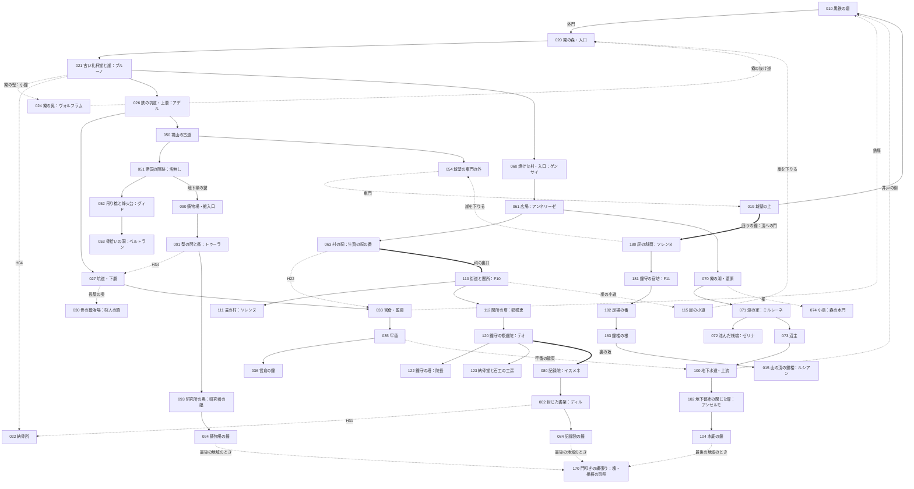

# 世界設計書 — 最後の鐘（仮題、D10）

W・P・V レーンがこのファイルを見て、新しい世界の拠点・ダンジョン・勢力・仲間・生き残り・鐘・結末を作るための設計書。
持ち主が世界観を**全部作り直す**と決めた（2026-10-12、#127）。前の世界「灰の王国」の設計は控えとして [docs/old/](old/) に移した。
筋は 2026-10-12 に持ち主と配り役が何度か決め直した。今の芯は次の三つ。
**物語の中心は「世界に何が起きたか」**で、たくさんの勢力と人の思惑が絡み、一つの真実を語る者はいない。**主人公の正体（人の味方をした使徒）はその中の一本の糸**。**誰も正体を指さして話さない**。

マップの作り方は [docs/mapdesign.md](mapdesign.md)、ID の帯は [docs/ROADMAP.md](ROADMAP.md)、データの形は [docs/mz-data.md](mz-data.md)、文の書き方は [docs/knowhow.md](knowhow.md)（決まりはそのまま。例は前の世界のもの）。

- 世界の手触りは、持ち主の別の作品 Morsveld の世界観を**参考にしただけ**で、改変してよい（持ち主の決め）。国・町・使徒の名前と出来事は新しく作った。人物は Morsveld の人物の**名前と絵を借りる**程度で、性格・口調・経歴はこの世界の立場に合わせて自由に変えた。絵は Morsveld の素材集でも MZ 同梱の素材でもよい（[6 章](#6-仲間)・[7 章](#7-生き残りと今の勢力)）。
- 手本（Fanastasis・ダークソウルの手触り）の遊びの構造と語り方は取り入れる。固有名詞・台詞・地名・人物は使っていない。
- 名前・題・細部は推しで書いた。決定待ちは [12 章](#12-決定待ち) と `needs-decision` の issue #129。
- **D14（#168、2026-10-12）で遊ぶ時間をいったん約 15 時間（本筋 8・寄り道 5・終盤 2）に組み直した**（持ち主の決め。理由は「テストが大変なので」）。鐘は四つのまま。鐘の無い地域五（麦の街道と鐘守の修道院）を記録院の鐘の道の途中に挟み、門叩きの縄張りを一つのダンジョンにし、境山の高み（終盤）を四つの鐘のあとに置いた。仲間 7 人・生き残り 7 人のまま、頼みごと 8 本。配分表は [5.7](#57-遊ぶ時間の配分表)（D18 で約 10 時間を正とした）、40 時間へ広げる余地は [5.9](#59-40-時間へ広げる余地)、確かめる手間を減らす作りは [5.10](#510-確かめる手間を減らす作り)。今あるマップ（W6〜W10）は作り直さない。
- 段階の印〔知〕〔噂〕〔進〕〔秘〕の意味は [knowhow.md 2.1](knowhow.md#21-設定の段階の印)。禁止語は [10 章](#10-禁止語の表)、口調は [11 章](#11-口調の表)。
- **原作（小説）を書いて、ゲームに載せた（2026-10-13）**：原作コンペ N1（#198）→ 骨子の決定版 N2（#209。[docs/story/original.md](story/original.md)）→ 小説 N3（#212。[docs/story/novel/](story/novel/)）→ 場面表 N4（#225。[docs/story/scenes/](story/scenes/)）→ 仕掛け P14（#230）と実装 W15〜W17・W14（#231〜#234）。この設計書との違いは、骨子の「破った決まり」（original.md 8.3）と場面表の章末 2 の行を D17（#244）でここに写した（印「N4」）。**文の正は場面表**、設定の正はこのファイル。
- **持ち主の決め（2026-10-13。小説の編集者の講評 `docs/story/reviews/novel-editor.md` への答え。4 件とも推し）**：ノラの妹はイーダ（6.4）。ゼリナは生き残りの側の「先に盛る席」に座り、ミルレーネは食卓に座らず炉の脇の石に座る（4.5）。伏せた椀は三つ目の鐘の夜から毎晩盛られ、結末の夜、ルカはその前に座る（4.5・9.3）。結末の朝の子は「麦の村から来た子ども」で、誰の孫かは書かない（9.3）。夜の戸の言い残し 4 件はすべて頂の三十で浮かび、テオの三通り目は修道院に場面を一つ足す（9.4・7.3）。

### 持ち主が決めたこと（変えない）
| 項目 | 決めたこと |
|---|---|
| 雰囲気 | もの悲しいが温かい |
| 語り方 | 目的ははっきり、真相は断片。アイテムの配置と説明文・碑文・日記・墓標で少しずつ。**単純に真実が分からないようにする**（Fanastasis・ダークソウルの手触り） |
| 物語の中心 | **世界に何が起きたか。** 様々な勢力・様々な人の思惑が絡み合う。「他の人間は何をしていたの」とならない。人類は使徒に対抗するため様々な方法を試し、禁忌にも手を出した |
| 書き方の大原則 | 人も文書も思念も、**自分の暮らし・自分の思惑・自分の後悔**のことだけを話す・書く。主人公の正体や謎を指さす台詞・文は書かない |
| 始まり | 目覚めると、荒れ果てた終わった世界。主人公は何も分からないまま冒険する。**案内役はいない** |
| 目的 | 各地域にある **4 つの鐘を鳴らして、山の頂の鐘楼へ行く**。目的は序盤で分かる |
| 残留思念 | 各地に、無念のまま死んだ人の残留思念がある。並べると、物語の輪郭がなんとなく分かる |
| 仲間 | 残留思念のうち**意志の強いもの**が、仲間として一緒に冒険する。**仲間は墓守を知らない**見知らぬ死者で、いろいろな勢力の当事者 |
| 主人公の正体 | **使徒で、人間の味方をしていた**。衝撃的で、しかも納得がいくこと。物語の主題ではなく、一本の糸 |
| 主人公の力 | 鐘の力とは関係ない。残留思念を見られる・仲間にできるのが、使徒に由来する力 |
| 正体を知らない者 | プレイヤーと主人公だけ。真実が分かったあと、**誰も主人公を非難しない** |
| 正体が分かる時 | **3 つ目の鐘のあと**。誰かの説明ではなく、主人公自身の記憶の場面で分かる。分かったあとも山場と謎が続く |
| 結末 | 目的を果たして**静かな希望**。しんみり、少し救い。主人公が失うのは**仲間との別れだけ**（生きて朝を迎える） |
| 世界 | 終わってしまった世界。約 200 年前、使徒によって終わった |
| 人物 | Morsveld の人物をスターシステムで使う。参考の設定は改変してよく、性格・口調も変えてよい（名前と絵を借りる程度）。絵は MZ 同梱の素材も使ってよい |
| 骨組み | 拠点＋ダンジョン巡り・仲間を呼ぶ。シンボル敵・隠し通路・施設・合成・来歴・召喚・ボスの仕組みは使い回す |

### 前の世界から変わらない前提
- 画面 1280×720、1 マス 48px（横 26.7 × 縦 15 マス）。壁の側面は 2 マスで、**部屋の縦は「床の行数＋2」**。部屋の大きさは床の広さで書く。
- マップは仕上げ後は JSON が正本。持ち主がエディタで仕上げたら、以後はイベントだけを直す。
- 敵の色（緑・黄・赤）、赤は必ず迂回路がある・持ち場から出ない、入口から追い始める距離＋2 マス以上離す（型は [mapdesign.md 7 章](mapdesign.md#7-敵の置き方の型)）。

---

## 1. 世界と年表

### 1.1 骨子（10 行）
1. ここは**終わったあとの世界**。約 200 年前の「**二度目の夜**」に、使徒がいっせいに境山を越え、三つの国は一夜で終わった。〔知〕
2. 昔、人は古言の銘で**鐘**を鋳た。鐘の鳴る所に使徒は入らない（人と使徒の取り決め）。四つの地域の鐘と、山の頂の**親鐘**。〔知〕（鐘の鳴る所に使徒は来ない）〔進〕（取り決めと親鐘）
3. 取り決めは代を重ねて弱り、鐘の届く範囲は年ごとに狭まった。夜の前の数十年（**黄昏の時代**）、人は生き延びるために、あらゆる手を試した。騎士・古言兵・禁忌の研究・地下への避難・生贄・使徒狩り。〔噂〕〜〔進〕（[2 章](#2-勢力と思惑)）
4. 二度目の夜は**一つの原因では起きていない**。教会の鐘の彫り直し、帝国の古言、王国の撤兵、エルフの沈黙、記録院の写し、灰の信徒の手引き、使徒の思惑が重なった。どれが決め手だったかは**最後まで分からない**。〔秘〕（決め手）
5. 各勢力の文書は自分に都合よく書かれ、互いに食い違う。プレイヤーは並べて考える。〔噂〕〜〔進〕
6. 今も、それぞれの勢力の残りと子孫が、それぞれの思惑で動いている。鐘を鳴らしたい者、鳴らさせたくない者、鐘で何か別のことをしたい者。〔知〕〜〔進〕（[7 章](#7-生き残りと今の勢力)）
7. 主人公は、黒鉄の砦の**墓守**だった。目を覚ますと記憶が無く、死んだ人の残留思念が見える。墓所の壁の書き付け「**四つの鐘を鳴らして。それから、山の頂の鐘楼へ**」に従って歩き出す。〔知〕
8. 意志の強い思念は**仲間**として一緒に歩く。仲間は旅の途中で出会う見知らぬ死者で、黄昏の時代のいろいろな勢力の当事者。墓守のことは知らない。〔知〕
9. 墓守の記憶は、各地の**会話できない薄い思念**（墓守を知っていた砦の人）を見るたびに少しずつ戻る。3 つ目の鐘のあと、戻ってきた記憶の中で、主人公は自分のしたことを見る。墓守は**死者の思いを取り込む使徒**で、取り込んだ思いを喰わずに生きている人へ届けていた。二度目の夜、喰わないために自分の記憶を死んでいく砦の人たちに預けて眠った。〔進：3 つ目の鐘〕
10. 頂の親鐘を鳴らすと、灰が止む。仲間は思いを届けて去る。主人公は名前を取り戻して朝を迎える。何が決め手だったのかは、誰にも分からないまま。〔進：015〕

### 1.2 昔の大陸（旧暦の時代）
旧暦は「一度目の夜」（使徒が初めて現れた夜）を元年に数えた暦。今の人は旧暦をほとんど使わない。

| 項目 | 中身 | 段階 |
|---|---|---|
| 三つの国 | 西の**アルメリア王国**（麦と川。人が多く、黄昏の時代は飢えていた）、北の**グラーデン帝国**（雪と鉄。軍が強い）、東寄りの**エリンデ共和国**（森と湖。エルフが多い）。名は墓標・碑文・古い札で出る | 〔知〕国があったこと／〔噂〕名 |
| 種族 | 人間・エルフ・獣人。エルフは長命で、200 年前を覚えている者がまだいる | 〔知〕 |
| 使徒 | 人の言葉を解する化け物（1.4） | 〔知〕 |
| 境山（さかいやま） | 人の地の東の端の山並み。向こう側が使徒の地。いちばん高い頂に**鐘楼**と**親鐘** | 〔知〕 |
| 鐘 | 人が古言の銘で鋳た鐘。**鳴る所に使徒は入らない**。四つの地域に一つずつ（**営倉の鐘・記録院の鐘・水底の鐘・鋳物場の鐘**）と、頂の**親鐘**。夕べに、親鐘に合わせて四つが鳴った | 〔知〕鐘で使徒が来ない／〔噂〕なぜ効くか（「神の音」「取り決め」「鉄の音を嫌う」と勢力ごとに違う） |
| 取り決め | 一度目の夜のあと、人と使徒が古言で結んだ約束。銘に刻まれている。「鐘の鳴る所へは入らない。内から戸を開けた所はこの限りでない」。全文は誰も持っていない（写しはどれも欠けている） | 〔噂〕〜〔進：084〕 |
| 黒鉄の砦 | 境山を越える唯一の道を塞ぐ、人の最前線。頂の鐘楼へ上る道の麓。三国の兵の寄り合いの騎士団が守った | 〔知〕 |
| 墓守 | 砦の墓所の番と弔いをする役。死んだ人の言い残しを家族に届けた | 〔知〕墓守がいた／〔噂〕「墓守さまは死んだ人の声を聞く」 |
| 夕べの数 | 夕べの鐘を三十まで数える祈り。指で鐘の形を切る | 〔知〕 |
| 古言（ふること） | 口にした通りに、物ごとを一つだけ動かす古い言葉。使うたびに、話した者から何かが欠ける（名・記憶・顔・影・声）。教会は禁じ、帝国は兵器にし、記録院は消そうとした。文には片仮名の短い音で出し、訳を付けない | 〔噂〕〜〔進〕 |

### 1.3 年表
| いつ | できごと | どこで断片が分かるか | 段階 |
|---|---|---|---|
| 旧暦 元年 | 一度目の夜。使徒が現れ、古い国が潰れる | 礼拝堂の碑文（021） | 〔知〕 |
| 旧暦 数十年 | 人と使徒が古言で取り決めを結ぶ。エルフの「取り決めの歌」を元に銘を作り、頂の親鐘と四つの鐘を鋳る | 記録院の古い記録（081）、エルフの歌（071） | 〔知〕鐘を鋳た／〔進〕取り決めと歌 |
| 旧暦 数百年 | 三つの国。黒鉄の砦。砦の墓所に墓守が居つく（墓守の帳面の字は、何代たっても同じ手） | 墓守の帳面（022） | 〔知〕／〔進〕帳面の字 |
| 夜の前の約 60 年〜 | **黄昏の時代**。鐘の届く範囲が年ごとに狭まる。境で使徒の連れが増える。人はあらゆる手を試す（[2.2](#22-黄昏の時代人類の対抗策)） | 各地のダンジョン | 〔噂〕〜〔進〕 |
| 夜の前の数年 | 教会が「鐘の境を東へ広げる」ため、四つの鐘と親鐘の銘を彫り直す計画を立てる。王国が金を出す。帝国は古言を大量に使い、墓守を調べる。記録院は銘の写しを教会に渡す（本物か偽物かは食い違う）。エルフは調律師を国へ呼び戻す | 2.3 の各勢力の文書 | 〔進〕（言い分ごとに） |
| 二度目の夜 | 教会が親鐘の舌を下ろし、一晩だけ鐘を黙らせて彫り直しを始める。王国の兵は前の日に砦を引き上げている。灰の信徒が門叩きの「入れておくれ」に答えて砦の門を開ける。使徒がいっせいに境山を越える。彫り直しは半ばで止まり、鐘は鳴らなくなる | 四つの札、各勢力の文書、思念 | 〔噂〕同じ夜に黙った／〔進〕それぞれの言い分／〔秘〕決め手 |
| 同じ夜 | 砦の人の多くが死ぬ。墓守は死んでいく人の思いに囲まれ、自分の記憶を死んでいく砦の人たちに預けて墓所で眠る。墓守の相棒の司祭が墓所の壁に書き付けを彫り、途中で喰われる | 薄い思念（6.5）、3 つ目の鐘のあとの場面 | 〔進〕 |
| 夜のあと | 三つの国は終わる。生き残りは灰と霧のあいだに散る。王国の一部は地下都市へ逃げ、扉を閉める。人々は「鐘喰い」が鐘を食べたと言う | 集落の人の話、地下都市（100–104） | 〔知〕〔噂〕 |
| 夜から数えて約 200 年 | 今。主人公は墓所で目を覚ます | 目覚め（010） | 〔知〕 |

- 今の人の暦は「**夜から数えて**」。墓標や札の年はこの数え方。旧暦の年は古い墓標だけに出る。

### 1.4 使徒（この世界の型）
- **人の言葉を解する化け物**。誰もが「使徒」と呼び、土地の呼び名を添える。名（古い刻印の読み）は碑文と記録院の写しにだけ出る。〔知〕呼び名／〔進〕名
- **縄張りを持ち、互いの縄張りに入らない。** 縄張りの中は霧や灰が濃く、人は長くいられない。使徒は使徒の縄張りを歩ける。〔知〕人は縄張りに入れない
- 自分から動く理由は、それぞれの性分だけ。筋のために動かさない。人は正面からは勝てない（格三。[knowhow.md 2.3](knowhow.md#23-敵や大きな存在の格)）。**使徒とは戦わない。**

| 呼び名／名 | 姿と性分 | 縄張り・出る所 | 人との関わり | 段階 |
|---|---|---|---|---|
| **門叩き**（喰い手）／ヴァルナ | 死者の思いを取り込み、喰う型の使徒。喰った死者の声で話す。夜、戸を三度叩き、身内の声で「入れておくれ」と言う。内から開けられた所にだけ入れる | 3 つ目の鐘のあと、最後に残った地域に縄張りを広げる。縄張りは一つのダンジョン（170–173。[3.7](#37-最後の地域の山場)） | 灰の信徒と通じていた。大きな死を喰いたい。墓守を「同胞」と呼ぶ | 〔知〕門叩きと夜の戸の習い／〔進〕喰うこと・信徒とのつながり |
| **霧の羊飼い**／ウルメ | 霧そのもの。霧で迷った者を群れに入れて連れて歩く | 森（020–025）と湖（070–074）の霧 | エルフが森を閉じたとき、霧の縁を借りた | 〔知〕霧に入るな |
| **灰の母**／セナルカ | 境山の向こうに横たわる大きな女の形と言われる。息をすると灰が降る | 境山の向こう。終盤の灰の斜面（180）は息のかかる所で、灰が降り続ける | 灰の信徒の拝む相手 | 〔知〕灰は東から来る／〔噂〕女の形 |
| **骨拾い**／ネムト | 痩せた鳥の頭の長い姿。死者の骨を拾って塔に積む。誰とでも取り引きする | 境山の古道（053 の洞） | 帝国に使徒の骨と知識を、教会に銘の古い形を、信徒に夜の時を売った。今も誰とでも取り引きする | 〔噂〕骨を返してくれる化け物／〔進〕取り引きの帳面 |
| （**鐘喰い**） | 鐘を食べたと言われる使徒。**いない**（人が鐘の沈黙に付けた説明） | ― | 鐘喰いの護符 | 〔噂〕いる／〔秘〕いない |

- 敵（ふつうの化け物）の多くは、黄昏の時代の試みの**成れの果て**（名無し兵・失敗作・狩人・鐘の騎士の亡骸・外に残された者）。そうとは書かず、装備の来歴や思念で察させる（[2.2](#22-黄昏の時代人類の対抗策)）。

### 1.5 答えを書かない所
最後まで、どこにも答えを書かない（〔秘〕。書き手も決めない）。
- 二度目の夜の決め手はどれか。
- 彫り直しの日を決めたのは誰か（教会か、王国の金か、骨拾いが売った「古い形」か）。
- 記録院が教会に渡した写しは偽物だったか。偽物なら、わざとか。
- エルフは夜が来ることを知っていたか。
- 騎士長が墓守を帝国に渡さなかったのは、友情か計算か。
- 灰の信徒は門を開けたことを、救いと思っていたか。
- 教会は「一晩のみ」で済まないと知っていたか（石工は三晩分の木を運んだ。D14）。
- 王家の金は、飢えの嘆願より前に着いていたか（議事録の印の墨は新しい。D14）。

### 1.6 今の暮らし
- 集落は 20〜40 人ほど。井戸と畑と、夜に灯す灯。**夜の戸に答えない**（門叩きの習い）。〔知〕
- 通貨は**鉄くず**（`Hai_Defeat` が落とす所持金。古い釘・蝶番・鎧の板。重さで量る）。〔知〕
- 祈りは「夕べの数」。鐘を知らない子もする。〔知〕
- 言い習わし「**墓守さまに言い残す**」：死ぬ前の言葉を墓に向かって言うと、いつか家族に届く。〔知〕
- 集落によって、拝むものが違う：夕べの会の鐘の祈り、灰の信徒の灰の祈り、何も拝まない拾い屋。〔知〕
- 今の人は自分の暮らしのことしか話さない。世界の説明をする人はいない（[knowhow.md 2.2](knowhow.md#22-説明役に語らせない)）。

### 1.7 使徒の由来と、壊れていく仕組み〔秘〕（D28。持ち主の決め 2026-10-15）
持ち主の別の作品 Morsveld の世界観（`nakaba9696/trpg-game` の docs/lore/gods.md・immortal.md。D11）を、この世界の底に取り入れた。**この節の中身はすべて〔秘〕**：プレイヤーに見える文に言葉として書かない（禁止語は [10 章](#10-禁止語の表)）。書き手が筋を通すための拠り所で、見える文では手触りで感じさせるだけ。1.1〜1.6 の〔知〕〔噂〕〔進〕は変えない（住人と各勢力が信じていることは、そのまま）。

| 項目 | 住人と各勢力が信じていること | 本当のこと〔秘〕 |
|---|---|---|
| 使徒 | 人の言葉を解する化け物。一度目の夜に現れた | **文明が異常に発達した人間たち（設計書の上の呼び名は「創造主」）が、互いの争いの兵器として作ったもの。** 作り手は一体ずつ違い、使徒どうしは仲間でも同じ陣営でもない。人の言葉を解するのは、兵器としてそう作られたから |
| 一度目の夜（旧暦元年） | 使徒が現れ、古い国が潰れた夜 | **最後の創造主が死んだ夜。** 主を失った使徒が誰の配下でもなく散った（人から見れば「現れた」）。誰が最後の一人を殺したかは書かない（書き手も決めない） |
| 創造主 | 誰も知らない | **全員死んでいる。** 名は誰も知らない。何人いたか・何を争ったか・なぜこの土地を作ったかは書かない（余白）。古い断片に出るとしても「あるじ」「上の方々」のような呼び方だけで、今の人には何のことか分からない |
| 神 | 鐘の教会は鐘を「神の音」と呼び、夜を「神の怒り」と書く。夕べの数は神への祈り | **神は最初からいない。** 人が創造主を忘れたあとに作った信仰。祈りがたまに応えるように見えるのは、残った仕組みに引っかかるから。神を登場させない。「神はいない」と人に言わせない |
| 古言 | 口にした通りに物ごとを一つ動かす古い言葉。使うたびに話した者から何かが欠ける | **創造主が世界と兵器に命じた言葉の切れ端。** だから銘に刻むと使徒に効く。欠けるのは、創造主でない者が使うと仕組みが代わりに何かを取り立てるから（理屈は書かない） |
| 鐘と取り決め | 人と使徒が古言で結んだ約束。鐘の鳴る所に使徒は入らない | 使徒が取り決めを守るのは、**兵器としての言いつけ（古言）に逆らえない作りだから**。人は自分たちが「結んだ」と思っている。「内から戸を開けた所はこの限りでない」の一行も、言いつけの抜け道（門叩きの「入れておくれ」） |
| 取り決めが弱る | 代を重ねて弱った（勢力ごとに理由が違う） | **作り手のいない仕組みが、少しずつ壊れていくから**（下の「終わっていく世界」）。二度目の夜の決め手（1.5）はこれとは別で、最後まで分からないまま。「仕組みが壊れたせい」と決め手を一つにしない |
| 主人公（墓守） | （3 つ目の鐘のあとで）死者の思いを取り込む使徒で、人の味方をした | 墓守も門叩きも、**死者の思いを取り込む同じ型の兵器**（門叩きの「同胞」の呼びかけはここから。〔進〕の範囲で見せるのは「同胞」まで）。墓守は喰わずに届けることを選んだ。作り手の言いつけより、人の言い残しを選んだ、とは書かない |

#### 使徒の不死（一体ずつ違う）〔秘〕
- 兵器として、殺されないように作られている。**不死は一体ずつ違い、共通の不死は無い。** 人が使徒に正面から勝てない（1.4・格三）のは、これが底にある。
- この世界の遊びでは**使徒とは戦わない**（1.4）ので、不死を破る仕組みは作らない。見える文では「斬っても戻った」「討ったはずが、翌年また戸を叩いた」のような噂と、思念の一行で感じさせるだけ。
- 一体ずつの不死（推し。見える文に書かない。手触りの置き場所の拠り所）：

| 使徒 | 不死の型 | 手触り（見える文で出してよい形） |
|---|---|---|
| 門叩き（ヴァルナ） | 喰った声が一つでも残る限り、その声から戻る | 「焼いたのに、翌晩は別の声で叩いた」（狩人・使徒狩りの記録）。172 の思いの塊は、喰われた声の集まり |
| 霧の羊飼い（ウルメ） | 体が霧そのもので、斬るものが無い | 「刃が濡れただけだった」 |
| 灰の母（セナルカ） | 大きすぎて人の刃の長さが足りない | 「境山の向こうの山並みが、息をした」。親鐘が鳴ると灰が止む（9 章）のは、古言の言いつけが届くから |
| 骨拾い（ネムト） | 自分の骨を、積んだ骨の塔のどれかに混ぜてある。塔が残る限り死なない | 「骨の塔を崩した者は、次の朝、自分の骨を一本返された」 |
| 墓守（主人公） | 預けた思い（記憶）が誰かの中に残る限り、目を覚ます | 全滅しても炉の前で目を開ける（`Hai_Defeat`）。二百年眠って起きた。理由は書かない |

#### 終わっていく世界（手触りだけ）〔秘〕
- 創造主は全員死に、作り手も直し手もいない。**この世界は、二度目の夜で終わったあとも、少しずつ壊れ続けている。** 住人は知らない。
- 見える文では一つの場面に一つまで、噂・愚痴・記録の食い違いとして：鐘の届く範囲が年ごとに狭まった（1.1 の 3）／灰の降る所が少しずつ西へ寄る／古言の欠け方が昔よりひどい（記録院）／夕べの数を数えると三十に一つ足りない日がある／帳面の頁の抜けた一生が増えた（墓守の帳面）。
- 「世界が滅びる」「終わっていく」と人に言わせない（言うとしても、酔った拾い屋の大げさな嘆きか、灰の信徒の経典の一行として）。親鐘を鳴らしたあとの「静かな希望」（結末）は変えない：灰は止むが、壊れていくことそのものが止んだとは書かない。

#### わざと残す余白（1.5 に足す）
誰が最後の創造主を殺したか／創造主は何人いて、何を争ったか／墓守と門叩きを作ったのは同じ者か／取り決めの言いつけを最初に鐘へ刻ませたのは誰か。

---

## 2. 勢力と思惑

### 2.1 200 年前の勢力
どの勢力にも正しさと後ろ暗さがある。どの勢力の文書も、自分に都合よく書かれている。

| 勢力 | 望み | 黄昏の時代にしたこと | 二度目の夜への関わり（言い分） | 残した物 | 段階 |
|---|---|---|---|---|---|
| **鐘の教会** | 鐘を「神の音」として人をまとめる。西の飢えを救うため、鐘の境を東へ広げたい | 鐘の騎士団 | 四つの鐘と親鐘の銘を彫り直す計画。一晩だけ鐘を黙らせる必要があった。「一晩なら使徒は気づかない」。教会の記録は「帝国の古言に神罰が下った夜」と書く | 彫り直しの指図書、頂の足場、親鐘の舌の運び出しの札 | 〔噂〕〜〔進〕 |
| **グラーデン帝国** | 古言を兵器にする。使徒を捕らえて使う | 古言兵（名無し兵）、人造使徒の研究 | 古言を大量に使い、取り決めを弱らせた。研究のなかで「年を取らない墓守」を掴み、捕らえようとしていた。帝国の文書は「教会の彫り直しが原因」と書く | 研究所の観察記録、名無し兵の手紙 | 〔進〕 |
| **アルメリア王国** | 飢えた民を食わせる。東の土地 | 地下への避難 | 教会の計画に金を出した。夜の前の日、戦の準備で兵を砦から引き上げた。王の布告は「民を地下へ守った」とだけ書く | 地下都市、閉じた扉、王の布告 | 〔噂〕〜〔進〕 |
| **エリンデのエルフ** | 取り決めの歌（銘の元）を守る。人を信じていない | 森を閉じる | 彫り直しを知り、危ないと分かって調律師を国へ呼び戻した。人に警告しなかった。エルフの歌は「人が取り決めを破った」と歌う | 森の閉じた門、取り決めの歌 | 〔進〕 |
| **記録院** | 古言の代償を知り、古言そのものを消したい | 真名の研究（禁忌） | 銘の写しを隠し、教会に別の写しを渡した。彫り直しが半端になった一因かもしれない（写しが偽物だったかは食い違う） | 封じた書架、二通りの写し | 〔進〕 |
| **灰の信徒** | 使徒に喰われること＝苦しみの終わり | 生贄の取り引き | 門叩きと通じていた。鐘が黙る夜を知り、砦の門で「入れておくれ」に答えて門を開けた。信徒の経典は「大いなる安らぎの夜」と書く | 経典、生贄の村 | 〔進〕 |
| **黒鉄の砦（騎士団）** | 前線を守る。三国の兵の寄り合い | 方舟（舟）・坑道の避難 | 教会・帝国・王国から食い違う命令を受け続けた。騎士長は帝国の使いに墓守を渡さなかった（理由は書いていない） | 騎士長の日誌、命令書の束 | 〔進〕 |
| **使徒：門叩き** | 大きな死を喰う。墓守を「こちら側」に戻す | ― | 信徒を使って時を合わせた | 喰われた思いの塊 | 〔進〕 |
| **使徒：骨拾い** | 骨を集める。誰とでも取り引きする | ― | 帝国に使徒の骨と知識を、教会に銘の古い形を、信徒に夜の時を売った。誰の味方でもない | 取り引きの帳面（053） | 〔進〕 |

### 2.2 黄昏の時代：人類の対抗策
取り決めは弱っていた。二度目の夜は突然ではなく、数十年の負け戦の終わり。この焦りが、どの勢力にも無理をさせた。
どの試みにもドラマと後ろ暗さがあり、当事者の言い分は食い違う。**今の敵の多くは、その成れの果て**（そうとは書かない）。

| 試み | 誰が | 中身 | 今に残るもの（地域・ダンジョン） |
|---|---|---|---|
| **鐘の騎士団** | 教会 | 小さな鐘を身に付けて境を守る騎士。鐘が弱るにつれ、境で死んでいった | 霧の森と礼拝堂（020–022）：鐘の付いた鎧の亡骸、最後の行軍の思念。敵「鐘鳴りの亡骸」 |
| **使徒狩り** | 傭兵団 | 使徒の連れを狩り、使徒の骨で武器を作る。強くなるほど人でなくなる | 鉄の坑道（026–029）：骨を鍛えた鍛冶場の跡、使徒の骨の武器（装備）。敵「狩人の成れの果て」 |
| **営倉の信徒** | 騎士団 | 捕らえた灰の信徒を営倉に入れていた。夜、その一人が門を開けた | 砦の営倉（033–036）：信徒の囚人の思念、牢番の日誌 |
| **生贄の取り引き** | 信徒の村 | 使徒に人を差し出して村を見逃してもらう。村は長く生き延びた | 焼けた村（060–064）：生贄に選ばれた娘と、止めようとした使徒狩りの話。祠の帳面 |
| **真名の研究（禁忌）** | 記録院 | 使徒の真名を知れば縛れる、という説。読み解いた学者は狂った | 記録院（080–084）：封じた書架、狂った学者の思念、二通りの写し |
| **方舟** | 砦の酒保ゼリナほか | 湖を渡る舟。誰を乗せるかで揉めた | 霧の湖（070–074）：沈んだ桟橋、乗れなかった者の思念 |
| **森を閉じる** | エルフ | 歌で森の境を閉じ、人を入れなくした。外に残された同胞もいた（ミルレーネの家族も） | 霧の湖の奥・霧の森の縁：閉じた門、外に残されたエルフの思念 |
| **地下への避難** | 王国 | 民を地下水道の先の地下都市へ。扉を閉めた日、外に残された民がいた | 地下水道と地下都市（100–105）：閉めた扉、王の言い分と外に残された者の思念。敵「扉の外の者」 |
| **古言兵（名無し兵）** | 帝国 | 古言を戦場で使う兵。使うたびに名・記憶・顔を払い、最後は誰でもなくなる | 境山の古道（050–054）：名を失った兵の成れの果て（敵「名無し」）、恋人の名を忘れた兵の手紙 |
| **人造使徒の研究（禁忌）** | 帝国の研究所 | 使徒の骨や肉（骨拾いから買った）を人に移し、使徒に対抗できる者を作る。ほとんどが失敗 | 古い鋳物場の奥の研究所（090–094）：失敗作の化け物（敵）、研究者の娘が被験者だった話（ボス「研究者の娘」）、観察記録 |
| **関所と飢えの列**（D14） | 王国 | 飢えの年、西から押し寄せた民を関所で止め、麦を一握りずつ取り立てた。「東の土地」への望みの始まり | 麦の街道と関所（110–114）：捨てた荷、通行の札、収税吏。敵「飢えの列」 |
| **鐘の境を東へ広げる会議**（D14） | 教会（王国の金） | 修道院で「西の飢えを救うため、鐘の境を東へ広げる」と決めた。反対した修道士がいた。石工の隊が頂へ発った | 鐘守の修道院（120–124）：議事録、嘆願書、金の箱の跡、石工の工房（石工の頭の思念）。敵「鐘守の亡骸」 |
| **彫り直しの隊の宿坊**（D14） | 教会 | 彫り直しの隊が頂の手前の宿坊に泊まった最後の夜。「一晩のみ」の指図と、三晩分の木 | 境山の高み（180–183）：宿帳、氷室の橇、足場の番。敵「石工の亡骸」 |
| **鐘の彫り直し** | 教会 | 銘を彫り直して境を東へ広げる | 山の頂（015）：彫りかけの足場、半分だけ新しい銘 |

### 2.3 同じ夜を、それぞれがどう書いたか
同じ出来事を、勢力ごとに違う文書・碑文・思念で見せる。**どれも一部は本当で、一部は都合よく書いてある。**
| 書いた者 | 物 | 二度目の夜の書き方 | 置く所 |
|---|---|---|---|
| 教会 | 夕べの会に伝わる祈祷書 | 「帝国の古言に、神の怒りが下った夜」 | 021 礼拝堂、夕べの会の集落 |
| 帝国 | 研究所の報告の写し | 「教会の彫り直しにより境が消滅。研究は継続」 | 093 研究所 |
| 王国 | 王の布告 | 「民を地下に守った。扉は神の御心により閉じた」 | 100 地下都市の門 |
| エルフ | 取り決めの歌 | 「人が約束を破り、鐘は黙った」 | 071 ミルレーネの家（歌うのは彼女だけ） |
| 記録院 | 学者の手記 | 「写しを渡した。あれで良かったのか」 | 082 封じた書架 |
| 灰の信徒 | 経典 | 「大いなる安らぎの夜。門は内から開かれた」 | 063 村の祠、今の信徒の集落 |
| 騎士団 | 騎士長の日誌 | 「命令が三つ、互いに食い違う。兵は昨日、半分いなくなった」 | 102 地下水道の深み |
| 骨拾い | 取り引きの帳面 | 日付と、売った物と、相手だけ。感想は無い | 053 骨拾いの洞（取り引きで読める） |
| 教会の修道院（D14） | 会議の議事録 | 「西の飢えを救うため、境を東へ」。夜のことは書いていない（会議は夜の前） | 121 修道院の写本室 |
| 彫り直しの隊（D14） | 宿帳 | 最後の夜の頁は一晩分だけ。「夜明けまでに戻る」 | 181 鐘守の宿坊 |

---

## 3. 主人公

### 3.1 主人公
| 項目 | 内容 |
|---|---|
| 名前 | **ルカ**（推し。性別を決めない名）。名前の欄は最初から「墓守」（薄い思念と墓所の言い伝えの呼び名）。仲間は初対面なので「あなた」「あんた」と呼ぶ。名前は最後の地域で、相棒の司祭の薄い思念が返す（3.7）。そのとき名前の変更（320）で「ルカ」にする |
| 性別 | 決めない（推し）。台詞で一人称を使わない。見た目は持ち主が素材から選ぶ |
| 肩書き | 墓守（`Actors.json` の `nickname`） |
| 正体 | 死者の思いを取り込む型の使徒。喰わずに、生きている人へ届けた。人の姿で砦の墓守をしていた。〔進：3 つ目の鐘〕 |
| 力 | 残留思念が見える・聞ける。意志の強い思念を連れて歩ける。使徒の縄張りを歩ける。**鐘とは関係ない** |
| Actors / Classes | Actors 1 番（持ち主の帯）。職業は今の Classes 10 を「墓守」に読み替える |
| 戦い方の案 | 剣と弔いの技。最後の地域で、**使徒の力**を自分の意志で使えるようになる（取り込んだ思いを力にする。強いが、使うたびに「呑まれ」が溜まり、溜まりきると数ターン操作できない。仲間が呼びかけると戻る。仕組みは P の後の issue） |
| 性格 | 口数が少ない。台詞は一行で、事実か問い。記憶が戻るほど、言うことがはっきりする。感想・教訓は言わせない |

### 3.2 主人公の糸の出し方
主人公の正体は、**物語の主題ではなく、たくさんの糸の一本**。誰も指さして話さない。プレイヤーが、他人の記録に混ざる一行を並べて気づく。
| 混ざる所 | 一行（例） | 段階 |
|---|---|---|
| 帝国の研究所の観察記録（093）の何十行目か | 「黒鉄の砦の墓守。死者と話すとの噂。年を取らない。要観察。」 | 〔進：093〕 |
| 騎士長の日誌（102） | 「墓守を帝国の使いに渡さなかった。理由は書かない。」 | 〔進：102〕 |
| 酒保のつけ帳（072） | 墓守の欄だけ、名前が空白。つけは二百年分の銀三枚 | 〔噂〕 |
| 墓守の帳面（022） | 何代にもわたって同じ手の字 | 〔噂〕 |
| 骨拾いの取り引きの帳面（053） | 「帝国へ。骨三本。問い：年を取らぬ者はいるか。答え：砦に一人」 | 〔進：053〕 |
| 名の壁（010） | 「墓守」の欄だけ、名前が削られては彫り直された跡 | 〔噂〕 |
| 宿坊の宿帳（181。D14） | 砦の鐘守の交代の欄に、墓守の名の所だけ印。印は五冊の帳面と同じ | 〔噂〕 |
| 仕組み | 残留思念が見える。生き残りには見えない（シャノ「誰と話してんの？」） | 〔知〕 |
| 弱い化け物・骨拾い | 化け物が一瞬ためらう（`<hai_enemy_hesitate>`）。骨拾いは頭を深く下げる。理由は言わない | 〔知〕 |

- **書かないこと**：「正体を知っていた」「言えない」「やっと言える」のような、正体を意識させる台詞。仲間は普段どおり、自分の暮らしと後悔の話だけをする。
- 地域が増えても、〔進〕の一行は上の四つ（093・102・053・022 と 010）から増やさない。新しい地域には〔噂〕の一行を一つまで（5.8 の 4）。

### 3.3 失ったもの
| 失ったもの | 今どこにあるか | 戻る時 | 段階 |
|---|---|---|---|
| 記憶 | 二度目の夜に死んだ砦の人たちに分けて預けた。今は各地の**会話できない薄い思念**（[6.5](#65-墓守の記憶のありか会話できない薄い思念)） | 薄い思念を見るたびに一つ。3 つ目の鐘のあとに大きな場面 | 〔知〕記憶がない／〔進：3 つ目の鐘〕預けたこと |
| 名前と最後の記憶 | 相棒の司祭の薄い思念。門叩きに喰われて抱えられている | 最後の地域の山場（3.7） | 〔進〕 |
| （失わないもの） | 思いを見る力、年を取らない体、古言を読む目、縄張りを歩ける体 | ― | 〔進〕 |

### 3.4 目覚めと最初の数分（案内役なし・主人公の台詞なし）
**狙い**：誰にも説明されずに、最初の数分で「ここは崩れた砦」「四つの鐘を鳴らして山の頂へ行く」「まず砦の下と霧の森」「死んだ人の思いが見える」が分かる。

1. **墓所**（010 の西）。画面は黒から始め、棺の並ぶ石の部屋の床で目を開ける。自動で 1 行だけ。
   ```
   床の小さな鈴が、まだ揺れている。
   ```
   扉は開いている。床の灰に、小さな足跡が外へ続く（調べると「灰に、裸足の小さな足跡。外へ駆けていった」）。
2. **最初の残留思念**（墓所の棺の一つ。主人公にだけ見える）。
   ```
   娘の婚礼の歌を、まだ半分しか覚えていない。
   墓守さん、続きを聞いといてくれ。
   ```
3. **墓所の壁の書き付け**。
   ```
   壁に、刃物で刻んだ字がある。
   「四つの鐘を鳴らして。それから、山の頂の鐘楼へ」
   最後の一画が、途中で止まっている。
   ```
   メモに「四つの鐘を鳴らす。それから山の頂の鐘楼へ（墓所の壁）」。**これが目的**。
4. **炉**（大広間）。「火を入れる」で回復と記録（`Hai_Defeat` の戻り先、`Hai_Warp` の拠点の結界）。
5. **シャノ**（最初の生き残り）。炉に火を入れたあと、柱の陰から出てくる。自分の用事だけを話す。
   ```
   シャノ「火、つけたの、あんた？」
   シャノ「おれ、鉄を拾いに来ただけ。鈴、蹴っちゃった。ごめん」
   シャノ「さっき誰と話してたの？　……ま、いいや」
   シャノ「頭に言われてんだ。砦の地下の牢の鐘、外して持ってこいって」
   シャノ「でも鉄の扉が開かない。あと、森の霧で炊き出しの爺さんが三日帰ってない」
   シャノ「おれは霧、だめなんだ。……ここ、ちょっといていい？」
   ```
   主人公は答えない。シャノは大広間に残り、**倉**が開く。メモに「鐘：砦の地下の牢（シャノ）」「炊き出しの爺さん：外の森の霧（シャノ）」。
   （シャノの「頭」は拾い屋のマルゴ。鐘を売るつもりでいる。[7.2](#72-今の勢力と人)）
6. **中庭**から東の空を調べると「雲の上に、塔の影が一つ。山の頂だ」。
7. **外門**の内側に「拳ほどの凹みが三つ。縦に並んでいる」。門の外が霧の森（020）。
8. **営倉への鉄扉**は錆びついて動かない。森から坑道を抜けて営倉へ回り、内側から開けると近道になる。

### 3.5 記憶が戻るたびの一言
薄い思念を見て記憶が一つ戻ったとき、主人公が一行だけ言う。事実か問い。一人称を使わない。
| 戻った数 | 一言 |
|---|---|
| 1 | 「……覚えている。この人の葬式を出した」 |
| 4 | 「墓守の帳面。全部、同じ手だ」 |
| 7 | 名前のところだけ、思い出せない（最後の地域で戻る） |

### 3.6 3 つ目の鐘のあと：自分の記憶の場面
- 3 つ目の鐘を鳴らしたあと、その鐘の間で死んだ人の思念を聞くと、主人公自身の記憶が大きく戻る（誰も説明しない。主人公が自分のしたことを見る）。
- 場面（案。画面を暗くし、文章だけ。地の文の主語は「自分」）：
  鐘が黙る。墓所に、死んでいく人の思いが次々に流れ込む。一つ取り込むたびに、喰いたくなる。喰えば楽になる、と体が知っている。死にかけた砦の人が一人ずつ、墓所に運びこまれてくる。自分は一人に一つずつ、自分の記憶を渡していく。外門の番には一緒に数を数えた夜を、帳場の娘にはつけの帳面の夜を。渡すたびに、喰いたい「自分」が薄くなる。相棒の司祭が壁に何かを彫りはじめる。目を閉じる。
- 場面のあとの主人公の一言：「……喰わないために、預けたのか」。
- **仲間は墓守を知らない**ので、何も変わらない。自分の暮らしと後悔の話を続ける（食堂でゼリナが「舟の金、まだ足りへん夢を見た」と言う。それだけ）。生き残りも変わらない。

### 3.7 最後の地域の山場
- 3 つ目の鐘のあと、門叩きは**まだ鳴っていない最後の地域**に縄張りを広げて待つ（受動の理由：同胞が必ず来る所で待つ。門叩き自身の思惑）。その地域の色調が暗くなり、「声だけの影」の敵が増える。その地域の今の勢力の人も、それぞれの思惑で動く（7.2）。
- **縄張りは一つのダンジョン**（170–173。D14。W11 が作る）。三つの鐘の間の手前（084 の南の控え・094 の手前の間・104 の手前）にそれぞれ霧の戸口があり、最後の地域になった所の戸口だけが開く。中は同じ（声と、塊から漏れる一行と、今の勢力の人の一言だけをその地域の物に替える。[text.md 5.5](text.md#5-地域ごとの文の割り当て)）。山場を三か所に作らずに済み、縄張りの中を一つのダンジョンとして歩ける（本筋 1.2 時間）。
- 縄張りの縁（170）で、門叩きが主人公を誘う（姿は見せない。死者の声を次々に替えて話す）。門叩きは自分の望みだけを話す。
  ```
  同胞よ。拾ったものは、喰うものだ。
  あの夜は、よく喰えた。お前の分も残しておいた。
  ```
- **門叩きが抱えた思いの塊**（ボス）。主人公は初めて**使徒の力**を自分の意志で使う。呑まれが溜まると、仲間が旅の中で使ってきた呼び方で呼びかけて戻す（ブルーノ「あなた！」、ノラ「あんた！」、トゥーラ「兄貴！」。11 章の呼び方のまま）。
- 塊を崩すと、**喰われていた相棒の司祭の薄い思念**が解き放たれる。会話はできない。短い場面だけが見える（司祭の目から。墓所で眠っている墓守の前で壁に書き付けを彫り、戸が三度叩かれ、墓守の声が司祭の名を呼ぶ。**司祭は戸を見ず、眠っている方へ向き直る**）。そのあと、司祭の思念は**名前と最後の記憶**を返す。仲間には加わらない。消えずに、頂の三十のあとで手ぶらで綱のそばに立つ（9.2。口は動かない）。〔進〕（N4。骨子 8.3「破った決まり」）
  ```
  手を止めた。戸は見ない。
  眠っている方へ、向き直る。
  「ルカ」
  ```
  （名前の欄をここで「ルカ」にする。「ルカ」の前に BGM・BGS を止め、無音のまま画面を戻す。主人公の一言は置かない。司祭の名は墓標にだけ出る。文は場面表 `04-climax.md` 3.6）
- 縁（170）の門叩きの声は、名前なしで声ごとに窓を分け、最後に相棒の声「呼んでやろうか。／……三十一。お前は、いつも一つ多い。」を足す（N4。三つの戸口のどれでも同じ）。
- そのあと、入った戸口から鐘の間へ戻り、その地域の鐘を鳴らす（4 つ目）。門叩きは退くが、倒れない（使徒とは戦わない）。四つ目が鳴ると、城壁の東の塔の門が開き、終盤の境山の高み（180–183）へ上れる（9.1）。
- W14（#234、PR #240）で 3 つ目の場面の二行（「数える。二十八、二十九、三十。」「三十一人目は、まだ来ない。目を閉じた。」）、縄張りの声と F12 の場面を場面表のとおりに差し替えた。
- W11（#194）で作った形：3 つ目の場面は鐘番の思念の 2 ページ目を自動で出す。戸口は鐘の間の口の 3 マスを霧でふさぐ（縄張りを越えないと 4 つ目を鳴らせない）。今の勢力の人の一言は 170 のその地域の着き場、塊と影から漏れる一行は読んだ思念だけ。019 の頂への門はスイッチ 109 で開く。推しの表は #194、座標は [maps.md](maps.md) の W11 の章。

---

## 4. 拠点 黒鉄の砦（マップ 010–019）

### 4.1 砦の今の姿
- 境山の麓、頂の鐘楼へ上る道を塞ぐ石の砦。外壁の半分は崩れ、中庭は灰に埋まっている。〔知〕
- 200 年、誰も住まなかった。だから生き残りが住める。〔知〕
- 部屋を一つずつ**直していく**：生き残りが来るたびに一部屋が開き、炉の火・食堂の皿・寝台の数が増える。
- 頂への道は、城壁の上（019）の東の端の門から続く。門の先は灰と霧が濃く、**四つの鐘が鳴るまで**通れない。〔知〕
- 今の勢力の人が砦を訪ねてくる（夕べの会の騎士、灰の信徒の使い、拾い屋の頭）。砦は誰の物でもない。

### 4.2 マップの割り当て
| マップ | 新しい名前 | 前の世界 | 大きさ | タイルセット |
|---|---|---|---|---|
| 010 | 黒鉄の砦・内郭 | 牢獄の間（作り直す） | 50 × 40 前後 | 11 |
| 011 | 稽古場 | 魂の間 | 17 × 13 | 11 |
| 012 | 食堂 | 創作者の厨房 | 17 × 13 | 11 |
| 013 | 倉 | 保管ゲート | 17 × 13 | 11 |
| 014 | 書庫 | 理知の間 | 17 × 13 | 11 |
| 015 | 山の頂の鐘楼 | 王都の門（W5 の枝。作り直す） | 40 × 30 前後 | 2 外観 |
| 016 | 療養所（新） | ― | 17 × 13 | 11 |
| 017 | 鍛冶場（新） | ― | 17 × 13 | 11 |
| 018 | 見張り台（新） | ― | 17 × 13 | 2 外観 |
| 019 | 城壁の上（新） | ― | 45 × 15 前後 | 2 外観。頂への門の行き先は 180 灰の斜面（終盤。D14） |

010 の部屋（大きさと形は [mapdesign.md 1 章](mapdesign.md#1-1-枚の大きさ)）：
| 前の世界の部屋 | 新しい部屋 | 置くもの |
|---|---|---|
| 目覚めの独房（西） | 墓所 | 棺の並ぶ石の部屋（開始位置）、小さな鈴、**壁の書き付け**、最初の残留思念、墓守の外套掛け（空） |
| 中央の広間 | 大広間 | **炉**（回復と記録）、食卓（生き残りの数で人が増える）、空の鐘架 |
| 召喚陣の間（東） | 名の壁 | 砦の兵の名を刻んだ壁。足元に輪。**形見か遺骸を置くと残留思念を呼べる**（`Hai_Companions`）。「墓守」の欄だけ、名前が削られては彫り直された跡 |
| 出口の階段（北） | 外門への階段 | 門の内側に三つの凹み |
| 4 つの施設の扉 | 稽古場・食堂・倉・書庫の扉 | **崩れた扉**。生き残りが来ると片付いて開く |
| 開かない鉄の扉（南） | 営倉への鉄扉 | 営倉の側から閂を外す近道 |
| 塞がった螺旋階段の跡 | 城壁へ上る階段 | 019 城壁の上へ。東の端に頂への門 |
| （新）療養所・鍛冶場・見張り台の扉 | 010 の空いた壁に足す | 同上 |
| （新）井戸 | 中庭の井戸 | 底は暗い。地下水道の側（105）から綱を下ろすと近道になる |

### 4.3 部屋が開く順と条件
**叡智のオーブはやめる**。部屋は**生き残りが砦に来ると開く**。開けるのは `Hai_Facilities` のプラグインコマンド `open`（オーブなしで開く）。開いたら施設のスイッチ（121〜124）を ON。新しい 3 部屋は新しい仕組みが要る（P の後の issue）。
生き残りが砦に来るかどうかは、その人の頼みごと（[7.3](#73-頼みごとの筋)）の結果で変わる。来ない・死ぬこともある。部屋は**別の手でも開く**（下の「来ないとき」）。

| 部屋 | マップ | 開く人 | 会う所 | できること | 来ないとき |
|---|---|---|---|---|---|
| 炉 | 010 | 主人公（最初に火を入れる） | ― | 回復・記録・全滅の戻り先 | ― |
| 名の壁 | 010 | 最初の遺骸か形見を見つける | ― | 残留思念を呼ぶ・並び替え | ― |
| 倉 | 013 | シャノ | 010 | 倉庫（`Hai_Items`） | ― |
| 食堂 | 012 | ヴォルフラム | 024 霧の奥 | 合成（`Hai_Craft`）。食卓の人の数で一言が変わる | 鍋だけ残る（合成はできる） |
| 稽古場 | 011 | アデル | 026 鉄の坑道 | 控えの仲間を育てる | 稽古の札を自分で読む（育てる値が少し高い） |
| 書庫 | 014 | イスメネ | 080 記録院 | 倒したボス・読んだ思念・写しの読み比べ | 本棚だけ（ボスの記録は読める） |
| 療養所 | 016（新） | ピピネル | 023 森の療養小屋 | 案：状態異常を治す・消耗品の所持上限を 1 つ増やす | 開かない |
| 見張り台 | 018（新） | グィド | 052 吊り橋と烽火台 | 案：オートマップの全図、転送の行き先を足す | 開かない |
| 鍛冶場 | 017（新） | アンネリーゼ | 061 焼けた村 | 案：一点ものの装備を鍛え直す。鉄切り鋏 | 開かない（鋏は拾い屋の頭から買える） |

- **食堂がにぎやかになる**：変数「生き残りの数」（0〜7）で、大広間の食卓の人が増える。〔知〕
- 新しい 3 部屋（016–018）は **P13**（D14 のあとの P の issue）で仕組みを足す。それまで生き残りは旗と数だけ。

### 4.4 旗の読み替えの案
番号の帯は配り役が [ROADMAP.md](ROADMAP.md) で決める。今の旗（[old/world.md 8 章](old/world.md#8-筋の旗の表スイッチ変数-101200)）の読み替えの案だけ。
| 今の旗 | 新しい意味 |
|---|---|
| スイッチ 101〜104・105・変数 101 | 鐘を鳴らした（営倉・記録院・水底・鋳物場）・四つ鳴った・鳴らした鐘の数 |
| スイッチ 106〜110 | 3 つ目の場面を見た・ミルレーネに会った・最後の地域の山場を越えた・頂への門が開いた・名前が戻った |
| スイッチ 111〜114 | 目覚めた・炉に火を入れた・名の壁を教わった・営倉の鉄扉を開けた |
| スイッチ 115〜118 | マルゴ:一度来た・食卓:伏せた椀を起こしてある・食卓:先に盛る一椀・マルゴ:二度来た（W15 #231。N4。4.5）。119・120 は空き（今の勢力の筋の分かれ目は頼みごとの変数 161〜166 で持つ。7.3） |
| スイッチ 121〜124 | 稽古場・食堂・倉・書庫が開いた |
| スイッチ 131〜150 | 仲間 7 人（P11：遺骸 131〜137・加入 138〜144・記憶 変数 131〜137・戻った記憶の数 変数 138）。40 時間で 9 人にするときは空き（スイッチ 145〜148・変数 139・140）を使う |
| スイッチ 151〜155 | ボス（5.5） |
| スイッチ 171〜174 | 墓所の書き付けを読んだ・シャノが砦にいる・灰の足跡を見た・城壁の東門が開いた（W6） |
| スイッチ 175・177〜179 | 砦:ノラが名乗った・中庭の火の話を聞いた・ディルが名乗った・書庫:写しの読み比べをした（W16 #232。N4） |
| スイッチ 180〜185 | 砦の食卓と夜の場面（済）：ゼリナの椀・トゥーラの背負子・ベルトランとピピネル・トゥーラとシャノ・ゼリナとアンセルモ・グィドの数え歌（W17 #233。N4）。前の案の「181〜184 結末の条件」はやめ、結末の旗は W14 の帯（下）に置いた |
| スイッチ 1151〜1177・変数 1151〜1152 | 三つ目の鐘の夜（伏せた椀に飯 1151・ミルレーネが砦にいる 1152）、終盤（1153〜1155・1167・1171〜1173）、頂（1156〜1158・1160・1174〜1177）、結末（結末を見た 1159・真の結末 1161・結末の夜 1162・戸を開けた 1163・名を彫った 1164・朝の砦 1165・ソレンヌが生きている 1166）、出立（1170）、縄張りの影の言い残し（1168・1169）。変数は頂の「まだ」の回数と綱の回数（W14 #234。名前は `System.json`、置き場所は [maps.md](maps.md) の W14 の章） |
| 変数 102・103 | 仲間の数（0〜7）・生き残りの数（0〜7） |
| スイッチ 125〜127 | 部屋：療養所・鍛冶場・見張り台（P8 の帯 121〜130 の空き。P13） |
| 変数 176 | 頼みごと「足場の木」の段（7.3。P12 の 161〜166 と W9 の 501 の続き。P13 が頼みごとの一覧に載せる。40 時間の 3 本は 177〜179） |

### 4.5 大広間の食卓と伏せた椀（N4。D17 で足した）
原作で砦の芯になった所。文は場面表（`01-fort-region1.md` 二・八、`03-region3-region4.md` 23、`04-climax.md` 2.1・6・7）、座標は [maps.md](maps.md) の W15・W17・W14 の章。
- **十四の椅子の長い食卓**。北（炉の壁の側）と南に六つずつと、西の端・東の端。西の戸口に近いほうが手前、東の端がいちばん奥。〔知〕
- **伏せた椀**：いちばん奥の席の前に、伏せた椀が一つ。底に小刀で彫った印（墓所の壁の書き付けと同じ手。相棒の司祭が、毎晩墓守のぶんを取っておいた。〔噂〕。骨子 3 章）。起こしておくか伏せておくかを選べる（スイッチ 116）。**三つ目の鐘の夜からは、ヴォルフラムが毎晩盛る**（「この椀は、触らん」「先に盛る。家の決まりだ」。スイッチ 1151）。結末の夜も盛られていて、**ルカはその前に座る**（初めて自分の席に座る。9.3）。朝は「食卓の椀が十四、伏せて干してある」。〔進〕（持ち主の決め 2026-10-13）
- **先に盛る一椀**：ヴォルフラムが砦に来た最初の夜、炉から数えて三つ目の、壁の側の席に一椀を先に置く（スイッチ 117。「家の決まり」とだけ言う）。〔知〕
- **席**：ブルーノの席は戸口にいちばん近い、壁と反対の側（半透明）。アデルの席は戸口にいちばん近い、壁の側。シャノは西の端（営倉の鐘のあとは梁の上）。**ゼリナは生き残りの側（壁の側）の「先に盛る席」に座る**（骨子 6.4 の「仲間は向かい、生き残りは壁の側」を一人だけ破る。椀がゼリナの前に置かれる絵が地域三の芯。隣にトゥーラ、向かいにアンセルモ）。仲間のほかの席は向かいの七つ。〔知〕（持ち主の決め 2026-10-13）
- **ミルレーネは食卓に座らない**。砦に来たら（三つ目の鐘の夜。スイッチ 1152）炉の脇の石に座る（「わたしは、火の側でいいわ」）。結末の夜も同じ。〔知〕（持ち主の決め 2026-10-13）
- 食卓の場面（ノラの夜・ディルの夜・ゼリナの椀・ベルトランとピピネル・トゥーラとシャノ・ゼリナとアンセルモ・グィドの数え歌）は、先に盛る一椀（117）のあと、その仲間と生き残りがそろったとき一度ずつ（スイッチ 175〜185）。
- **マルゴ**は砦に二度来る（一度目 115、鳴らしたあとの二度目 118。7.2・7.3）。

## 5. 地図と段階

### 5.0 全体
砦を真ん中に、北に霧の森、北東の山に鉄の坑道、砦の下に営倉。東の尾根に**境山の古道**、西の谷に**焼けた村**、南西の低地に**霧の湖**、北西の丘に**記録院**、山の根の下に**古い鋳物場と帝国の研究所**、砦の真下に**地下水道と地下都市**。
D14（#168）で、遊ぶ時間を**いったん 15 時間**（本筋 8・寄り道 5・終盤 2）に組み直した（持ち主の決め。理由は「テストが大変なので」。後で 40 時間へ広げる余地は [5.9](#59-40-時間へ広げる余地)）。足したのは、西の谷の先の**麦の街道と鐘守の修道院**（地域五。鐘は無い。記録院の鐘の道の途中）、坑道の最深の**骨の鍛冶場**（寄り道）、最後の地域の山場を置く**門叩きの縄張り**、砦の上の**境山の高み**（終盤）。いちばん東の高みに**山の頂の鐘楼**。
マップは**網の目**につなぎ、1 枚を広くし、近道と「後の物で開く道」で前の場所へ戻らせる。作り方の決まりは [docs/mapdesign.md](mapdesign.md)（15 時間の大きさの目安と新しい網は [mapdesign.md 10 章](mapdesign.md#10-15-時間の大きさと新しい網40-時間への余地)）。
**鐘は四つのまま**（墓所の壁の書き付けと、持ち主が決めたこと）。地域五には鐘が無い。鐘の無い地域は、鐘へ行く道の途中に挟む（通らないと鐘に着かない）。
**どのダンジョンにも、一つ以上の「滅びの前のドラマ」**（[2.2](#22-黄昏の時代人類の対抗策)）と、**今の勢力の思惑**（[7.2](#72-今の勢力と人)）を割り当てる。どれも当事者の言い分が食い違う。間延びさせない決まりは [5.8](#58-間延びさせない決まり)。持ち主が手で確かめる手間と CI の重さを減らす作りは [5.10](#510-確かめる手間を減らす作り)。
今あるマップ（砦 W6・地域一 W7・地域二 W8・地域三 W9・地域四 W10）は**作り直さない**。足すのは、出入口の行き先の差し替え（3 つ）と新しいイベント（1 つ）と、新しいマップだけ。

### 5.1 五つの地域と終盤・鐘・滅びの前のドラマ
「本筋」はその鐘へ行くのに通る所。「寄り道」は通らなくてよい所。地域二〜五は好きな順。

| 地域 | ダンジョン | 本筋／寄り道 | 滅びの前のドラマ（2.2） | 今の勢力（7.2） | 鐘 | 守り（ボス） | 段階 |
|---|---|---|---|---|---|---|---|
| 一 砦の下 | 霧の森（020–025） | 本筋 | 鐘の騎士団の最後の行軍。エルフが閉じた森の門 | 夕べの会の巡礼 | ― | ― | 第1段階 |
| 一 砦の下 | 鉄の坑道（026–029） | 本筋 | 使徒狩りの傭兵団。骨を鍛えた鍛冶場。坑夫の避難 | 拾い屋の頭の掘り場 | ― | ― | 第1段階 |
| 一 砦の下 | 砦の営倉（033–037） | 本筋 | 捕らえた灰の信徒。夜に門を開けた一人 | ― | **営倉の鐘**（036） | 牢番 | 第1段階（必ず 1 つ目） |
| 一 砦の下 | 骨の鍛冶場（030–032。新） | 寄り道 | 使徒狩りの工房。骨の剣の最初の持ち主 | 拾い屋（マルゴの買い付け） | ― | 隠しボス 狩人の頭 | 第2段階 |
| 二 西の谷 | 焼けた村（060–064） | 本筋 | 生贄の取り引きの村。選ばれた娘と、止めようとした使徒狩り | 灰の信徒の今の集落 | ― | 生贄の祠の番 | 第2段階 |
| 五 麦の街道 | 街道と関所（110–113。新） | **本筋**（記録院の鐘の道） | 飢えの年、西から押し寄せた民と、関所の王国の兵。「一握りは王のもの」 | 夕べの会の集落（麦の村） | ― | 関所の収税吏 | 第2段階 |
| 五 麦の街道 | 鐘守の修道院（120–124。新） | **本筋** | 「鐘の境を東へ広げる」を決めた教会の会議。飢えの嘆願と王家の金。反対した修道士。石工の隊の出発 | 夕べの会の本拠（ルシアン・ソレンヌ・写本係テオ） | ― | 院長 | 第2段階 |
| 五 麦の街道 | 崖の小道（115–116。新） | 寄り道 | 巡礼が運んだ小鐘。霧の森へ下りる崖 | ― | ― | ― | 第2段階 |
| 二 西の谷 | 記録院（080–084） | 本筋 | 真名の研究と狂った学者。教会に渡した二通りの写し | 書庫番イスメネ | **記録院の鐘**（084） | 真名を読んだ学者 | 第2段階 |
| 三 南の水 | 霧の湖（070–074） | 本筋 | 方舟。誰を乗せるかで揉めた。森の外に残されたエルフ | ミルレーネ | ― | 沼主 | 第2段階 |
| 三 南の水 | 地下水道と地下都市（100–105） | 本筋 | 王国の地下への避難。閉めた扉と、外に残された民。騎士長の最後の日誌 | 地下都市の子孫（扉の内の村） | **水底の鐘**（104） | 扉の番 | 第2段階 |
| 四 東の山 | 境山の古道（050–054） | 本筋 | 帝国の古言兵（名無し兵）。恋人の名を忘れた兵の手紙 | 名無し、骨拾い | ― | 岩背負い（任意） | 第2段階 |
| 四 東の山 | 古い鋳物場と帝国の研究所（090–094） | 本筋 | 人造使徒の研究。研究者の娘。親鐘の舌の鋳直し | 名無しの隠れ家 | **鋳物場の鐘**（094） | 研究者の娘 | 第2段階 |
| 最後の地域 | 門叩きの縄張り（170–173。新） | **本筋**（4 つ目の鐘の手前） | 二度目の夜に喰われた思い。相棒の司祭 | 門叩き（使徒） | （最後の地域の鐘） | 門叩きが抱えた思いの塊 | 第3段階 |
| 終盤 | 境山の高み（180–183。新） | **本筋**（四つの鐘のあと） | 教会の彫り直しの隊が泊まった宿坊。「一晩のみ」を信じた石工たち | 夕べの会の先発隊（ソレンヌ） | ― | 足場の番 | 終盤 |
| 頂 | 山の頂の鐘楼（015） | **本筋** | 教会の彫り直しの足場。半分だけ新しい銘 | 夕べの会の長ルシアン | **親鐘**（舌が無い） | 夜の思い（耐える戦い） | 終盤 |

| 段階 | 鐘 | 仲間 | 生き残り | 遊ぶ時間（本筋／寄り道） |
|---|---|---|---|---|
| 第1段階 | 営倉の鐘 | ブルーノ | シャノ・ヴォルフラム・アデル | 1.8 時間／1 時間（骨の鍛冶場を含めて 1.8 時間） |
| 第2段階 | 記録院・水底・鋳物場の鐘（好きな順。鐘の無い地域五は記録院の鐘の道の途中。3 つ目のあと主人公の記憶の場面） | ノラ・ディル・ゼリナ・アンセルモ・ベルトラン・トゥーラ | イスメネ・ピピネル・グィド・アンネリーゼ、ミルレーネ（生きて会う） | 5.3 時間／3.4 時間 |
| 第3段階 | 最後の地域（門叩きの縄張り）の鐘 | ― | ― | 1.1 時間／― |
| 終盤 | 親鐘 | ― | ― | 2 時間 |
| 合計 | 4 ＋ 親鐘 | 7 人 | 7 人＋ミルレーネ | **約 10 時間**（D18。前は約 15 時間。配分表は [5.7](#57-遊ぶ時間の配分表)） |

- 地域二〜五は**好きな順**で回れる。主人公の記憶の大きな場面は**鳴らした数**が 3 になったとき（どの鐘でも。[3.6](#36-3-つ目の鐘のあと自分の記憶の場面)）。3 つ目のあと、門叩きは**まだ鳴っていない最後の地域**に縄張りを広げる。縄張りは一つのダンジョン（170–173）で、三つの鐘の間の手前（084・094・104）のどれからでも入れる（[3.7](#37-最後の地域の山場)）。
  - 記録院の鐘：森 → 焼けた村 →（生贄の祠の番）→ **街道と関所 →（収税吏）→ 鐘守の修道院 →（院長）**→ 記録院。
  - 鋳物場の鐘：坑道 → 境山の古道 →（陣跡の地下壕の鍵）→ 古い鋳物場と研究所。
  - 水底の鐘：森 → 焼けた村 → 霧の湖 →（沼主）→ 地下水道、**または** 営倉 →（牢番の鍵束）→ 地下水道。
- 本道で要る「後の物」は、牢番の鍵束・鐘番の角灯・見張り塔の小鐘の 3 つのまま。地域五で本道に要る物（関所の通行の札）は**その地域の中で手に入る**。ほかは寄り道（[mapdesign.md 4 章](mapdesign.md#4-後の物で開く道)）。
- ボスの強さは鳴らした鐘の数で変えない。鐘の無い地域のボス（収税吏・院長）は、記録院の鐘の間のボスより少し弱い（道の途中の壁）。
- 敵の多くは 2.2 の試みの成れの果て：森と礼拝堂は「鐘鳴りの亡骸」、坑道は「狩人の成れの果て」、古道は「名無し」、研究所は「失敗作」、地下都市は「扉の外の者」、街道は「飢えの列」、修道院は「鐘守の亡骸」、縄張りは「声だけの影」、高みは「石工の亡骸」。そうとは書かず、装備の来歴と思念で察させる。

### 5.2 使えるマップと作り直すマップ
「済」＝新しい世界のマップが main にある（W6〜W10。[docs/maps.md](maps.md)）。「新」＝新しく作る。「作り直す」＝ [mapdesign.md 1 章](mapdesign.md#1-1-枚の大きさ) の大きさで描き直す。
番号は前の世界の帯のまま（[mapdesign.md 2.1](mapdesign.md#21-id-の帯)）。

**砦と地域一（第1段階。W6・W7 で済）**
| マップ | 新しい名前 | 判定 | 中身 |
|---|---|---|---|
| 010 | 黒鉄の砦・内郭 | 済（50 × 40） | 4.2。足す物は無い（40 時間に広げるときの空の鐘架は 5.9） |
| 011–014 | 稽古場・食堂・倉・書庫 | 済 | そのまま。読み比べ（書庫）は記録院の写しだけ。教会の側の写しは修道院のテオの所で読む（砦には来ない） |
| 016–018 | 療養所・鍛冶場・見張り台 | 新（P13 のあと） | 4.3 |
| 019 | 城壁の上 | 済 | 東門（054 から開く）、頂への門（四つの鐘が鳴ると通れる）。**行き先は 015 ではなく 180 灰の斜面**（終盤） |
| 020–024 | 霧の森・入口／古い礼拝堂と崖／納骨所／森の療養小屋／霧の奥 | 済 | 020 の西の崖に 116 からの近道の出口（崖を下りる。片側） |
| 026–029 | 鉄の坑道・上層／下層／坑道の門／坑夫の詰め所 | 済 | 027 の長屋の奥に 030 骨の鍛冶場への下り口（新しいイベントを足す） |
| 030 | 骨の鍛冶場・炉の間 | 新（50 × 40、暗がり） | 使徒狩りの工房。骨を削った台、焼き印の型。思念「狩人の頭の弟子」 |
| 031 | 骨の鍛冶場・骨置き場 | 新（40 × 30） | 隠しボス 狩人の頭。赤い宝箱「骨の大剣」 |
| 032 | 狩人の寝床 | 新（27 × 17） | 鞘の型（ベルトランの形見と同じ型）。帰りの近道→026 の鍛冶場の跡（片側） |
| 033–037 | 営倉・監房／廊下／牢番の詰め所／営倉の鐘の間／井戸の底への通路 | 済 | 036 の鐘の綱に 3 つ目の場面（形だけ） |

**地域二〜四（第2段階。W8・W9・W10 で済）**
| マップ | 新しい名前 | 判定 | 中身 |
|---|---|---|---|
| 060–064 | 焼けた村・入口／広場／村の見張り台／村の祠／荷運びの抜け道 | 済 | 063 の奥の戸（祠の裏口）の行き先を **080 → 110 街道**に差し替える |
| 080–084 | 記録院・前庭／書架／封じた書架／真名の間／記録院の鐘の間 | 済 | 080 の南の坂の行き先を **063 → 124 修道院の裏の坂**に差し替える。084 の南の控えから **170 門叩きの縄張り**へ（最後の地域のとき） |
| 070–074 | 霧の湖・葦原／湖の家／沈んだ桟橋／湖の淵／小島 | 済 | そのまま（40 時間の歌の森は 074 の森の水門から。5.9） |
| 100–105 | 地下水道・上流／水門／地下都市の閉じた扉の前／扉の番の間／水底の鐘の間／井戸の縦穴 | 済 | 104 の南の控えから **170 門叩きの縄張り**へ |
| 050–054 | 境山の古道・尾根道／帝国の陣跡／吊り橋と烽火台／骨拾いの洞／城壁の東門の外 | 済 | 054 の崖の上に 180 灰の斜面からの下り（片側） |
| 090–094 | 鋳物場・搬入口／型の間と研究所の檻／鐘の型の部屋／研究所の奥／鋳物場の鐘の間 | 済 | 094 の手前の間から **170 門叩きの縄張り**へ |

**地域五 麦の街道（新。W12）**
| マップ | 名前 | 大きさ | 中身 |
|---|---|---|---|
| 110 | 麦の街道・関所の道 | 70 × 50（外、段が 2） | 063 からの東の口。飢えの年の列の跡（捨てた荷、配給札の束）、王国の道標、関所の門（通行の札）、夕べの会の巡礼。薄い思念 F10 荷車の御者（街道の荷車小屋）。北の崖道→115 |
| 111 | 麦の村 | 50 × 40（外、集落） | 夕べの会の集落。ヴォルフラムの家（家の帳面「舟で着いた。十四」）、麦の倉、ソレンヌの詰め所。結界 |
| 112 | 関所の塔 | 50 × 40（中） | ボス 関所の収税吏。収税吏の帳面「一握りは王のもの」、通行の札の束、石段の刻み（石工の頭の父）。裏の崖道→120 |
| 113 | 街道の祠 | 27 × 17 | 鐘を抱く像（021 と同じ型。鐘の口は開いている）。結界 |
| 115 | 崖の小道 | 40 × 30（外、段が 3） | 寄り道。巡礼が運んだ小鐘。赤い宝箱「巡礼の杖」 |
| 116 | 崖の上の見晴らし | 27 × 17 | 020 霧の森の西へ下りる近道（片側）。東の眺め（頂と、縄張りの灰） |
| 120 | 鐘守の修道院・前庭と回廊 | 60 × 45（中） | 回廊の輪が 2 つ。嘆願書の束（飢えの村々の判）、鐘守の当番表、空の鐘架 |
| 121 | 写本室と食堂 | 40 × 30（中） | 写本係テオ（今の勢力の人。砦には来ない）。会議の議事録「東へ広げる」。祈祷書の古い版。写しの読み比べ（教会の側） |
| 122 | 鐘守の塔 | 40 × 30（中、縦） | ボス 院長。塔の鐘は無い（鐘架だけ）。「東へ、東へ」の刻み |
| 123 | 地下の納骨堂と石工の工房 | 50 × 40（暗がり） | 反対した修道士の思念。王家の使いの部屋（金の箱の跡）。石工の工房（足場の設計図「三晩分」、石工の頭の思念）。足場の木 |
| 124 | 裏の坂 | 27 × 15 | 080 記録院の南の坂へ。写しの使いが通った道 |

**門叩きの縄張り（新。W11。最後の地域の山場）**
| マップ | 名前 | 大きさ | 中身 |
|---|---|---|---|
| 170 | 縄張りの縁 | 50 × 40（霧、暗がり 1.5） | 三つの戸口（084・094・104 の手前から来る。入った戸口だけ開いている）。その地域の死者の声で門叩きが話す。今の勢力の人の一言（text.md 5.5 の a） |
| 171 | 喰われた者の廊下 | 50 × 40（暗がり） | 声だけの影。塊から漏れる一行（その地域で読んだ思念）。相棒の司祭の彫り刀の音が近づく |
| 172 | 塊の間 | 40 × 30 | ボス 門叩きが抱えた思いの塊。崩すと相棒の司祭の薄い思念（3.7）。刃の欠けた彫り刀 |
| 173 | 戻りの戸口 | 27 × 15 | 入った戸口へ戻る（その地域の鐘の間へ）。4 つ目の鐘 |

**終盤 境山の高み（新。W14）と頂（W14）**
| マップ | 名前 | 大きさ | 中身 |
|---|---|---|---|
| 180 | 灰の斜面 | 70 × 50（外、段が 3、灰） | 019 の頂への門から。灰の母の息（灰が降る。色調）。夕べの会の先発隊の野営（ソレンヌ）、使徒狩りの最後の野営の跡。054 の崖へ下りる近道（片側） |
| 181 | 鐘守の宿坊 | 50 × 40（中） | 彫り直しの隊が泊まった宿。宿帳（石工の名の列、「一晩のみ」の指図の写し）。王家の使いの部屋。氷室（舌を運ぶはずだった橇。石工の思念「三晩分の木」）。薄い思念 F11 砦の鐘守（囲炉裏）。結界 |
| 182 | 足場の番の間 | 27 × 19 | ボス 足場の番（石工の隊の成れの果て） |
| 183 | 鐘楼の根 | 40 × 30（中） | 綱と巻き上げ。舌を吊る所。頂への石段→015 |
| 015 | 山の頂の鐘楼 | 作り直す（40 × 30 前後） | 舌の無い親鐘、彫り直しの足場、夕べの会の長（9 章） |

- 遠い所が実は隣（VISION 核 1）の 4 つ（H22・H31・H34・H35）は残す。D14 で足す「隣」は 2 つ：**崖の小道（116）→ 霧の森（020）**（巡礼は森の西の崖を下りて来た）、**灰の斜面（180）→ 東門の外（054）**（東門の上の崖は頂への斜面）。
- 砦へ戻る近道は 4 つのまま（営倉の鉄扉・城壁の東門・井戸の綱・霧の抜け道）。地域五から砦へは、崖の小道で霧の森へ下りて戻る。

### 5.3 つながり図
網の全体は [mapdesign.md 2 章](mapdesign.md#2-網の目拠点からのつながり)。ここは人と鐘の置き場所を足した図。点線は近道か隠しか、後の物で開く道。太い矢印（==>）は D14 で差し替える行き先。



### 5.4 生き残りと仲間の置き場所（まとめ）
| 地域 | ダンジョン | 仲間の遺骸・形見 | 生き残り | 生きて会う人・今の勢力の人 |
|---|---|---|---|---|
| ― | 砦（010） | ― | シャノ | 訪ねてくる：夕べの会の騎士ソレンヌ、拾い屋の頭マルゴ |
| 一 | 霧の森（020–024） | ブルーノ（021） | ヴォルフラム（024） | ― |
| 一 | 鉄の坑道（026–029） | ― | アデル | マルゴの掘り場 |
| 一 | 砦の営倉（033–037） | ― | ― | ― |
| 一 | 骨の鍛冶場（030–032） | ― | ― | マルゴの買い付けの使い |
| 二（森の脇） | 森の療養小屋（023） | ― | ピピネル | ― |
| 二 | 焼けた村（060–064） | ノラ（062） | アンネリーゼ（061） | 灰の信徒の司祭ゲンサイ、弟ルッツ |
| 五 | 街道と関所（110–113） | ― | ― | 夕べの会の集落（麦の村）、ソレンヌの詰め所、ヴォルフラムの家族 |
| 五 | 鐘守の修道院（120–124） | ― | ― | 写本係テオ（砦には来ない）、ルシアン（頂へ発つ前） |
| 二 | 記録院（080–084） | ディル（082） | イスメネ（080） | ― |
| 三 | 霧の湖（070–074） | ゼリナ（072） | ― | ミルレーネ（071） |
| 三 | 地下水道と地下都市（100–105） | アンセルモ（102） | ― | 扉の内の村の長（105） |
| 四 | 境山の古道（050–054） | ベルトラン（053） | グィド（052） | 骨拾い（使徒）、名無し |
| 四 | 古い鋳物場と研究所（090–094） | トゥーラ（091） | ― | 名無しの隠れ家 |
| 最後 | 門叩きの縄張り（170–173） | （相棒の司祭の薄い思念） | ― | 門叩き（声だけ） |
| 終盤 | 境山の高み（180–183） | ― | ― | ソレンヌ |
| 頂 | 015 | ― | ― | 夕べの会の長ルシアン |

### 5.5 ボスの一覧
ボスは「必須はボスだけ・ボスからも逃げられる」（`Hai_Boss`）。**使徒はボスにしない。**
多くは黄昏の時代の試みの成れの果て。倒すと静かに崩れ、形見が一つ残る。ボスも自分の命令と後悔のことだけをくり返す。
「隠し」は寄り道のダンジョンの奥の任意のボス。倒さなくても何も止まらない。倒すと赤い宝箱と、その地域の来歴が一つ増える。

| ボス | マップ | 何の成れの果てか | なぜそこにいる | 弱みの手がかり | 段階 |
|---|---|---|---|---|---|
| 牢番 | 035 | 砦の営倉の牢番 | 夜に門を開けた信徒を出したのは自分の営倉だった。「誰も出すな」と、まだ見張っている | 帳面の「火を嫌う。灯を持って来るな」 | 第1段階 |
| 狩人の頭（隠し） | 031 | 使徒狩りの傭兵団の頭。骨の剣の最初の持ち主。名は「オスヴァル」（仮。W13 #193。030 の柄の棚にだけ書く） | 骨を削る台から離れない。「次の骨を」 | 骨の短剣の柄の、線で消した名（026） | 第2段階 |
| 岩背負い（任意） | 052 | 境山の大きな獣 | 橋のたもとを寝床にしている | 背の岩の割れ目に霜（氷） | 第2段階 |
| 生贄の祠の番 | 063 | 生贄の村の祠守り | 「差し出す者を逃がすな」と、まだ祠の戸を守っている | 生贄の帳面の最後の名（逃げた娘） | 第2段階 |
| 関所の収税吏 | 112 | 王国の関所の役人 | 「一握りは王のもの」。飢えの列から麦を取り立て続けている | 通行の札を持っていると「通せ」と言われて半ターン止まる。配給札で勘定が狂う | 第2段階 |
| 院長 | 122 | 鐘守の修道院の長 | 「東へ、東へ」。鐘の無い鐘架に向かって唱えている | 嘆願書の束を読み上げると「西の飢えは」と言って崩れる（沈黙がよく効く） | 第2段階 |
| 沼主 | 073 | 湖の主の化け物（霧の羊飼いの連れ） | 淵を寝床にしている | 焦げた刈り跡を嫌う（炎。W9） | 第2段階 |
| 真名を読んだ学者 | 083 | 記録院の学者 | 真名を読み解いて狂い、まだ読み続けている | 封じた書架の「声に出すな」の札 | 第2段階 |
| 扉の番 | 103 | 王国の地下都市の衛兵 | 「扉を開けるな」の命令を、外の者にも内の者にも守り続けている | 王の布告を持って話しかけると、削られた所で読み上げが止まる（W9） | 第2段階 |
| 研究者の娘 | 093 | 人造使徒の研究の被験者 | 父の研究所から出られない。父の名を呼ぶ | 観察記録の「光を嫌う」 | 第2段階 |
| 門叩きが抱えた思いの塊 | 172 | 二度目の夜に喰われた思いの固まり。中に墓守の相棒の司祭の薄い思念 | 門叩きが同胞を待つ所に置いた | 仲間の呼びかけ（使徒の力の呑まれを戻す） | 第3段階（4 つ目） |
| 足場の番 | 182 | 彫り直しの石工の隊の成れの果て | 「夜明けまでに」。足場を守り、誰も上らせない | 宿帳の指図の写し（Items 1151 宿帳を持っていると、戦いの前に見せて手を止め、戦いの頭に「一晩のみ」〔States 1151〕が掛かる。N4・W14） | 終盤 |
| 夜の思い | 015 | 二度目の夜に死んだ人たちの残りの思いの群れ | 親鐘に舌が吊られると集まる | 倒す戦いではない。耐える／呼ぶ（命令はこの二つだけ。`Hai_Apostle` の `endureCommands`）。決まったターン（8）を耐える（9.2。N4・P14・W14） | 終盤 |

### 5.6 使い回す仕組み
| 仕組み（[docs/plugins/](plugins/)） | 新しい世界での使い方 | 足すもの（D14 で増えた分は P13） |
|---|---|---|
| `Hai_SymbolEnemy` | 2.2 の成れの果て・灰の獣・迷い人。色と迂回路の約束はそのまま | 弱い化け物のためらい（済。P12）。縄張りの「声だけの影」（姿が薄く、追わない。触れると戦闘。`<hai_enemy_shade>`） |
| `Hai_HiddenPassage` | 隠し通路・片側扉・隠し階段 | なし |
| `Hai_Thoughts`・`Hai_Notes` | 残留思念（主人公にしか見えない）、勢力ごとの文書、墓所の書き付け、頼みごとのメモ | 頼みごとを 8 本に（P12 の一覧は 6 本。W9 が 7 本目を足した） |
| `Hai_Companions` | 意志の強い残留思念を名の壁に呼ぶ・記憶 4 断片・完全体。墓守の記憶は会話できない薄い思念 | 7 人のまま。薄い思念 11＋司祭（数え方は「7 以上で名前が戻っていない間」） |
| `Hai_Facilities` | 稽古場・食堂・倉・書庫。生き残りが来たら `open` | 新しい 3 部屋（016–018） |
| `Hai_Craft`・`Hai_Items` | 食堂の合成、倉、赤い宝箱の一点もの | なし |
| `Hai_Lore` | 8.3 の来歴 | なし |
| `Hai_Boss`・`Hai_Battle` | 5.5 のボス。使徒の力（代償つき）。頂の耐える戦い | 済（P12 `Hai_Apostle`）。隠しボスの印 |
| `Hai_Defeat` | 全滅で鉄くずを落とし、炉に戻る | 通貨の名（持ち主） |
| `Hai_Warp`・`Hai_AutoMap` | 転送の結界、地図 | 見張り台で入口を足す（案）。結界は 1 ダンジョン 2 つのまま |
| `Hai_MapTone`・`Hai_Comfort`・`Hai_TouchUI` | そのまま | 灰の色調（V5） |
| `Hai_TestHooks`（T） | テストの窓口 | **確認用の入口**（5.10）：旗の束と転送。持ち主が途中から遊べる |
| 頼みごとの筋（P12 `Hai_Notes` の `errand`） | 生き残りと今の勢力の人の連続した用事（7.3）。スイッチと変数で分かれ目を持つ | 8 本に広げる（変数 161–166 は 6 本分。扉の外の歌は W9 の 501。足場の木は P13 の 176） |

### 5.7 遊ぶ時間の配分表
**持ち主の決め（D18、2026-10-14。5.7.2 の長-1〜3 をすべて A）：今の作り（約 10 時間）を正とする。** 15 時間・40 時間へは 5.9 でまとめて広げる（波10。持ち主が広げると決めたとき）。

**目標（D18）**：5.7.1 の「見込み」の列に、R2 が見ていない寄り道（骨の鍛冶場・岩背負い・見張り台ほか）を足した数。

| 段階 | 区間 | 目標（時間） |
|---|---|---|
| 序 | 砦の目覚め | 0.1 |
| 1 | 地域一（森・坑道・営倉・砦の夜） | 2.0 |
| 1 | 骨の鍛冶場（寄り道のダンジョン） | 0.8 |
| 2 | 焼けた村・療養小屋 | 0.9 |
| 2 | 地域五（街道・村・修道院・崖） | 1.2 |
| 2 | 記録院（と写しの寄り道） | 0.6 |
| 2 | 霧の湖 | 1.0 |
| 2 | 地下水道・地下都市 | 0.9 |
| 2 | 三つ目の鐘の場面と砦 | 0.1 |
| 2 | 地域四（古道・鋳物場。岩背負いと 050 の上段を含む） | 1.3 |
| 3 | 縄張り（170–173）と四つ目の鐘 | 0.6 |
| 終 | 終盤（180–183）と頂・結末（見張り台・180 の崖を含む） | 0.7 |
| | **合計** | **約 10.2 時間**（本筋 約 7・寄り道 約 2.5・終盤 0.7） |

- 本筋・寄り道の内訳は、R2 の区間が両方を含むので目安（区間の見込みの 7 割を本筋とした）。
- W が足したり削ったりしたら、5.7 の測り方で区間の数を出して PR に書く。目標から 3 割以上ずれたら D が直す。
- 下の表は D14 の **前の目標（約 15 時間）**。5.9 で広げるときの下書きとして残す。

**前の目標（D14 #168。控え）**：持ち主の決め（#168）：いったん約 15 時間。本筋 8・寄り道 5・終盤 2 を混ぜる（40 時間の比と同じ混ぜ方）。
D16（#254）で、表を二つに分けた。**前の目標**（D14 の配分。下の一つ目の表）と、**今の作りで何時間か**（R2 #249 の実測。[5.7.1](#571-今の作りで何時間かr2-の実測d16)）。目標の 15 時間に届かせるか、今の長さで良しとするかは持ち主が決める（[5.7.2](#572-持ち主が決めること長さ)）。

前の目標の表（D14 #168。下の数は「初めて遊ぶ人が、普通に迷いながら進む」時間）。本筋はその鐘へ行くのに通る所を通り抜ける時間（戦闘・ボス・読む物・砦との行き来を含む）、寄り道はそのダンジョンを隅まで探す・寄り道のダンジョン・頼みごと・集め物に足す時間。
今あるマップの目安は持ち主の見立て（第1段階 45 分、地域二〜四で 5 時間、頂まで 6〜7 時間）を元に、枚数（[docs/maps.md](maps.md)）で割った。新しいダンジョンは [mapdesign.md 10 章](mapdesign.md#10-15-時間の大きさと新しい網40-時間への余地) の大きさで出した。W が作ったあと、通しテストの歩数と手元の計測で直す（R2）。

| 段階 | 地域・ダンジョン | 枚数 | 本筋（時間） | 寄り道（時間） | 何で時間が出るか |
|---|---|---|---|---|---|
| 序 | 砦の目覚め・炉・シャノ・倉 | 010 ほか | 0.3 | 0.1 | 3.4 の数分と、砦を一周 |
| 1 | 霧の森（020–024） | 5 | 0.5 | 0.3 | 広い 2 枚、霧の壁、ブルーノ |
| 1 | 鉄の坑道（026–029） | 4 | 0.5 | 0.3 | 暗がり、昇降機、アデル |
| 1 | 砦の営倉（033–037） | 5 | 0.5 | 0.2 | 往復の番、牢番、1 つ目の鐘 |
| 1 | 骨の鍛冶場（030–032。新） | 3 | ― | 0.8 | 隠しボス、赤い宝箱 |
| 2 | 焼けた村（060–064） | 5 | 0.5 | 0.3 | 弟の頼みごと、祠の番 |
| 2 | 麦の街道と関所（110–113。新） | 4 | 0.8 | 0.3 | 広い 70 × 50、関所の札、収税吏、麦の村 |
| 2 | 鐘守の修道院（120–124。新） | 5 | 1.0 | 0.3 | 回廊の輪、納骨堂の暗がり、院長、テオの読み比べ |
| 2 | 崖の小道（115–116。新） | 2 | ― | 0.4 | 小鐘、赤い宝箱、森への近道 |
| 2 | 記録院（080–084） | 5 | 0.6 | 0.3 | 番号錠、暗がり、学者、鐘 |
| 2 | 霧の湖（070–074） | 5 | 0.6 | 0.4 | 舟、霧の道、ミルレーネ、沼主、小島 |
| 2 | 地下水道と地下都市（100–105） | 6 | 0.6 | 0.3 | 水門、暗がり、扉の番、鐘、扉の内の村 |
| 2 | 境山の古道（050–054） | 5 | 0.6 | 0.3 | 段が 3、鉤綱、グィド、岩背負い（任意） |
| 2 | 古い鋳物場と研究所（090–094） | 5 | 0.6 | 0.3 | 柱、鉄格子、名無し、研究者の娘、鐘 |
| 2 | 3 つ目の鐘の場面（3.6） | ― | 0.1 | ― | 9 行の場面と、砦に戻ったときの食堂 |
| 2 | 砦との行き来・生き残りの到着・施設・召喚・記憶 4 断片（本筋の分） | ― | 0.7 | ― | 鐘を鳴らすたびに砦が変わる。仲間 7 人の召喚 |
| 3 | 最後の地域（縄張りで敵と色調が変わる分） | ― | 0.3 | ― | 声だけの影、今の勢力の人の一言 |
| 3 | 門叩きの縄張り（170–173。新） | 4 | 0.8 | ― | 塊、相棒の司祭、4 つ目の鐘 |
| 寄 | 頼みごと 8 本（7.3。ダンジョンの外で足す分） | ― | ― | 0.8 | 集落を往復する、人と話す |
| 寄 | 来歴・薄い思念・仲間の記憶 4 断片を集める | ― | ― | 0.4 | 8.3・6.5 |
| 寄 | 合成・倉・稽古場・読み比べ | ― | ― | 0.4 | 4.3 の施設 |
| 終 | 灰の斜面（180） | 1 | 0.5 | ― | 広い 70 × 50 と灰、ソレンヌ |
| 終 | 鐘守の宿坊・足場の番（181–182） | 2 | 0.6 | ― | 宿帳、氷室、ボス |
| 終 | 鐘楼の根（183） | 1 | 0.2 | ― | 綱と巻き上げ、舌を吊る |
| 終 | 頂（015）：夕べの会、耐える戦い、鳴らす | 1 | 0.5 | ― | 9.1・9.2 |
| 終 | 結末・真の結末・後日談（015 → 010） | ― | 0.2 | ― | 9.3 |
| | **合計** | **約 78 枚（今 55 ＋ 新 23）** | **本筋 8.2 ＋ 終盤 2.0** | **寄り道 5.2** | **約 15.4 時間** |

- 本筋 8 のうち、鐘の無い地域五が 1.8 時間、今ある地域が 5.3 時間、縄張りと場面と砦が 1.1 時間。
- 寄り道 5 のうち、寄り道のダンジョン 2 本（骨の鍛冶場・崖の小道）が 1.2 時間、今あるダンジョンの隅が 3.2 時間、頼みごとと集め物と施設が 1.6 時間（重なるので表の合計より少し少ない）。
- 終盤 2 は四つの鐘のあと。
- **測り方**（D16 で足した）：歩数から 1 歩 0.25 秒＋戦闘 1 回 1 分＋ボス 8 分＋思念 1 つ 20 秒＋**文章 1 頁 4 秒**で換算し、そのうえ**人が迷う分**として歩く時間を 1.5〜2 倍にする（通しテストや操作台の歩数は最短の道に近いため）。W は通しテストの本道の歩数でこの換算をして PR に書く（道具は T12。頁の数が出せないときは、換算の 1.6 倍を見込みとする。下の 5.7.1）。見込みが目標から 3 割以上ずれたら D が表を直す。

#### 5.7.1 今の作りで何時間か（R2 の実測。D16）
R2（`docs/reviews/2026-10-13-r2.md` 5 章）が、ニューゲームから二つの結末まで一本のセーブで遊んで測った。歩数は最短の道に近く、寄り道もほぼ全部見た（見ていない所は右端）。
- **R2 換算**：上の測り方のうち、歩く・戦闘・ボス・思念だけ（R2 の表のまま）。
- **見込み**：R2 換算に、文章の頁（遊んで出た頁は約 1800、重なりを除いて 1392。1 頁 4 秒で 1.5〜2 時間）と人が迷う分（歩く分がもう 1〜1.5 時間）を足した。区間ごとの頁の数は R2 に無いので、全体の比（9.0 ÷ 5.6 ≒ 1.6 倍）で割り振った。
- **目標**：上の表の、同じ範囲の本筋＋寄り道（R2 の「5.7 の表」の列）。

| 区間 | 歩数 | 戦闘（うちボス） | 思念 | R2 換算 | 見込み | 目標 | 見込み − 目標 | 見ていない所 |
|---|---|---|---|---|---|---|---|---|
| 序（砦） | 428 | 0 | 6 | 0.06 | 0.1 | 0.4 | −0.3 | ― |
| 地域一（森・坑道・営倉・砦の夜） | 3918 | 41（1） | 30 | 1.24 | 2.0 | 2.2 | −0.2 | 022・030〜032（骨の鍛冶場） |
| 地域二 焼けた村・療養小屋 | 1791 | 13（1） | 15 | 0.54 | 0.9 | 0.8 | +0.1 | ― |
| 地域五（街道・村・修道院・崖） | 2374 | 19（2） | 8 | 0.76 | 1.2 | 2.8 | **−1.6** | ― |
| 記録院（と写しの寄り道） | 1093 | 8（1） | 10 | 0.38 | 0.6 | 0.9 | −0.3 | ― |
| 地域三 湖 | 1475 | 21（1） | 11 | 0.63 | 1.0 | 1.0 | 0 | ― |
| 地域三 地下水道・地下都市 | 1625 | 15（1） | 15 | 0.56 | 0.9 | 0.9 | 0 | ― |
| 三つ目の鐘の場面と砦 | 194 | 1 | 0 | 0.03 | 0.1 | 0.1 | 0 | ― |
| 地域四（古道・鋳物場） | 1936 | 20（1） | 15 | 0.67 | 1.1 | 1.8 | **−0.7** | 岩背負い・050 の上段 |
| 縄張り（170–173）と四つ目の鐘 | 1109 | 14（4） | 2 | 0.39 | 0.6 | 1.1 | **−0.5** | ― |
| 終盤（180–183）と頂・結末 | 511 | 3（2） | 2 | 0.33 | 0.5 | 2.0 | **−1.5** | 018 見張り台・180 の崖・後日の遊び |
| **合計** | **16454** | **155（14）** | **114** | **5.6** | **9.0** | **14.0** | **−5.0** | 表全体の目標は 15.4 |

- 単位は時間。R2 の本文は見た範囲の目標を 13.6 時間としている（行を足すと 14.0）。縄張りの全滅 3 回のやり直しは入れていない（入れると R2 換算 0.79）。
- 見ていない寄り道（骨の鍛冶場ほか。目標で約 1.8 時間）を足しても、**今の作りは 9〜10 時間**。目標の 15 時間の 6〜7 割。
- **どの区間も、R2 換算では目標より 3 割以上短い。** 頁と迷いを入れた見込みで目標に届くのは、地域一〜三（今あるマップ）。足りないのは、**地域五（−1.6）・終盤（−1.5）・地域四（−0.7）・縄張り（−0.5）**。地域五と終盤は、マップの広さの割に本道が短い（地域五は 70 × 50 の街道を一回通るだけ、終盤は 4 枚を一直線）。
- 戦闘の数（155）は目標の作りの見立てとほぼ合っている。短いのは、歩く道が最短で済むこと（隠し通路の手がかりが文になっている所は迷わない）と、ボスが中盤で 6〜8 ターンで終わること（R2 6 章）。

#### 5.7.2 持ち主が決めること（長さ）
目標の 15 時間に届かせるか、今の長さで良しとするか。推しで返せるように、決める所を一つの表にした。決まったら D が 5.7 の目標の表と、ROADMAP の波10 を直す。
| # | 決めること | 案 | 推し |
|---|---|---|---|
| 長-1 | 目標の長さ | **A** 今の作り（9〜10 時間）を正とし、目標を「約 10 時間」に直す。15 時間・40 時間へは 5.9 でまとめて広げる／**B** 15 時間に届かせる（長-2 の B と長-3 の B で約 3.5〜4.5 時間足す。残りは迷い）／**C** 12 時間前後にする（長-2 の B だけ） | **A**。R2 の良かった所は、短い文と仕掛けが詰まっていること（2 章）。本道を延ばすと 5.8 の「間延びさせない」とぶつかる。15 時間にした理由（テストが大変）とも同じ向き |
| 長-2 | 地域五と終盤の本道が短い | **A** 今のまま／**B** 地域五の本道に一往復を足す（関所の札を麦の村で受け取って戻る、修道院の回廊の輪を本道にする。+0.8〜1 時間）と、終盤の 180 灰の斜面を本道で一回りさせる（ソレンヌの前に火床を三つ回る。+0.5 時間）。W の項目が一つずつ増える／**C** 地域五だけ B | **A**。終盤が短いのは山場のあとなので悪くない（4 つの鐘から頂まで一息で上る）。地域五は R2 で詰まる所が無く、短さの不満は出ていない |
| 長-3 | 5.9 の広げる所を早めるか | **A** 波10 のまま（持ち主が広げると決めたとき）／**B** 寄り道のダンジョン 3 本（065–067・075–077・095–097）だけ先に作る（+約 2〜2.5 時間。差し込み口は 15 時間版で空いている。通しテストは足さず到達性の検査だけ）／**C** 地域六・七まで先に | **A**。先に R2 の直し（ROADMAP の波9 の後ろ）と文の書き直しを済ませ、R3 で手触りを見てから決める |

- A・A・A なら、5.7 の目標の表を「約 10 時間」に書き直す（本筋・寄り道・終盤の内訳は、D が 5.7.1 の見込みの列から出す。D の小さな直し）。
- **決まった（D18、2026-10-14）：長-1 A・長-2 A・長-3 A。** 5.7 の頭に「目標（D18）」の表を置いた。

### 5.8 間延びさせない決まり
15 時間にしても、物語は「様々な勢力の思惑が絡み、単純に真実が分からない」まま（持ち主の強い希望）。地域が増えるほど、言い分は増え、答えは増えない。
1. **一つの地域に、一つの滅びの前のドラマと、一つの今の思惑。** 地域五は、2.2 の試みのうち**まだ場所の無かったもの**（修道院の会議・石工の隊の出発）に場所を与える。終盤は彫り直しの隊の宿坊。既にある試みを別の場所で繰り返さない。
2. **どの地域にも二つ以上の勢力の言い分**（8.2）。地域五の言い分は、**今ある地域の言い分と食い違う**ように作る：修道院の議事録「飢えを救うため」は王家の金の箱の日付と、宿帳の「一晩のみ」は氷室の「三晩分の木」と並ぶ。
3. **鐘の無い地域にも「鐘」の話を一つ。** 街道の祠の像の口は開いている（鐘の境の内だった）、修道院の鐘架は空（鐘は四つの地域にしか置かれなかった）。鐘が無い理由を誰も説明しない。
4. **主人公の糸は、新しい地域では〔噂〕の一行を一つまで**（宿帳の墓守の欄。[3.2](#32-主人公の糸の出し方)）。〔進〕の一行は今の四つのまま増やさない。
5. **1 ダンジョンに、仲間か生き残りか今の勢力の人のどれかが一人以上。** 人のいないダンジョンを 2 つ続けない（寄り道のダンジョンは思念と隠しボスだけでよい）。
6. **行き止まりを空にしない・同じ型を続けない**（mapdesign 5.2・text.md 0.2）。新しい地域の 1 枚目は「広い外」、2 枚目は「集落か中」、ボスの前に「暗がりか縦」の順で手触りを変える。
7. **頼みごとは暮らしの言葉で、結果は後日談の一行に。** 8 本のうち、同じ人物が二本以上を頼まない。筋どうしは一か所でだけ交わる（頂の道具 × 足場の木 × 本物の写し）。

### 5.9 40 時間へ広げる余地
「いったん 15 時間」なので、後で 40 時間（本筋 20・寄り道 15・終盤 5）へ広げられる形にしてある。**今回作るのは 15 時間分だけ。** 広げるときに足すのは下の物で、差し込み口と番号の帯は空けておく（[mapdesign.md 10.4](mapdesign.md#104-40-時間へ広げる余地差し込み口と帯)、[ROADMAP の波10](ROADMAP.md#波7-以降--15-時間の構成d14-168設計は-worldmd-5-章mapdesignmd-10-章textmd-575-11)）。
| 足す物 | 中身 | 差し込み口（15 時間版で空けておく所） | 帯 |
|---|---|---|---|
| 地域六 雪の峠と帝国の国境 | 帝国の内側。帝国が古言をいっせいに撃った冬（境の霧は三里退き、翌年の縄張りは倍になった）、使徒の連れの檻、研究所へ送られた被験者の護送路。今の勢力「鉄の氏族」（帝国の子孫。鐘の銘を鋳つぶして砲に戻したい。「鐘で別のことをしたい者」）。仲間ヘルガ（砲手、代償つきの砲のメイジ）、生き残りカイ（若い鉄工、鍛冶場の段階 2）、頼みごと「名を持つ者」。ボス 砲台の番・護送官 | 026 東の坑道の行き先（050 → 130）と 050 西の坑口。090 帳場の奥の見えない通路（護送路 143 からの出口） | マップ 130–144、スイッチ・データベース 1101–1150 |
| 地域七 歌の森（閉じた森の内） | エルフの内側。調律師を呼び戻した日、歌わなくなった最後の節、中で育てられた人間の子。長老セルネア。頼みごと「歌の節」（真の結末の条件に足す）。隠しボス 群れの頭（霧の羊飼いの連れ） | 074 小島の森の水門（W9。開けると 150 へ）。071 湖の家の裏（森の裏口の出口） | マップ 150–154、1201–1250 |
| 寄り道のダンジョン 3 本 | 生贄の山道（065–067。妹の最期、迎えに来るもの）、舟の着いた岸（075–077。方舟の子が着いた向こう岸、岸の番）、研究所の下層（095–097。失敗作の墓場、最初の失敗作） | 063 の西の山道の口、074 の向こう岸の舟着き、093 の下層への階段（どれも新しいイベントを 1 つ足すだけ） | 1151–1200 |
| 仲間 9 人 | バルト（石工の頭。足場のタンク。遺骸は 123 の石工の工房 → 15 時間版では石工の頭の思念だけ）、ヘルガ。記憶 4 断片と掛け合い | 123 石工の工房の思念を遺骸に替える。P13 で Actors 12・13 と P11 の帯の空き（スイッチ 145–148・変数 139・140） | Actors 12・13 |
| 生き残り 9 人と施設の段階 2 | テオ（砦に来て書庫の段階 2：教会の側の写しの読み比べ）、カイ（鍛冶場の段階 2：古言の鉄）、麦の荷で食堂の段階 2 | 121 のテオの頼みごとの結果に「砦へ来る」を足す。スイッチ 125–130 | ― |
| 頼みごと 10 本 | 名を持つ者・歌の節・麦の荷 | 変数 177–179 | ― |
| 七つの小鐘 | 鐘の騎士団の七つの小鐘を寄り道の奥に一つずつ（015 の崖の小道の分は 15 時間版にもある）。揃うと 010 の空の鐘架に並び、頂で麓から七つの音が返る | 010 の空の鐘架のイベント、変数 175 | ― |
| 終盤の続き | 骨の塔（184。骨拾いの帳面の最後の頁、ベルトランの遺骸の段）、鐘楼の根の拡張、灰の斜面の鉄の氏族の斥候 | 180 の塔の根の脇道 | マップ 184–186 |
| 配分 | 本筋 +12（地域六 3.6・地域七 ―・各地域の 3 本目・縄張りの続き）、寄り道 +10、終盤 +3 | ― | ― |

- 広げるときも「言い分は増える。答えは増えない」。地域六は「帝国の古言は取り決めを弱らせたのか、押し返したのか」、地域七は「エルフは何を知っていたか」を、答えを書かずに足す（1.5 に足す行は、そのときに書く）。

### 5.10 確かめる手間を減らす作り
持ち主が「テストが大変なので」15 時間にした。設計の側でも、手で遊んで確かめる手間と CI の重さを減らす。
**持ち主が手で確かめる手間**
1. **地域ごとに途中から始められる確認用の入口。** `Hai_TestHooks`（T）に「旗の束」を足す：「砦だけ」「地域一まで済み（営倉の鐘・ブルーノ・シャノとヴォルフラムとアデル）」「鐘 2 つ（地域二・四まで）」「鐘 3 つ（3 つ目の場面のあと。最後の地域を一つ選ぶ）」「四つ鳴った（終盤）」の 5 束。束を選ぶと、必要なスイッチ・変数・仲間・施設・持ち物をまとめて立て、その地域の入口の結界へ転送する。`?hai_test` の `__game.setup("region5")` と、持ち主用に Map001（持ち主の帯）の確認部屋から呼べる形（T12）。
2. **地域の中で完結する寄り道を多めにし、地域をまたぐ条件を少なく。** 今ある地域をまたぐ条件は 8 つ（鍵束 035→100、角灯 029→082・102、小鐘 020→021・070、鉤綱 051→021・050・062、ディル→092、ブルーノかトゥーラ→027・091、ノラ→020・060、頼みごと 頂の道具・本物の写し→015）。地域五と終盤で足すのは**「足場の木」（123→180・015）の一つだけ**。地域五の寄り道（崖の小道・読み比べ・麦の村の用事）と骨の鍛冶場は、その地域の中だけで終わる。縄張り（170–173）は三つの戸口のどこから入っても同じで、旗はスイッチ 106 と「その地域の鐘が鳴っていない」の二つだけを見る。
3. **確かめる順を小さく切る。** 地域五（W12）・縄張り（W11）・骨の鍛冶場（W13）・終盤と頂（W14）を別々の PR にし、どれも「旗の束」で途中から 30 分以内に見られる長さにする。
4. **数値の調整は場所をまとめる。** 敵・ボスの数値は各 W の `w*_data.mjs` に一か所。持ち主がエディタで直すときは、その W の帯の敵だけを見ればよい。

**自動テスト（CI）の重さ**
1. 新しい地域ごとに通しテストを **1〜2 本**、1 本 **6 分（360 秒）以内**を目安にする（今の `w_region3` が 360 秒。`tests/durations.json`）。地域五は `w_region5`（街道と修道院）の 1 本、縄張りは `w_last`（三つの戸口のうち一つを通す。残り二つは到達性の検査で見る）の 1 本、終盤は `w_summit` の 1 本。
2. 前の世界の `w_stage*` は W9 までで置き換え終わった（`w_stage2c` は W9 で消えた）。残っていれば、その地域の新しい通しテストに置き換えて減らす（#154）。
3. 通しテストは**本道だけ**を歩く。寄り道と隠しボスは `t_reach`（到達性）と `t_data`（整合）で見る（ブラウザを使わない）。
4. CI は 8 シャードのまま。新しい通しテストを足したら `durations.json` に実測を写し、`--plan 8` で 25 分を超えないことを確かめる。

---

## 6. 仲間

### 6.1 仲間の決まり
- 各地に、**無念のまま死んだ人の残留思念**がある（`Hai_Thoughts`）。たいていはその場で、一つの無念をくり返すだけ。〔知〕
- そのうち**意志の強いもの**は、遺骸か形見を名の壁に置くと**呼べる**。仲間として一緒に歩き、戦う（`Hai_Companions`）。主人公が思念を見て仲間にできるのは使徒の力だから。**誰もその理由を説明しない**。〔知〕
- 仲間は旅の途中で出会う**見知らぬ死者**。墓守とは縁がない。初対面として話し、主人公を名前でも「墓守」でも呼ばない。
- 仲間は**黄昏の時代のいろいろな勢力の当事者**（[2.2](#22-黄昏の時代人類の対抗策)）。立場が違うので、同じ出来事を違う目で見ていて、掛け合いで食い違い、ぶつかる。これも真相を単純にしない仕掛け。
- **仲間は主人公にしか見えない**。生き残りには見えず、声も聞こえない（食堂の席は空いて見える）。〔知〕
- 仲間の記憶 4 断片（生い立ち・転機・罪か誇り・臨終）は、**その人自身の人生と無念だけ**。4 つ揃うと完全体で強技（今の仕組みのまま）。〔進〕
- 仲間それぞれに**無念**と、思いを届けたい**生きている人**がいる（たいていは、その人の勢力の子孫）。頂のあと、届けて去る（9 章）。
- **人物は Morsveld の人物をスターシステムで使うが、名前と絵を借りる程度でよい。** 性格・口調・経歴は、この世界の立場と物語に合わせて自由に変えた（参考の設定は改変してよい、が持ち主の決め）。40 時間へ広げるときに足す二人（バルト・ヘルガ。5.9）の名は仮。
- **絵**は、Morsveld の素材集でも、MZ 同梱の素材でもよい。素材に合わせて人物を作ってもよい（持ち主の PC 側で決める）。

### 6.2 7 人の一覧（Actors 5–11）
今の Actors 5–9 の役割（タンク・ファイター・メイジ・サポート・ヒーラー）と固有の立ち回りをそのまま受け、10・11 を足した（P11 で 7 人）。D14 の 15 時間版では 7 人のまま。40 時間へ広げるときに 12・13（バルト・ヘルガ）を足す（5.9）。

| Actor | 名前（借りた名） | 役割 | 生前の立場（勢力） | 人となり | 無念 | 届けたい人 | 固有の立ち回り | 完全体の強技（案） |
|---|---|---|---|---|---|---|---|---|
| 5 | **ブルーノ** | タンク | **鐘の騎士団**の最後の一人。教会の騎士 | 巨漢の臆病者。鐘が弱っても、隊の最後の一人になっても行軍をやめなかった。祈りの文句を数のように唱える | 隊の鐘を、誰にも返せなかった | アデル（夕べの会。教会の残り） | かばう＋反撃（今の鉄の誓い） | 「行軍」：3 ターン味方全員の盾になり、受けるたびに反撃 |
| 6 | **ノラ** | ファイター | **生贄の村**で生贄に選ばれた娘。犬の獣人 | 明るく、足が速い。くじの夜に逃げた。逃げたことを、まだ自分で許していない | 代わりに選ばれた妹を置いてきた | アンネリーゼ（生贄の村の子孫） | 2 回行動。HP が半分を切ると、勢いが上がって止まらない | 「逃げ足」：敵全体に 4 回のランダム攻撃 |
| 7 | **ディル** | メイジ | **記録院**の写字生。教会に渡った写しを写した本人 | 本好きで皮肉屋。どちらの写しを渡したか、自分でも確かめないことにした | 写しの続きを、誰にも読ませられなかった | イスメネ（記録院の書庫番） | 沈黙と即死。HP は低い | 「頁を伏せる」：敵全体に沈黙＋低い率の即死 |
| 8 | **ゼリナ** | サポート | **方舟**を出した砦の酒保。自分は乗れなかった | 関西言葉、金が好き、子どもが好き。舟に乗せる者を選んだ | 降ろした大人の顔を覚えている。子どもらが着いたか見届けられなかった | ヴォルフラム（舟の子の子孫） | 味方全体強化と回避盾。戦闘の後の鉄くずが増える（案） | 「勘定合わせ」：味方全体の HP と SP を少し回復し、状態異常を防ぐ壁 |
| 9 | **アンセルモ** | ヒーラー | **地下都市の扉の外に残された**王国の司祭 | 下品で陽気。歌うと聞く者が泣く。扉の外で、残された民の弔いを最後まで続けた | 扉の内へ入った王に、言いたいことが言えなかった | 扉の内側の村の長（地下都市の子孫） | 回復と SP の受け渡し。蘇生ができる唯一の仲間 | 「扉の外の歌」：味方全体の戦闘不能を回復し HP を半分まで |
| 10 | **ベルトラン** | ファイター（受け流し） | **使徒狩り**の傭兵。骨の剣の使い手 | だらしないおじさん。強くなるほど自分の手が自分のものでなくなるのを、冗談にしている | 最後に狩った「連れ」が、子どもの姿をしていた | マルゴ（拾い屋の頭。ベルトランの剣を売り買いしてきた家） | 受け流しと反撃。挑発で狙いを引き、物理を返す | 「骨断ち」：敵 1 体に大きな一撃、確実に当たる |
| 11 | **トゥーラ** | ファイター（力） | **帝国の研究所**の被験者の子。熊の獣人（14） | 口が悪く、世話焼き。使徒の骨を移されて力が強い。年上を「兄貴」「姉貴」と呼ぶ | 弟妹に、帰るという約束を守れなかった | 名無し（トゥーラを研究所へ連れてきた兵の一人） | 力が強い。味方へのアイテムの効き目を上げる（案） | 「檻破り」：戦闘不能の味方 1 人を起こし、自分が狙われる |

- 第1段階で実装するのは**ブルーノだけ**（遺骸は 021 礼拝堂、記憶 4「臨終」も同じ所）。
- 届けたい人が砦や近くにいない（頼みごとの結果で来ない・死んだ）と、その仲間の別れは短くなる（届け先を探して去る）。

### 6.3 遺骸と形見の置き場所
| 仲間 | 呼ぶもの | 置き場所 | 置き場所が語ること |
|---|---|---|---|
| ブルーノ | 遺骸 | 021 古い礼拝堂（鐘の騎士の亡骸の列の最後） | 鐘の付いた鎧のまま、礼拝堂の方を向いて座っている。前の騎士たちの鐘はみな布で巻かれている。ブルーノの鐘だけ巻かれていない |
| ノラ | 遺骸 | 062 村の見張り台 | 薪の山の前。火打ち石を握っている。村の方ではなく、山の方を向いている |
| ディル | 遺骸 | 082 記録院・封じた書架 | 写しの棚の前で、二通りの写しを一冊ずつ抱えて座っている |
| ゼリナ | 遺骸 | 072 沈んだ桟橋 | 桟橋の端。舟を出した綱が切ってある |
| アンセルモ | 遺骸 | 102 地下都市の閉じた扉の前 | 扉に背を預けて座っている。扉の外側に、爪の跡がいくつも |
| ベルトラン | 形見（骨の剣） | 053 骨拾いの洞 | 遺骸は骨拾いの塔に積まれている。骨拾いに砦の名札を三つ渡すと、剣を返してくれる（戦わない取り引き） |
| トゥーラ | 遺骸 | 091 研究所の檻 | 檻の戸は内側から曲げられて開いている。背負子に親鐘の舌（8.1。研究所へ運ばれていた） |

### 6.4 記憶 4 断片
記憶の中身はすべて〔進〕（その断片を読んで初めて分かる）。どれも**その人の人生と無念だけ**。主人公の正体を指さす言葉は入れない。断片は、その人の勢力の言い分の一つになる（[8.2](#82-勢力ごとの言い分が増えていく段)）。

**ブルーノ（タンク・鐘の騎士団）**
| 断片 | 内容 | 場所 |
|---|---|---|
| 生い立ち | 粉屋の大きな末っ子。体が大きいから、と教会の騎士に出された。何を見ても怖かった | 022 納骨所（騎士団の名の札の棚） |
| 転機 | 鐘の騎士になる。隊長に「怖いときは祈りを数えろ」と教わった | 020 霧の森（倒れた見張り塔の脇の野営の跡） |
| 罪か誇り | 隊が一人ずつ境で倒れるたび、その騎士の鐘を布で巻いた。最後に残った自分の鐘を、巻いてくれる者はいなかった（誇りとも言わない） | 050 古道（騎士団の行軍の札） |
| 臨終 | 下の本文 | 021（遺骸と同じ所） |

ブルーノの記憶 4「臨終」（遺骸を調べたとき。5 行。顔なし）
```
礼拝堂の屋根が見える。あと少しだ。
手の甲の鐘が、歩くたびに小さく鳴る。
後ろには、もう誰もいない。数える。いち、に、さん。
膝が折れた。鐘は、まだ鳴っている。
隊長。最後の一つ、巻いてくれる人がいません。
```

**ノラ（ファイター・生贄の村）**：生い立ち＝生贄の村で、狩りの追い込みだけ上手かった（060 焼けた村の家の跡）／転機＝くじで選ばれた夜、窓から逃げた（063 村の祠の帳面）／罪か誇り＝代わりに妹が選ばれたと、街道の噂で聞いた（罪。061 広場の触れ書き）／臨終＝見張り台で火を上げた。村に戻る道を照らすつもりだった。足は最後まで山の方を向いていた（遺骸の場所）。
  - **妹の名は「イーダ」**（持ち主の決め 2026-10-13。二音で、ノラと母音が違い、読み上げに向く）。名が出るのは地域二の 063 だけ：生贄の帳面（Items 421）を調べた文と、生贄の祠の番の戦いの前の読み上げ「狩りの家、下の娘、イーダ。印、済」（帳面を持っているとき）。ノラの返事は「イーダ」の一語（「！」を付けない）。頂の十では「妹に、先に行ってるって言う」とだけ言う（名は出さない）。〔進：063〕（N4。場面表 `02-region2-region5.md` 1-9）

**ディル（メイジ・記録院）**：生い立ち＝字も勘定も捨てられた本で覚えた港の子。記録院の写字生になった（080 前庭の書見台）／転機＝真名の研究で狂っていく学者たちの写しを取った（081 書架）／罪か誇り＝教会に渡す写しを写した。どちらの写しを渡したかは、確かめないことにした（罪とも誇りとも言わない。084 の手前の写字台）／臨終＝写しの続きを書きかけて、封じた書架の前で夜を迎えた（遺骸の場所）。

**ゼリナ（サポート・方舟）**：生い立ち＝商いの家の娘。最初の商いで騙されて全部なくした（071 湖の家の帳場の跡）／転機＝砦の酒保を一人で回し、方舟の舟を買う金を貯めた（070 葦原の舟小屋）／罪か誇り＝舟に誰を乗せるかで揉めた。大人を降ろして、子ども十四人を乗せた。降ろした大人の顔を覚えている（誇りと罪。070 葦原の舟着き）／臨終＝桟橋で舟の灯が見えなくなるまで数を数えていた（遺骸の場所）。

**アンセルモ（ヒーラー・地下への避難）**：生い立ち＝聖歌隊を酒で追い出された（100 地下水道の上流の祭壇）／転機＝王国の司祭として、地下都市へ民を送る列の世話をした（101 水門）／罪か誇り＝扉が閉まる日、内に入る札を持っていた。札を外の子どもに渡して、自分は外に残った（誇り。103 扉の番の間の手前）／臨終＝扉の外で、残された民の弔いの歌を歌い続け、歌の途中で止まった（遺骸の場所）。

**ベルトラン（受け流し・使徒狩り）**：生い立ち＝絵描きになりたかったが、剣のほうが上手かった（026 使徒狩りの鍛冶場の跡）／転機＝骨の剣を握った日、手が自分のものでなくなる気がした。それでも狩り続けた（029 坑夫の詰め所）／罪か誇り＝最後に狩った使徒の連れは、子どもの姿をしていた。狩ってから、そうと知った（罪。052 橋のたもと）／臨終＝骨拾いの洞の前で、剣を杖にして立ったまま止まった（053 骨拾いの塔の、形見の剣の鞘の中）。記憶 4 の 3 行目に「子どもは、森の小屋へ運んだ。息があった」（斬った子は死んでいない。療養小屋の婆＝ピピネルにつながる。骨子 8.2。N4。〔進：053〕）。

**トゥーラ（力・帝国の研究所）**：生い立ち＝坑夫の家の長女。弟妹のぶんまで働いた（027 坑道・下層の長屋）／転機＝帝国の兵に「食べ物が出る仕事」と言われて研究所へ行った（090 搬入口）／罪か誇り＝檻の中で、同じ檻の小さい子らの世話を焼いた。骨を移されて力が強くなり、檻を曲げた（誇り。092 の型置き場）／臨終＝檻から出て、運び込まれていた鐘の舌を背負子に載せた。「かえりは かるい」と背負子に彫った（遺骸の場所）。

### 6.5 墓守の記憶のありか：会話できない薄い思念
- 主人公（墓守）の記憶は、二度目の夜に、喰わないために**死んでいく砦の人たちに分けて預けた**。預けた相手は仲間ではなく、**会話できない薄い思念**として各地に散っている。〔進：3 つ目の鐘〕
- 薄い思念は、調べると**短い場面が見えるだけ**（話しかけても答えない。その人の目から見た、墓守のいる一場面）。見ると、主人公の記憶が一つ戻る（3.5 の一言）。
- 薄い思念も、自分の暮らしの場面だけを見せる。墓守の正体を指さす場面にはしない。
- D12（#162 の 3、持ち主が OK）で W10 の F08 を認め、W9 が地域三の F09 を置いた（#167）。D14 で地域五の F10 と終盤の F11 を足した。**薄い思念は 11 ＋ 相棒の司祭**。

| 薄い思念 | 置き場所 | 見える場面（その人の目から） |
|---|---|---|
| F01 墓所の番の老人 | 010 墓所 | 墓守が棺の前で耳を寄せ、立ち上がって外套を羽織る |
| F02 門番 | 033 営倉の外門の詰め所 | 門番が怖がって数を数えていると、墓守が隣で一緒に数える |
| F03 坑夫の頭 | 028 坑道の門 | 坑道の崩れのあと、墓守が坑夫の妻に何かを伝えている |
| F04 酒保の帳場の娘 | 012 食堂の古い勘定台 | 帳面の一番上に、墓守のつけ。娘が「いつ払うの」と笑う |
| F05 剣の教官 | 011 稽古場 | 何年たっても顔の変わらない弟子を、教官が冗談にする |
| F06 伝令の子 | 062 村の見張り台の下 | 墓守と駆けっこをして、伝令の子が勝つ |
| F07 小間使いの子 | 010 墓所の壁の背比べの刻み | 墓守が子どもの背丈に刻みをつける |
| F08 東門の番 | 054 城壁の東門の外 | 東門の閂を、墓守と二人で持ち上げる（W10 #159） |
| F09 井戸番の女 | 105 井戸の縦穴の底 | 墓守が井戸の綱を一緒に引き、桶が上がるまで三十を数える（W9 #167）。4 行目「三十で桶が届き、指が、もう一本折れる」（女は何も言わない）。見たあとの一言は「……一つ多い」（P14 の `Hai_Thoughts`。N4） |
| F10 荷車の御者（新） | 110 街道の荷車小屋 | 修道院へ麦を取りに行く荷車の荷台で、墓守が麦の袋を枕に寝ている。御者が揺らしても起きない |
| F11 砦の鐘守（新） | 181 鐘守の宿坊の囲炉裏 | 頂の鐘守の交代で宿坊に泊まった夜。墓守は鐘守と向かい合って、鐘を数える指の形を一緒にする。鐘守が「三十で止めろ」と言う |
| **墓守の相棒の司祭** | 喰われている（門叩きの縄張り 172 で解き放つ。3.7） | 墓所の壁に書き付けを彫る。最後の一画で手が止まる |

- 薄い思念の一言（3.5）：1 つ目、4 つ目は数で出す。「名前のところだけ、思い出せない」は数ではなく、**7 以上で、名前が戻っていない間（スイッチ 110 OFF）**（#162 の 3）。
- 頂の耐える戦い（9.2）では、まだ見ていない薄い思念が群れの中から浮かぶ。全部見ていれば、相棒の司祭の場面がもう一度浮かぶ。
- 頂の三十（9.2）では、見た薄い思念（F02・F04・F11）が番ごとに浮かんで一緒に数える。見ていない思念は浮かばない（読んだ人ほど見送る人が多い）。夜の戸の言い残しも同じ（9.4）。（N4）

### 6.6 目覚めの一言（`<hai_wake>`）
一行。死ぬ直前の続きか、初めて見る相手への一言。自己紹介しない。主人公を名前でも「墓守」でも呼ばない。
| 仲間 | 一言 |
|---|---|
| ブルーノ | 「……礼拝堂は、まだですか。あなたは、どこの隊の方です」 |
| ノラ | 「火、上げたよ！　……あれ。あんた、誰？」 |
| ディル | 「……読める人か。いや、読めない顔だな」 |
| ゼリナ | 「舟は？　……あんた、乗りそびれたクチか」 |
| アンセルモ | 「おう、お前さん、扉の内の人かの。外かの」 |
| ベルトラン | 「よう。俺の剣、骨拾いから取り返してくれたのか。高かったろ」 |
| トゥーラ | 「兄貴、誰だよ。……檻の外の人か」 |

### 6.7 仲間どうしの関係（掛け合いの種）
立場が違うので、同じ出来事を違う目で見ている。掛け合いで食い違い、ぶつかる。どちらが正しいかは書かない。
| 組 | ぶつかる所 |
|---|---|
| ブルーノ と ノラ | 教会の騎士と、信徒の村の娘。「鐘は神の音です」「その鐘が鳴っても、村には誰も来なかった」 |
| ディル と ブルーノ | 記録院と教会。写しのことで、ディルは「教会が急がせた」、ブルーノは「記録院が遅れた」と聞いている |
| アンセルモ と ゼリナ | 地下へ逃がす列と、湖へ逃がす舟。どちらも「乗せなかった者」の顔を覚えている。互いに責めない |
| ベルトラン と トゥーラ | 使徒狩りと、使徒の骨を移された子。ベルトランはトゥーラの腕を見て黙る。トゥーラは「骨の剣、売ったの誰だよ」と聞く |
| ノラ と ベルトラン | 生贄の村に来た使徒狩りの話。互いに相手の話を半分しか信じない |
| ディル と トゥーラ | 帝国の研究所の報告を、ディルは「記録として正確だ」と言い、トゥーラは破る |
| ゼリナ と トゥーラ | ゼリナはトゥーラを甘やかす。トゥーラは「子ども扱いすんな」と怒る |

### 6.8 生きて会う人：ミルレーネ
| 項目 | 内容 | 段階 |
|---|---|---|
| 名前（借りた名） | ミルレーネ（エルフ。おっとりして、一度決めたら引かない） | ― |
| 昔 | エリンデの、取り決めの歌を守る家の者。親鐘と四つの鐘の調律に来ていた | 〔進：071〕 |
| エルフの命令 | 彫り直しを知ったエルフは、調律師たちを国へ呼び戻し、森を閉じた。人には警告しなかった。ミルレーネだけが命に背いて残り、森の外に締め出された（家族も外に残された一人だった） | 〔進：071〕 |
| 今 | 霧の湖の水上の家で、湖の灯を毎晩灯している。200 年、一晩も欠かしていない | 〔知〕 |
| 主人公に | 初めて会う人として話す（「あなた」）。自分の民が警告しなかったことを 200 年悔いていて、知っていることを全部は言わない（自分の民の恥だから） | 〔噂〕 |
| 頼みごと | 森の外に残されたエルフの思念を探してほしい（7.3。W9 が 074 小島の森の水門に置いた） | 〔知〕 |
| 頂へは | 鐘を 3 つ鳴らしたあと、灯を誰かに頼めたら砦に来る（真の結末の条件の一つ） | 〔知〕 |

---

## 7. 生き残りと今の勢力

### 7.1 生き残り（砦に来る人）
砦に来る、今を生きている人。7 人（D14 の 15 時間版では増やさない。地域五の写本係テオは今の勢力の人で、砦には来ない。40 時間へ広げるときに 9 人。5.9）。スターシステムで、性格・口調・癖を写し、今の暮らしを新しく作った。
**世界を説明しない。** 自分の暮らしと用事（食べ物・家族・商い・信仰・恨み）の途中で口にしたことだけが手がかりになる（[knowhow.md 2.2](knowhow.md#22-説明役に語らせない)）。どの人も、どこかの勢力の子孫か、その中の人。

| 名前（スター） | 今の暮らし | つながる勢力 | 好きなもの・癖 | 会う所と砦に来る条件 | 開く部屋 |
|---|---|---|---|---|---|
| **シャノ** | 廃墟の高い所に登って鉄くずを拾う拾い屋。猫の獣人。地面では猫背で人見知り。字が読めない | 拾い屋の頭マルゴの子分 | 高い所、乾いた寝床。水と霧が大嫌い。「見てた？」 | 010（炉に火を入れると出てくる） | 倉 |
| **ヴォルフラム** | 集落の炊き出し番の爺さん。大声で短い命令形。銭勘定ができず、道に迷う | 方舟の子の子孫。夕べの会に麦を出している集落（麦の村 111） | 大鍋、腹から笑うこと | 024 霧の奥（三日迷っている）。話すと砦までついて来る | 食堂 |
| **アデル** | 坑道の鉄を掘る、夕べの会の見習い騎士。自称「先輩」。教えることはだいたい間違い。槍は本物 | 夕べの会 | 「いい？」と前置き | 026 坑道・上層。話すと「後輩の面倒を見る」と言って砦に来る | 稽古場 |
| **イスメネ** | 記録院でただ一人、書庫番を続けているエルフ | 記録院 | 「記録します」「知りません。まだ」 | 080 記録院・前庭。学者を越えると砦に来る | 書庫 |
| **ピピネル** | 森の療養小屋に住みついた、小さな女の子の姿のエルフ。自分を「婆」と呼ばせる | 森の外に締め出されたエルフ | 薬草、昼寝 | 023 森の療養小屋。話すと砦に来る | 療養所 |
| **グィド** | 境山の烽火台で灯を守る爺さん。何でも明日にするが、灯の油と山の数は間違えない | 帝国の名無し兵の子孫（家に古い手紙） | 「まあ、明日にしよう」 | 052 吊り橋と烽火台 | 見張り台 |
| **アンネリーゼ** | 焼けた村の鍛冶小屋で鉄を打ち直す兎の獣人。姉御肌で、足し算を間違える | 生贄の村の子孫。弟ルッツが灰の信徒に入った | べらんめえ。弟の話 | 061 焼けた村。頼みごと（弟）の途中で砦に来る | 鍛冶場 |

- 生き残りは昔の砦を知らない（ピピネル・ミルレーネのほかは 200 年前に生まれていない。ピピネルは斬られた子だが、砦は知らない。骨子 8.3）。
- 生き残りどうしも、勢力の言い分で食い違う（アデルは「鐘は神の音」、アンネリーゼは「信徒にも言い分はある」、イスメネは「古言は消すべき」、グィドは「帝国は悪くない」）。今の勢力の人も同じ（テオは「教会の写しが正しい」）。
- **原作で足した癖と暮らしの一行**（N4。場面表の章末 2。どれも本人の暮らしの中の一行で、説明はしない）：
  - **アンネリーゼ**：夜、中庭の火を落とさない（「外の火、落とさねえ。帰ってくるのがいる」「誰が」「知らねえ。うちは昔から、そうしてる」）。砦に来たあと、中庭の火 (010) で一度話す（スイッチ 177）。〔知〕
  - **イスメネ**：書庫の戸に閂を掛けない。二つ目の書見台をしまわない（014。「書見台が二つ、出してある。一つはイスメネの。もう一つは。」「知りません。まだ」）。〔知〕
  - **ピピネル**：袖の下を見せない。袖の下に古い刃の傷がある。ベルトランの席の前で鼻を動かす（ベルトランとピピネルの場面。スイッチ 182。斬られた子がピピネルだとは誰も言わない。骨子 3.6・8.2）。〔噂〕〜〔進：053〕
  - **グィド**：夕べの山を数え歌「ひとつ、戸の外。ふたつ、扉の前」で数える。三つ目は言わない（「じいさんが言うなと」）。アンセルモがいる食卓で一度（スイッチ 185）。〔知〕
  - **ヴォルフラム**：先に盛る一椀と、三つ目の鐘の夜からの伏せた椀（4.5）。「わし」の鍋（麦の村 111 の家）。〔知〕
  - **シャノ**：営倉の鐘のあとは大広間の梁の上で寝る。結末の朝「おれ、今日、下で寝た」。〔知〕

### 7.2 今の勢力と人
主人公の外で、それぞれの思惑で動いている。どの人も、自分の言い分には一理ある。主人公の正体を指さす話はしない。
鐘をめぐる思惑は四通り：**鳴らしたい**（夕べの会）、**鳴らさせたくない**（灰の信徒）、**鐘で別のことをしたい**（マルゴ・名無し）、**どちらでもいい**（骨拾い・地下都市の村）。40 時間へ広げるときの鉄の氏族と森の内のエルフは 5.9。

| 勢力・人（スター） | 望み | 言い分 | 主人公との関わり | 段階 |
|---|---|---|---|---|
| **夕べの会**（教会の残り）。長**ルシアン**、騎士**ソレンヌ**、写本係**テオ**（新。名は仮） | 鐘を鳴らしてほしい。頂の親鐘で、今度こそ銘を彫り直し、使徒を全部境山の向こうへ追い払う | 「鐘は神の音。二百年前は帝国の古言が邪魔をした」 | 最初は頼れる味方に見える。食料と道具をくれる。本拠は鐘守の修道院（120）と麦の村（111）。テオは修道院で写しを続け、教会の側の写しの読み比べをさせてくれる（砦には来ない）。200 年前と同じことをしようとしていることは、修道院の議事録で薄く、頂ではっきり分かる | 〔知〕〜〔進：015〕 |
| **灰の信徒**。司祭**ゲンサイ**、アンネリーゼの弟**ルッツ** | 鐘を鳴らさせない。死者は喰われて安らぐべき | 「鐘が鳴っても、また黙る。苦しみが長くなるだけや」 | 先回りして邪魔をする人の敵役。言っていることにも一理ある。信徒の中には説得できる者もいる | 〔知〕〜〔進〕 |
| **名無し**（帝国の古言使い） | 古言で 200 年生き延びた名無し兵の最後の一人。影・声・名を払った。墓守の力で、払ったものを取り戻したい | 「帝国は人を守ろうとした。俺たちは名を払った」 | 鐘の在りかや研究所のことを教えてくれる謎の人物。研究所で思惑が分かる。生かすか、止めるかを選べる | 〔噂〕〜〔進〕 |
| **拾い屋の頭マルゴ** | 儲け。子どもと年寄りからは取らない | 「誰に売るかは、払う方が決める」 | 鍵・道具・情報を、主人公にも信徒にも夕べの会にも売る。営倉の鐘を外して売ろうとしている。骨の鍛冶場（031）の骨の大剣も買い付けに来ている | 〔知〕 |
| **ミルレーネ** | エルフが警告しなかったことを悔いている | 「わたしたちは、知っていて黙った」 | 知っていることを全部は言わない | 〔進〕 |
| **地下都市の子孫**。扉の内の村の長（W9） | 扉を開けない。外の話をしない | 「王は民を守った」 | アンセルモの届け先。頼みごと「扉の外の歌」（W9）。鐘には関わらない | 〔知〕 |
| **骨拾い**（使徒） | 取り引き | 言い分を持たない | 今も誰とでも取り引きしている。主人公にも | 〔噂〕 |
| **門叩き**（使徒） | 大きな死を喰う。同胞を戻す | 自分の望みだけを話す | 最後の地域で待つ（3.7）。縄張りは一つのダンジョン（170–173） | 〔進〕 |

- **マルゴ**（N4。場面表 `01-fort-region1.md` 八・十五）：営倉の鐘を**鉄として**買いに来る。砦に二度来る（一度目スイッチ 115、鳴らしたあとの二度目 118）。鳴らしたあとは鉄切り鋏（Items 1001）を売りに来る。子どもの前では値を言わない。取り引きの道は 7.3。
- **テオ**（N4。3-29）：読み比べで「三通り目」を見せたあと、その行を小さな紙に写してしまう。どこに置いたかは言わない（「写しておきました。どこに置いたかは、写しておきませんでした」。121）。三通り目の行の中身はどこにも書かない。〔進：121〕
- **扉の内の村の長**（N4。地域三 25）：長だけが「わしの代になってから、戸を叩く音が増えた」と言う（頼みを受ける頁。105）。〔噂〕
- **ルシアン**（N4。頂 5.9）：鳴ったあと「鳴りましたね。……私が彫るつもりだった所から、鳴りました」。言い訳をしない。〔進：015〕

### 7.3 頼みごとの筋
生き残りと今の勢力の人の、連続した用事。**どちらに付くかで結果が変わり、死ぬ人もいる**（ダークソウルの人の筋の手触り）。用事は暮らしの言葉で頼まれる（「弟を連れて帰ってくれ」「鉄を運んでくれ」）。物語の説明はしない。
W9 が「扉の外の歌」を足し、D14 で「足場の木」を足して **8 本**。同じ人物が二本以上を頼まない。筋どうしが交わるのは「頂の道具 × 足場の木 × 本物の写し」の一か所だけ（5.8 の 7）。40 時間で足す 3 本は 5.9。

| 筋 | 頼む人 | 中身 | 分かれ目 | 結果 |
|---|---|---|---|---|
| 弟を連れて帰る | アンネリーゼ | 灰の信徒に入った弟ルッツを連れ戻す。ゲンサイの集落（060）で弟と話す | 弟に村の生贄の帳面（063）を見せるか／ゲンサイと言い争うか／放っておくか | 帳面を見せると弟は戻り、アンネリーゼは砦に来る。言い争うと弟は信徒に残る。放っておくと、弟は最後の地域で門叩きの縄張りに入り、戻らない（死ぬ） |
| 頂の道具 | アデル（夕べの会） | 頂で使う「鐘の手入れの道具」の鉄を、坑道と鋳物場から運ぶ | 運ぶ／運ばない。イスメネの写し（下）を誰に渡すか | 運ぶと夕べの会は頂で彫り直しを始める（9.1）。アデルは最後に道具の使い道を知り、自分で決める |
| 本物の写し | イスメネ（記録院） | 記録院に残る二通りの写しのうち、どちらが本物かを確かめたい | 写しを夕べの会に渡す／イスメネに返す／燃やす／テオの読み比べに掛ける | 渡すと頂の彫り直しが進む。返すとイスメネは書庫に置く。燃やすとイスメネは怒るが、頂で彫れなくなる。テオに掛けると、教会の祈祷書と並べて「三通り目」が出る（どれが本物だったかは最後まで分からない）。読み比べは二度：砦の書庫（014）でイスメネと二冊を並べ（「乗せよ」の一行。スイッチ 179）、修道院（121）でテオが三通り目を見せる（スイッチ 1057。場面を一つ足した。持ち主の決め 2026-10-13）。書庫で返したあとも持ち出せる（N4。3-28・3-29） |
| 名を返す | 名無し | 研究所の奥へ行く道を教える代わりに、研究所の観察記録を持ってきてほしい | 持っていく／持っていかない。研究所で名無しが墓守に「力をよこせ」と迫ったとき、止める／見逃す | 止めると名無しは崩れる（死ぬ）。見逃すと、名無しは取り込んだ死者の名を名乗って去る。グィドの家の手紙の恋人の名（イルゼ）を名無しに教えると、名無しは名乗るのをやめて静かに座る（三つ目の道） |
| 営倉の鐘を売る | マルゴ・シャノ | マルゴはシャノに営倉の鐘を外させたい | 鐘を先に鳴らす／マルゴと取り引きする | 先に鳴らすと、マルゴは鉄切り鋏を売りに来る（スイッチ 310）。シャノは砦に残る。取り引きする（036 で「鐘を外す」。変数 165＝3）と、マルゴは砦で「鉄は、鳴らしてから売る方が高い」と言って鐘を台に戻させる（165＝4）。シャノは板挟みになり、鐘が鳴るまで砦を出る（戻る）。取り引きのあとに鳴らしても 310 は立たない（W15 #231） |
| 外に残された者 | ミルレーネ・ピピネル | 森の外に残されたエルフの思念を探す（閉じた森の門の近く） | 森の水門（074 小島。W9）を開ける／開けない | 開けると湖の霧が少し引き、ピピネルが泣く（023）。開けないと、ミルレーネは灯の帳面に一行足す。40 時間では開けた先が歌の森（5.9） |
| 扉の外の歌（W9） | 扉の内の村の長 | 扉の外で夜ごとに歌っていた者を探す。102 の弔いの名簿を長に見せる | 名簿を見せる／見せない | 見せると長は大扉の閂を外す（102 と 105 の近道）。見せないと何も変わらない（#167） |
| 足場の木（新） | テオ（夕べの会）・ソレンヌ | 修道院の石工の工房（123）の木を、頂の足場を直すために麦の村のソレンヌの詰め所へ運んでほしい。ソレンヌが頂へ持って上る | 運ぶ／工房に置いたままにする／燃やす | 運ぶと、終盤の灰の斜面でソレンヌの先発隊が足場の木を担いでいる。頂でルシアンを止めたとき、ソレンヌが「木は、下ろす」と言える（ソレンヌが生きて残る道が一つ増える）。置いたままだと何も変わらない。燃やすとテオは写しを閉じ、読み比べができなくなる |

- 頼みごとはどれも**任意**。どれをしなくても鐘は鳴らせ、結末まで行ける。
- 結果は結末の後日談の一行に出る（9.3）。
- 頼みごとの一覧（P12 `Hai_Notes` の `errand`）は 6 本分の変数 161–166 を使う。扉の外の歌は W9 の変数 501、足場の木は変数 176（P13。4.4）。

---

## 8. 集める物と真相の出し方

### 8.1 四つの鐘と親鐘の舌
- 鐘は**持ち帰る物ではなく、鳴らす場所**。鐘の間でボスを越え、鐘の綱を引くと鳴る。鳴らすと鐘の近くの縄張りが少し退き、頂の鐘楼の扉の閂が一つ外れる（銘の決まり）。
- **鐘は四つのまま**（D14）。鐘の無い地域（五）は記録院の鐘の道の途中にあり、鐘の間へ行くには通る。寄り道のダンジョンは通らなくてよい。
- **鐘の力は主人公と関係ない。** 主人公の記憶は会話できない薄い思念から戻る（6.5）。
- **親鐘の舌**（大事なもの）：二度目の夜の前、教会が彫り直しのために親鐘から下ろし、鋳物場へ運ばせた（トゥーラ）。091 のトゥーラの遺骸の背負子にある（W10 の Items 606）。結末に要る唯一の物。マルゴは「舌のありかを知っている」と言って売りに来る（偽物。買っても使えない）。
- 鳴らした数で変わること：1 で頂の塔の影に灯が一つ点く／2 で灰が少し薄くなる／3 で主人公の記憶の場面（3.6）、門叩きが最後の地域へ（3.7）、ミルレーネが砦に来られる／4 で頂への道（019 の門 → 180 灰の斜面）が開く。

### 8.2 勢力ごとの言い分が増えていく段
真相の段は「一つの真実へ近づく段」ではなく、**勢力ごとの言い分が増えていく段**。同じ出来事（二度目の夜・黄昏の時代）を、勢力ごとに違う文書・碑文・思念で見せる（[2.3](#23-同じ夜をそれぞれがどう書いたか)）。プレイヤーが並べて考える。
- どの地域にも、**二つ以上の勢力の言い分**を置く（片方だけにしない）。
- 主人公の糸は、他人の記録に混ざる一行だけ（[3.2](#32-主人公の糸の出し方)）。
- 答えを書かない所（[1.5](#15-答えを書かない所)）に、答えに見える文を置かない。
- 地域が増えても段は増やさない。新しい地域の言い分は**段 3〜5 の中で増える**（text.md 1 章）。

| 段 | 増える言い分 | 主な物 | 段階 |
|---|---|---|---|
| 1 | 世界は終わった。鐘の鳴る所に使徒は来なかった。夜の戸に答えるな | 見張り塔の小鐘・戸板の盾 | 〔知〕 |
| 2 | 鐘は同じ夜に黙った（当番の札）。教会は「神罰」、信徒は「安らぎ」と言う | 当番の札・鐘喰いの護符・教会の祈祷書・信徒の経典の頁 | 〔噂〕 |
| 3 | 黄昏の時代の試み（騎士・狩人・生贄・方舟・地下・名無し・研究・**関所の飢え**） | 各地の装備の来歴、思念、手紙、通行の札 | 〔噂〕〜〔進〕 |
| 4 | 彫り直しの計画。教会の指図書と、帝国の報告と、王の布告が食い違う。**修道院の議事録は「飢えを救うため」、王家の金の箱は議事録より前の日付** | 彫り直しの指図書・研究所の報告の写し・王の布告・会議の議事録 | 〔進〕 |
| 5 | 写しは二通りあった。エルフは黙った。騎士長は命令に挟まれた。**宿帳の「一晩のみ」と氷室の「三晩分」** | 学者の手記・取り決めの歌・騎士長の日誌・宿帳 | 〔進〕 |
| 6 | 誰が書き付けを彫ったか。誰が待っていたか（相棒の司祭・ミルレーネ） | 刃の欠けた彫り刀・湖の灯の帳面 | 〔進〕 |

**並べると分かる組**（一つだけでは答えにならない。並べても一つの答えにはならない）
| 組 | 並べると見えること |
|---|---|
| 四枚の当番の札（036・084・094・104）＋彫り直しの指図書（015） | 札の「鳴らず」の日付と、指図書の「一晩」の日付が同じ |
| 研究所の報告の写し（093）＋教会の祈祷書（021） | 同じ夜を、互いに相手のせいにしている |
| 王の布告（100）＋外に残された民の思念（102） | 扉を閉めた日と、外で叩いた日 |
| 学者の手記（082）＋イスメネの二通りの写し＋テオの祈祷書の古い版（121） | どちらを渡したか、書いた本人も確かめていない。教会の側の写しは、さらにもう一行違う |
| 墓守の帳面（022）＋観察記録の一行（093）＋骨拾いの帳面（053） | 同じ手の字・年を取らない墓守・「砦に一人」 |
| 会議の議事録（121）＋王家の使いの部屋の金の箱の跡（123）＋指図書の余白の印（015） | 「飢えを救うため」の会議の日付より、金の箱が着いた日付が前 |
| 宿帳の「一晩のみ」（181）＋氷室の「三晩分の木」（181）＋石工の工房の設計図（123） | 教会は一晩と言い、石工は三晩分を運んだ。誰が三晩と知っていたかは書いていない |

### 8.3 アイテムの説明と来歴
前の世界の [old/lore.md](old/lore.md) の形のまま：説明 2 行（1 行目は効果か何か、2 行目は来歴の一行）、来歴 3〜6 行（メモ欄 `<hai_lore>`）。1 行は全角 40 字まで。アイテムはどのマップでも読めるので、**禁止語は全部使わない**。ID は各 W の帯で決める。来歴は持ち主の暮らしの跡だけを書き、答えを言わない。
**当番の札は鐘ごとに一枚のアイテム**（#162 の 4、持ち主が OK。W7 の Items 323「当番の札（営倉）」の形）。W8・W9・W10 が「当番の札（記録院）」「（水底）」「（鋳物場）」を自分の帯で作り、来歴の日付を 323 と揃える。下の「四つの札」は四枚を並べたときの読み方。

**見張り塔の小鐘**（装飾品・020 の倒れた塔の根元）
- 説明：「眠りを防ぐ。」／「境山の見張り塔に吊ってあった、手のひらほどの鐘。」
- 来歴：`塔の梁に、同じ形の鉤が七つ並んでいた。`／`鐘が残っていたのは、この一つだけ。`／`内側に煤で数が書いてある。夕べの数らしい。`／`最後の数は千と九十一。その次の行は無い。`

**戸板の盾**（防具・060 焼けた村の入口の家）
- 説明：「物理の傷を少し減らす。」／「村の戸を外して、取っ手を付けた盾。」
- 来歴：`表に、拳ほどの凹みが三つ縦に並ぶ。`／`裏には子どもの字で「こたえない」。`／`取っ手の革は新しい。戸のほうは古い。`

**当番の札（四枚を並べたとき）**（大事なもの・四つの鐘の間で一枚ずつ。鐘ごとに別のアイテム）
- 説明：「鐘の当番の札。鐘の間ごとに一枚。」／「どれも同じ日付で、書き付けが止まっている。」
- 来歴：`営倉の札「夕べ、三十。頂の鐘、鳴らず」。`／`記録院の札「頂の鐘、鳴らず。こちらも鳴らず」。`／`水底の札は日付だけ。鋳物場の札は字が流れている。`／`四枚とも、同じ日。`

**鐘喰いの護符**（装飾品・ヴォルフラムに話すと一つくれる）
- 説明：「沈黙を防ぐ。」／「鐘の形に削った骨。紐に結び目が三つ。」
- 来歴：`夜のあとに生まれた子に、親が持たせた。`／`鐘の形をしているが、振っても鳴らない。`／`子の名の焼き印が、裏で二度押し直してある。`

**鐘鳴りの籠手**（防具・021 礼拝堂の騎士の亡骸。鐘の騎士団）
- 説明：「沈黙を防ぐ。」／「手の甲に、小指ほどの鐘が縫い付けてある。」
- 来歴：`鐘の舌は、布で巻いて結んである。`／`鳴らないようにしたのか、鳴らなくなったのか。`／`内側に、行軍の日数が刻んである。四十二で止まる。`
- 来歴は今のまま。**結末の夜にアデルが手拭いで巻くのは、この籠手の鐘**（列の端に落ちていた片方だけの籠手。Armors 322 を持っていればその物、無ければ「籠手」とだけ。骨子 5.4 の注。N4）。

**骨の短剣**（武器・026 使徒狩りの鍛冶場の跡。赤い宝箱）
- 説明：「攻撃が上がる。使うたびに少し HP が減る。」／「白い骨を削った刃。柄は人の手の形に馴染む。」
- 来歴：`骨は人のものではない。継ぎ目が無い。`／`柄に、持ち主の名が三つ刻んである。`／`上の二つは線で消してある。`

**名無し兵の手紙**（大事なもの・051 帝国の陣跡）
- 説明：「帝国の兵の手紙。宛名の欄が空いている。」／「字は丁寧で、途中から急に崩れる。」
- 来歴：`「おまえの名前を書こうとして、思い出せない」。`／`「顔は覚えている。たぶん」。`／`封は切られていない。届け先が無かった。`

**研究所の報告の写し**（大事なもの・093 研究所の奥）
- 説明：「帝国の研究所の報告。何十枚もの綴り。」／「観察の記録が、一行ずつ並んでいる。」
- 来歴：`被験者の名の欄は、どれも番号に書き換えてある。`／`四十いくつ目の行に、砦の墓守のこと。年を取らない、と。`／`最後の頁「教会の彫り直しにより境消滅。研究は継続」。`

**彫り直しの指図書**（大事なもの・015 頂の足場）
- 説明：「鐘の教会の指図書。」／「判は四つ。どれも同じ日。」
- 来歴：`「一晩のみ。使徒は気づかぬ」。`／`「舌は鋳物場へ。夜明けまでに戻すこと」。`／`余白に、金を出した家の印が一つ。王家の印に似ている。`

**王の布告**（大事なもの・100 地下水道の上流の壁から剥がれた板）
- 説明：「アルメリアの王の布告。」／「下の半分は、内側から削られている。」
- 来歴：`「民を地下に守る。扉は日没に閉じる」。`／`削られた所に、爪の跡がいくつもある。`

**学者の手記**（大事なもの・082 封じた書架）
- 説明：「記録院の学者の手記。」／「後ろの頁ほど、字が大きい。」
- 来歴：`「写しを渡した。あれで良かったのか」。`／`次の頁は、同じ一語で埋まっている。`／`その一語は読めない。読もうとすると目が滑る。`

**騎士長の日誌**（大事なもの・102 地下都市の閉じた扉の前）
- 説明：「黒鉄の砦の騎士長の日誌。」／「三つの封蝋の欠片が挟まっている。」
- 来歴：`「命令が三つ。教会、帝国、王。互いに食い違う」。`／`「墓守を帝国の使いに渡さなかった。理由は書かない」。`／`最後の頁「兵は昨日、半分いなくなった」。`

**墓守の帳面**（大事なもの・022 納骨所の棚）
- 説明：「砦の墓所の帳面。死んだ人の名と言い残し。」／「墓守の欄だけ、印が一つ添えてある。」
- 来歴：`帳面は五冊を綴じ直してある。いちばん古い冊は黒い。`／`五冊とも、書いた手は同じ。`／`言い残しの欄の横に、届けた日と、届けた相手。`

**湖の灯の帳面**（大事なもの・071 ミルレーネの家）
- 説明：「湖の家の、灯の帳面。」／「一晩に一つ、点が打ってある。」
- 来歴：`点は十ずつ束ね、千で頁を替えてある。`／`頁の数は七十三。`／`どの頁の端にも、閉じた森の門の絵。`

**刃の欠けた彫り刀**（武器 Weapons 701・門叩きの縄張り 172 の山場のあと、相棒の司祭の思念が消えた所に落ちている）
- 説明：「墓掘りの使う、短い彫り刀。」／「刃の先が欠けている。」
- 来歴：`柄に、蝋の跡と、墨の染み。`／`刃の欠けは石を彫った跡。`／`柄の革の巻き方は、司祭の結び方。`
- **相棒の司祭の印は、蝋と墨と彫り傷**（蝋で汚れた袖・指の節の彫り傷。頂の三十のあと）。前の来歴の「酒の染み」は外した。酒はアンセルモの印で、似すぎるため（N4。W14 で直した）。真の結末では、主人公がこの刀で書き付けの最後の一画を彫る（9.3）。

**通行の札**（大事なもの・110 街道の関所の道。新）
- 説明：「関所を通る札。表に王国の麦の印。」／「裏に、通った人数の刻み。線で消した跡が多い。」
- 来歴：`札は家ごとに一枚。関所で麦を一握り納めると刻みが増える。`／`裏の刻みは十一。線で消してあるのが七。`／`最後の刻みの横に、別の手で「東へ」。`

**会議の議事録**（大事なもの・121 修道院の写本室。新）
- 説明：「鐘守の修道院の会議の記録。」／「判は六つ。一つだけ、修道院の印ではない。」
- 来歴：`「西の飢えを救うため、鐘の境を東へ広げる」。`／`反対の欄に名が一つ。線で消してある。`／`日付の横に、王家の印に似た印。印は議事録より新しい墨。`

**宿帳**（大事なもの Items 1151・181 鐘守の宿坊。新。W14）
- 説明：「鐘守の宿坊の宿帳。」／「石工の隊の名が並ぶ。最後の夜の頁は、一晩分しか無い。」
- 来歴：`「石工、二十二。鐘守、三。王家の使い、一」。`／`指図の写しが挟んである。「一晩のみ」。`／`砦の鐘守の交代の欄に、墓守の名の所だけ印。印は五冊の帳面と同じ。`
- 指図の写しが挟んであるので、持っていると足場の番（182）に見せられる（5.5。スイッチ 1171）。

**石工の工具**（大事なもの Items 1152・183 鐘楼の根。新。W14）
- 説明：「鐘楼の根の巻き上げを直す。」／「歯が一つ、新しい。」
- 来歴は付けない（本道の道具）。拾って巻き上げを直すと、頂で舌を吊れる（スイッチ 1155）。

**生贄の帳面**（大事なもの Items 421・063 村の祠。W8）
- 説明：「村の祠の帳面。くじの月と、家の名が並ぶ。」／「印の欄が、一行だけ空いている。」
- 来歴：`くじ。収めの月。鍛冶の家の下の娘。印、済。`／`くじ。種蒔きの月。粉屋の娘。印、済。`／`くじ。刈り入れの月。狩りの家の上の娘、ノラ。印、無し。`／`同じ月。同じ家の下の娘、イーダ。印、済。`
- 名（ノラ・イーダ）は P15（#251）で来歴に入った（場面表 `02-region2-region5.md` の章末 2）：`刈り入れの月。狩りの家の上の娘、ノラ。印、無し。`／`同じ月。同じ家の下の娘、イーダ。印、済。`。063 の調べた文と祠の番の読み上げにも出る。6.4。

**巡礼の杖**（武器・115 崖の小道。赤い宝箱。新）
- 説明：「魔法防御が上がる。」／「夕べの会の巡礼が、森へ下りる崖で使った杖。」
- 来歴：`石突きに小さな鉤。小鐘を吊る鉤と同じ形。`／`柄に、崖を下りた回数の刻み。四十。`／`最後の刻みの下に、鐘の形が一つ。`

**骨の大剣**（武器・031 骨の鍛冶場。赤い宝箱。新）
- 説明：「攻撃が大きく上がる。両手で持つ。」／「骨を継がずに削り出した大剣。柄に名が四つ。」
- 来歴：`骨は人のものではない。継ぎ目が無い。`／`柄の名の一番上は、短剣の二番目と同じ。`／`四つ目の名は、削りかけで止まっている。`

**崖の小道の小鐘**（装飾品・115 崖の小道。新）
- 説明：「眠りを防ぐ。」／「見張り塔の小鐘と同じ形。預かり物の札が付いている。」
- 来歴：`塔の鉤と同じ形の鉤に、吊ってあった。`／`札に「返す先」。その先は雨で読めない。`／`内側の数は、見張り塔の鐘より四つ少ない。`

（来歴の `／` は改行。W はメモ欄に 1 行ずつ写す）

### 8.4 七つの小鐘（40 時間で足す集め物）
- 鐘の騎士団は、見張り塔の七つの小鐘を騎士に持たせた（R1-02「鐘を七つ、騎士に渡した。帰ったのは音だけ」）。見張り塔に残ったのは一つ（020）。15 時間版では、崖の小道（115）の一つを足すだけ（二つ）。
- 40 時間へ広げるとき、残りの五つを寄り道のダンジョンの奥に置き、七つ揃うと大広間の空の鐘架（010）に並ぶ集め物にする（5.9）。真の結末の条件には**しない**。

---

## 9. 結末

### 9.1 頂へ
- 四つの鐘を鳴らすと、城壁の東の塔の門（019）が開き、**境山の高み**（180–183。終盤）を登る。灰の斜面には夕べの会の先発隊（ソレンヌ）がいて、自分の用事をしている（足場の木）。宿坊で彫り直しの隊の最後の夜を読み、足場の番を越え、鐘楼の根で親鐘の綱の巻き上げを直す。
- 頂の鐘楼（015）には、教会の彫り直しの足場が 200 年そのまま残り、親鐘の銘は半分だけ新しい。
- **夕べの会の長ルシアン**が先に来ている（頼みごと「頂の道具」「本物の写し」「足場の木」の結果で、道具と写しと足場を持っているかが変わる）。ルシアンは自分の望みだけを話す。
  ```
  ルシアン「鳴らしてくれて、ありがとう。あとは、私が彫ります」
  ルシアン「今度は一晩もかからない。使徒を、境の向こうへ全部」
  ```
  - 道具と本物の写しがそろっていると、ルシアンは彫りはじめる。主人公は止める（選択肢）。止めると、騎士ソレンヌが長の前に立つ（「かたじけない。ここからは、わたしが」）。ソレンヌは生きて残るか、長を止めて倒れる（頼みごとの結果で変わる。足場の木を運んでいれば、ソレンヌは「木は、下ろす」と言って足場を外し、生きて残る道が増える）。
  - 道具か写しが欠けていると、ルシアンは彫れず、足場に座りこむ。
- 親鐘に**舌**（8.1）を吊る。鐘楼の根（183）で綱を直していないと、舌は吊れない（終盤の本道）。
- **親鐘の銘は一行だけ読める**（N4。骨子 8.2）：古い字の中に、記録院の写しの終わりの近くの一行と同じ形「鳴る音に、その日の者を乗せよ」。その上に教会の新しい字「鳴る所は、東の果て」が彫りかけで、「果て」の次で鑿が止まっている。主人公「ここで、止まっている」。〔進：015〕
- ルシアンを止めるのは選択肢「手首を掴む／見ている」（掴むまでくり返す。スイッチ 1156）。道具は変数 162、写しは変数 163（夕べの会に渡した）かスイッチ 1057（テオの三通り目を見た）で決まる（W14）。

### 9.2 頂の山場
N4（場面表 `04-climax.md` 5.4〜5.9）で、骨子の「破った決まり」（original.md 8.3）のとおりに直した：**親鐘が三十打つのではなく、プレイヤーが三十回引く**。
1. 舌を吊ると、境山じゅうから、二度目の夜に死んだ人たちの**残りの思い**が一斉に集まってくる。200 年前と同じ状況。
2. **耐える戦い**（ボス「夜の思い」。Troops 1152）。倒す戦いではない。**命令は「耐える」「呼ぶ」の二つだけ**（P14 の `Hai_Apostle` `endureCommands`）。8 ターンを耐える（`<hai_endure:8>`。逃げられない）。一つおきのターンに、まだ見ていない薄い思念が群れの中から一つ浮かび、場面を見せて記憶を返す（全部見ていれば、相棒の司祭の場面がもう一度）。呑まれが溜まると、仲間が旅の呼び方で呼んで戻す。
3. 最後のターン、ブルーノとトゥーラだけが、最後の地域で聞いた名前で初めて主人公を呼ぶ（いなければ連れている仲間が旅の呼び方で呼ぶ）。主人公は「合っている」「戻っている」と答える。仲間は墓守のことを知らない。ただ、隣で戦った者として呼ぶ。
   ```
   ブルーノ「……ルカさん、で、合ってますか」
   トゥーラ「ルカ兄貴！　戻ってこい！」
   ```
4. **綱の前**：「引く／まだ」。「まだ」は何度でも選べる（変数 1151）。一周目は連れている仲間が一人ずつ一言、二周目からは相づちだけ。
5. **三十**：プレイヤーが一回ずつ引く（変数 1152。結末を見たあとの二周目は「早送り」。スイッチ 1177）。夕べの鐘であり、弔いの鐘。
   - 仲間は決まった番（七・十・十三・十六・十九・二十二・二十五）で一人ずつ去る（ブルーノ・ノラ・ディル・ゼリナ・アンセルモ・ベルトラン・トゥーラの順。届けたい人への一言を残し、パーティから外れる）。〔進〕
   - 画面の切り替えは二度だけ（七のあと 011 で数えるアデル、二十五のあと 010 の梁の上のシャノ。いなければ飛ばす）。
   - 番の空いた所に、**夜の戸で拾った言い残し**（十四・二十・二十三・二十八。9.4）と、見た薄い思念（二十六 F02・二十七 F04・二十九 F11）が浮かぶ。拾っていない・見ていない番は数だけ。読んだ人ほど見送る人が多い。
6. **三十のあと**：綱のそばに、相棒の司祭が手ぶらで立っている（蝋で汚れた袖、指の節の彫り傷。口は動かない）。相棒が鐘の音の中へ入ると、群れが消え、**灰が止む**（全マップ。`Hai_MapTone` の `stopAsh`。スイッチ 1175）。指が次を数えている。「もう一度、引く／手を離す」。引くと**三十一**（1160）。音は山の向こうで消える。ミルレーネが頂に来ていれば一緒に引き、遠い鐘が応える（真の結末。1161。〔秘〕）。
7. 頂の終わり：足場に、仲間が置いていった物（火打ち石・二冊の写し・空の鞘・背負子）。ソレンヌが生きていれば「木は、下ろした」。ルシアン「鳴りましたね」。石段を下りると、灰は止み、足跡が消えずに残る。010 の夜へ（1162）。

### 9.3 結末
結末は**二つのまま**（D14 の推し。持ち主の決め「静かな希望・失うのは別れだけ」はどちらも守る）。違いは頼みごとの後日談と、ソレンヌの生死と、真の結末の場面で付ける。「鳴らさない結末」は作らない（目的を果たすのが結末）。
N4（場面表 `04-climax.md` 6〜8）で中身を「夜の戸と鈴、背比べ、椀、『答えた』」に組み直した（骨子 8.3）。**仲間の別れは頂の三十で済ませ、砦ではもう一度やらない。**

| 結末 | 名前 | 条件 | 中身 | 段階 |
|---|---|---|---|---|
| 一 | 夕べの数 | 親鐘を三十まで引く | **結末の夜（010）**：炉に誰かが火を入れている。食卓に生き残り（砦にいる人の一行ずつ）。向かいの七つの席は空で、椀が一つずつ。奥の椀には飯が盛られていて、ルカはその前に座る（4.5）。外門で**戸を叩く音が三度**。食卓がいっせいに黙る。ルカだけが外門の内側へ歩き、「開ける／開けない」（1163）。開けると、外に誰もいず、段に小さな真鍮の鈴（紐は新しい）。東の空の塔の影に、灯はもう無い。戻ると「閉めた？」「開けてある」。冷めた飯を食う。**朝**：墓所の背比べの刻みが一つ増える（ピピネル）。食卓の椀が十四、伏せて干してある。シャノ「おれ、今日、下で寝た」。中庭から**麦の村から来た子ども**の声「ルカ！　爺ちゃんが、飯だって！」。**答えた。**（地の文。主人公の台詞は無い）→ 題「最後の鐘」 | 〔進：015〕 |
| 真 | 遠い鐘 | 仲間 7 人が完全体（変数 131〜137 が全部 4）＋生き残り 7 人（変数 103 が 7）＋ミルレーネが砦にいる（1152）。条件は〔秘〕（40 時間では歌の節を足す。5.9） | 一に足す：頂でミルレーネが来ていて、**三十一を一緒に引く**。境山の向こうの遠い山から、知らない鐘が一つ応える。結末の夜、ルカは墓所の壁の書き付けの止まっていた最後の一画を、刃の欠けた彫り刀で彫り足し、名の壁の「墓守」の欄に二文字（「ルカ」）を彫る（1164。以後の調べた文も替わる）。名無しにイルゼの名を渡した道なら、グィドの樽の上に手紙を二通置く | 〔秘〕 |

- 子どもは「麦の村から来た子ども」。**誰の孫かは書かない**（持ち主の決め 2026-10-13）。ヴォルフラムの孫は第一章の護符の話（死んだ孫）のまま。
- 結末のあと、記録「朝の砦」から続けて遊べる（P14 の `Hai_Warp` `saveRecord`。スイッチ 1159・1165）。灰は降らず、書庫の「読んだ思念」の見出しが「送った人」になり、中庭の子どもが「三十のつぎって、なんだっけ」と数え、021 の列の最後の席と巡礼が替わる。
- **後日談の一行**（頼みごとの結果ごと。8 本。朝の砦で、各地の一か所を調べた文）：アンネリーゼの弟（061 の戸板の裏にルッツの字）、名無し（052 宛名の無い手紙に宛名）、夕べの会（122 空の鐘架の前のルシアン／111 戸を開けておく家）、灰の信徒（060 灰の祈りと夕べの数を同じ夕べに）、マルゴとシャノ（026 鐘守の名札を売りはじめた）、外に残されたエルフ（071 灯の帳面に開いた門の絵）、扉の内の村（102 大扉が夕べの間だけ開く）、足場の木とソレンヌ（018 足場の木を薪に）。どれも、その人の暮らしの一行で書く。置き場所は [maps.md](maps.md) の W14 の章。
- 主人公が失うのは**仲間との別れだけ**。主人公は生きて朝を迎え、名前を取り戻す。
- 二度目の夜の決め手は、どの結末でも書かない。誰も責めない。〔秘〕

### 9.4 夜の戸（N4。D17 で足した）
原作で序盤から使う仕掛け（骨子 8.3「A の夜の戸を序盤から使う」）。**身内の声が本当に身内の声だったことを、プレイヤーの手で知らせる**。門叩きの習い「夜の戸に答えない」（1.6）を、各地域で一度ずつプレイヤーに選ばせる。
- 形：夜、戸が三度叩かれ（SE `Knock`）、身内の声がする。「答える／答えない」。答えると、声だけの影（敵。一度きり。倒すと声の一行）が出る。表の旗が立つと**言い残し**が一つ書庫の「言い残し」に並ぶ（P14 の `Hai_Thoughts` の表。地域一は答えたとき 314、地域二・五は影を倒したとき 413・1061、地域四は答えても答えなくても 620。今のデータの形）。答えなくても先へ進める。〔知〕夜の戸の習い／〔進〕声が本人だったこと

| 地域 | 所 | 声（影） | 言い残し | 旗 | 敵 |
|---|---|---|---|---|---|
| 一 | 020 木樵の小屋の土間 | 木樵の女房 | 「薪、三束。戸の脇に置いといたよ」（L1-01。頂の二十八） | スイッチ 314 | Enemies・Troops 336 |
| 二 | 060 内から打ち付けた戸 | 焼けた村の子 | 「おねえちゃん、三つしか叩かなかったよ。おかあ」（L2-01。頂の十四） | スイッチ 412・413 | 432 |
| 五 | 110 関所の詰め所の戸 | 列に並んだ女 | 「名を呼ばれて、この子が笑った。初めてだ」（L5-01。頂の二十） | スイッチ 1060・1061 | 1060 |
| 三 | 102 閉じた大扉（内から叩かれる） | 扉の内からの声「そとのひと、まだいる？」 | なし（答えると閂が一つ動く音だけ。影は出ない） | スイッチ 519 | ― |
| 四 | 051 帝国の陣跡の天幕（名無し兵の手紙を持っているとき） | 名無し兵「……おまえ。名前を、書こうとして」 | 「顔は覚えている。たぶん」（頂の二十三） | スイッチ 620 | 613 |

- 言い残しの 4 件（木樵の女房・焼けた村の子・列の女・名無し兵）は、**すべて頂の三十で浮かぶ**（持ち主の決め 2026-10-13）。縄張り（171）の影の一行にも、その地域の言い残しが混ざる（スイッチ 1168・1169）。
- 声だけの影の強さは、その地域のふつうの敵 1〜2 体分（W11 の 701 と同じ型：光に弱く闇に強い）。
- 地域三の夜の戸だけは影も言い残しも無い（声は扉の内から。扉の内の村の長「わしの代になってから、戸を叩く音が増えた」と並ぶ）。

## 10. 禁止語の表
〔秘〕の真相と、〔進〕の真相を分かる所より前に**直接示す語**、それに**正体や謎を指さす語**。プレイヤーに見える文（Map の「文章の表示」401・選択肢 102、`Actors.json` の `nickname`・`profile`・`<hai_wake>`、アイテム・スキル・敵の名前と説明・来歴、メモの一行）に書かない。
段階の印の決まりは [docs/knowhow.md](knowhow.md) 2.1。T7（`tests/t_words.mjs`）がこの表を読んでテストにする。

- 1 行 1 語。「語」は部分一致で数える（前後に何が付いても当たる）。
- 「使ってよい所」はマップ番号（3 桁、`,` で区切る）か `なし`。`なし` の語はどこにも書かない。アイテムの文は、マップ限定の語も使わない。
- **主人公の名前（ルカ）は、名前が返される最後の地域の鐘の間とその手前、頂、結末の砦だけ**。名前の欄を「ルカ」にしたあとは、それ以外の所で `\N[1]` を使わない。
- 「3 つ目の鐘のあと」「最後の地域」で出す語は、その地域がどこになるか決まらないので、四つの鐘の間（036・084・094・104）と門叩きの縄張り（170–173）と終盤（180–183）と頂（015）を許し、**順番は人が見る**（イベントの出現条件をスイッチに）。
- 設計書（`docs/`）とイベントの名前・注釈（エディタだけに出る所）は対象外。
- 語を足すときは、この表に行を足してから文を書く。この章には、この表のほかに表を置かない（T7 が章の中の表を全部読むため）。

| 語 | 段階 | 使ってよい所 | 理由 |
|---|---|---|---|
| 決め手だった | 〔秘〕 | なし | 二度目の夜の決め手は最後まで分からない（1.5） |
| 本当の原因 | 〔秘〕 | なし | 同上。一つの真実を語る者を作らない |
| 夜を招いた | 〔秘〕 | なし | 誰が悪いかを決めない（1.5） |
| 誰が悪い | 〔秘〕 | なし | 同上 |
| 墓守のせい | 〔秘〕 | なし | 誰も主人公を責めない |
| 墓守は使徒 | 〔秘〕 | なし | 正体を一文で言う人はいない。他人の記録の一行と、主人公自身の記憶の場面で察させる（3.2） |
| 正体を知って | 〔秘〕 | なし | 正体を指さす言い方（3.2） |
| やっと言える | 〔秘〕 | なし | 同上。正体を告白する人はいない（3.6） |
| 拾いきれなかった | 〔秘〕 | なし | 頂に集まる思いの由来を一文で言わない（9.2） |
| 鐘喰いはいない | 〔秘〕 | なし | 鐘喰いは人が付けた説明。「いない」と書かない（1.4） |
| 遠い鐘が応え | 〔秘〕 | なし | 真の結末の中身。結末のあとまで書かない（9.3） |
| ルカ | 〔進〕 | 083,084,093,094,103,104,170,171,172,173,180,181,182,183,015,010 | 主人公の名前。最後の地域で相棒の司祭の思念が返すまで出さない（3.7）。010 は結末だけ |
| 記憶を預け | 〔進〕 | 036,084,094,104,170,171,172,173,180,181,182,183,015 | 3 つ目の鐘の場面の地の文と頂だけ（3.6） |
| 同胞 | 〔進〕 | 036,084,094,104,080,081,082,083,090,091,092,093,100,101,102,103,170,171,172,173,180,181,182,183,015 | 門叩きの呼びかけ。最後の地域の山場と頂 |
| 喰い手 | 〔進〕 | 036,084,094,104,080,081,082,083,090,091,092,093,100,101,102,103,170,171,172,173,180,181,182,183,015 | 門叩きの性分の呼び名。最後の地域から |
| 書き付けを彫 | 〔進〕 | 036,084,094,104,170,171,172,173,180,181,182,183,015 | 書き付けを彫った人。最後の地域の山場（相棒の司祭の思念）から |
| 偽の写し | 〔進〕 | 080,081,082,083,084,121,014 | 記録院の写しが偽物だったという言い方。記録院の中の言い分としてだけ（答えではない）。121 と 014 はテオの読み比べ（教会の側の言い分） |
| 三晩と知って | 〔秘〕 | なし | 教会が「一晩のみ」で済まないと知っていたか（1.5。D14）。石工は三晩分の木を運んだ、までしか書かない |
| 知っていて黙った | 〔進〕 | 071,074,015 | エルフの言い分（6.8）。ミルレーネの家と小島と頂だけ。「何を」知っていたかは誰も言わない |
| 乗せよ | 〔進〕 | 082,014,121,015 | 二通りの写しの違う一行「鳴る音に、その日の者を乗せよ」と親鐘の銘（9.1）。読ませるのは書庫の読み比べ（014）と頂の銘（015）だけ。082・121 は写しの場として許すが、今は置いていない（骨子 8.3。N4） |
| お前の名 | 〔進〕 | 170,171,172,173 | 門叩き・相棒の声が名を指す言い方。縄張りの中だけ（骨子 8.3。N4） |
| 創造主 | 〔秘〕 | なし | 使徒の作り手（1.7）。設計書の上だけの呼び名。古い断片でも「あるじ」「上の方々」までにする |
| 使徒は兵器 | 〔秘〕 | なし | 使徒の由来（1.7）。「帝国は古言を兵器にした」のような人の側の言い方は使ってよい |
| 兵器として作 | 〔秘〕 | なし | 同上 |
| 神はいない | 〔秘〕 | なし | 神は最初からいない（1.7）。人に言わせない |
| 神々はいない | 〔秘〕 | なし | 同上 |
| 滅びていく | 〔秘〕 | なし | 終わっていく世界は手触りだけ（1.7） |
| 世界が終わっていく | 〔秘〕 | なし | 同上 |

## 11. 口調の表
名のある人物の一人称・相手の呼び方・語尾を固定する。**全員でこの表を守る**（[docs/knowhow.md](knowhow.md) 3.2）。
スターの人物は、Morsveld の口調表（一人称・呼び方・語尾）を写した。主人公の呼び方は、この世界の昔の縁に合わせて決めた（※は推し）。

### 11.1 名のある人物
| 人物 | 立場 | 一人称 | 主人公の呼び方 | ほかの人の呼び方 | 語尾・話し方 | くだけ方 |
|---|---|---|---|---|---|---|
| ルカ（主人公） | 墓守 | 使わない（※） | ― | 仲間・生き残り→呼び捨て（※） | 一行。事実か問い。「……」はためらいにだけ | 記憶が戻るほど「……」が減る |
| ブルーノ | 仲間・鐘の騎士団の騎士 | 僕 | 「あなた」 | 仲間→さん付け | 丁寧語「すみません」。祈りの文句を数のように唱える。怖いと声が裏返る | 仲間が倒れると、震えながら短く言い切る |
| ノラ | 仲間・生贄の村の娘 | あたし | 「あんた」 | 呼び捨て | 明るく短い、「！」が多い | 妹の話になると急に短くなる |
| ディル | 仲間・記録院の写字生 | 俺 | 「あんた」 | 呼び捨て | だるそうな「〜だろ」「〜だよ」。皮肉 | 写しの話だけ、はぐらかす |
| ゼリナ | 仲間・方舟の酒保 | うち | 「あんた」 | 呼び捨て。子ども→名前に「ちゃん」（※） | 関西言葉「〜や」「〜へん」「〜で」 | 子どもの前では声がやわらかい |
| アンセルモ | 仲間・扉の外に残された司祭 | わし | 「お前さん」 | 呼び捨て | 陽気で下品な酒場言葉。祈りの文句を冗談に使う | 弔いのときだけ、冗談を言わない |
| ベルトラン | 仲間・使徒狩りの傭兵 | 俺 | 「お前」 | 呼び捨て | 間延びしたおじさん「〜だ」「〜な」「〜じゃねえ」 | 骨の剣を抜くと口数が減る |
| トゥーラ | 仲間・研究所の被験者の子 | あたし | 「兄貴」（主人公の性別によらず） | 年上→「兄貴」「姉貴」 | 「〜だろ」「〜じゃねえ」「馬鹿」。飯と寝る時間には母親の小言 | 怒りながら世話を焼く |
| ミルレーネ | 生きて会う・エルフの調律師 | わたし | 「あなた」 | さん付け | おっとりした丁寧語「〜の」「〜わ」「〜かしら」 | 一度決めたことは、同じ調子のまま引かない |
| シャノ | 生き残り・拾い屋 | おれ | 「あんた」 | 呼び捨て | 「〜だろ？」「〜じゃん」「見てた？」 | 高い所では大胆、地面では言葉が減る |
| ヴォルフラム | 生き残り・炊き出し番 | わし | 「お前」 | 呼び捨て | 大声で短い命令形。腹から笑う | 迷ったときも、言い方は命令形のまま |
| アデル | 生き残り・夕べの会の見習い騎士 | 私 | 「後輩」 | 年上も後輩あつかい | 「いい？」と前置き | 間違いを指摘されると「……今のは試し」 |
| イスメネ | 生き残り・書庫番 | わたし | 「あなた」 | 呼び捨て | 丁寧語「〜です」「記録します」「知りません。まだ」 | くだけない。知らないことを聞くと速くなる |
| ピピネル | 生き残り・森の婆さま | 婆 | 「おぬし」「人の子」 | 若い男→「坊」、若い女→「嬢」 | 「〜じゃ」「〜のう」 | 怒ると短くなる |
| グィド | 生き残り・灯守 | わし | 「あんた」 | 呼び捨て | 「〜だな」「まあ、明日にしよう」「わからんよ」 | 灯と山の数の話だけ、明日にしない |
| アンネリーゼ | 生き残り・鍛冶 | あたい | 「あんた」「後輩」 | 後輩あつかい | べらんめえ調 | 計算の話になると声が小さくなる |
| 牢番 | ボス | 私（※） | 「誰だ」（※） | ― | 命令を読み上げる体言止め（「綱に、触れさせぬ。」）。同じ文をくり返す | くり返しが止まるときだけ崩れる |
| 扉の番 | ボス（W9） | ※使わない | 「外の者」（※） | ― | 王の布告を読み上げる硬い言葉。読点で区切る（「扉は、日没に、閉じる。」）。削られた所で止まる | 布告の続きを探して止まるときだけ崩れる |
| 扉の内の村の長 | 今の勢力（地下都市の子孫。W9） | わし | 「あんた」 | 呼び捨て | 「〜じゃ」「〜のう」「〜かね」。村の決まりを先に言う | 名の話になると言葉が短くなる |
| 門叩き | 使徒（姿を見せない） | ― | 「同胞」 | ― | 喰った死者の声を次々に替えて話す。丁寧で、急がない。自分の望みだけを話す | なし |
| ルシアン | 夕べの会の長 | 私 | 「あなた」 | 「〜どの」 | 低く丁寧。言い訳をしない。皮肉は自分に向ける | なし |
| ソレンヌ | 夕べの会の騎士 | わたし | 「きみ」 | 「〜どの」 | 「〜だ」「〜しろ」「かたじけない」 | 気を許すと「あなた」 |
| ゲンサイ | 灰の信徒の司祭 | わし | 「あんた」 | 呼び捨て | いつも笑う。「〜やねえ」「ほな」「堪忍な」（「〜どす」は使わない） | 笑ったまま、言うことは変えない |
| 名無し | 帝国の古言使い | ※使わない（名と一緒に払った） | 「墓守」 | ― | 声が無く、書いて話す（文章の表示は短い書き付けの形）。丁寧な軍の書き言葉 | 名を思い出しかけると、字が崩れる |
| マルゴ | 拾い屋の頭 | あたし | 「あんた」 | 呼び捨て | 伝法な姐さん口調。値段の話で早口 | 子どもの前では値を言わない |
| 骨拾い | 使徒 | ※わたくし | ※「生きておられる方」 | ― | ※ひどく丁寧。数を正確に言う | なし |
| ルッツ（#160。D14 で反映） | アンネリーゼの弟・灰の信徒 | おれ | 「あんた」 | 姉→「姉ちゃん」、ゲンサイ→「司祭さま」 | 短い。言い切らずに語尾が消える「〜だし」「〜けど」 | 姉の前でだけ声が大きくなる |
| テオ（新。今の勢力の人） | 夕べの会の写本係 | ぼく | 「あなた」 | さん付け | 声が小さい。「写しておきます」「読み比べは、好きです」。語尾が上がる | 写しの間違いを見つけると早口 |
| 研究者の娘（#162 の 7。D14 で反映） | ボス（093） | あたし | 「とうさま」（相手を父と思う） | ― | 子どもの言葉。灯を嫌う「消して」 | なし |
| 生贄の祠の番（同上。#162） | ボス（063） | 使わない | 「差し出す者」 | ― | 勘定「一人で村が残る」。くり返す | 最後の名を読まれると止まる |
| 真名を読んだ学者（同上） | ボス（083） | ― | ― | ― | 同じ一語のくり返しだけ（読めない音） | なし |
| 関所の収税吏（新） | ボス（112） | 使わない | 「通る者」 | ― | 取り立ての読み上げ「一握り。一握りは王のもの」 | 通行の札を見ると「通せ」で止まる |
| 院長（新） | ボス（122） | 私 | 「西の者」 | ― | 祈りの文句の形「東へ、東へ」。丁寧で低い | 嘆願書を読まれると「西の飢えは」で止まる |
| 足場の番（新） | ボス（182） | 使わない | 「上る者」 | ― | 「夜明けまでに」「段を外せ」。石工の号令 | 指図の写しを見せると手が止まる |
| 狩人の頭（W13） | 隠しボス（031） | 使わない | 「骨運び」（※。来る者を誰でも弟子と思う） | ― | 短い命令「次の骨を」「火を落とすな」。くり返す | 自分の名（柄の二つ目の名）を呼ばれると手が止まる。崩れるとき「次の……」 |
| 声だけの影（名無し兵。N4） | 夜の戸の影（051） | 使わない（名と一緒に払った） | 「おまえ」 | ― | 一行だけ。名の所で止まる（「……おまえ。名前を、書こうとして」）。言い残しは「顔は覚えている。たぶん」 | なし |
| 相棒の司祭（声。N4） | 縄張り（170）の声・頂（015）の姿 | 使わない | 「お前」 | ― | 低い、乾いた、年寄りの声。「呼んでやろうか。／……三十一。お前は、いつも一つ多い。」。頂では口が動かない | なし |

### 11.2 名の無い思念の声の型
| 立場 | 一人称 | 語尾・話し方 | 例の場所 |
|---|---|---|---|
| 砦の兵（昔） | 俺／自分 | 短い報告。命令の言い回しが残る | 営倉・古道・水路 |
| 騎士長の触れ書き（昔） | ― | 硬い書き言葉、体言止め（「頂の鐘、鳴らず。灯を倍に。」） | 010・033 |
| 坑夫（昔） | 俺 | 荒い言葉。数と重さで話す | 坑道 |
| 子ども（昔・今） | ぼく／あたし | ひらがなが多い。「〜って」「〜んだよ」 | 礼拝堂・湖・焼けた村 |
| 集落の人（今） | わし／あたし | 用事の途中の一言。夜の戸の習いが口癖に出る | 霧の森・焼けた村 |
| 記録院の写字生（昔） | 私 | 丁寧な書き言葉。言い訳が混ざる | 記録院 |
| 森の外に残されたエルフ（昔） | わたし／わし（年寄り） | 古い丁寧語「〜ました」「〜のです」。歌の数え方が混ざる | 074 小島 |

### 11.3 似すぎの点検
| 組 | 似ている所 | 分け方 |
|---|---|---|
| ノラ と トゥーラ | どちらも獣人の「あたし」 | ノラは明るく短い「！」、主人公は「あんた」。トゥーラは口が悪く「兄貴」「馬鹿」、母親の小言 |
| ディル と ベルトラン | どちらも「俺」でだるそう | ディルは若く皮肉「〜だろ」、本の話。ベルトランは間延びしたおじさん「〜じゃねえ」、剣と絵の話 |
| アンセルモ・ヴォルフラム・グィド | 三人とも「わし」の年寄り | アンセルモは下品な冗談と祈り、ヴォルフラムは大声の命令形、グィドは「明日にしよう」 |
| アデル と アンネリーゼ | どちらも主人公を「後輩」 | 張り合いを掛け合いにする。アデルは「私」「いい？」、アンネリーゼは「あたい」べらんめえ |
| ミルレーネ と イスメネ | どちらもエルフの丁寧な女 | ミルレーネは「〜の」「〜かしら」、名前で呼ぶ。イスメネは「〜です」「記録します」、「あなた」 |
| ピピネル と ミルレーネ | どちらも長命のエルフ | ピピネルは小さな女の子の姿の「婆」、「〜じゃ」。ミルレーネは大人の姿、丁寧語 |
| ルシアン と ゲンサイ | どちらも年上の男で、相手を穏やかに否定する | ルシアンは「私」の丁寧語で理を言う。ゲンサイは「わし」の島言葉で笑う |
| 名無し と ほかの全員 | ― | 名無しだけ声が無く、書き付けで話す |
| テオ と ディル | どちらも写しの人 | テオは生きていて「ぼく」、声が小さく語尾が上がる。ディルは死者で「俺」、皮肉 |
| シャノ と ルッツ | どちらも若い「おれ」 | シャノは「〜じゃん」「見てた？」で高い所の話。ルッツは語尾が消える「〜けど」で姉の話 |

---

## 12. 決定待ち
推しで書いた。どれも後から名前・文の置き換えで済み、W・P を止めない。`needs-decision` の issue #129 にまとめる。

| 何を | 案 | 推し | 決まらないと困る時期 |
|---|---|---|---|
| 200 年前の勢力 | 鐘の教会・グラーデン帝国・アルメリア王国・エリンデのエルフ・記録院・灰の信徒・黒鉄の砦の騎士団・使徒（門叩き・骨拾い）（2.1） | このまま（名は仮） | 第1段階の W の前（文書の置き方） |
| 二度目の夜の原因 | A 一つの原因では起きていない。教会の彫り直し・帝国の古言・王国の撤兵・エルフの沈黙・記録院の写し・信徒の手引き・門叩きの狙いが重なり、決め手は最後まで分からない／B 一つに決める | A | 第1段階の W の前 |
| 黄昏の時代の試みと割り当て | 鐘の騎士団（森）・使徒狩り（坑道）・営倉の信徒（営倉）・生贄（村）・真名の研究（記録院）・方舟（湖）・森を閉じる（湖の奥）・地下への避難（地下水道）・名無し兵（古道）・人造使徒（研究所）・彫り直し（頂）（2.2・5.1） | このまま | 各地域の W の前 |
| 地域三・四の作り替え | 地域三の水路を「地下水道と地下都市」に、地域四の鋳物場の奥を「帝国の研究所」にする | このまま（W5 の枝の研究所・下水道の形が合う） | 第2段階の W の前 |
| 今の勢力の人 | 夕べの会（長ルシアン・騎士ソレンヌ）・灰の信徒（司祭ゲンサイ）・名無し（新しい人物）・拾い屋の頭マルゴ（7.2） | このまま | 第1段階の W の前（ソレンヌとマルゴは序盤に砦へ来る） |
| 頼みごとの筋 | 6 本（弟を連れて帰る・頂の道具・本物の写し・名を返す・営倉の鐘を売る・外に残された者）。死ぬ人がいる（7.3） | このまま | 各地域の W の前 |
| 頂の夕べの会 | A 長ルシアンが親鐘を彫り直そうとする（200 年前の過ちを繰り返す）／B 夕べの会は頂に来ない | A | 頂の W の前 |
| 答えを書かない所 | 決め手・彫り直しの日を決めた者・写しの真偽・エルフは知っていたか・騎士長の理由・信徒の気持ち（1.5） | このまま | ― |
| 主人公の糸の出し方 | A 他人の記録に混ざる一行だけ（3.2）＋3 つ目の鐘のあとの自分の記憶の場面／B 仲間が話す | A（持ち主の大原則） | 第1段階の W の前 |
| 眠りと記憶 | A 喰わないために自分の記憶を死んでいく砦の人たちに預けて眠った。今は会話できない薄い思念（6.5）／B 別の理由 | A | 第1段階の W の前 |
| 記憶の戻し方 | A 薄い思念を見るたびに一つ＋3 つ目の鐘のあとの場面＋最後の地域で名前／B 仲間から戻す | A（仲間は墓守を知らない、が持ち主の決め） | 第1段階の W の前 |
| 門叩き | A 死者の思いを喰う型の使徒（主人公と同じ型）。信徒と通じた。最後の地域に縄張りを広げる／B 出さない | A | 第2段階の W の前 |
| 書き付けを彫った人 | A 墓守の相棒の司祭（会話できない薄い思念。門叩きに喰われていて、最後の地域で解き放つと名前と最後の記憶を返して消える）／B ミルレーネ | A | 第2段階の W の前 |
| 名前の扱い | A 名前の欄は「墓守」。仲間は初対面の呼び方。名前は最後の地域で相棒の司祭が返す／B 最初から名前を出す | A | 最初の W の前 |
| 結末で主人公が行く所 | A 名前を持って山を下り、砦の墓守に戻る／B 頂の鐘楼に残る | A | 頂の W の前 |
| 結末の数 | A 二つ（夕べの数・遠い鐘）＋頼みごとの後日談の一行／B 一つ | A | 頂の W の前 |
| 題 | A「最後の鐘」／B「夕べの数」／C「墓守」 | A | 配布の前 |
| 主人公の性別・名前 | 性別を決めない・「ルカ」 | このまま | 最初の W の前 |
| 昔の国と使徒の名前 | A 新しい名／B Morsveld の名をそのまま | A | 最初の W の前 |
| 仲間の立場 | ブルーノ＝鐘の騎士団・ノラ＝生贄の娘・ディル＝記録院の写字生・ゼリナ＝方舟の酒保・アンセルモ＝扉の外の司祭・ベルトラン＝使徒狩り・トゥーラ＝研究所の被験者の子（6.2）／ほかの組み合わせ | このまま（名前と絵を借りる程度。性格・口調も変えてよい） | P6 の 7 人化と最初の W の前 |
| 人物の絵 | Morsveld の素材集／MZ 同梱の素材 | どちらでもよい（持ち主の PC 側で決める） | 最初の W の前 |
| 生き残りの人選 | 生き残り 7 人（7.1） | このまま | 最初の W の前 |
| 新しい 3 部屋 | 療養所・見張り台・鍛冶場を作る／作らない | 作る（後回しでよい） | 第2段階の P の前 |
| 通貨 | A 鉄くず／B 魔石のまま | A | 最初の W の前 |

**D14（#168）で推しで決めたこと**（決定待ちの issue は #170。どれも文・番号・枚数の置き換えで直せる。持ち主の変更で、目標は 40 時間 → いったん 15 時間）
| 何を | 案 | 推し | 決まらないと困る時期 |
|---|---|---|---|
| 15 時間の配分 | A 本筋 8・寄り道 5・終盤 2（40 時間と同じ比）／B 本筋を厚く 9・寄り道 4・終盤 2 | A（5.7 の表は本筋 8.2・寄り道 5.2・終盤 2.0。持ち主の「混ぜる」の比のまま） | W12 の前 |
| 15 時間に届く最小の足し方 | A 鐘の無い地域を一つ（麦の街道と修道院）＋縄張り＋終盤の山一つ＋寄り道 2 本／B 各地域に 3 本目のダンジョン／C 新しい地域を二つ | A（今ある地域一〜四を生かし、差し替える出入口は 3 つ。地域二の記録院の道が 2 → 4 ダンジョンになる） | W12 の前 |
| 鐘の数 | A 四つのまま。鐘の無い地域を道に挟む／B 五つ目を地域五に置く | A（墓所の書き付けと「持ち主が決めたこと」のまま） | W12 の前 |
| 地域五の題材 | 麦の街道と関所（王国の飢え）・鐘守の修道院（教会の内側） | このまま（2.2 でまだ場所の無かった会議と石工の隊に場所を与えた） | W12 の前 |
| 地域五をどこに挟むか | 焼けた村の祠（063）と記録院（080）の間 | このまま（W8 の出入口のイベントの行き先を 2 つ差し替えるだけ） | W12 の前 |
| 仲間・生き残りの数 | A 7 人・7 人のまま（テオは砦に来ない今の勢力の人）／B 8 人（バルト）・8 人（テオ） | A（P13 を小さく保つ。40 時間で 9 人・9 人） | P13 の前 |
| 最後の地域の山場の置き方 | A 門叩きの縄張りを一つのダンジョン（170–173）にし、三つの鐘の間の手前の戸口から入る／B text.md 5.5 の前の形（三か所に同じ構成） | A（一つ作れば済み、持ち主の確認も一度で済む） | W11 の前 |
| 終盤の形 | A 四つの鐘のあとに境山の高み（180–183）を登る 2 時間／B 頂 015 だけ | A | W14 の前 |
| 真の結末の条件 | A 9.3 のまま（仲間 7 完全体＋生き残り 7＋ミルレーネ）／B 歌の節を足す（40 時間） | A | W14 の前 |
| 結末の数 | A 二つのまま／B 三つ目「鳴らさない」を足す | A | W14 の前 |
| 頼みごとの数 | A 8 本（6＋W9 の扉の外の歌＋足場の木）／B 6 本のまま | A | P13・W12 の前 |
| 寄り道のダンジョン | A 骨の鍛冶場（030–032）と崖の小道（115–116）の 2 本／B 骨の鍛冶場だけ | A（寄り道 5 時間に届かせる最小） | W13 の前 |
| 新しい人物の名 | テオ（仮）。40 時間のバルト・ヘルガ・カイ・ヴィルマ・セルネアも仮 | 持ち主が Morsveld の人物の名と絵に替えてよい | W12 の前 |
| 確認用の入口 | A `Hai_TestHooks` の「旗の束」5 束と転送（5.10）／B 持ち主が手で旗を立てる | A（T12） | W12 の前 |
| CI の重さ | 新しい地域ごとに通しテスト 1〜2 本、1 本 6 分以内。寄り道と隠しボスは到達性の検査だけ | このまま | W11 の前 |
| 40 時間へ広げる余地 | 5.9 の表（地域六・七、寄り道 3 本、仲間 9 人、生き残り 9 人、頼みごと 10 本、七つの小鐘、終盤の続き）。差し込み口と帯を空けておく | このまま | 広げると決めたとき |
| ID の帯 | W12 以降のスイッチ・変数・データベースは 1001 から 50 ずつ、マップは 110 から 20 ずつ（130–169 は 40 時間のために空ける）。P13 は W 全体の帯の空き（スイッチ 125〜127、変数 176）（ROADMAP） | このまま（T12 で bands.json を広げる） | W12 の前 |
