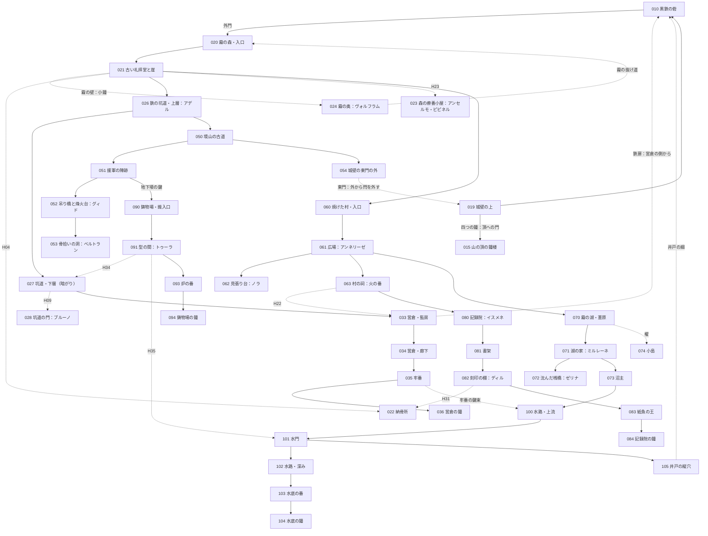

# 世界設計書 — 最後の鐘（仮題、D10）

W・P・V レーンがこのファイルを見て、新しい世界の拠点・ダンジョン・仲間・生き残り・鐘・結末を作るための設計書。
持ち主が世界観を**全部作り直す**と決めた（2026-10-12、#127）。前の世界「灰の王国」の設計は控えとして [docs/old/](old/) に移した。
筋は 2026-10-12 に持ち主と配り役が決め直した（主人公は人の味方をした使徒、四つの鐘は封じの楔）。
マップの作り方は [docs/mapdesign.md](mapdesign.md)、ID の帯は [docs/ROADMAP.md](ROADMAP.md)、データの形は [docs/mz-data.md](mz-data.md)、文の書き方は [docs/knowhow.md](knowhow.md)（決まりはそのまま。例は前の世界のもの）。

- 世界の手触りは、持ち主の別の作品 Morsveld の世界観を**参考にしただけ**。国・町・使徒の名前と出来事は新しく作った。人物は Morsveld の人物を**スターシステム**で使う（性格・口調・癖だけを写し、経歴・立場・この世界での生き死には新しく作った。[5 章](#5-仲間)・[6 章](#6-生き残り)）。
- 手本（Fanastasis）の遊びの構造はそのまま。固有名詞・台詞・地名・人物は使っていない。
- 名前・題・細部は推しで書いた。決定待ちは [9 章](#9-決定待ち) と `needs-decision` の issue #129。決まったら置き換える（筋は変わらない）。
- 段階の印〔知〕〔噂〕〔進〕〔秘〕の意味は [knowhow.md 2.1](knowhow.md#21-設定の段階の印)。禁止語は [10 章](#10-禁止語の表)、口調は [11 章](#11-口調の表)。

### 持ち主が決めたこと（変えない）
| 項目 | 決めたこと |
|---|---|
| 雰囲気 | もの悲しいが温かい |
| 語り方 | 目的ははっきり、真相は断片。アイテムの配置と説明文・碑文・日記・墓標で少しずつ |
| 始まり | 目覚めると、荒れ果てた終わった世界。主人公は何も分からないまま冒険する。**案内役はいない** |
| 目的 | 各地域にある **4 つの鐘を鳴らして、山の頂の鐘楼へ行く**。目的は序盤で分かる |
| 真相の見せ方 | 敵やボスに襲われながら、アイテム・日記・碑文で、何が起きたのか・主人公は何者なのかの片鱗が少しずつ見える |
| 残留思念 | 各地に、無念のまま死んだ人の残留思念がある。並べると、物語の輪郭がなんとなく分かる |
| 仲間 | 残留思念のうち**意志の強いもの**が、仲間として一緒に冒険する |
| 主人公の正体 | **使徒で、人間の味方をしていた**。衝撃的で、しかも納得がいくこと |
| 正体が分かる時 | **3 つ目の鐘のあと**。分かったあとも冒険は続く（4 つ目の地域と山の頂） |
| 結末 | 目的を果たして**静かな希望**を感じる終わり。しんみり、少し救い。主人公が失うのは**仲間との別れだけ**（主人公は生きて朝を迎える） |
| 世界 | 終わってしまった世界。約 200 年前、使徒によって終わった |
| 人物 | Morsveld の人物をスターシステムで使う（性格・口調は写し、立場は新しく） |
| 骨組み | 拠点＋ダンジョン巡り・仲間を呼ぶ・集める物は一部変える。シンボル敵・隠し通路・施設・合成・来歴・召喚・ボスの仕組みは使い回す |

### 前の世界から変わらない前提
- 画面 1280×720、1 マス 48px（横 26.7 × 縦 15 マス）。壁の側面は 2 マスで、**部屋の縦は「床の行数＋2」**。部屋の大きさは床の広さで書く。
- マップは仕上げ後は JSON が正本。持ち主がエディタで仕上げたら、以後はイベントだけを直す。
- 敵の色（緑・黄・赤）、赤は必ず迂回路がある・持ち場から出ない、入口から追い始める距離＋2 マス以上離す（[old/world.md 4.0](old/world.md#40-全体) の約束のまま。型は [mapdesign.md 7 章](mapdesign.md#7-敵の置き方の型)）。

---

## 1. 世界と年表

### 1.1 骨子（10 行）
1. ここは**終わったあとの世界**。約 200 年前の「**二度目の夜**」に、使徒がいっせいに境山を越え、三つの国は一夜で終わった。〔知〕
2. 昔、使徒は**鐘の聞こえる所へは入らなかった**。人は「神さまの音」と思っていた。〔知〕（入らなかったこと）〔噂〕（神さまの音）
3. 本当は、鐘の音の届く所は**一体の使徒の縄張り**だった。使徒は互いの縄張りに入らない。だから他の使徒は来なかった。〔進：3 つ目の鐘〕
4. その使徒は人の姿をとり、黒鉄の砦で**鐘番**として人と暮らしていた。人は「鐘守りさま」と子守唄に歌った。それが自分たちの鐘番だとは知らずに。〔進：3 つ目の鐘〕
5. 200 年前、鐘番が使徒だと知った教会と騎士長は、恐れて、**四つの鐘を楔にして**鐘番を封じた。縄張りは消え、三日後に二度目の夜が来た。〔進：3 つ目の鐘〕（人が自分で守り手を封じた、と一文で言うことは〔秘〕）
6. **主人公がその鐘番**。封じられて声（縄張り）と記憶を失い、砦の石室で 200 年眠っていた。拾い屋の少年が鈴を蹴った音で目を覚ます。〔知〕目覚め／〔進：3 つ目の鐘〕誰か
7. 石室の壁に「**四つの鐘を鳴らして。それから、山の頂の鐘楼へ**」と刻んである。誰の字かは頂で分かる。〔知〕（刻み）〔進：015〕（誰の字か）
8. 鐘を一つ鳴らすたびに、楔が一つ外れ、主人公の声と記憶が少し戻る。各地には、無念のまま死んだ人の**残留思念**があり、意志の強いものが**仲間**になる。〔知〕
9. 3 つ目の鐘のあと、主人公は自分が何者かを知る。仲間の反応は分かれ、一人はいったん離れる。冒険は続く。〔進：3 つ目の鐘〕
10. 山の頂の大鐘が鳴ると、各地の鐘が応え、縄張りが戻り、灰が止む。仲間は無念が晴れて去り、主人公は鐘番として残る。静かな朝。〔進：015〕

### 1.2 昔の大陸（旧暦の時代）
旧暦は「一度目の夜」（使徒が初めて現れた夜）を元年に数えた暦。今の人は旧暦をほとんど使わない。

| 項目 | 中身 | 段階 |
|---|---|---|
| 三つの国 | 西の**アルメリア王国**（麦と川）、北の**グラーデン帝国**（雪と鉄）、東寄りの**エリンデ共和国**（森と湖。エルフが多い）。名は墓標・碑文・古い札で出る | 〔知〕国があったこと／〔噂〕名（読める者が少ない） |
| 種族 | 人間・エルフ・獣人。エルフは長命で、200 年前を覚えている者がまだいる | 〔知〕 |
| 使徒 | 人の言葉を解する化け物（1.4） | 〔知〕 |
| 境山（さかいやま） | 人の地の東の端の山並み。向こう側が使徒の地。いちばん高い頂に**古い鐘楼**と**大鐘** | 〔知〕 |
| 鐘の列 | 境山の尾根の見張り塔ごとに小さな鐘（**子鐘**）。夕べに、頂の大鐘に合わせて鳴らす。鐘の聞こえる所へ使徒は入らなかった | 〔知〕鐘で使徒を遠ざけた／〔噂〕なぜ効いたか（「神さまの音」「鉄の音を嫌う」と人ごとに違う）／〔進：3 つ目の鐘〕縄張りだったこと |
| 黒鉄の砦 | 境山を越える唯一の道を塞ぐ、人の最前線。頂の鐘楼へ上る道の麓。三国の兵が詰めた | 〔知〕 |
| 鐘番 | 砦から頂へ上り、夕べに大鐘を打つ当番。当番表には何代も同じ名が続く | 〔知〕鐘番がいた／〔進：2 つ目の鐘〕同じ名が続く |
| 夕べの数 | 夕べの鐘を三十まで数える祈り。指で鐘の形を切る | 〔知〕 |
| 古言（ふること） | 口にした通りに、物ごとを一つだけ動かす古い言葉。使うたびに、話した者から何かが欠ける。教会は禁じた。使徒の名の刻印も古言で書かれている。文には片仮名の短い音で出し、訳を付けない | 〔噂〕禁じられた言葉があった／〔進〕主人公だけが読める |
| 四つの鐘 | 二度目の夜の少し前に、四つの地域に新しく吊られた鐘。教会は「守りを強める鐘」と触れた | 〔知〕鐘がある／〔噂〕夜の前に吊られた／〔進：1 つ目の鐘〕楔／〔進：3 つ目の鐘〕何を封じたか |

### 1.3 年表
| いつ | できごと | どこで断片が分かるか | 段階 |
|---|---|---|---|
| 旧暦 元年 | 一度目の夜。使徒が現れ、古い国が潰れる | 礼拝堂の碑文（021）、記録院（080） | 〔知〕 |
| 旧暦 数十年 | 一体の使徒が人の姿で山の麓の村へ下り、一人の娘に**夕べの数**を教わる | 4 つ目の鐘の場面、古い数え札（015） | 〔進：4 つ目の鐘〕（誰に、なぜは断片だけ） |
| 旧暦 百年ごろ | 人が頂に大鐘を鋳て、境山に鐘の列を並べる。鐘の音の届く所は、その使徒の縄張りになる。使徒は人の姿で、鐘を鳴らす役に就く | 記録院の古い記録（081） | 〔知〕鐘の列ができた／〔進：3 つ目の鐘〕縄張り |
| 旧暦 数百年 | 三つの国ができる。黒鉄の砦。鐘番は名と顔を少しずつ変えながら砦に居つづける | 当番表（033・081）、鐘番の日誌 | 〔知〕／〔進：2 つ目の鐘〕年を取らない |
| 約 200 年前・ある夜 | 砦の外で化け物の群れに追われた坑夫たちを、鐘番が**声ひとつ**で救う。それを見た兵が騎士長に告げる | 3 つ目の鐘の場面、騎士長の日誌 | 〔噂〕鐘番が化け物を追い払った夜があった／〔進：3 つ目の鐘〕 |
| その後の一月 | 教会と騎士長が鐘番を恐れ、封じを決める。調律師ミルレーネに、何のためか言わずに四つの鐘を調律させる。四つの地域に鐘を吊る | 調律の帳面、鋳物場の注文書、司祭の手紙 | 〔進〕（段 3〜5） |
| 封じの夜 | 四つの鐘をいっせいに鳴らし、鐘番を封じる。鐘番は頂の鐘楼で倒れ、砦の石室に運ばれて眠る。頂の大鐘は鎖で縛られる | 3 つ目の鐘の場面、015 | 〔進：3 つ目の鐘〕 |
| その翌日〜三日目 | 子鐘を鳴らしても、使徒は退かない（縄張りが消えた）。人は「鐘が鳴らない」と言う | 配給の札、子鐘の数 | 〔噂〕鐘は三日鳴らなかった |
| 三日目の夜 | **二度目の夜**。使徒がいっせいに境山を越える。門叩きが砦の門を三度叩く。砦の人の多くが無念のまま死ぬ | 各地の残留思念 | 〔知〕夜が来た／〔進〕各仲間の臨終 |
| 夜のあと | 三つの国は終わる。生き残りは灰と霧のあいだに散る。ミルレーネが石室の壁に刻みを残し、湖へ去る。人々は「鐘喰い」が鐘を食べたと言う | 石室の刻み、湖の灯の帳面 | 〔知〕〔噂〕／〔進：015〕刻んだ人 |
| 夜から数えて約 200 年 | 今。主人公は石室で目を覚ます | 目覚め（010） | 〔知〕 |

- 今の人の暦は「**夜から数えて**」。墓標や札の年はこの数え方（例：「夜から百十二年」）。旧暦の年は古い墓標だけに出る。

### 1.4 使徒（この世界の型）
- **人の言葉を解する化け物**。誰もが「使徒」と呼び、土地の呼び名を添える。名（古い刻印の読み）は碑文と記録院の写しにだけ出る。〔知〕呼び名／〔進〕名
- **縄張りを持ち、互いの縄張りに入らない。** 話が通じても、話が合うとは限らない。人は正面からは勝てない（格三。[knowhow.md 2.3](knowhow.md#23-敵や大きな存在の格)）。〔知〕縄張りがあること／〔進：3 つ目の鐘〕鐘の音の届く所も縄張りだったこと
- 自分から動く理由は、それぞれの性分だけ。筋のために動かさない。
- **使徒とは戦わない。** ボスは使徒の連れか、使徒ではない化け物か、留まりすぎた砦の人の魂（[4.4](#44-ボスの一覧)）。

| 呼び名／名 | 姿と性分 | 縄張り・出る所 | 人との関わり | 段階 |
|---|---|---|---|---|
| **鐘守り**（主人公） | 人の姿の鐘番。本当の姿は鐘の音そのものに近い（姿は見せない） | 鐘の音の届く所。今は四つの楔で封じられている | 人の味方をした。子守唄「鐘守りさま」 | 〔知〕子守唄／〔進：3 つ目の鐘〕主人公だということ |
| **門叩き**／ハドラム | 背の高い、顔のない長衣の姿。夜、戸や門を**三度叩き**、人の声で「入れておくれ」と言う。答えた家にだけ入る | 門と戸のある所。二度目の夜に砦の門を叩いた | 今の人は夜の戸に答えない。砦の外門に拳ほどの凹みが三つ | 〔知〕夜の戸の習い／〔噂〕砦の門の凹み |
| **霧の羊飼い**／ウルメ | 霧そのもの。霧で迷った者を群れに入れて連れて歩く。殺さないが帰さない | 森（020–025）と湖（070–074）の霧 | 霧の中の人影（敵「迷い人」）は群れの者 | 〔知〕霧に入るな／〔噂〕霧の中の人影は昔の人 |
| **灰の母**／セナルカ | 境山の向こうに横たわる大きな女の形と言われる。息をすると灰が降る | 境山の向こう。灰は東から来る | 灰が降る日は外に出ない | 〔知〕灰は東から来る／〔噂〕女の形 |
| **骨拾い**／ネムト | 痩せた鳥の頭の長い姿。死者の骨を拾って塔に積む。生きている者には丁寧で、取り引きをする | 境山の古道（053 の洞） | 主人公にだけ、最初から妙に丁寧（「お久しゅう」とは言わない。頭を深く下げる） | 〔噂〕骨を返してくれる化け物がいる／〔進：3 つ目の鐘〕丁寧だった理由 |
| （**鐘喰い**） | 鐘を食べたと言われる使徒。**いない**（人が鐘の沈黙に付けた説明） | ― | 鐘喰いの護符 | 〔噂〕いる／〔秘〕いない（「いない」とは書かない） |

- 敵（ふつうの化け物）：灰犬・灰鴉（灰の地の獣）、迷い人（霧の群れ）、坑道の獣、記録院の紙魚、留まりすぎた魂。名前と色は W が決める。

### 1.5 「誰が悪いか」を決めない
- 鐘番は人の味方をした。教会と騎士長は、人の中に使徒がいることを恐れた。鐘は神さまの音で、使徒はそれに寄生していると信じた（鐘番を封じても鐘は効くと思った）。調律師は何のための調律か知らされなかった。〔秘〕（誰が悪いかは誰にも判定させない）
- 封じた側にも理由があった。騎士長の日誌と司祭の手紙で見せる：「あれが一度でも牙をむけば、砦の千人が死ぬ」「神の鐘を、化け物の手から取り戻す」。〔進：段 5〕
- 「人が自分で守り手を封じて終わった」という皮肉を、**一文で言わない**。並べたプレイヤーの頭の中にだけある。〔秘〕
- 断片は食い違わせる：「鐘喰いが食べた」「鐘が古くなった」「鐘番が何かした」「教会が鐘を替えたから」。どれが本当かは書かない。

### 1.6 今の暮らし
- 集落は 20〜40 人ほど。井戸と畑と、夜に灯す灯。戸は夜に開けない。〔知〕
- 通貨は**鉄くず**（`Hai_Defeat` が落とす所持金。古い釘・蝶番・鎧の板。集落どうしで重さで量る）。〔知〕
- 祈りは「夕べの数」：夕べに指で鐘の形を切り、三十まで数える。鐘を知らない子もする。〔知〕
- 子守唄「**鐘守りさま**」が各地に少しずつ違う形で残る（「鐘守りさまは ねむらない／夕べに三十 かぞえたら／こわいものは こえられない」）。〔知〕
- 今の人は使徒の名も、古言も、鐘の仕組みも知らない。知っているのは習いと歌だけ（[knowhow.md 2.2](knowhow.md#22-説明役に語らせない)）。

### 1.7 前から見えている手がかり
3 つ目の鐘のあとで「だからか」と思えるように、最初から置いておく。どれも**説明しない**。一つでは答えにならない。
| 手がかり | 見える所 | 見せ方 |
|---|---|---|
| 年を取らない | 名の壁、当番表、仲間の一言 | 名の壁の「鐘番」の欄だけ、名前が何度も彫り直してある。ベルトラン「お前、俺が来たときから顔が変わらねえな」（冗談として） |
| 古言と使徒の名の刻印が読める | 礼拝堂の碑文、記録院の刻印の写し | 主人公が調べると、ほかの人には読めない行が一行だけ読める（訳は出さない） |
| 弱い化け物がためらう | 第1段階の緑の敵 | 主人公を見て一瞬止まる（シンボル敵の追い始めが 1 歩遅い。P の小さな足し：`<hai_enemy_hesitate>`） |
| 骨拾いが妙に丁寧 | 053 | 頭を深く下げる。取り引きの値を一つ負ける |
| 鐘の近くで回復する・鐘が共鳴する | 各地の鐘の部屋、子鐘の塔の跡 | 鐘のそばで HP が少し戻る（イベント）。子鐘に近づくと、鳴らしていないのに唸る |
| 子守唄「鐘守りさま」 | 集落の人、子どもの思念、ヴォルフラムの鍋の歌 | 歌詞が地域ごとに一行ずつ違う |
| 一部の残留思念が怯える | 営倉の牢番の思念、封じた司祭の思念 | 主人公が近づくと「なぜ、戻った」「鐘番、来るな」と言って消える（読めるのは 3 つ目の鐘のあと） |
| 目覚めた場所 | 石室 | 壁の刻み、内側から閂の掛からない扉、寝台に鎖の跡 |

---

## 2. 主人公

### 2.1 主人公
| 項目 | 内容 |
|---|---|
| 既定名 | **ルカ**（推し。性別を決めない名。名前の入力はさせない。仲間に呼ばれて初めて名前が分かる。[9 章](#9-決定待ち)） |
| 名前の欄 | 目覚めから最初の仲間を呼ぶまでは「？？？」。最初の仲間の目覚めの一言のあと、名前の変更（320）で「ルカ」にする |
| 性別 | 決めない（推し）。台詞で一人称を使わない。見た目は持ち主が素材から選ぶ |
| 肩書き | 鐘番（`Actors.json` の `nickname`。最初は空、ルカと同じ時に付ける）。3 つ目の鐘のあとも変えない |
| 正体 | 人の味方をした使徒「鐘守り」。人の姿で砦の鐘番をしていた。〔進：3 つ目の鐘〕 |
| Actors / Classes | Actors 1 番（持ち主の帯）。職業は今の Classes 10 を「鐘番」に読み替える（技は W・P の後の issue で入れ替える） |
| 戦い方の案 | 剣と鐘の音（声）の技。鐘を鳴らすたびに声の技が一つ増える。3 つ目の鐘のあと、**使徒の技**（強いが、使うと次のターンに仲間が一人「怯え」になる。代償の手触り。仕組みは P の後の issue） |
| 性格 | 口数が少ない。台詞は一行で、事実か問い。記憶が戻るほど、言うことがはっきりする。感想・教訓は言わせない |

### 2.2 封じで失ったもの
| 失ったもの | 今の姿 | 戻る時 | 段階 |
|---|---|---|---|
| 声（縄張り） | 鐘の音が使徒を退けない。子鐘を鳴らしても何も起きない | 鐘を一つ鳴らすたびに少し。頂の大鐘で全部 | 〔知〕鐘が効かない／〔進：3 つ目の鐘〕声＝縄張り |
| 記憶 | 自分の名前も、砦のことも、仲間の顔も覚えていない。体は覚えている（鐘の綱を見ると手が伸びる、剣の構えがベルトランの型） | 鐘ごとに一場面（[7.2](#72-鐘の場面)） | 〔知〕記憶がない |
| （失わないもの） | 年を取らない体、古言を読む目 | ― | 〔進：3 つ目の鐘〕 |

### 2.3 目覚めと最初の数分（案内役なし・主人公の台詞なし）
**狙い**：誰にも説明されずに、最初の数分で「ここは崩れた砦」「四つの鐘を鳴らして山の頂へ行く」「まず砦の下と霧の森」が分かる。
すべて**調べると分かる物**と、最初の生き残りシャノの用事の一言で示す。

1. **石室**（010 の西）。画面は黒から始め、寝台の上で目を開ける。自動で 1 行だけ。
   ```
   床の小さな鈴が、まだ揺れている。
   ```
   扉は開いている。床の灰に、小さな足跡が外へ続く（調べると「灰に、裸足の小さな足跡。外へ駆けていった」）。寝台を調べると「寝台の四隅に、鎖を留めた跡。鎖は無い」。
2. **石室の壁の刻み**。寝台の正面の壁。調べると：
   ```
   壁に、刃物で刻んだ字がある。
   「四つの鐘を鳴らして。それから、山の頂の鐘楼へ」
   ```
   選択肢なし。読むと `Hai_Thoughts` のメモに「四つの鐘を鳴らす。それから山の頂の鐘楼へ（石室の壁）」が残る。**これが目的**。
3. **炉**（大広間の北の壁）。調べると「炉は冷えている。脇に、乾いた薪が積んである」→「火を入れる／やめる」。入れると「炉に火が入った」。
   以後、炉は**回復と記録**。`Hai_Defeat` の戻り先と `Hai_Warp` の拠点の結界もここ。
4. **シャノ**（最初の生き残り）。炉に火を入れたあと、柱の陰から出てくる。
   ```
   シャノ「……火、つけたの、あんた？」
   シャノ「おれ、鉄を拾いに来ただけ。鈴、蹴っちゃった。ごめん」
   シャノ「名前は？　……ないの。ふうん」
   シャノ「鐘？　この砦の地下の牢に、一つ吊ってあるって。鉄の扉は開かないけど」
   シャノ「あと、外の森で炊き出しの爺さんが三日帰ってない。霧の中」
   シャノ「おれは霧、だめなんだ。濡れるから。……ここ、ちょっといていい？」
   ```
   主人公は答えない（選択肢なし）。シャノは大広間に残り、**倉**が開く（[3.3](#33-部屋が開く順と条件)）。メモに「鐘：砦の地下の牢（シャノ）」「炊き出しの爺さん：外の森の霧（シャノ）」。
5. **中庭**。中庭から東の空を調べると「雲の上に、塔の影が一つ。山の頂だ」。〔知〕
6. **外門**（010 の北）。門の内側を調べると「門の板に、拳ほどの凹みが三つ。縦に並んでいる」。〔噂〕門の外が霧の森（020）。
7. **営倉への鉄扉**（010 の南）。調べると「錆びついて動かない。向こう側に閂があるようだ」。シャノに話すと「そこ、おれも試した。開かない」。
   → 森から坑道を抜けて営倉へ回り、内側から開けると拠点への近道になる（[mapdesign.md 3 章](mapdesign.md#3-近道の数と場所)）。

- 目覚めの場面は**主人公の台詞なし・説明の語りなし**。名前・世界・正体を誰も言わない。
- 迷ったときの戻り道：炉の前で「休む」と、メモの最新の行がもう一度出る（`Hai_Notes` の画面を開くだけ）。

### 2.4 鐘を鳴らしたあとの主人公の一言
鐘の場面（[7.2](#72-鐘の場面)）のあと、主人公が一行だけ言う。事実か問い。一人称を使わない。場面と同じく、**鳴らした数**で決まる（どの鐘かによらない）。
| 数 | 一言 |
|---|---|
| 1 | 「……三十。いつも、三十だった」 |
| 2 | 「当番表の名前。全部、同じ手だ」 |
| 3 | 「……そうか。だから、来なかったのか」 |
| 4 | 「数えると、怖くない。そう教わった」 |

### 2.5 3 つ目の鐘のあと（正体が分かる）
3 つ目の鐘の場面（7.2 の 3）で、主人公は封じの夜を思い出す。場面のあと、転送陣で砦へ戻ると自動で次の場面。
1. **名の壁の前**。呼んでいる仲間（いなければ、炉の前の生き残り）が待っている。主人公の一言「……鐘守りは、ここにいた」。
2. **仲間の反応は分かれる**（呼んだ仲間だけ。一人一行〜二行。説明させない）：
   | 仲間 | 反応 |
   |---|---|
   | ブルーノ | 震えながら「……知ってました。門の前で、化け物がルカさんを避けて通ったから。言えなかっただけです」 |
   | ノラ | 黙って名の壁から離れる。**いったん仲間から外れる**（2.6） |
   | ディル | 「刻印の写しに、あんたの印があった。教えなかったのは、俺だ」 |
   | ゼリナ | 「つけは帳消しにせえへんで。使徒でも払ってもらう」 |
   | アンセルモ | 「わしは封じの話を聞いとった。止められんかった。……すまんの」 |
   | ベルトラン | 「顔が変わらねえと思ってたんだ。……剣は、変わらず下手だな」 |
   | トゥーラ | 「兄貴は兄貴だろ。飯、食ったのかよ」 |
3. 以後、主人公は**使徒の技**を覚える（2.1）。生き残りの反応は変えない（生き残りは昔を知らない。シャノだけが「使徒って、あんたみたいなのもいるんだ」と言う）。
4. 1.7 の「怯える残留思念」が、この後から読める（「なぜ、戻った」）。

### 2.6 離れる仲間と、戻る場面
- 離れるのは**ノラ**（推し）。二度目の夜に村の家族を失った。家族を殺したのは使徒で、その夜を作ったのが鐘番の封じだったことを知る。主人公を責めはしないが、隣を歩けない。
- 離れている間、ノラは名の壁から消え、編成に入れられない。記憶の断片は読める。
- **4 つ目の地域に入ると**（どの地域が 4 つ目でもよい。変数「鳴らした鐘の数」が 3 のとき、その地域の入口のイベント）、ノラが道の先で待っている。
  ```
  ノラ「村のみんなを殺したのは、あんたじゃない。分かってる」
  ノラ「分かってるけど、走ってこないと、言えなかった」
  ノラ「……それでも、あんたと鳴らす。行こう！」
  ```
  ノラが戻る。完全体の条件は変えない。
- ノラを呼んでいなかったら、この場面は無い（離れる人がいない）。

---

## 3. 拠点 黒鉄の砦（マップ 010–019）

### 3.1 砦の今の姿
- 境山の麓、頂の鐘楼へ上る道を塞ぐ石の砦。外壁の半分は崩れ、中庭は灰に埋まっている。〔知〕
- 200 年、誰も住まなかった。使徒の縄張りではない（門叩きは夜のあと去った）。だから生き残りが住める。〔知〕（住めること）〔秘〕（理由は書かない）
- 部屋を一つずつ**直していく**：生き残りが来るたびに一部屋が開き、炉の火・食堂の皿・寝台の数が増える。
- 頂への道は、城壁の上（019）の東の端の門から続く。門は**四つの鐘が鳴るまで**開かない（門の鎖が鐘の数だけ一本ずつ外れる）。〔知〕

### 3.2 マップの割り当て
| マップ | 新しい名前 | 前の世界 | 大きさ | タイルセット |
|---|---|---|---|---|
| 010 | 黒鉄の砦・内郭 | 牢獄の間（作り直す） | 50 × 40 前後 | 11 |
| 011 | 稽古場 | 魂の間 | 17 × 13 | 11 |
| 012 | 食堂 | 創作者の厨房 | 17 × 13 | 11 |
| 013 | 倉 | 保管ゲート | 17 × 13 | 11 |
| 014 | 書庫 | 理知の間 | 17 × 13 | 11 |
| 015 | 山の頂の鐘楼 | 王都の門（W5 の枝。作り直す） | 40 × 30 前後 | 2 外観 |
| 016 | 療養所（新） | ― | 17 × 13 | 11 |
| 017 | 鍛冶場（新） | ― | 17 × 13 | 11 |
| 018 | 見張り台（新） | ― | 17 × 13 | 2 外観 |
| 019 | 城壁の上（新） | ― | 45 × 15 前後 | 2 外観 |

010 の部屋（010 は網に合わせて広げて作り直す。下の表は、前の世界の部屋が新しい何に当たるかの対応。大きさと形は [mapdesign.md 1 章](mapdesign.md#1-1-枚の大きさ)）：
| 前の世界の部屋 | 新しい部屋 | 置くもの |
|---|---|---|
| 目覚めの独房（西） | 石室 | 寝台（開始位置。四隅に鎖の跡）、小さな鈴、**壁の刻み**、鐘番の外套掛け（空） |
| 中央の広間 | 大広間 | **炉**（回復と記録）、食卓（生き残りの数で人が増える）、空の鐘架（砦の小鐘は無い） |
| 召喚陣の間（東） | 名の壁 | 砦の兵の名を刻んだ壁。足元に輪。**形見か遺骸を置くと残留思念を呼べる**（`Hai_Companions` の `summonMenu`・`partyMenu`）。「鐘番」の欄だけ、名前が何度も彫り直してある |
| 出口の階段（北） | 外門への階段 | 門の内側に三つの凹み |
| 4 つの施設の扉 | 稽古場・食堂・倉・書庫の扉 | 叡智のオーブの台座の代わりに、**崩れた扉**。調べると「中は瓦礫で埋まっている」。生き残りが来ると片付いて開く |
| 開かない鉄の扉（南） | 営倉への鉄扉 | 営倉の側から閂を外す近道 |
| 塞がった螺旋階段の跡 | 城壁へ上る階段 | 019 城壁の上へ。東の端に頂への門（鎖 4 本） |
| （新）療養所・鍛冶場・見張り台の扉 | 010 の空いた壁に足す | 同上（崩れた扉） |
| （新）井戸 | 中庭の井戸 | 調べると「底は暗い。綱は切れている」。水路の側（105）から綱を下ろすと近道になる |

### 3.3 部屋が開く順と条件
**叡智のオーブはやめる**（Items 171 は使わない）。部屋は**生き残りが砦に来ると開く**。どの順で会ってもよい。
開けるのは `Hai_Facilities` のプラグインコマンド `open`（オーブなしで開く）。開いたら今の施設のスイッチ（121〜124）を ON。新しい 3 部屋は新しい仕組みが要る（P の後の issue）。

| 部屋 | マップ | 開く人（[6 章](#6-生き残り)） | 会う所 | できること（使い回す仕組み） | 段階 |
|---|---|---|---|---|---|
| 炉 | 010 | 主人公（最初に火を入れる） | ― | 回復・記録・全滅の戻り先（`Hai_Defeat`・`Hai_Warp`） | 第1段階 |
| 名の壁 | 010 | 最初の遺骸か形見を見つける | ― | 残留思念を呼ぶ・並び替え（`Hai_Companions`） | 第1段階 |
| 倉 | 013 | シャノ | 010（目覚めの直後） | 倉庫（`Hai_Items`） | 第1段階 |
| 食堂 | 012 | ヴォルフラム | 024 霧の奥 | 合成（`Hai_Craft`）。生き残りの数で食卓の人と、ヴォルフラムの鍋の一言が変わる | 第1段階 |
| 稽古場 | 011 | アデル | 026 鉄の坑道・上層 | 控えの仲間を育てる（`Hai_Facilities` の「魂」を「稽古」と読み替え） | 第1段階 |
| 書庫 | 014 | イスメネ | 080 記録院 | 倒したボス・読んだ思念・刻印の写し | 第2段階 |
| 療養所 | 016（新） | ピピネル | 023 森の療養小屋 | 案：状態異常を治す・消耗品の所持上限を 1 つ増やす（新しい仕組み） | 第2段階 |
| 見張り台 | 018（新） | グィド | 052 吊り橋と烽火台 | 案：オートマップの全図、転送の行き先に各ダンジョンの入口を足す | 第2段階 |
| 鍛冶場 | 017（新） | アンネリーゼ | 061 焼けた村 | 案：一点ものの装備を鍛え直す。鉄切り鋏（[mapdesign.md 4 章](mapdesign.md#4-後の物で開く道)） | 第2段階 |

- **食堂がにぎやかになる**：変数「生き残りの数」（0〜7）で、大広間の食卓のイベントのページが替わる（座る人が増える）。7 人揃うと、ヴォルフラムが「皿が足りん」と言う。〔知〕
- 開いた部屋の入口に、生き残りの一言（[6 章](#6-生き残り)）。

### 3.4 旗の読み替えの案
番号の帯は配り役が [ROADMAP.md](ROADMAP.md) で決める。ここは今の旗（[old/world.md 8 章](old/world.md#8-筋の旗の表スイッチ変数-101200)）をどう読み替えるかの案だけ。

| 今の旗 | 新しい意味 |
|---|---|
| スイッチ 101〜104（オーブ 4 つ） | 鐘を鳴らした：営倉の鐘・記録院の鐘・水底の鐘・鋳物場の鐘 |
| スイッチ 105・変数 101（オーブの数） | 四つ鳴った・鳴らした鐘の数（0〜4。場面と一言はこの数で決める） |
| スイッチ 106・107 | 正体が分かった（3 つ目の場面のあと）・ミルレーネに会った |
| スイッチ 108〜110（予備） | ノラが離れた・ノラが戻った・頂への門が開いた |
| スイッチ 111〜113 | 目覚めた・炉に火を入れた・名の壁を教わった（最初の遺骸） |
| スイッチ 114 | 営倉の鉄扉を開けた |
| スイッチ 115 | 山の頂に着いた |
| スイッチ 121〜124 | 稽古場・食堂・倉・書庫が開いた |
| スイッチ 131〜145（遺骸・加入・完全体 ×5） | 仲間が 7 人になるので、帯を広げる（P6 の窓口も 7 人に。P の後の issue） |
| スイッチ 151〜155（ボス） | 牢番・紙魚の王・水底の番・炉の番・騎士長ほか（[4.4](#44-ボスの一覧)） |
| スイッチ 181〜184（結末） | 結末・真の結末の条件 |
| 変数 102（仲間の数） | そのまま（0〜7） |
| 変数 103（叡智のオーブの数） | 生き残りの数（0〜7） |

---

## 4. 地図と段階

### 4.0 全体
砦を真ん中に、北に霧の森、北東の山に鉄の坑道、砦の下に営倉。東の尾根に**境山の古道**、西の谷に**焼けた村**、南西の低地に**霧の湖**、北西の丘に**記録院**、山の根の下に**古い鋳物場**、砦の真下に**砦の下の水路**。いちばん東の高みに**山の頂の鐘楼**。
マップは**網の目**につなぎ、1 枚を広くし、近道と「後の物で開く道」で前の場所へ戻らせる。作り方の決まりは [docs/mapdesign.md](mapdesign.md)。
前の世界のマップは**形をそのまま使う前提をやめ**、この網に合わせて作り直す。使い回すのは ID の帯と、遠い所がつながる 4 つ（H22・H31・H34・H35）の考え方、それに形の合う小部屋だけ（4.1）。

**四つの地域と鐘**
| 地域 | ダンジョン | 鐘（吊ってある所） | 守り | 段階 |
|---|---|---|---|---|
| 一 砦の下 | 霧の森（020–025）・鉄の坑道（026–032）・砦の営倉（033–049） | **営倉の鐘**（036） | 牢番 | 第1段階（必ず 1 つ目） |
| 二 西の谷 | 焼けた村（060–069）・記録院（080–089） | **記録院の鐘**（084） | 紙魚の王 | 第2段階 |
| 三 南の水 | 霧の湖（070–079）・砦の下の水路（100–109） | **水底の鐘**（104） | 水底の番 | 第2段階 |
| 四 東の山 | 境山の古道（050–059）・古い鋳物場（090–099） | **鋳物場の鐘**（094） | 炉の番 | 第2段階 |
| 頂 | 山の頂の鐘楼（015） | **大鐘** | 騎士長（留まりすぎた魂） | 終盤 |

| 段階 | 鐘 | 仲間 | 生き残り | 遊ぶ時間 |
|---|---|---|---|---|
| 第1段階 | 営倉の鐘 | ブルーノ | シャノ・ヴォルフラム・アデル | 45 分前後（本道だけなら 25 分） |
| 第2段階 | 記録院・水底・鋳物場の鐘（好きな順。**3 つ目を鳴らしたとき正体が分かる**） | ノラ・ディル・ゼリナ・アンセルモ・ベルトラン・トゥーラ | イスメネ・ピピネル・グィド・アンネリーゼ、ミルレーネ（生きて会う） | 4 時間前後 |
| 終盤 | 大鐘 | ― | ― | 結末 |

- 地域二〜四は**好きな順**で回れる。場面と主人公の一言は**鳴らした数**で決まり、どの鐘でも 3 つ目で正体が分かる。だから、どの地域が「正体のあとの 4 つ目の地域」になってもよい。
  - 記録院の鐘：森 → 焼けた村 →（火の番）→ 記録院。
  - 鋳物場の鐘：坑道 → 境山の古道 →（陣跡の地下壕の鍵）→ 古い鋳物場。
  - 水底の鐘：森 → 焼けた村 → 霧の湖 →（沼主）→ 砦の下の水路、**または** 営倉 →（牢番の鍵束）→ 水路。
- 本道で要る「後の物」は、牢番の鍵束・鐘番の角灯・見張り塔の小鐘の 3 つだけ。ほかの物と仲間で開く道は寄り道（[mapdesign.md 4 章](mapdesign.md#4-後の物で開く道)）。
- ボスの強さは鳴らした鐘の数で変えない。

### 4.1 使えるマップと作り直すマップ
「使える」＝前の世界のマップの**形（タイル層）をそのまま使い**、置く物・文・敵・色調・飾りを替える小部屋。「作り直す」＝ [mapdesign.md 1 章](mapdesign.md#1-1-枚の大きさ) の大きさで描き直す。「新」＝新しく作る。
番号は前の世界の帯のまま（[mapdesign.md 2.1](mapdesign.md#21-id-の帯前の世界の帯をそのまま使う)）。W5 の枝 `claude/w5-stage2e` のマップ（015・090–104）は main に入っていない。

**砦と地域一（第1段階）**
| マップ | 前の世界 | 新しい名前 | 判定 | 中身 |
|---|---|---|---|---|
| 010 | 牢獄の間（33 × 27） | 黒鉄の砦・内郭 | 作り直す（50 × 40 前後） | 3.2 |
| 011–014 | 魂の間・厨房・保管ゲート・理知の間 | 稽古場・食堂・倉・書庫 | 使える | 台座をやめ、生き残りの置き物に替える |
| 016–018 | ― | 療養所・鍛冶場・見張り台 | 新 | 3.3 |
| 019 | ― | 城壁の上 | 新 | 東門（古道の側から開く近道）、頂への門（鎖 4 本） |
| 020 | 巡礼の森・入口 | 霧の森・入口 | 作り直す（70 × 50） | 倒れた見張り塔（小鐘）、森の墓地 |
| 021 | 巡礼の森・奥 | 古い礼拝堂と崖 | 作り直す（60 × 45） | 鐘を抱く像と碑文、霧の壁、崖の上の祠、北東の坑口 |
| 022 | 礼拝堂の地下納骨所 | 納骨所 | 使える | H04・H31 の裏、名札の棚 |
| 024 | ― | 霧の奥 | 新（40 × 30） | ヴォルフラム、入口へ抜ける霧の抜け道 |
| 026 | 廃坑・上層 | 鉄の坑道・上層 | 作り直す（60 × 45） | アデル、昇降機、鉄格子の奥（鉄切り鋏）、東の坑道→古道 |
| 027 | 廃坑・下層 | 鉄の坑道・下層 | 作り直す（50 × 40、暗がり） | 大扉（ブルーノ・トゥーラ）、掘り抜き→営倉 |
| 028 | 崩落の間 | 坑道の門 | 使える | ブルーノの遺骸 |
| 029 | ― | 坑夫の詰め所 | 新 | 鐘番の角灯 |
| 033 | 地下牢・監房区 | 営倉・監房 | 作り直す（60 × 45） | 施錠扉（鍵束）、鉄扉→砦（近道）、当番表 |
| 034 | 地下牢・更生の廊下 | 営倉・廊下 | 作り直す | 往復の番の獣とレバー（mapdesign 8 章「見張りの読み」） |
| 035 | 拷問の間 | 牢番の詰め所 | 使える | ボス 牢番、西の扉→水路（鍵束） |
| 036 | オーブの間 | 営倉の鐘の間 | 使える | **営倉の鐘**、楔の鐘の札 |
| 037 | ― | 井戸の底への通路 | 新 | 水路 105 へ（第2段階で開く） |

**地域二〜四（第2段階）と頂**
| マップ | 前の世界 | 新しい名前 | 判定 | 中身 |
|---|---|---|---|---|
| 023 | 看取りの小屋 | 森の療養小屋 | 使える | アンセルモの遺骸、ピピネル |
| 050 | 崖道・下の道 | 境山の古道・尾根道 | 作り直す（80 × 60、段が 3 つ） | 倒れた子鐘の塔、上段（鉤綱） |
| 051 | 帝国の陣跡 | 援軍の陣跡 | 作り直す | 鉤綱、地下壕の鍵→鋳物場 |
| 052 | 巨人の吊り橋と門 | 吊り橋と烽火台 | 作り直す | グィド、岩背負い（任意） |
| 053 | 見張りの洞 | 骨拾いの洞 | 使える | 骨拾い、ベルトランの形見 |
| 054 | ― | 城壁の東門の外 | 新 | 東門の閂（019 への近道） |
| 060 | 焼け野の入口 | 焼けた村・入口 | 作り直す | 戸板の盾、配給札、盛り土（ノラ） |
| 061 | 廃集落・広場 | 焼けた村・広場 | 作り直す（70 × 50） | アンネリーゼ、倒れた梁（トゥーラ） |
| 062 | 焼けた見張り台 | 村の見張り台 | 使える | ノラの遺骸、屋根（鉤綱） |
| 063 | 焚刑の教会 | 村の祠 | 使える | ボス 火の番、裏口→記録院 |
| 064 | 地下の護送路 | 荷運びの抜け道 | 使える | H22（村→営倉） |
| 070 | 湿地・葦原 | 霧の湖・葦原 | 作り直す（80 × 60、舟） | 霧の道（小鐘）、向こう岸（櫂） |
| 071 | 水上集落の跡 | 湖の家 | 作り直す | ミルレーネ、湖の灯の帳面 |
| 072 | 沈んだ舞台 | 沈んだ桟橋 | 使える | ゼリナの遺骸、櫂、酒保のつけ帳 |
| 073 | 沼主の淵 | 湖の淵 | 使える | ボス 沼主、排水口→水路 |
| 074 | ― | 小島 | 新 | 赤い宝箱（舟で） |
| 080 | 古書院・前庭と閲覧室 | 記録院・前庭 | 作り直す | イスメネ、古言の碑の扉（ディル） |
| 081 | 書架の迷路 | 記録院・書架 | 作り直す（60 × 45） | 番号錠、鐘の列の古い記録 |
| 082 | 禁書庫 | 刻印の棚 | 作り直す（暗がり） | ディルの遺骸、刻印の写し、H31 |
| 083 | 紙魚の王の間 | 紙魚の王の間 | 使える | ボス 紙魚の王 |
| 084 | オーブの間「聖灰」 | 記録院の鐘の間 | 使える | **記録院の鐘** |
| 090 | 研究所・搬入口（枝） | 鋳物場・搬入口 | 作り直す | 楔の鐘の注文書 |
| 091 | 実験棟（枝） | 鋳物場・型の間 | 作り直す（60 × 45） | トゥーラの遺骸、H34・H35、鉄格子（鋏） |
| 092 | 契約の写し室（枝） | 鐘の型の部屋 | 使える | 子鐘と楔の鐘の型が並ぶ、古言の碑の扉（ディル） |
| 093 | 番人の間（枝） | 炉の間 | 使える | ボス 炉の番 |
| 094 | オーブの間「契約」（枝） | 鋳物場の鐘の間 | 使える | **鋳物場の鐘**、調律師の音叉 |
| 100 | 下水道・上流（枝） | 水路・上流 | 作り直す | 舟で下る |
| 101 | 水門の間（枝） | 水路・水門 | 作り直す（60 × 45） | 二つの弁（水位の切り替え） |
| 102 | 結界の真下（枝） | 水路・深み | 作り直す（暗がり） | 司祭の手紙 |
| 103 | 灰の騎士の間（枝） | 水底の番の間 | 使える | ボス 水底の番 |
| 104 | オーブの間「封印」（枝） | 水底の鐘の間 | 使える | **水底の鐘**、鐘番の日誌 |
| 105 | ― | 井戸の縦穴 | 新 | 綱を下ろす（010 の井戸への近道） |
| 015 | 王都の門（枝） | 山の頂の鐘楼 | 作り直す（40 × 30 前後） | 鎖で縛られた大鐘、騎士長、古い数え札（8 章） |

- 遠い所が実は隣（VISION 核 1）の 4 つ（H22・H31・H34・H35）は残す。意味だけ読み替える：村は営倉へ荷を運んだ／記録院の古い帳面は納骨所に移した／鋳物場の鉄は坑道から来た／鋳物場の水は砦の水路へ流れた。
- 砦へ戻る近道は 4 つ：営倉の鉄扉（033）・城壁の東門（054→019）・井戸の綱（105→010）・霧の抜け道（024→020）。

### 4.2 つながり図
網の全体は [mapdesign.md 2 章](mapdesign.md#2-網の目拠点からのつながり)。ここは人と鐘の置き場所を足した図。点線は近道か隠しか、後の物で開く道。



### 4.3 生き残りと仲間の置き場所（まとめ）
| 地域 | ダンジョン | 仲間の遺骸・形見 | 生き残り | 生きて会う人 |
|---|---|---|---|---|
| ― | 砦（010） | ― | シャノ | ― |
| 一 | 霧の森（020–025） | ― | ヴォルフラム（024） | ― |
| 一 | 鉄の坑道（026–032） | ブルーノ（028） | アデル | ― |
| 一 | 砦の営倉（033–049） | ― | ― | ― |
| 二（森の脇） | 森の療養小屋（023） | アンセルモ | ピピネル | ― |
| 二 | 焼けた村（060–069） | ノラ（062） | アンネリーゼ（061） | ― |
| 二 | 記録院（080–089） | ディル（082） | イスメネ（080） | ― |
| 三 | 霧の湖（070–079） | ゼリナ（072） | ― | ミルレーネ（071） |
| 三 | 砦の下の水路（100–109） | ― | ― | ― |
| 四 | 境山の古道（050–059） | ベルトラン（053） | グィド（052） | （骨拾い） |
| 四 | 古い鋳物場（090–099） | トゥーラ（091） | ― | ― |

### 4.4 ボスの一覧
ボスは「必須はボスだけ・ボスからも逃げられる」（`Hai_Boss`）。**使徒はボスにしない。**
砦の人の成れの果てのボスは、命令を守り続けているだけ。倒すと静かに崩れ、形見が一つ残る（留まりすぎた魂。そうとは書かない）。

| ボス | マップ | 正体 | 受動の理由（なぜそこにいる） | 弱みの手がかり | 段階 |
|---|---|---|---|---|---|
| 牢番 | 035 | 砦の営倉の牢番 | 「鐘番を鐘に近づけるな」と言われ、営倉の鐘の前を守り続けている。目が見えず、近づく者を誰でも止める | 帳面の「火を嫌う。灯を持って来るな」 | 第1段階 |
| 岩背負い | 052 | 境山の大きな獣（任意の門番） | 橋のたもとを寝床にしている | 背の岩の割れ目 | 第2段階 |
| 火の番 | 063 | 焼けた村の夜番 | 鐘の代わりの火を絶やすなと言われ、まだ燃やしている | 祠の水瓶 | 第2段階 |
| 沼主 | 073 | 湖の主の化け物（霧の羊飼いの連れ） | 淵を寝床にしている | 葦の刈り跡 | 第2段階 |
| 紙魚の王 | 083 | 記録院の紙を食う化け物 | 古い紙のある所に湧く。記録院の鐘の前の帳面の山を巣にした | 閲覧の札「乾いた砂を撒くこと」 | 第2段階 |
| 水底の番 | 103 | 水路の深みに沈んだ鐘の番の化け物 | 鐘の唸りを好み、水底の鐘に巻きついている | 水門の弁（水を抜くと弱る） | 第2段階 |
| 炉の番 | 093 | 鋳物場の親方 | 楔の鐘を鋳た炉を落とすなと言われ、空の炉を守っている | 型の間の冷えた水桶 | 第2段階 |
| 騎士長 | 015 | 砦の騎士長。封じを行った人 | 大鐘を縛った鎖を、200 年守り続けている。「鐘を化け物に返すな」 | 騎士長の日誌の最後の頁（段 5） | 終盤 |

### 4.5 使い回す仕組み
| 仕組み（[docs/plugins/](plugins/)） | 新しい世界での使い方 | 足すもの |
|---|---|---|
| `Hai_SymbolEnemy` | 灰の獣・迷い人・留まりすぎた魂。色と迂回路の約束はそのまま | 弱い化け物のためらい（1.7） |
| `Hai_HiddenPassage` | 隠し通路・片側扉・隠し階段 | なし |
| `Hai_Thoughts`・`Hai_Notes` | 残留思念（無念のまま死んだ人）、石室の壁の刻み、シャノの話のメモ。3 つ目の鐘のあとにだけ読める思念 | 読める条件（スイッチ）の付け方は今のイベントの出現条件で足りる |
| `Hai_Companions` | 意志の強い残留思念を、遺骸か形見で名の壁に呼ぶ・記憶 4 断片・完全体。ノラが離れる・戻る | 7 人にする（今は 5 人）。一時的に外す窓口 |
| `Hai_Facilities` | 稽古場・食堂・倉・書庫。生き残りが来たら `open` で開く。台座はやめる | 新しい 3 部屋（療養所・見張り台・鍛冶場） |
| `Hai_Craft`・`Hai_Items` | 食堂の合成、倉の出し入れ、赤い宝箱の一点もの | なし |
| `Hai_Lore` | 7.3 の来歴 | なし |
| `Hai_Boss`・`Hai_Battle` | 4.4 のボス。使徒の技（代償つき） | 「怯え」の状態（P） |
| `Hai_Defeat` | 全滅で鉄くずを落とし、炉に戻る | 通貨の名（`System.json`、持ち主） |
| `Hai_Warp`・`Hai_AutoMap` | 転送の結界、地図 | 見張り台で入口を足す（案） |
| `Hai_MapTone`・`Hai_Comfort`・`Hai_TouchUI` | そのまま（霧の森は白く、湖は青く、水の底は暗く、頂は白く明るく） | なし |

---

## 5. 仲間

### 5.1 仲間の決まり
- 各地に、**無念のまま死んだ人の残留思念**がある（`Hai_Thoughts`）。たいていはその場で、一つの無念をくり返すだけ。〔知〕
- そのうち**意志の強いもの**は、遺骸か形見を名の壁に置くと**呼べる**。仲間として一緒に歩き、戦う（`Hai_Companions`）。〔知〕
- 仲間はみな二度目の夜に死んだ砦の人で、**鐘番としての主人公を覚えている**。覚えていないのは主人公だけ。仲間は主人公を名前で呼び、昔の続きの口をきく。〔知〕
- **正体を知っていた仲間は少ない**（ディルは刻印で、アンセルモは封じの話で、ブルーノは見て。言わなかった）。3 つ目の鐘の前に、仲間に正体を言わせない。
- 仲間が知っているのは**自分が見たことだけ**。仲間に真相を説明させない。
- 記憶は 4 断片（生い立ち・転機・罪か誇り・臨終）。4 つ揃うと完全体で強技（今の仕組みのまま）。〔進〕
- 仲間それぞれに**無念**が一つある。頂の大鐘が鳴ると、無念が晴れて去る（8 章）。
- 人物は Morsveld の人物のスターシステム。**性格の芯・口調・癖・好き嫌い**を写し、経歴・家族・国・年はこの世界で新しく作った。絵は Morsveld の素材集の同じ人物のものを使える（人物の id が同じ）。

### 5.2 7 人の一覧（Actors 5–11）
今の Actors 5–9 の役割（タンク・ファイター・メイジ・サポート・ヒーラー）と固有の立ち回りをそのまま受け、10・11 を足す。

| Actor | 名前（スター） | 役割 | 生前（新しい立場） | 無念 | 固有の立ち回り | 完全体の強技（案） | 主人公への態度 |
|---|---|---|---|---|---|---|---|
| 5 | **ブルーノ** | タンク | 砦の門番。巨漢の臆病者。夜は怖いのに、門の番だけは代わらなかった | 門を閉めきれたか、確かめられなかった | かばう＋反撃（今の鉄の誓い） | 「閂」：3 ターン味方全員の盾になり、受けるたびに反撃 | 「ルカさん」と呼ぶ。鐘番の夕べの数を毎日一緒に数えた |
| 6 | **ノラ**（ノラミ） | ファイター | 砦の伝令。犬の獣人。足が速く、明るいあほ。弓は下手 | 村の家族に、逃げろと伝えるのが間に合わなかった | 2 回行動。HP が半分を切ると、勢いが上がって止まらない | 「伝令走り」：敵全体に 4 回のランダム攻撃 | 鐘番と駆けっこで勝ったことがない。勝つまで挑む。正体のあと、いったん離れる（2.6） |
| 7 | **ディル** | メイジ | 砦の書記。本好きで悪知恵。古言と刻印を読めた | 刻印の写しに鐘番の印を見つけ、誰にも言わなかった。封じを止める字を書けなかった | 沈黙と即死。HP は低い | 「頁を伏せる」：敵全体に沈黙＋低い率の即死 | だるそうに「鐘番」と呼ぶ。知っていたが、言わない |
| 8 | **ゼリナ** | サポート | 砦の酒保の娘。関西言葉、金が好き、子どもが好き | 子どもを舟で逃がしたが、向こう岸に着いたか見届けられなかった | 味方全体強化と回避盾。戦闘の後の鉄くずが増える（案） | 「勘定合わせ」：味方全体の HP と SP を少し回復し、状態異常を防ぐ壁 | 鐘番に「つけ」がある。200 年分の利子を言い出す |
| 9 | **アンセルモ** | ヒーラー | 砦の従軍司祭。墓掘り。下品で陽気。歌うと聞く者が泣く | 教会の封じの話を聞いていたのに、止められなかった | 回復と SP の受け渡し。蘇生ができる唯一の仲間 | 「弔いの歌」：味方全体の戦闘不能を回復し HP を半分まで | 飲み仲間。「お前さん」と呼ぶ |
| 10 | **ベルトラン** | ファイター（受け流し） | 砦の剣の教官。だらしない絵描きのおじさん。抜くと桁が違う | 最後の一枚の絵を描き終えられなかった | 受け流しと反撃。挑発で狙いを引き、物理を返す | 「一筆」：敵 1 体に大きな一撃、確実に当たる | 主人公の剣の師。主人公の構えを見て、何も言わずに笑う |
| 11 | **トゥーラ** | ファイター（力） | 鐘楼の小間使い。熊の獣人の子（14）。口が悪く、世話焼き | 「守りの鐘」だと言われて、楔の鐘の舌を鋳物場まで運んだ | 力が強い。味方へのアイテムの効き目を上げる（案） | 「担ぎ出し」：戦闘不能の味方 1 人を起こし、自分が狙われる | 「兄貴」と呼ぶ（主人公の性別によらず）。鐘番の飯と寝る時間にうるさい |

- 第1段階で実装するのは**ブルーノだけ**（遺骸と記憶 4「臨終」は 028）。
- 7 人の帯（スイッチ・アクター・強技）は今の P6 の帯（5 人分）を超える。帯は配り役が決め、P6 の窓口を 7 人にする P の issue が要る（[9 章](#9-決定待ち)）。

### 5.3 遺骸と形見の置き場所
| 仲間 | 呼ぶもの | 置き場所 | 置き場所が語ること |
|---|---|---|---|
| ブルーノ | 遺骸 | 028 坑道の門（H09 の先） | 門の閂に両手を掛けたまま。門の向こうは崩れて、坑夫が逃げた跡がある |
| ノラ | 遺骸 | 062 村の見張り台 | 薪の山の前。火打ち石を握っている。鐘が効かないので、火で知らせた |
| ディル | 遺骸 | 082 記録院・刻印の棚 | 刻印の写しの棚の前で、一枚を抱えて座っている |
| ゼリナ | 遺骸 | 072 沈んだ桟橋 | 桟橋の端。舟を出した綱が切ってある |
| アンセルモ | 遺骸 | 023 森の療養小屋 | 寝台の並ぶ部屋の真ん中の椅子。寝台はみな空 |
| ベルトラン | 形見（剣） | 053 骨拾いの洞 | 遺骸は骨拾いの塔に積まれている。骨拾いに砦の名札を三つ渡すと、剣を返してくれる（戦わない取り引き） |
| トゥーラ | 遺骸 | 091 鋳物場・型の間 | 背負子を背負ったまま、楔の鐘の型の前にうずくまっている |

### 5.4 記憶 4 断片
記憶の中身はすべて〔進〕（その断片を読んで初めて分かる）。主人公の正体に触れる断片（下の ※）は、**3 つ目の鐘のあとでないと読めない**（出現条件をスイッチ「正体が分かった」に）。

**ブルーノ（タンク）**
| 断片 | 内容 | 場所 |
|---|---|---|
| 生い立ち | 粉屋の大きな末っ子。体が大きいから、と兵に出された。何を見ても怖かった | 022 納骨所（家族の名の札の棚） |
| 転機 | 門番に回される。夜の番を誰も代わらず、自分だけが残った。鐘番に、怖いときは数えるといいと教わった | 033 営倉・監房（門番の詰め所の写し） |
| 罪か誇り ※ | 門の前で、化け物の群れが鐘番を避けて道を開けたのを見た。誰にも言わなかった（誇りとも罪とも言わない） | 050 古道（門番の交代の札） |
| 臨終 | 下の本文 | 028（遺骸と同じ所） |

ブルーノの記憶 4「臨終」（遺骸を調べたとき。5 行。顔なし）
```
門の向こうで、坑夫の足音が遠くなっていく。
こっちの門を叩く音は、三つ。また、三つ。
答えちゃだめだ。閂を押さえる。手が震える。
数える。いち、に、さん。……閉めました。
ルカさん。今夜の数、ちゃんと閉めましたよ。
```
（名前はイベントでは `\N[1]`。最後の行の数え方は、鐘番の夕べの数をまねたもの）

**ノラ（ファイター）**：生い立ち＝境山の麓の獣人の村で、狩りの追い込みだけ上手かった（060 焼けた村の家の跡）／転機＝伝令に取られる。鐘番と駆けっこをして負ける（050 古道の伝令の小屋）／
罪か誇り＝鐘が効かなくなった日、騎士長の命令を待たずに村へ走って逃げろと触れ回った。家族の家には最後に着いた（誇りと悔い。061 広場の触れ書き）／臨終＝見張り台で火を上げ、村の灯が山の方へ動いていくのを見ていた（遺骸の場所）。

**ディル（メイジ）**：生い立ち＝字も勘定も捨てられた本で覚えた港の子（080 前庭の書見台）／転機＝砦の書記になり、古言と刻印を読めることを隠した（081 書架）／
罪か誇り ※＝刻印の写しの中に、鐘の形の印を見つけた。当番表の鐘番の印と同じだった。写しの頁を伏せ、誰にも見せなかった（罪とも誇りとも言わない。084 の手前の写字台）／臨終＝封じを止める手紙を書きかけて、刻印の棚の前で夜を迎えた（遺骸の場所）。

**ゼリナ（サポート）**：生い立ち＝商いの家の娘。最初の商いで騙されて全部なくした（071 湖の家の帳場の跡）／転機＝砦の酒保を一人で回すようになり、兵に「つけ」を許した（012 食堂の古い勘定台）／
罪か誇り＝夜に、砦の子ども十四人を舟に乗せた。舟は一艘で、自分の乗る場所はなかった（誇り。070 葦原の舟着き）／臨終＝桟橋で舟の灯が見えなくなるまで数を数えていた（遺骸の場所）。

**アンセルモ（ヒーラー）**：生い立ち＝聖歌隊を酒で追い出された（022 納骨所の古い楽譜）／転機＝砦の従軍司祭になり、死者の物を生きている者に回した（033 営倉の没収品の棚）／
罪か誇り ※＝教会の司祭から封じの話を聞き、酒の席で一度だけ「やめとけ」と言った。それ以上は言わなかった（罪。102 水路・深みの司祭の手紙の脇）／臨終＝療養小屋で、最後の一人の手を握って歌い、歌の途中で止まった（遺骸の場所）。

**ベルトラン（受け流し）**：生い立ち＝絵描きになりたかったが、剣のほうが上手かった（051 陣跡の天幕）／転機＝砦の剣の教官になる。弟子に鐘番がいた。何年たっても弟子の顔が変わらないのを、冗談にしていた（011 稽古場の壁の落書き）／
罪か誇り＝夜、鋳物場から逃げる子らを通すため、吊り橋に一人で残った（誇り。052 橋のたもと）／臨終＝橋の上で筆を出し、最後の一枚に何かを描こうとした。描けたのは鐘の形の線が一本（053 骨拾いの塔の、形見の剣の鞘の中）。

**トゥーラ（力）**：生い立ち＝坑夫の家の長女。弟妹のぶんまで働いた（027 坑道・下層の長屋）／転機＝鐘楼の小間使いになり、鐘番を「兄貴」と呼ぶ（010 石室の壁の背比べの刻み）／
罪か誇り＝司祭に「守りの鐘」だと言われ、楔の鐘の舌を背負って鋳物場まで運んだ。大人の兵は途中で倒れたが、自分は着いた（誇り。あとで何の鐘か知ったかは書かない。090 搬入口）／臨終＝鐘の型の前で夜が来た。「かえりは かるい」と背負子に彫った（遺骸の場所）。

### 5.5 目覚めの一言（`<hai_wake>`）
一行。死ぬ直前の続きか、主人公との縁。自己紹介しない。
| 仲間 | 一言 |
|---|---|
| ブルーノ | 「門は、閉めました。……あ、\N[1]さん。お、起きたんですね」 |
| ノラ | 「火、上げたよ！　……あれ。村の灯、どっち行った？」 |
| ディル | 「……あんたか。起きるのが遅いんだよ、鐘番」 |
| ゼリナ | 「舟は？　あの子ら、みんな向こう岸に着いたんか」 |
| アンセルモ | 「おう、お前さんか。歌の続き、どこまで歌ったかの」 |
| ベルトラン | 「よう。剣、ちゃんと振ってたか。……振ってねえな、その顔は」 |
| トゥーラ | 「兄貴！　重いの、ちゃんと届けたからな！」 |

- 最初に呼んだ仲間の一言のあと、主人公の名前の欄を「ルカ」にする（2.1）。ブルーノ以外が最初でも、その仲間の 2 行目に名を呼ばせる（W が決める）。

### 5.6 仲間どうしの関係（掛け合いの種）
主人公抜きで話す場面（名の壁の前、食堂、ボスの控え）を作る（[knowhow.md 3.4](knowhow.md#34-掛け合いで深める)）。
| 組 | 関係 |
|---|---|
| ディル と ゼリナ | 書記と酒保。しょっちゅう喧嘩。ディルのつけは一番長い |
| トゥーラ と ブルーノ | 小さいトゥーラが大きいブルーノに飯と寝る時間を言いつける。ブルーノは逆らえない |
| ゼリナ と トゥーラ | ゼリナはトゥーラを甘やかす。トゥーラは「子ども扱いすんな」と怒る |
| ノラ と トゥーラ | どちらも獣人の「あたし」。鼻と力を張り合う |
| ベルトラン と アンセルモ | 飲み仲間。どちらが先に酔うかの賭けは 200 年まえから決着していない |
| ベルトラン と ディル | 剣を教えようとして諦めた。ディルは本を盾にする |
| ディル と アンセルモ | どちらも、言わなかった者。3 つ目の鐘のあと、名の壁の前で一度だけ二人で話す（主人公はいない） |
| ブルーノ と ノラ | 門番と伝令。ノラが離れている間、ブルーノが名の壁の前で毎晩数を数えて待つ |

### 5.7 生きて会う人：ミルレーネ
| 項目 | 内容 | 段階 |
|---|---|---|
| スター | ミルレーネ（エルフ。おっとりして騙されやすいが、一度決めたら引かない） | ― |
| 昔 | エリンデの、鐘の音を合わせる家の者。黒鉄の砦に頂の大鐘の調律に来ていた。鐘番と仲が良かった | 〔進：071〕 |
| 封じ | 教会に「守りを強める鐘」だと言われ、四つの鐘を調律した。封じの夜、何のための鐘だったかを知った | 〔進：3 つ目の鐘〕（調律したこと）／〔秘〕（気持ち） |
| 夜のあと | 眠る鐘番の石室の壁に、刃物で刻みを残した。頂の大鐘の鎖は、一人では外せなかった。湖へ去った | 〔進：015〕刻んだのが彼女 |
| 今 | 霧の湖の水上の家で、湖の灯を毎晩灯している（ゼリナの舟が子どもを渡した道の灯）。200 年、一晩も欠かしていない | 〔知〕 |
| 主人公に | 名前で呼ぶ。会えたことを喜ぶが、泣かない。**3 つ目の鐘の前は、封じのことを言わない**（「わたしからは、言えないの」）。3 つ目の鐘のあとに会うと、調律したことだけを言う。刻んだことは頂まで言わない | 〔噂〕〜〔進〕 |
| 頂へは | 鐘を 3 つ鳴らしたあとで湖の家で話すと「灯を誰かに頼めたら」と言う。グィドかシャノに灯を頼むと（選択肢）、砦に来る（真の結末の条件の一つ） | 〔知〕 |
| 案内役ではない | 鐘の在りかも、使い方も教えない。湖の外のことは 200 年見ていない | ― |

## 6. 生き残り
砦に来る、今を生きている人。7 人。スターシステムで、性格・口調・癖を写し、今の暮らしを新しく作った。
**世界を説明しない。** 自分の暮らしと用事の途中で口にしたことだけが手がかりになる（[knowhow.md 1.3](knowhow.md#1-創作の原則)）。

| 名前（スター） | 今の暮らし | 好きなもの・癖 | 会う所と砦に来る条件 | 開く部屋 | 砦での一言（開いたとき） |
|---|---|---|---|---|---|
| **シャノ** | 廃墟の高い所に登って鉄くずを拾う拾い屋。猫の獣人。綱や梁の上では大胆、地面では猫背で人見知り。字が読めない | 高い所、乾いた寝床。水と霧が大嫌い。「見てた？」 | 010（炉に火を入れると出てくる） | 倉 | 「拾った物、ここに置いとく。数は数えてない」 |
| **ヴォルフラム** | 集落の炊き出し番の爺さん。大声で短い命令形。銭勘定ができず、道に迷う。いざとなると誰より早く決める | 大鍋、腹から笑うこと | 024 霧の奥（迷い人の群れの端で三日迷っている）。話すと砦までついて来る | 食堂 | 「鍋だ。水だ。火はあるな。よし、食え」 |
| **アデル** | 坑道の鉄を一人で掘っている自称「先輩」。教えることはだいたい間違い。槍は本物 | 「いい？」と前置きして教える。筆記の試しに七回落ちた話 | 026 坑道・上層の西の詰め所。話すと「後輩の面倒を見る」と言って砦に来る | 稽古場 | 「いい？　稽古は毎日。先輩の言うことは聞く」 |
| **イスメネ** | 記録院でただ一人、書庫番を続けているエルフ。知らないことを知るのが何より好き | 「記録します」「知りません。まだ」 | 080 記録院・前庭。紙魚の王を倒すと「ここの本は読み終えた」と言って砦に来る | 書庫 | 「書庫を開けます。記録の続きはここで」 |
| **ピピネル** | 森の療養小屋に住みついた、小さな女の子の姿のエルフ。自分を「婆」と呼ばせる。人の子の怪我と腹具合にうるさい | 薬草、昼寝 | 023 森の療養小屋。アンセルモの遺骸を見つけたあと話すと砦に来る（「あの坊主の続きは婆がやる」） | 療養所 | 「傷を見せい。腹はどうじゃ。ほれ、座れ」 |
| **グィド** | 境山の烽火台で灯を守る爺さん。何でも明日にするが、灯の油と山の数だけは間違えない | 「まあ、明日にしよう」「わからんよ」 | 052 吊り橋と烽火台。岩背負いを倒すか迂回して烽火台に着くと、「灯は孫に任せた」と言って砦に来る | 見張り台 | 「ここからなら、灯が全部見える。数えるのは明日だ」 |
| **アンネリーゼ** | 焼けた村の焼け残った鍛冶小屋で、昔の鉄を打ち直している兎の獣人。姉御肌で、足し算を間違える | べらんめえ。父の最後の剣の話 | 061 焼けた村・広場。火の番を倒すと「炉が要る。砦の炉、借りるよ」と砦に来る | 鍛冶場 | 「あたいの炉だ。後輩、鉄持ってきな」 |

- **会えないと困る人を作らない**：どの生き残りも、いなくても鐘は鳴らせ、結末まで行ける。
- 7 人の組で掛け合いの種：アデル と アンネリーゼ（どちらも主人公を「後輩」と呼び、どちらが先輩かで張り合う）／ピピネル と シャノ（婆さまが拾い屋の濡れた足を叱る）／ヴォルフラム と グィド（爺さん二人。どちらも道を間違える）／イスメネ と ディル（ディルが加わったあと：ディルの写しを読んで「この人の字は嘘をつきません」）。
- 生き残りは昔の砦を知らない（ミルレーネとピピネルのほかは 200 年前に生まれていない。ピピネルは森にいて砦を知らない）。

---

## 7. 集める物と真相の出し方

### 7.1 四つの鐘
今の「記憶のオーブ 4 つ」の代わり。鐘は**持ち帰る物ではなく、鳴らす場所**。鐘の間でボスを越え、鐘の綱を引くと鳴る。
鳴らすと、鐘の場面（7.2）・主人公の一言（2.4）・声の技が一つ。帰りは炉への転送陣（今のオーブの間と同じ）。

| 鐘 | 地域 | 置き場所 | 守り | 鳴らすと開く物 | 段階 |
|---|---|---|---|---|---|
| 営倉の鐘 | 一 砦の下 | 036 | 牢番 | 頂への門の鎖が 1 本外れる | 〔知〕鐘の名／〔進：1 つ目〕楔であること |
| 記録院の鐘 | 二 西の谷 | 084 | 紙魚の王 | 同上 | 〔知〕 |
| 水底の鐘 | 三 南の水 | 104 | 水底の番 | 同上 | 〔知〕 |
| 鋳物場の鐘 | 四 東の山 | 094 | 炉の番 | 同上 | 〔知〕 |
| 大鐘 | 頂 | 015 | 騎士長 | 結末（8 章） | 〔知〕 |

- 四つの鐘はどれも**同じ形**（子鐘より大きく、縁に古言の銘、吊り手に教会の印）。並べると、同じ時に同じ型で鋳たと分かる。〔進：2 つ目〕
- 鳴らした数で変わること（どの鐘かによらない）：
  | 数 | 変わること |
  |---|---|
  | 1 | 子鐘の塔の跡が、近づくと唸るようになる（1.7）。主人公の声の技が一つ |
  | 2 | 名の壁の「鐘番」の欄の古い名前が読めるようになる（「鐘番　ルカ」の下に、別の年の同じ名がいくつも） |
  | 3 | 正体が分かる（2.5）。ノラが離れる（2.6）。ミルレーネが調律の話をする。怯える思念が読める |
  | 4 | 頂への門が開く（019 の東の端）。灰が少し薄くなる（色調を変える） |

### 7.2 鐘の場面
画面を暗くし、文章だけ。7〜10 行。地の文の主語は「自分」、昔の主人公の台詞は一人称を使わない。**鳴らした数**で場面が決まる（どの鐘でも同じ順）。最後に主人公の一言（2.4）。

7.2.1 一つ目：夕べの鐘〔進：1 つ目〕（本文。第1段階で作る）
```
夕べ。頂の鐘楼の床が、冷えている。
綱を握ると、手のひらの古い豆に、ちょうど収まる。
下の砦の中庭で、子どもが指を立てて待っている。
一つ。二つ。子どもたちが声をそろえて数える。
門番が、門の前で一緒に口を動かしている。
三十。綱を放すと、鐘はしばらく唸っていた。
「今日も、来なかったね」と、隣の小さいのが言った。
```
（主人公の一言：「……三十。いつも、三十だった」）

7.2.2 二つ目：変わらない顔（案）：砦の当番表に名前を書く自分の手。上の行に、同じ名前、同じ手の字が何十行も続く。ベルトランが若い。次の行ではベルトランに白髪がある。その次の行では、ベルトランの字の弔いの札。自分の手は変わらない。〔進：2 つ目〕

7.2.3 三つ目：封じの夜（案・正体が分かる）：砦の外、化け物の群れに追われる坑夫たち。自分が一声出すと、群れが割れて退く。兵が見ている。数日後、頂の鐘楼。四方の地域から、聞いたことのない四つの鐘の音が同時に届く。音が体に刺さる。声が出ない。膝をつく。騎士長が鎖を持って上がってくる。その後ろに、音叉を握ったまま立ちすくむ調律師。自分は鐘番で、そして**鐘の音の届く所は、自分の縄張りだった**ことを思い出す。〔進：3 つ目〕
（「鐘番は使徒」「鐘守りの縄張り」などの語は、この場面から出してよい。10 章）

7.2.4 四つ目：夕べの数を教えた人（案）：ずっと昔、山の麓の村。人の姿をとったばかりの自分は、夜を怖がる子の隣に座っている。娘が指で鐘の形を切り、「数えると、怖くない」と言って三十まで数えてみせる。自分も数える。それから、鐘の音の届く所を自分の縄張りに決めた。娘の名前は出さない。〔進：4 つ目〕

7.2.5 頂：大鐘（8 章）：記憶が全部戻る。石室の壁の刻みを彫ったのがミルレーネだと分かる（彼女が砦に来ていれば、本人が隣で綱を握る）。

### 7.3 真相の段とアイテム
前の世界の [old/lore.md](old/lore.md) の形のまま：**段ごとに 2〜4 品**、説明 2 行（1 行目は効果か何か、2 行目は来歴の一行）、来歴 3〜6 行（メモ欄 `<hai_lore>`）。1 行は全角 40 字まで。
アイテムはどのマップでも読めるので、**禁止語は全部使わない**（マップ限定の語も）。〔進〕を書いてよいのは、その分かる所で手に入る物だけ。正体に触れる物（段 4・5）は、3 つ目の鐘のあとに初めて置かれるか開く所に置く。ID は各 W の帯で決める。

| 段 | 分かること | 段階 | 品 |
|---|---|---|---|
| 1 | 世界は終わった。鐘の聞こえる所に使徒は来なかった | 〔知〕 | 見張り塔の小鐘・戸板の盾 |
| 2 | 夜の前に、四つの鐘が新しく吊られた。そのあと鐘が効かなくなった | 〔噂〕 | 三日分の配給札・楔の鐘の札 |
| 3 | 鐘番は年を取らなかった。鐘番の印は刻印の一つと同じ形 | 〔噂〕〜〔進：2 つ目〕（手がかり。正体は言わない） | 鐘番の当番表・刻印の写し |
| 4 | 四つの鐘は、鐘番を封じるために調律された | 〔進：3 つ目〕 | 調律師の音叉・楔の鐘の注文書 |
| 5 | 封じた側の理由 | 〔進：3 つ目〕 | 騎士長の日誌・司祭の手紙 |
| 6 | 誰が待っていたか。誰が教えたか | 〔進：4 つ目・頂〕 | 湖の灯の帳面・古い数え札 |

**並べると分かる組**（一つだけでは答えにならない）
| 組 | 並べると分かること |
|---|---|
| 楔の鐘の札（036）＋楔の鐘の注文書（090） | 四つの鐘は同じ月に、同じ注文で鋳られた |
| 鐘番の当番表（033）＋刻印の写し（082） | 当番表の鐘番の欄の印と、刻印の写しの一つの印が同じ形 |
| 調律師の音叉（094）＋三日分の配給札（060） | 調律の日付から三日目に夜が来た |
| 騎士長の日誌（015）＋司祭の手紙（102） | 恐れた理由と、信じていたこと（鐘は神のもの） |

#### 段 1〔知〕
**見張り塔の小鐘**（装飾品・020 の倒れた塔の根元）
- 説明：「眠りを防ぐ。」／「境山の見張り塔に吊ってあった、手のひらほどの鐘。」
- 来歴：
  ```
  塔の梁に、同じ形の鉤が七つ並んでいた。
  鐘が残っていたのは、この一つだけ。
  内側に煤で数が書いてある。夕べの数らしい。
  最後の数は千と九十一。その次の行は無い。
  ```
- 霧の壁を払う物でもある（[mapdesign.md 4 章](mapdesign.md#4-後の物で開く道)）。

**戸板の盾**（防具・060 焼けた村の入口の家）
- 説明：「物理の傷を少し減らす。」／「村の戸を外して、取っ手を付けた盾。」
- 来歴：
  ```
  表に、拳ほどの凹みが三つ縦に並ぶ。
  裏には子どもの字で「こたえない」。
  取っ手の革は新しい。戸のほうは古い。
  ```

#### 段 2〔噂〕
**三日分の配給札**（大事なもの・060 焼けた村の倉の跡）
- 説明：「黒鉄の砦の配給の札。三枚で一束。」／「裏に日付と、短い書き付け。」
- 来歴：
  ```
  一枚目の裏「鐘、効かず。今夜は灯を倍に」。
  二枚目の裏「鐘、効かず。粥を薄く」。
  三枚目の裏には、日付だけがある。
  束ねた紐は、四枚目の穴まで通してあった。
  ```

**楔の鐘の札**（大事なもの・036 営倉の鐘の吊り手に結んであった）
- 説明：「鐘の吊り手に結ばれていた、教会の札。」／「印は新しい。鐘の古びかたと合わない。」
- 来歴：
  ```
  表に「守りの鐘　第一」。
  裏に、鋳た月と、吊った日。
  吊った日の欄の下に、小さく「鳴らすな」。
  ```

#### 段 3〔進：2 つ目〕
**鐘番の当番表**（大事なもの・033 営倉の詰め所の壁から外れた板）
- 説明：「砦の鐘番の当番表の板。」／「鐘番の欄だけ、印が一つ添えてある。」
- 来歴：
  ```
  板は三枚を継いである。いちばん古い板は黒い。
  三枚とも、鐘番の欄の名は同じ。
  ほかの欄の名は、十年ほどで入れ替わる。
  名の横の印は、鐘の形を二本の線で囲んだもの。
  ```

**刻印の写し**（大事なもの・082 ディルの遺骸の膝の上）
- 説明：「古い刻印を写した紙の束。」／「一枚だけ、伏せて綴じてある。」
- 来歴：
  ```
  刻印は七十二。どれも見たことのない形。
  伏せた一枚の印は、鐘の形を二本の線で囲む。
  その紙の端に、書記の字で「言うな」。
  ```

#### 段 4〔進：3 つ目〕
**調律師の音叉**（装飾品・094 鋳物場の鐘の脇の棚。3 つ目の鐘のあとに現れる）
- 説明：「混乱を防ぐ。」／「二股の鉄。叩くと、細く長く鳴る。」
- 来歴：
  ```
  柄に、四つの鐘の音の高さが刻んである。
  四つとも、頂の大鐘の音から少しずつずらしてある。
  ずらし方は、合わせるためではなく、消すため。
  柄の布は、何度も握り直して黒い。
  ```

**楔の鐘の注文書**（大事なもの・090 鋳物場の搬入口の帳場。3 つ目の鐘のあとに帳場の引き出しが開く）
- 説明：「教会から鋳物場への注文書。」／「判は四つ。どれも同じ日。」
- 来歴：
  ```
  鐘、四つ。同じ型、同じ重さ。
  吊る所は四つの地域。頂から同じ遠さ。
  用の欄は「守りを強める」。
  欄外に、別の筆で「鐘番には見せるな」。
  ```

#### 段 5〔進：3 つ目〕
**騎士長の日誌**（大事なもの・015 山の頂、騎士長を倒したあと）
- 説明：「砦の騎士長の日誌。」／「最後の頁だけ、字が揺れている。」
- 来歴：
  ```
  「あれが一度でも牙をむけば、砦の千人が死ぬ」。
  「鐘は神のもの。あれはそこに巣くっている」。
  三日後の頁「鐘を鳴らせ。何度でも鳴らせ」。
  最後の頁は、鎖の数を数えた線だけ。
  ```

**司祭の手紙**（大事なもの・102 水路の深み。3 つ目の鐘のあとに現れる）
- 説明：「教会の司祭が、上の者に宛てた手紙。」／「封は切られていない。」
- 来歴：
  ```
  封じの支度が整ったこと。調律は済んだこと。
  「砦の司祭に一度、やめろと言われた」。
  「酒の席の話だ。気にしていない」。
  宛名の上に、水の跡が丸く一つ。
  ```

#### 段 6〔進：4 つ目・頂〕
**湖の灯の帳面**（大事なもの・071 ミルレーネの家。話したあと、灯の台の脇で拾える）
- 説明：「湖の家の、灯の帳面。」／「一晩に一つ、点が打ってある。」
- 来歴：
  ```
  点は十ずつ束ね、千で頁を替えてある。
  頁の数は七十三。
  どの頁の端にも、同じ鐘の絵。鎖が描いてある。
  ```

**古い数え札**（大事なもの・015 山の頂の鐘楼の土台）
- 説明：「木の札。指で削った刻みが三十。」／「大鐘の土台の石の間に挟まっていた。」
- 来歴：
  ```
  札の角は丸く、手垢で黒い。
  刻みは、子どもの指の幅で並ぶ。
  三十の刻みの横に、もう一つ、大きな刻み。
  ```

---

## 8. 結末

### 8.1 頂へ
- 四つの鐘を鳴らすと、城壁の上（019）の東の端の門の鎖が全部外れる。門の先が頂への道（015 の下の段）。
- 頂の鐘楼で、大鐘は鎖で縛られている。鎖の前に**騎士長**（留まりすぎた魂。封じを行った人）が立っている。「鐘を化け物に返すな」とだけくり返す。
  - 騎士長はボス。**使徒とは戦わない**決まりはそのまま。倒すと静かに崩れ、日誌が残る。
- 鎖を外す。仲間が一人ずつ一言（記憶が揃っている仲間ほど長い）。ここで仲間は「鳴らせば、自分たちの無念が晴れる」と**自分で気づいて**口にする（誰かに説明させない）。

### 8.2 結末
| 結末 | 名前 | 条件 | 中身 | 段階 |
|---|---|---|---|---|
| 一 | 夕べの数 | 大鐘を鳴らす | 主人公が綱を引く。三十打つ。四つの地域の鐘が一つずつ応え、境山の子鐘の跡が唸る。縄張りが戻り、灰が止む。記憶が全部戻る（刻みを彫ったのがミルレーネだと分かる）。仲間は一人ずつ、無念の晴れた一言を残して去る。主人公は鐘番として残る。夕べ、砦の中庭で生き残りの子どもが数を数える。最後は静かな朝の砦と、炉の火 | 〔進：015〕 |
| 真 | 遠い鐘 | 仲間 7 人が完全体＋生き残り 7 人＋ミルレーネが砦にいる（条件は〔秘〕） | 一に足す：主人公とミルレーネが一緒に綱を引く。仲間は去る前に、名の壁の自分の名の横に一つずつ刻みを足す。鳴らし終えたあと、境山の向こうの遠い山から、**知らない鐘が一つ応える**（ほかにも生き残りがいる）。最後は、遠い鐘の方を向いて数える子ども | 〔秘〕（条件と名前は結末のあとまで書かない） |

- 主人公が失うのは**仲間との別れだけ**。主人公は生きて朝を迎える。どの結末でも主人公は死なず、記憶も失わない。
- 「人が自分で守り手を封じた」「封じがなければ夜は来なかった」は、どの結末でも言わない。〔秘〕
- 結末を分けない案（一だけ）もある（9 章）。

---

## 9. 決定待ち
推しで書いた。どれも後から名前・文の置き換えで済み、W・P を止めない。`needs-decision` の issue #129 にまとめる。

| 何を | 案 | 推し | 決まらないと困る時期 |
|---|---|---|---|
| 題 | A「最後の鐘」／B「夕べの数」／C「鐘守り」 | A | 配布の前 |
| 主人公の性別 | A 決めない（一人称を使わない台詞）／B 男（一人称「俺」）／C 女 | A（台詞は一行なので一人称なしで書ける） | 最初の W の前 |
| 主人公の名前 | A「ルカ」固定、最初の仲間に呼ばれて欄に入る／B 名前の入力あり／C 別の名前 | A（名前も取り戻すものの一つにする） | 最初の W の前 |
| 鐘が使徒を遠ざけた理由 | A 鐘の音の届く所が、人の味方をした使徒（主人公）の縄張り（このファイル）／B 鐘の音そのものに力がある（正体とは別） | A（正体が分かったとき、鐘の仕組みが一度に説明できる） | 第1段階の W の前（手がかりの置き方） |
| 主人公の使徒の呼び名 | A「鐘守り」／B 別の名 | A（子守唄にそのまま入る） | 最初の W の前 |
| 主人公が人の味方をした理由 | A 昔ひとりの娘に夕べの数を教わった（断片だけ。4 つ目の鐘）／B 理由は見せない | A | 第2段階の W の前 |
| 封じた側 | A 教会と騎士長（このファイル）／B 国（三国の約定）／C 砦の兵の総意 | A（日誌と手紙で理由を見せやすい） | 第2段階の W の前 |
| 壁の刻みを彫った人 | A ミルレーネ（封じの鐘を調律させられた人）／B 封じに立ち会った仲間の一人（例：アンセルモ） | A（生きて会える人が答えになる） | 第2段階の W の前 |
| 3 つ目のあとに離れる仲間 | A ノラ（村の家族を夜に失った）／B トゥーラ／C 離れない | A | 第2段階の W の前 |
| 頂の最後の敵 | A 騎士長（留まりすぎた魂）／B 封じの司祭／C 敵を置かない | A | 頂の W の前 |
| 結末の数 | A 二つ（夕べの数・遠い鐘）／B 一つ（夕べの数だけ） | A（真の結末で「ほかにも生き残りがいる」を足す） | 頂の W の前 |
| 地域の数と鐘の置き場所 | 四つの地域（砦の下・西の谷・南の水・東の山）と 036・084・104・094 | このまま | 第2段階の W の前 |
| 昔の国と使徒の名前 | A 新しい名（このファイル）／B Morsveld の名をそのまま | A（参考にするだけ、という決めに合う） | 最初の W の前（碑文・墓標） |
| 仲間の人選と数 | ブルーノ・ノラ・ディル・ゼリナ・アンセルモ・ベルトラン・トゥーラ（7 人）／6 人／8 人 | 7 人のまま | P6 の 7 人化の前 |
| 生き残りの人選 | シャノ・ヴォルフラム・アデル・イスメネ・ピピネル・グィド・アンネリーゼ（7 人） | このまま | 最初の W の前（第1段階の 3 人） |
| 新しい 3 部屋 | 療養所・見張り台・鍛冶場を作る／作らず 4 部屋のまま | 作る（後回しでよい） | 第2段階の P の前 |
| 通貨 | A 鉄くず／B 魔石のまま | A | 最初の W の前（`System.json` の通貨の名は持ち主の欄） |

---

## 10. 禁止語の表
〔秘〕の真相と、〔進〕の真相を分かる所より前に**直接示す語**。プレイヤーに見える文（Map の「文章の表示」401・選択肢 102、`Actors.json` の `nickname`・`profile`・`<hai_wake>`、アイテム・スキル・敵の名前と説明・来歴、メモの一行）に書かない。
段階の印の決まりは [docs/knowhow.md](knowhow.md) 2.1。T7（`tests/t_words.mjs`）がこの表を読んでテストにする。

- 1 行 1 語。「語」は部分一致で数える（前後に何が付いても当たる）。
- 「使ってよい所」はマップ番号（3 桁、`,` で区切る）か `なし`。`なし` の語はどこにも書かない。アイテムの文は、マップ限定の語も使わない。
- 正体の語は「3 つ目の鐘のあと」にだけ出してよい。3 つ目がどの鐘になるか決まらないので、四つの鐘の間（036・084・094・104）・砦（010）・頂（015）を許し、**3 つ目より前に出さないことは人が見る**（イベントの出現条件をスイッチ「正体が分かった」に）。
- 設計書（`docs/`）とイベントの名前・注釈（エディタだけに出る所）は対象外。
- 語を足すときは、この表に行を足してから文を書く。この章には、この表のほかに表を置かない（T7 が章の中の表を全部読むため）。

| 語 | 段階 | 使ってよい所 | 理由 |
|---|---|---|---|
| 守り手を封じ | 〔秘〕 | なし | 人が自分で守り手を封じて終わった、という皮肉を一語でまとめてしまう（1.5） |
| 封じたせいで | 〔秘〕 | なし | 同上。封じと二度目の夜の因果を言い切らない |
| 封じがなければ | 〔秘〕 | なし | 同上（8.2：どの結末でも言わない） |
| 夜を招いた | 〔秘〕 | なし | 同上 |
| 誰が悪い | 〔秘〕 | なし | 誰が悪いかを判定させない（1.5） |
| 鐘喰いはいない | 〔秘〕 | なし | 鐘喰いは人が付けた説明。「いない」と書かない（1.4） |
| 遠い鐘が応え | 〔秘〕 | なし | 真の結末の中身。結末のあとまで書かない（8.2） |
| 鐘番は使徒 | 〔進〕 | 036,084,094,104,010,015 | 主人公の正体。3 つ目の鐘のあとだけ（2.5） |
| 鐘守りは使徒 | 〔進〕 | 036,084,094,104,010,015 | 同上 |
| 人の味方をした使徒 | 〔進〕 | 036,084,094,104,010,015 | 同上 |
| 鐘守りの縄張り | 〔進〕 | 036,084,094,104,010,015 | 鐘の音の届く所が縄張りだったこと（1.1 の 3） |
| 鐘番の縄張り | 〔進〕 | 036,084,094,104,010,015 | 同上 |
| 封じの楔 | 〔進〕 | 036,084,094,104,015 | 四つの鐘が封じの楔であること。鐘の間と頂だけ |
| 鐘番を封じ | 〔進〕 | 084,094,104,010,015 | 封じの中身。3 つ目の鐘のあと |
| 消すための調律 | 〔進〕 | 094,104,084,015 | 調律の目的。音叉の場面と 3 つ目のあと |
| ミルレーネが刻 | 〔進〕 | 015 | 壁の刻みを彫った人。頂だけ |
| 調律師が刻 | 〔進〕 | 015 | 同上 |
| 夕べの数を教えた | 〔進〕 | 036,084,094,104,015 | 人の味方をした理由。4 つ目の鐘の場面（どの鐘の間でも）と頂 |

## 11. 口調の表
名のある人物の一人称・相手の呼び方・語尾を固定する。**全員でこの表を守る**（[docs/knowhow.md](knowhow.md) 3.2）。
スターの人物は、Morsveld の口調表（一人称・呼び方・語尾）を写した。主人公の呼び方は、この世界の昔の縁に合わせて決めた（※は推し）。

### 11.1 名のある人物
| 人物 | 立場 | 一人称 | 主人公の呼び方 | ほかの人の呼び方 | 語尾・話し方 | くだけ方 |
|---|---|---|---|---|---|---|
| ルカ（主人公） | 鐘番 | 使わない（※） | ― | 仲間・生き残り→名前の呼び捨て（※） | 一行。事実か問い。「……」はためらいにだけ | 記憶が戻るほど「……」が減る |
| ブルーノ | 仲間・門番 | 僕 | 「\N[1]さん」 | 仲間→さん付け／子ども→「〜ちゃん」（※） | 丁寧語「すみません」。怖いと声が裏返る | 仲間が倒れると、震えながら短く言い切る |
| ノラ | 仲間・伝令 | あたし | 「あんた」 | 呼び捨て | 明るく短い、「！」が多い | 沈むときは急に短くなる |
| ディル | 仲間・書記 | 俺 | 「あんた」「鐘番」 | 呼び捨て | だるそうな「〜だろ」「〜だよ」 | 褒められると居心地が悪い。からかいには乗る |
| ゼリナ | 仲間・酒保の娘 | うち | 「あんた」 | 呼び捨て。子ども→名前に「ちゃん」（※） | 関西言葉「〜や」「〜へん」「〜で」 | 子どもの前では声がやわらかい |
| アンセルモ | 仲間・従軍司祭 | わし | 「お前さん」 | 呼び捨て | 陽気で下品な酒場言葉。祈りの文句を冗談に使う | 弔いのときだけ、冗談を言わない |
| ベルトラン | 仲間・剣の教官 | 俺 | 「お前」 | 呼び捨て | 間延びしたおじさん「〜だ」「〜な」「〜じゃねえ」 | 剣を抜くと口数が減る |
| トゥーラ | 仲間・鐘楼の小間使い | あたし | 「兄貴」（主人公の性別によらず） | 年上→「兄貴」「姉貴」 | 「〜だろ」「〜じゃねえ」「馬鹿」。飯と寝る時間には母親の小言 | 怒りながら世話を焼く |
| ミルレーネ | 生きて会う・調律師 | わたし | 「\N[1]」（名前） | さん付け | おっとりした丁寧語「〜の」「〜わ」「〜かしら」（「〜ですわ」は使わない） | 一度決めたことは、同じ調子のまま引かない |
| シャノ | 生き残り・拾い屋 | おれ | 「あんた」 | 呼び捨て | 「〜だろ？」「〜じゃん」「見てた？」 | 高い所では大胆、地面では言葉が減る |
| ヴォルフラム | 生き残り・炊き出し番 | わし | 「お前」 | 呼び捨て | 大声で短い命令形。腹から笑う | 迷ったときも、言い方は命令形のまま |
| アデル | 生き残り・坑道の先輩 | 私 | 「後輩」 | 年上も後輩あつかい | 「いい？」と前置き | 間違いを指摘されると「……今のは試し」 |
| イスメネ | 生き残り・書庫番 | わたし | 「あなた」 | 呼び捨て | 丁寧語「〜です」「記録します」「知りません。まだ」 | くだけない。知らないことを聞くと速くなる |
| ピピネル | 生き残り・森の婆さま | 婆 | 「おぬし」「人の子」 | 若い男→「坊」、若い女→「嬢」 | 「〜じゃ」「〜のう」 | 怒ると短くなる |
| グィド | 生き残り・灯守 | わし | 「あんた」 | 呼び捨て | 「〜だな」「まあ、明日にしよう」「わからんよ」 | 灯と山の数の話だけ、明日にしない |
| アンネリーゼ | 生き残り・鍛冶 | あたい | 「あんた」「後輩」 | 後輩あつかい | べらんめえ調 | 計算の話になると声が小さくなる |
| 牢番 | ボス | 私（※） | 「誰だ」（※） | ― | 命令を読み上げる体言止め（「鐘に、近づけるな。」）。同じ文をくり返す | くり返しが止まるときだけ崩れる |
| 騎士長 | 頂のボス | ※名乗らない | ※「化け物」 | ― | ※日誌と同じ硬い書き言葉。「鐘を化け物に返すな」をくり返す | なし |
| 骨拾い | 使徒 | ※わたくし | ※「生きておられる方」 | ― | ※ひどく丁寧。数を正確に言う | なし |
| 門叩き | 使徒 | ― | ― | ― | 「入れておくれ」だけ | なし |

### 11.2 名の無い思念の声の型
| 立場 | 一人称 | 語尾・話し方 | 例の場所 |
|---|---|---|---|
| 砦の兵（昔） | 俺／自分 | 短い報告。命令の言い回しが残る | 営倉・古道・水路 |
| 騎士長の書き付け（昔） | ― | 硬い書き言葉、体言止め（「舌、営倉へ。」） | 010・102 |
| 坑夫（昔） | 俺 | 荒い言葉。数と重さで話す | 坑道 |
| 子ども（昔・今） | ぼく／あたし | ひらがなが多い。「〜って」「〜んだよ」 | 礼拝堂・湖・焼けた村 |
| 集落の人（今） | わし／あたし | 用事の途中の一言。夜の戸の習いが口癖に出る | 霧の森・焼けた村 |
| 記録院の写字生（昔） | 私 | 丁寧な書き言葉。言い訳が混ざる | 記録院 |

### 11.3 似すぎの点検
| 組 | 似ている所 | 分け方 |
|---|---|---|
| ノラ と トゥーラ | どちらも獣人の「あたし」 | ノラは明るく短い「！」、主人公は「あんた」。トゥーラは口が悪く「兄貴」「馬鹿」、母親の小言 |
| ディル と ベルトラン | どちらも「俺」でだるそう | ディルは若く皮肉「〜だろ」、本の話。ベルトランは間延びしたおじさん「〜じゃねえ」、剣と絵の話 |
| アンセルモ・ヴォルフラム・グィド | 三人とも「わし」の年寄り | アンセルモは下品な冗談と祈り、ヴォルフラムは大声の命令形、グィドは「明日にしよう」 |
| アデル と アンネリーゼ | どちらも主人公を「後輩」 | 張り合いを掛け合いにする。アデルは「私」「いい？」、アンネリーゼは「あたい」べらんめえ |
| ミルレーネ と イスメネ | どちらもエルフの丁寧な女 | ミルレーネは「〜の」「〜かしら」、名前で呼ぶ。イスメネは「〜です」「記録します」、「あなた」 |
| ピピネル と ミルレーネ | どちらも長命のエルフ | ピピネルは小さな女の子の姿の「婆」、「〜じゃ」。ミルレーネは大人の姿、丁寧語 |
