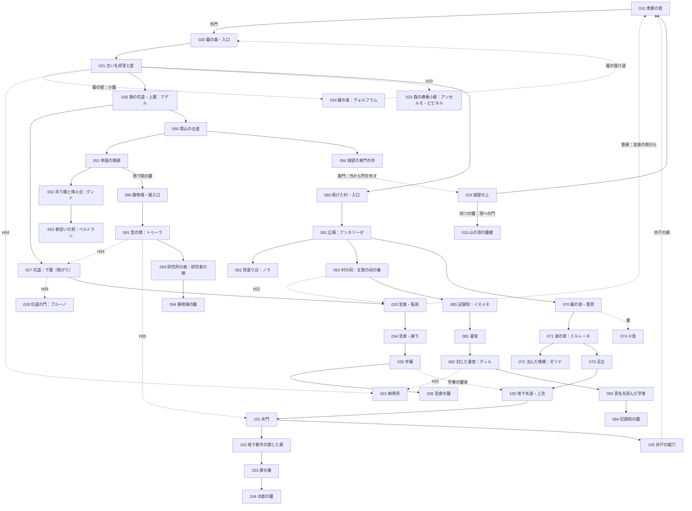

# 世界設計書 — 最後の鐘（仮題、D10）

W・P・V レーンがこのファイルを見て、新しい世界の拠点・ダンジョン・勢力・仲間・生き残り・鐘・結末を作るための設計書。
持ち主が世界観を**全部作り直す**と決めた（2026-10-12、#127）。前の世界「灰の王国」の設計は控えとして [docs/old/](old/) に移した。
筋は 2026-10-12 に持ち主と配り役が何度か決め直した。今の芯は次の三つ。
**物語の中心は「世界に何が起きたか」**で、たくさんの勢力と人の思惑が絡み、一つの真実を語る者はいない。**主人公の正体（人の味方をした使徒）はその中の一本の糸**。**誰も正体を指さして話さない**。

マップの作り方は [docs/mapdesign.md](mapdesign.md)、ID の帯は [docs/ROADMAP.md](ROADMAP.md)、データの形は [docs/mz-data.md](mz-data.md)、文の書き方は [docs/knowhow.md](knowhow.md)（決まりはそのまま。例は前の世界のもの）。

- 世界の手触りは、持ち主の別の作品 Morsveld の世界観を**参考にしただけ**。国・町・使徒の名前と出来事は新しく作った。人物は Morsveld の人物を**スターシステム**で使う（性格・口調・癖だけを写し、経歴・立場・この世界での生き死には新しく作った。[6 章](#6-仲間)・[7 章](#7-生き残りと今の勢力)）。
- 手本（Fanastasis・ダークソウルの手触り）の遊びの構造と語り方は取り入れる。固有名詞・台詞・地名・人物は使っていない。
- 名前・題・細部は推しで書いた。決定待ちは [12 章](#12-決定待ち) と `needs-decision` の issue #129。
- 段階の印〔知〕〔噂〕〔進〕〔秘〕の意味は [knowhow.md 2.1](knowhow.md#21-設定の段階の印)。禁止語は [10 章](#10-禁止語の表)、口調は [11 章](#11-口調の表)。

### 持ち主が決めたこと（変えない）
| 項目 | 決めたこと |
|---|---|
| 雰囲気 | もの悲しいが温かい |
| 語り方 | 目的ははっきり、真相は断片。アイテムの配置と説明文・碑文・日記・墓標で少しずつ。**単純に真実が分からないようにする**（Fanastasis・ダークソウルの手触り） |
| 物語の中心 | **世界に何が起きたか。** 様々な勢力・様々な人の思惑が絡み合う。「他の人間は何をしていたの」とならない。人類は使徒に対抗するため様々な方法を試し、禁忌にも手を出した |
| 書き方の大原則 | 人も文書も思念も、**自分の暮らし・自分の思惑・自分の後悔**のことだけを話す・書く。主人公の正体や謎を指さす台詞・文は書かない |
| 始まり | 目覚めると、荒れ果てた終わった世界。主人公は何も分からないまま冒険する。**案内役はいない** |
| 目的 | 各地域にある **4 つの鐘を鳴らして、山の頂の鐘楼へ行く**。目的は序盤で分かる |
| 残留思念 | 各地に、無念のまま死んだ人の残留思念がある。並べると、物語の輪郭がなんとなく分かる |
| 仲間 | 残留思念のうち**意志の強いもの**が、仲間として一緒に冒険する |
| 主人公の正体 | **使徒で、人間の味方をしていた**。衝撃的で、しかも納得がいくこと。物語の主題ではなく、一本の糸 |
| 主人公の力 | 鐘の力とは関係ない。残留思念を見られる・仲間にできるのが、使徒に由来する力 |
| 正体を知らない者 | プレイヤーと主人公だけ。真実が分かったあと、**誰も主人公を非難しない** |
| 正体が分かる時 | **3 つ目の鐘のあと**。誰かの説明ではなく、主人公自身の記憶の場面で分かる。分かったあとも山場と謎が続く |
| 結末 | 目的を果たして**静かな希望**。しんみり、少し救い。主人公が失うのは**仲間との別れだけ**（生きて朝を迎える） |
| 世界 | 終わってしまった世界。約 200 年前、使徒によって終わった |
| 人物 | Morsveld の人物をスターシステムで使う（性格・口調は写し、立場は新しく） |
| 骨組み | 拠点＋ダンジョン巡り・仲間を呼ぶ。シンボル敵・隠し通路・施設・合成・来歴・召喚・ボスの仕組みは使い回す |

### 前の世界から変わらない前提
- 画面 1280×720、1 マス 48px（横 26.7 × 縦 15 マス）。壁の側面は 2 マスで、**部屋の縦は「床の行数＋2」**。部屋の大きさは床の広さで書く。
- マップは仕上げ後は JSON が正本。持ち主がエディタで仕上げたら、以後はイベントだけを直す。
- 敵の色（緑・黄・赤）、赤は必ず迂回路がある・持ち場から出ない、入口から追い始める距離＋2 マス以上離す（型は [mapdesign.md 7 章](mapdesign.md#7-敵の置き方の型)）。

---

## 1. 世界と年表

### 1.1 骨子（10 行）
1. ここは**終わったあとの世界**。約 200 年前の「**二度目の夜**」に、使徒がいっせいに境山を越え、三つの国は一夜で終わった。〔知〕
2. 昔、人は古言の銘で**鐘**を鋳た。鐘の鳴る所に使徒は入らない（人と使徒の取り決め）。四つの地域の鐘と、山の頂の**親鐘**。〔知〕（鐘の鳴る所に使徒は来ない）〔進〕（取り決めと親鐘）
3. 取り決めは代を重ねて弱り、鐘の届く範囲は年ごとに狭まった。夜の前の数十年（**黄昏の時代**）、人は生き延びるために、あらゆる手を試した。騎士・古言兵・禁忌の研究・地下への避難・生贄・使徒狩り。〔噂〕〜〔進〕（[2 章](#2-勢力と思惑)）
4. 二度目の夜は**一つの原因では起きていない**。教会の鐘の彫り直し、帝国の古言、王国の撤兵、エルフの沈黙、記録院の写し、灰の信徒の手引き、使徒の思惑が重なった。どれが決め手だったかは**最後まで分からない**。〔秘〕（決め手）
5. 各勢力の文書は自分に都合よく書かれ、互いに食い違う。プレイヤーは並べて考える。〔噂〕〜〔進〕
6. 今も、それぞれの勢力の残りと子孫が、それぞれの思惑で動いている。鐘を鳴らしたい者、鳴らさせたくない者、鐘で何か別のことをしたい者。〔知〕〜〔進〕（[7 章](#7-生き残りと今の勢力)）
7. 主人公は、黒鉄の砦の**墓守**だった。目を覚ますと記憶が無く、死んだ人の残留思念が見える。墓所の壁の書き付け「**四つの鐘を鳴らして。それから、山の頂の鐘楼へ**」に従って歩き出す。〔知〕
8. 意志の強い思念は**仲間**として一緒に歩く。仲間の記憶の断片を聞くと、主人公自身の記憶も少しずつ戻る。〔知〕（仲間）〔進〕（戻ること）
9. 3 つ目の鐘のあと、戻ってきた自分の記憶の中で、主人公は自分のしたことを見る。墓守は**死者の思いを取り込む使徒**で、取り込んだ思いを喰わずに生きている人へ届けていた。二度目の夜、喰わないために自分の記憶を仲間たちに預けて眠った。〔進：3 つ目の鐘〕
10. 頂の親鐘を鳴らすと、灰が止む。仲間は思いを届けて去る。主人公は名前を取り戻して朝を迎える。何が決め手だったのかは、誰にも分からないまま。〔進：015〕

### 1.2 昔の大陸（旧暦の時代）
旧暦は「一度目の夜」（使徒が初めて現れた夜）を元年に数えた暦。今の人は旧暦をほとんど使わない。

| 項目 | 中身 | 段階 |
|---|---|---|
| 三つの国 | 西の**アルメリア王国**（麦と川。人が多く、黄昏の時代は飢えていた）、北の**グラーデン帝国**（雪と鉄。軍が強い）、東寄りの**エリンデ共和国**（森と湖。エルフが多い）。名は墓標・碑文・古い札で出る | 〔知〕国があったこと／〔噂〕名 |
| 種族 | 人間・エルフ・獣人。エルフは長命で、200 年前を覚えている者がまだいる | 〔知〕 |
| 使徒 | 人の言葉を解する化け物（1.4） | 〔知〕 |
| 境山（さかいやま） | 人の地の東の端の山並み。向こう側が使徒の地。いちばん高い頂に**鐘楼**と**親鐘** | 〔知〕 |
| 鐘 | 人が古言の銘で鋳た鐘。**鳴る所に使徒は入らない**。四つの地域に一つずつ（**営倉の鐘・記録院の鐘・水底の鐘・鋳物場の鐘**）と、頂の**親鐘**。夕べに、親鐘に合わせて四つが鳴った | 〔知〕鐘で使徒が来ない／〔噂〕なぜ効くか（「神の音」「取り決め」「鉄の音を嫌う」と勢力ごとに違う） |
| 取り決め | 一度目の夜のあと、人と使徒が古言で結んだ約束。銘に刻まれている。「鐘の鳴る所へは入らない。内から戸を開けた所はこの限りでない」。全文は誰も持っていない（写しはどれも欠けている） | 〔噂〕〜〔進：084〕 |
| 黒鉄の砦 | 境山を越える唯一の道を塞ぐ、人の最前線。頂の鐘楼へ上る道の麓。三国の兵の寄り合いの騎士団が守った | 〔知〕 |
| 墓守 | 砦の墓所の番と弔いをする役。死んだ人の言い残しを家族に届けた | 〔知〕墓守がいた／〔噂〕「墓守さまは死んだ人の声を聞く」 |
| 夕べの数 | 夕べの鐘を三十まで数える祈り。指で鐘の形を切る | 〔知〕 |
| 古言（ふること） | 口にした通りに、物ごとを一つだけ動かす古い言葉。使うたびに、話した者から何かが欠ける（名・記憶・顔・影・声）。教会は禁じ、帝国は兵器にし、記録院は消そうとした。文には片仮名の短い音で出し、訳を付けない | 〔噂〕〜〔進〕 |

### 1.3 年表
| いつ | できごと | どこで断片が分かるか | 段階 |
|---|---|---|---|
| 旧暦 元年 | 一度目の夜。使徒が現れ、古い国が潰れる | 礼拝堂の碑文（021） | 〔知〕 |
| 旧暦 数十年 | 人と使徒が古言で取り決めを結ぶ。エルフの「取り決めの歌」を元に銘を作り、頂の親鐘と四つの鐘を鋳る | 記録院の古い記録（081）、エルフの歌（071） | 〔知〕鐘を鋳た／〔進〕取り決めと歌 |
| 旧暦 数百年 | 三つの国。黒鉄の砦。砦の墓所に墓守が居つく（墓守の帳面の字は、何代たっても同じ手） | 墓守の帳面（022） | 〔知〕／〔進〕帳面の字 |
| 夜の前の約 60 年〜 | **黄昏の時代**。鐘の届く範囲が年ごとに狭まる。境で使徒の連れが増える。人はあらゆる手を試す（[2.2](#22-黄昏の時代人類の対抗策)） | 各地のダンジョン | 〔噂〕〜〔進〕 |
| 夜の前の数年 | 教会が「鐘の境を東へ広げる」ため、四つの鐘と親鐘の銘を彫り直す計画を立てる。王国が金を出す。帝国は古言を大量に使い、墓守を調べる。記録院は銘の写しを教会に渡す（本物か偽物かは食い違う）。エルフは調律師を国へ呼び戻す | 2.3 の各勢力の文書 | 〔進〕（言い分ごとに） |
| 二度目の夜 | 教会が親鐘の舌を下ろし、一晩だけ鐘を黙らせて彫り直しを始める。王国の兵は前の日に砦を引き上げている。灰の信徒が門叩きの「入れておくれ」に答えて砦の門を開ける。使徒がいっせいに境山を越える。彫り直しは半ばで止まり、鐘は鳴らなくなる | 四つの札、各勢力の文書、思念 | 〔噂〕同じ夜に黙った／〔進〕それぞれの言い分／〔秘〕決め手 |
| 同じ夜 | 砦の人の多くが死ぬ。墓守は死んでいく人の思いに囲まれ、自分の記憶を仲間たちに預けて墓所で眠る。司祭アンセルモが墓所の壁に書き付けを彫り、途中で喰われる | 仲間の記憶の断片、3 つ目の鐘のあとの場面 | 〔進〕 |
| 夜のあと | 三つの国は終わる。生き残りは灰と霧のあいだに散る。王国の一部は地下都市へ逃げ、扉を閉める。人々は「鐘喰い」が鐘を食べたと言う | 集落の人の話、地下都市（100–104） | 〔知〕〔噂〕 |
| 夜から数えて約 200 年 | 今。主人公は墓所で目を覚ます | 目覚め（010） | 〔知〕 |

- 今の人の暦は「**夜から数えて**」。墓標や札の年はこの数え方。旧暦の年は古い墓標だけに出る。

### 1.4 使徒（この世界の型）
- **人の言葉を解する化け物**。誰もが「使徒」と呼び、土地の呼び名を添える。名（古い刻印の読み）は碑文と記録院の写しにだけ出る。〔知〕呼び名／〔進〕名
- **縄張りを持ち、互いの縄張りに入らない。** 縄張りの中は霧や灰が濃く、人は長くいられない。使徒は使徒の縄張りを歩ける。〔知〕人は縄張りに入れない
- 自分から動く理由は、それぞれの性分だけ。筋のために動かさない。人は正面からは勝てない（格三。[knowhow.md 2.3](knowhow.md#23-敵や大きな存在の格)）。**使徒とは戦わない。**

| 呼び名／名 | 姿と性分 | 縄張り・出る所 | 人との関わり | 段階 |
|---|---|---|---|---|
| **門叩き**（喰い手）／ヴァルナ | 死者の思いを取り込み、喰う型の使徒。喰った死者の声で話す。夜、戸を三度叩き、身内の声で「入れておくれ」と言う。内から開けられた所にだけ入れる | 今は最後に残った地域（[3.6](#37-最後の地域の山場)） | 灰の信徒と通じていた。大きな死を喰いたい。墓守を「同胞」と呼ぶ | 〔知〕門叩きと夜の戸の習い／〔進〕喰うこと・信徒とのつながり |
| **霧の羊飼い**／ウルメ | 霧そのもの。霧で迷った者を群れに入れて連れて歩く | 森（020–025）と湖（070–074）の霧 | エルフが森を閉じたとき、霧の縁を借りた | 〔知〕霧に入るな |
| **灰の母**／セナルカ | 境山の向こうに横たわる大きな女の形と言われる。息をすると灰が降る | 境山の向こう | 灰の信徒の拝む相手 | 〔知〕灰は東から来る／〔噂〕女の形 |
| **骨拾い**／ネムト | 痩せた鳥の頭の長い姿。死者の骨を拾って塔に積む。誰とでも取り引きする | 境山の古道（053 の洞） | 帝国に使徒の骨と知識を、教会に銘の古い形を、信徒に夜の時を売った。今も誰とでも取り引きする | 〔噂〕骨を返してくれる化け物／〔進〕取り引きの帳面 |
| （**鐘喰い**） | 鐘を食べたと言われる使徒。**いない**（人が鐘の沈黙に付けた説明） | ― | 鐘喰いの護符 | 〔噂〕いる／〔秘〕いない |

- 敵（ふつうの化け物）の多くは、黄昏の時代の試みの**成れの果て**（名無し兵・失敗作・狩人・鐘の騎士の亡骸・外に残された者）。そうとは書かず、装備の来歴や思念で察させる（[2.2](#22-黄昏の時代人類の対抗策)）。

### 1.5 答えを書かない所
最後まで、どこにも答えを書かない（〔秘〕。書き手も決めない）。
- 二度目の夜の決め手はどれか。
- 彫り直しの日を決めたのは誰か（教会か、王国の金か、骨拾いが売った「古い形」か）。
- 記録院が教会に渡した写しは偽物だったか。偽物なら、わざとか。
- エルフは夜が来ることを知っていたか。
- 騎士長が墓守を帝国に渡さなかったのは、友情か計算か。
- 灰の信徒は門を開けたことを、救いと思っていたか。

### 1.6 今の暮らし
- 集落は 20〜40 人ほど。井戸と畑と、夜に灯す灯。**夜の戸に答えない**（門叩きの習い）。〔知〕
- 通貨は**鉄くず**（`Hai_Defeat` が落とす所持金。古い釘・蝶番・鎧の板。重さで量る）。〔知〕
- 祈りは「夕べの数」。鐘を知らない子もする。〔知〕
- 言い習わし「**墓守さまに言い残す**」：死ぬ前の言葉を墓に向かって言うと、いつか家族に届く。〔知〕
- 集落によって、拝むものが違う：夕べの会の鐘の祈り、灰の信徒の灰の祈り、何も拝まない拾い屋。〔知〕
- 今の人は自分の暮らしのことしか話さない。世界の説明をする人はいない（[knowhow.md 2.2](knowhow.md#22-説明役に語らせない)）。

---

## 2. 勢力と思惑

### 2.1 200 年前の勢力
どの勢力にも正しさと後ろ暗さがある。どの勢力の文書も、自分に都合よく書かれている。

| 勢力 | 望み | 黄昏の時代にしたこと | 二度目の夜への関わり（言い分） | 残した物 | 段階 |
|---|---|---|---|---|---|
| **鐘の教会** | 鐘を「神の音」として人をまとめる。西の飢えを救うため、鐘の境を東へ広げたい | 鐘の騎士団 | 四つの鐘と親鐘の銘を彫り直す計画。一晩だけ鐘を黙らせる必要があった。「一晩なら使徒は気づかない」。教会の記録は「帝国の古言に神罰が下った夜」と書く | 彫り直しの指図書、頂の足場、親鐘の舌の運び出しの札 | 〔噂〕〜〔進〕 |
| **グラーデン帝国** | 古言を兵器にする。使徒を捕らえて使う | 古言兵（名無し兵）、人造使徒の研究 | 古言を大量に使い、取り決めを弱らせた。研究のなかで「年を取らない墓守」を掴み、捕らえようとしていた。帝国の文書は「教会の彫り直しが原因」と書く | 研究所の観察記録、名無し兵の手紙 | 〔進〕 |
| **アルメリア王国** | 飢えた民を食わせる。東の土地 | 地下への避難 | 教会の計画に金を出した。夜の前の日、戦の準備で兵を砦から引き上げた。王の布告は「民を地下へ守った」とだけ書く | 地下都市、閉じた扉、王の布告 | 〔噂〕〜〔進〕 |
| **エリンデのエルフ** | 取り決めの歌（銘の元）を守る。人を信じていない | 森を閉じる | 彫り直しを知り、危ないと分かって調律師を国へ呼び戻した。人に警告しなかった。エルフの歌は「人が取り決めを破った」と歌う | 森の閉じた門、取り決めの歌 | 〔進〕 |
| **記録院** | 古言の代償を知り、古言そのものを消したい | 真名の研究（禁忌） | 銘の写しを隠し、教会に別の写しを渡した。彫り直しが半端になった一因かもしれない（写しが偽物だったかは食い違う） | 封じた書架、二通りの写し | 〔進〕 |
| **灰の信徒** | 使徒に喰われること＝苦しみの終わり | 生贄の取り引き | 門叩きと通じていた。鐘が黙る夜を知り、砦の門で「入れておくれ」に答えて門を開けた。信徒の経典は「大いなる安らぎの夜」と書く | 経典、生贄の村 | 〔進〕 |
| **黒鉄の砦（騎士団）** | 前線を守る。三国の兵の寄り合い | 方舟（舟）・坑道の避難 | 教会・帝国・王国から食い違う命令を受け続けた。騎士長は帝国の使いに墓守を渡さなかった（理由は書いていない） | 騎士長の日誌、命令書の束 | 〔進〕 |
| **使徒：門叩き** | 大きな死を喰う。墓守を「こちら側」に戻す | ― | 信徒を使って時を合わせた | 喰われた思いの塊 | 〔進〕 |
| **使徒：骨拾い** | 骨を集める。誰とでも取り引きする | ― | 帝国に使徒の骨と知識を、教会に銘の古い形を、信徒に夜の時を売った。誰の味方でもない | 取り引きの帳面（053） | 〔進〕 |

### 2.2 黄昏の時代：人類の対抗策
取り決めは弱っていた。二度目の夜は突然ではなく、数十年の負け戦の終わり。この焦りが、どの勢力にも無理をさせた。
どの試みにもドラマと後ろ暗さがあり、当事者の言い分は食い違う。**今の敵の多くは、その成れの果て**（そうとは書かない）。

| 試み | 誰が | 中身 | 今に残るもの（地域・ダンジョン） |
|---|---|---|---|
| **鐘の騎士団** | 教会 | 小さな鐘を身に付けて境を守る騎士。鐘が弱るにつれ、境で死んでいった | 霧の森と礼拝堂（020–022）：鐘の付いた鎧の亡骸、最後の行軍の思念。敵「鐘鳴りの亡骸」 |
| **使徒狩り** | 傭兵団 | 使徒の連れを狩り、使徒の骨で武器を作る。強くなるほど人でなくなる | 鉄の坑道（026–029）：骨を鍛えた鍛冶場の跡、使徒の骨の武器（装備）。敵「狩人の成れの果て」 |
| **営倉の信徒** | 騎士団 | 捕らえた灰の信徒を営倉に入れていた。夜、その一人が門を開けた | 砦の営倉（033–036）：信徒の囚人の思念、牢番の日誌 |
| **生贄の取り引き** | 信徒の村 | 使徒に人を差し出して村を見逃してもらう。村は長く生き延びた | 焼けた村（060–064）：生贄に選ばれた娘と、止めようとした使徒狩りの話。祠の帳面 |
| **真名の研究（禁忌）** | 記録院 | 使徒の真名を知れば縛れる、という説。読み解いた学者は狂った | 記録院（080–084）：封じた書架、狂った学者の思念、二通りの写し |
| **方舟** | 砦の酒保ゼリナほか | 湖を渡る舟。誰を乗せるかで揉めた | 霧の湖（070–074）：沈んだ桟橋、乗れなかった者の思念 |
| **森を閉じる** | エルフ | 歌で森の境を閉じ、人を入れなくした。外に残された同胞もいた（ミルレーネの家族も） | 霧の湖の奥・霧の森の縁：閉じた門、外に残されたエルフの思念 |
| **地下への避難** | 王国 | 民を地下水道の先の地下都市へ。扉を閉めた日、外に残された民がいた | 地下水道と地下都市（100–105）：閉めた扉、王の言い分と外に残された者の思念。敵「扉の外の者」 |
| **古言兵（名無し兵）** | 帝国 | 古言を戦場で使う兵。使うたびに名・記憶・顔を払い、最後は誰でもなくなる | 境山の古道（050–054）：名を失った兵の成れの果て（敵「名無し」）、恋人の名を忘れた兵の手紙 |
| **人造使徒の研究（禁忌）** | 帝国の研究所 | 使徒の骨や肉（骨拾いから買った）を人に移し、使徒に対抗できる者を作る。ほとんどが失敗 | 古い鋳物場の奥の研究所（090–094）：失敗作の化け物（敵）、研究者の娘が被験者だった話（ボス「研究者の娘」）、観察記録 |
| **鐘の彫り直し** | 教会 | 銘を彫り直して境を東へ広げる | 山の頂（015）：彫りかけの足場、半分だけ新しい銘 |

### 2.3 同じ夜を、それぞれがどう書いたか
同じ出来事を、勢力ごとに違う文書・碑文・思念で見せる。**どれも一部は本当で、一部は都合よく書いてある。**
| 書いた者 | 物 | 二度目の夜の書き方 | 置く所 |
|---|---|---|---|
| 教会 | 夕べの会に伝わる祈祷書 | 「帝国の古言に、神の怒りが下った夜」 | 021 礼拝堂、夕べの会の集落 |
| 帝国 | 研究所の報告の写し | 「教会の彫り直しにより境が消滅。研究は継続」 | 093 研究所 |
| 王国 | 王の布告 | 「民を地下に守った。扉は神の御心により閉じた」 | 100 地下都市の門 |
| エルフ | 取り決めの歌 | 「人が約束を破り、鐘は黙った」 | 071 ミルレーネの家（歌うのは彼女だけ） |
| 記録院 | 学者の手記 | 「写しを渡した。あれで良かったのか」 | 082 封じた書架 |
| 灰の信徒 | 経典 | 「大いなる安らぎの夜。門は内から開かれた」 | 063 村の祠、今の信徒の集落 |
| 騎士団 | 騎士長の日誌 | 「命令が三つ、互いに食い違う。兵は昨日、半分いなくなった」 | 102 地下水道の深み |
| 骨拾い | 取り引きの帳面 | 日付と、売った物と、相手だけ。感想は無い | 053 骨拾いの洞（取り引きで読める） |

---

## 3. 主人公

### 3.1 主人公
| 項目 | 内容 |
|---|---|
| 名前 | **ルカ**（推し。性別を決めない名）。**頂まで出さない**。名前の欄は最初から「墓守」。仲間は昔からの呼び名で呼ぶ（「墓守」「墓守さん」「あんた」「兄貴」）。頂で名前を呼ばれたとき、名前の変更（320）で「ルカ」にする |
| 性別 | 決めない（推し）。台詞で一人称を使わない。見た目は持ち主が素材から選ぶ |
| 肩書き | 墓守（`Actors.json` の `nickname`） |
| 正体 | 死者の思いを取り込む型の使徒。喰わずに、生きている人へ届けた。人の姿で砦の墓守をしていた。〔進：3 つ目の鐘〕 |
| 力 | 残留思念が見える・聞ける。意志の強い思念を連れて歩ける。使徒の縄張りを歩ける。**鐘とは関係ない** |
| Actors / Classes | Actors 1 番（持ち主の帯）。職業は今の Classes 10 を「墓守」に読み替える |
| 戦い方の案 | 剣と弔いの技。最後の地域で、**使徒の力**を自分の意志で使えるようになる（取り込んだ思いを力にする。強いが、使うたびに「呑まれ」が溜まり、溜まりきると数ターン操作できない。仲間が呼びかけると戻る。仕組みは P の後の issue） |
| 性格 | 口数が少ない。台詞は一行で、事実か問い。記憶が戻るほど、言うことがはっきりする。感想・教訓は言わせない |

### 3.2 主人公の糸の出し方
主人公の正体は、**物語の主題ではなく、たくさんの糸の一本**。誰も指さして話さない。プレイヤーが、他人の記録に混ざる一行を並べて気づく。
| 混ざる所 | 一行（例） | 段階 |
|---|---|---|
| 帝国の研究所の観察記録（093）の何十行目か | 「黒鉄の砦の墓守。死者と話すとの噂。年を取らない。要観察。」 | 〔進：093〕 |
| 騎士長の日誌（102） | 「墓守を帝国の使いに渡さなかった。理由は書かない。」 | 〔進：102〕 |
| 酒保のつけ帳（072） | 墓守の欄だけ、名前が空白。つけは二百年分の銀三枚 | 〔噂〕 |
| 墓守の帳面（022） | 何代にもわたって同じ手の字 | 〔噂〕 |
| 骨拾いの取り引きの帳面（053） | 「帝国へ。骨三本。問い：年を取らぬ者はいるか。答え：砦に一人」 | 〔進：053〕 |
| 名の壁（010） | 「墓守」の欄だけ、名前が削られては彫り直された跡 | 〔噂〕 |
| 仕組み | 残留思念が見える。生き残りには見えない（シャノ「誰と話してんの？」） | 〔知〕 |
| 弱い化け物・骨拾い | 化け物が一瞬ためらう（`<hai_enemy_hesitate>`）。骨拾いは頭を深く下げる。理由は言わない | 〔知〕 |

- **書かないこと**：「正体を知っていた」「言えない」「やっと言える」のような、正体を意識させる台詞。仲間は普段どおり、自分の暮らしと後悔の話だけをする。

### 3.3 失ったもの
| 失ったもの | 今どこにあるか | 戻る時 | 段階 |
|---|---|---|---|
| 記憶 | **仲間たちに一つずつ預けてある**（7 人分） | 仲間の記憶の断片を聞くたびに、主人公の記憶の一行が戻る（6.4 の ◆）。3 つ目の鐘のあとに大きな場面。全部は頂で | 〔知〕記憶がない／〔進：3 つ目の鐘〕預けたこと |
| 名前 | 仲間が呼ばないので分からない | 頂 | 〔進：015〕 |
| 最後の欠片 | アンセルモに預けた分。アンセルモの思いごと門叩きが抱えている | 最後の地域の山場 | 〔進〕 |
| （失わないもの） | 思いを見る力、年を取らない体、古言を読む目、縄張りを歩ける体 | ― | 〔進〕 |

### 3.4 目覚めと最初の数分（案内役なし・主人公の台詞なし）
**狙い**：誰にも説明されずに、最初の数分で「ここは崩れた砦」「四つの鐘を鳴らして山の頂へ行く」「まず砦の下と霧の森」「死んだ人の思いが見える」が分かる。

1. **墓所**（010 の西）。画面は黒から始め、棺の並ぶ石の部屋の床で目を開ける。自動で 1 行だけ。
   ```
   床の小さな鈴が、まだ揺れている。
   ```
   扉は開いている。床の灰に、小さな足跡が外へ続く（調べると「灰に、裸足の小さな足跡。外へ駆けていった」）。
2. **最初の残留思念**（墓所の棺の一つ。主人公にだけ見える）。
   ```
   娘の婚礼の歌を、まだ半分しか覚えていない。
   墓守さん、続きを聞いといてくれ。
   ```
3. **墓所の壁の書き付け**。
   ```
   壁に、刃物で刻んだ字がある。
   「四つの鐘を鳴らして。それから、山の頂の鐘楼へ」
   最後の一画が、途中で止まっている。
   ```
   メモに「四つの鐘を鳴らす。それから山の頂の鐘楼へ（墓所の壁）」。**これが目的**。
4. **炉**（大広間）。「火を入れる」で回復と記録（`Hai_Defeat` の戻り先、`Hai_Warp` の拠点の結界）。
5. **シャノ**（最初の生き残り）。炉に火を入れたあと、柱の陰から出てくる。自分の用事だけを話す。
   ```
   シャノ「……火、つけたの、あんた？」
   シャノ「おれ、鉄を拾いに来ただけ。鈴、蹴っちゃった。ごめん」
   シャノ「さっき誰と話してたの？　……ま、いいや」
   シャノ「頭に言われてんだ。砦の地下の牢の鐘、外して持ってこいって」
   シャノ「でも鉄の扉が開かない。あと、森の霧で炊き出しの爺さんが三日帰ってない」
   シャノ「おれは霧、だめなんだ。……ここ、ちょっといていい？」
   ```
   主人公は答えない。シャノは大広間に残り、**倉**が開く。メモに「鐘：砦の地下の牢（シャノ）」「炊き出しの爺さん：外の森の霧（シャノ）」。
   （シャノの「頭」は拾い屋のマルゴ。鐘を売るつもりでいる。[7.2](#72-今の勢力と人)）
6. **中庭**から東の空を調べると「雲の上に、塔の影が一つ。山の頂だ」。
7. **外門**の内側に「拳ほどの凹みが三つ。縦に並んでいる」。門の外が霧の森（020）。
8. **営倉への鉄扉**は錆びついて動かない。森から坑道を抜けて営倉へ回り、内側から開けると近道になる。

### 3.5 記憶が戻るたびの一言
仲間の記憶の断片の ◆ で主人公の記憶が一行戻ったとき、主人公が一行だけ言う。事実か問い。一人称を使わない。
| 戻った数 | 一言 |
|---|---|
| 1 | 「……覚えている。この人の葬式を出した」 |
| 4 | 「墓守の帳面。全部、同じ手だ」 |
| 7 | 名前のところだけ、思い出せない（頂で戻る） |

### 3.6 3 つ目の鐘のあと：自分の記憶の場面
- 3 つ目の鐘を鳴らしたあと、その鐘の間で死んだ人の思念を聞くと、主人公自身の記憶が大きく戻る（誰も説明しない。主人公が自分のしたことを見る）。
- 場面（案。画面を暗くし、文章だけ。地の文の主語は「自分」）：
  鐘が黙る。墓所に、死んでいく人の思いが次々に流れ込む。一つ取り込むたびに、喰いたくなる。喰えば楽になる、と体が知っている。仲間が一人ずつ墓所に入ってくる。自分は一人に一つずつ、自分の記憶を渡していく。門番には数え方の夜を、書記には黙っていてくれと頼んだ夜を。渡すたびに、喰いたい「自分」が薄くなる。相棒の司祭が壁に何かを彫りはじめる。目を閉じる。
- 場面のあとの主人公の一言：「……喰わないために、預けたのか」。
- **仲間は普段どおり**話す（特別な告白をしない）。食堂でゼリナが「つけ、まだ残ってるで」と言う。それだけ。生き残りも変わらない。
- 以後、仲間の記憶の断片の ※ が読める（6.4）。

### 3.7 最後の地域の山場
- 3 つ目の鐘のあと、門叩きは**まだ鳴っていない最後の地域**に縄張りを広げて待つ（受動の理由：同胞が必ず来る所で待つ。門叩き自身の思惑）。その地域の色調が暗くなり、「声だけの影」の敵が増える。その地域の今の勢力の人も、それぞれの思惑で動く（7.2）。
- 鐘の間の手前で、門叩きが主人公を誘う（姿は見せない。死者の声を次々に替えて話す）。門叩きは自分の望みだけを話す。
  ```
  同胞よ。拾ったものは、喰うものだ。
  あの夜は、よく喰えた。お前の分も残しておいた。
  ```
- **門叩きが抱えた思いの塊**（ボス）。主人公は初めて**使徒の力**を自分の意志で使う。呑まれが溜まると、仲間が呼び名で呼びかけて戻す（「墓守！」「兄貴！」）。
- 塊を崩すと、**喰われていたアンセルモの思い**が解き放たれ、最後の仲間になる。アンセルモは自分のことだけを話す。
  ```
  アンセルモ「おう。遅かったの、お前さん」
  アンセルモ「壁の字は読んだか。最後の一画、彫れんかった」
  ```
- そのあと、その地域の鐘を鳴らす（4 つ目）。門叩きは退くが、倒れない（使徒とは戦わない）。

---

## 4. 拠点 黒鉄の砦（マップ 010–019）

### 4.1 砦の今の姿
- 境山の麓、頂の鐘楼へ上る道を塞ぐ石の砦。外壁の半分は崩れ、中庭は灰に埋まっている。〔知〕
- 200 年、誰も住まなかった。だから生き残りが住める。〔知〕
- 部屋を一つずつ**直していく**：生き残りが来るたびに一部屋が開き、炉の火・食堂の皿・寝台の数が増える。
- 頂への道は、城壁の上（019）の東の端の門から続く。門の先は灰と霧が濃く、**四つの鐘が鳴るまで**通れない。〔知〕
- 今の勢力の人が砦を訪ねてくる（夕べの会の騎士、灰の信徒の使い、拾い屋の頭）。砦は誰の物でもない。

### 4.2 マップの割り当て
| マップ | 新しい名前 | 前の世界 | 大きさ | タイルセット |
|---|---|---|---|---|
| 010 | 黒鉄の砦・内郭 | 牢獄の間（作り直す） | 50 × 40 前後 | 11 |
| 011 | 稽古場 | 魂の間 | 17 × 13 | 11 |
| 012 | 食堂 | 創作者の厨房 | 17 × 13 | 11 |
| 013 | 倉 | 保管ゲート | 17 × 13 | 11 |
| 014 | 書庫 | 理知の間 | 17 × 13 | 11 |
| 015 | 山の頂の鐘楼 | 王都の門（W5 の枝。作り直す） | 40 × 30 前後 | 2 外観 |
| 016 | 療養所（新） | ― | 17 × 13 | 11 |
| 017 | 鍛冶場（新） | ― | 17 × 13 | 11 |
| 018 | 見張り台（新） | ― | 17 × 13 | 2 外観 |
| 019 | 城壁の上（新） | ― | 45 × 15 前後 | 2 外観 |

010 の部屋（大きさと形は [mapdesign.md 1 章](mapdesign.md#1-1-枚の大きさ)）：
| 前の世界の部屋 | 新しい部屋 | 置くもの |
|---|---|---|
| 目覚めの独房（西） | 墓所 | 棺の並ぶ石の部屋（開始位置）、小さな鈴、**壁の書き付け**、最初の残留思念、墓守の外套掛け（空） |
| 中央の広間 | 大広間 | **炉**（回復と記録）、食卓（生き残りの数で人が増える）、空の鐘架 |
| 召喚陣の間（東） | 名の壁 | 砦の兵の名を刻んだ壁。足元に輪。**形見か遺骸を置くと残留思念を呼べる**（`Hai_Companions`）。「墓守」の欄だけ、名前が削られては彫り直された跡 |
| 出口の階段（北） | 外門への階段 | 門の内側に三つの凹み |
| 4 つの施設の扉 | 稽古場・食堂・倉・書庫の扉 | **崩れた扉**。生き残りが来ると片付いて開く |
| 開かない鉄の扉（南） | 営倉への鉄扉 | 営倉の側から閂を外す近道 |
| 塞がった螺旋階段の跡 | 城壁へ上る階段 | 019 城壁の上へ。東の端に頂への門 |
| （新）療養所・鍛冶場・見張り台の扉 | 010 の空いた壁に足す | 同上 |
| （新）井戸 | 中庭の井戸 | 底は暗い。地下水道の側（105）から綱を下ろすと近道になる |

### 4.3 部屋が開く順と条件
**叡智のオーブはやめる**。部屋は**生き残りが砦に来ると開く**。開けるのは `Hai_Facilities` のプラグインコマンド `open`（オーブなしで開く）。開いたら施設のスイッチ（121〜124）を ON。新しい 3 部屋は新しい仕組みが要る（P の後の issue）。
生き残りが砦に来るかどうかは、その人の頼みごと（[7.3](#73-頼みごとの筋)）の結果で変わる。来ない・死ぬこともある。部屋は**別の手でも開く**（下の「来ないとき」）。

| 部屋 | マップ | 開く人 | 会う所 | できること | 来ないとき |
|---|---|---|---|---|---|
| 炉 | 010 | 主人公（最初に火を入れる） | ― | 回復・記録・全滅の戻り先 | ― |
| 名の壁 | 010 | 最初の遺骸か形見を見つける | ― | 残留思念を呼ぶ・並び替え | ― |
| 倉 | 013 | シャノ | 010 | 倉庫（`Hai_Items`） | ― |
| 食堂 | 012 | ヴォルフラム | 024 霧の奥 | 合成（`Hai_Craft`）。食卓の人の数で一言が変わる | 鍋だけ残る（合成はできる） |
| 稽古場 | 011 | アデル | 026 鉄の坑道 | 控えの仲間を育てる | 稽古の札を自分で読む（育てる値が少し高い） |
| 書庫 | 014 | イスメネ | 080 記録院 | 倒したボス・読んだ思念・写しの読み比べ | 本棚だけ（ボスの記録は読める） |
| 療養所 | 016（新） | ピピネル | 023 森の療養小屋 | 案：状態異常を治す・消耗品の所持上限を 1 つ増やす | 開かない |
| 見張り台 | 018（新） | グィド | 052 吊り橋と烽火台 | 案：オートマップの全図、転送の行き先を足す | 開かない |
| 鍛冶場 | 017（新） | アンネリーゼ | 061 焼けた村 | 案：一点ものの装備を鍛え直す。鉄切り鋏 | 開かない（鋏は拾い屋の頭から買える） |

- **食堂がにぎやかになる**：変数「生き残りの数」（0〜7）で、大広間の食卓の人が増える。〔知〕

### 4.4 旗の読み替えの案
番号の帯は配り役が [ROADMAP.md](ROADMAP.md) で決める。今の旗（[old/world.md 8 章](old/world.md#8-筋の旗の表スイッチ変数-101200)）の読み替えの案だけ。
| 今の旗 | 新しい意味 |
|---|---|
| スイッチ 101〜104・105・変数 101 | 鐘を鳴らした（営倉・記録院・水底・鋳物場）・四つ鳴った・鳴らした鐘の数 |
| スイッチ 106〜110 | 3 つ目の場面を見た・ミルレーネに会った・最後の地域の山場を越えた・頂への門が開いた・名前が戻った |
| スイッチ 111〜114 | 目覚めた・炉に火を入れた・名の壁を教わった・営倉の鉄扉を開けた |
| スイッチ 115〜120 | 今の勢力の筋（夕べの会・灰の信徒・名無し・拾い屋の頭）の分かれ目（7.3） |
| スイッチ 121〜124 | 稽古場・食堂・倉・書庫が開いた |
| スイッチ 131〜145 | 仲間が 7 人になるので帯を広げる（P の後の issue） |
| スイッチ 151〜155 | ボス（5.5） |
| スイッチ 181〜184 | 結末と真の結末の条件 |
| 変数 102・103 | 仲間の数（0〜7）・生き残りの数（0〜7） |

## 5. 地図と段階

### 5.0 全体
砦を真ん中に、北に霧の森、北東の山に鉄の坑道、砦の下に営倉。東の尾根に**境山の古道**、西の谷に**焼けた村**、南西の低地に**霧の湖**、北西の丘に**記録院**、山の根の下に**古い鋳物場と帝国の研究所**、砦の真下に**地下水道と地下都市**。いちばん東の高みに**山の頂の鐘楼**。
マップは**網の目**につなぎ、1 枚を広くし、近道と「後の物で開く道」で前の場所へ戻らせる。作り方の決まりは [docs/mapdesign.md](mapdesign.md)。
前の世界のマップは**形をそのまま使う前提をやめ**、この網に合わせて作り直す。使い回すのは ID の帯と、遠い所がつながる 4 つ（H22・H31・H34・H35）の考え方、それに形の合う小部屋だけ（5.2）。
**どのダンジョンにも、一つ以上の「滅びの前のドラマ」**（[2.2](#22-黄昏の時代人類の対抗策)）を割り当てる。どれも当事者の言い分が食い違う。

### 5.1 四つの地域・鐘・滅びの前のドラマ
| 地域 | ダンジョン | 滅びの前のドラマ（2.2） | 今の勢力（7.2） | 鐘 | 守り | 段階 |
|---|---|---|---|---|---|---|
| 一 砦の下 | 霧の森（020–025） | 鐘の騎士団の最後の行軍。エルフが閉じた森の門 | 夕べの会の巡礼 | ― | ― | 第1段階 |
| 一 砦の下 | 鉄の坑道（026–032） | 使徒狩りの傭兵団。骨を鍛えた鍛冶場。坑夫の避難（ブルーノ） | 拾い屋の頭の掘り場 | ― | ― | 第1段階 |
| 一 砦の下 | 砦の営倉（033–037） | 捕らえた灰の信徒。夜に門を開けた一人 | ― | **営倉の鐘**（036） | 牢番 | 第1段階（必ず 1 つ目） |
| 二 西の谷 | 焼けた村（060–064） | 生贄の取り引きの村。選ばれた娘と、止めようとした使徒狩り | 灰の信徒の今の集落 | ― | 生贄の祠の番 | 第2段階 |
| 二 西の谷 | 記録院（080–084） | 真名の研究と狂った学者。教会に渡した二通りの写し | 書庫番イスメネ | **記録院の鐘**（084） | 真名を読んだ学者 | 第2段階 |
| 三 南の水 | 霧の湖（070–074） | 方舟。誰を乗せるかで揉めた。森の外に残されたエルフ | ミルレーネ | ― | 沼主 | 第2段階 |
| 三 南の水 | 地下水道と地下都市（100–105） | 王国の地下への避難。閉めた扉と、外に残された民。騎士長の最後の日誌 | 地下都市の子孫（扉の内側の村） | **水底の鐘**（104） | 扉の番 | 第2段階 |
| 四 東の山 | 境山の古道（050–054） | 帝国の古言兵（名無し兵）。恋人の名を忘れた兵の手紙 | 名無し（帝国の古言使い） | ― | 岩背負い（任意） | 第2段階 |
| 四 東の山 | 古い鋳物場と帝国の研究所（090–094） | 人造使徒の研究。研究者の娘。親鐘の舌の鋳直し（トゥーラ） | 名無しの隠れ家 | **鋳物場の鐘**（094） | 研究者の娘 | 第2段階 |
| 頂 | 山の頂の鐘楼（015） | 教会の彫り直しの足場。半分だけ新しい銘 | 夕べの会の長 | **親鐘**（舌が無い） | 夜の思い（耐える戦い） | 終盤 |

| 段階 | 鐘 | 仲間 | 生き残り | 遊ぶ時間 |
|---|---|---|---|---|
| 第1段階 | 営倉の鐘 | ブルーノ | シャノ・ヴォルフラム・アデル | 45 分前後（本道だけなら 25 分） |
| 第2段階 | 記録院・水底・鋳物場の鐘（好きな順。3 つ目のあと主人公の記憶の場面。最後の地域に門叩きが縄張りを広げる） | ノラ・ディル・ゼリナ・ベルトラン・トゥーラ、最後にアンセルモ | イスメネ・ピピネル・グィド・アンネリーゼ、ミルレーネ（生きて会う） | 5 時間前後 |
| 終盤 | 親鐘 | ― | ― | 結末 |

- 地域二〜四は**好きな順**で回れる。主人公の記憶の大きな場面は**鳴らした数**が 3 になったとき（どの鐘でも。[3.6](#36-3-つ目の鐘のあと自分の記憶の場面)）。3 つ目のあと、門叩きは**まだ鳴っていない最後の地域**に縄張りを広げ、その地域の鐘の間の守りは門叩きが抱えた思いの塊に替わる（[3.7](#37-最後の地域の山場)）。どの地域が最後になってもよいよう、三つの鐘の間の手前に、山場の置き場所を作っておく。
  - 記録院の鐘：森 → 焼けた村 →（生贄の祠の番）→ 記録院。
  - 鋳物場の鐘：坑道 → 境山の古道 →（陣跡の地下壕の鍵）→ 古い鋳物場と研究所。
  - 水底の鐘：森 → 焼けた村 → 霧の湖 →（沼主）→ 地下水道、**または** 営倉 →（牢番の鍵束）→ 地下水道。
- 本道で要る「後の物」は、牢番の鍵束・鐘番の角灯・見張り塔の小鐘の 3 つだけ。ほかは寄り道（[mapdesign.md 4 章](mapdesign.md#4-後の物で開く道)）。
- ボスの強さは鳴らした鐘の数で変えない。
- 敵の多くは 2.2 の試みの成れの果て：森と礼拝堂は「鐘鳴りの亡骸」、坑道は「狩人の成れの果て」、古道は「名無し」、研究所は「失敗作」、地下都市は「扉の外の者」。そうとは書かず、装備の来歴と思念で察させる。

### 5.2 使えるマップと作り直すマップ
「使える」＝前の世界のマップの**形（タイル層）をそのまま使い**、置く物・文・敵・色調・飾りを替える小部屋。「作り直す」＝ [mapdesign.md 1 章](mapdesign.md#1-1-枚の大きさ) の大きさで描き直す。「新」＝新しく作る。
番号は前の世界の帯のまま（[mapdesign.md 2.1](mapdesign.md#21-id-の帯前の世界の帯をそのまま使う)）。W5 の枝 `claude/w5-stage2e` のマップ（015・090–104）は main に入っていない。

**砦と地域一（第1段階）**
| マップ | 前の世界 | 新しい名前 | 判定 | 中身 |
|---|---|---|---|---|
| 010 | 牢獄の間（33 × 27） | 黒鉄の砦・内郭 | 作り直す（50 × 40 前後） | 4.2 |
| 011–014 | 魂の間・厨房・保管ゲート・理知の間 | 稽古場・食堂・倉・書庫 | 使える | 台座をやめ、生き残りの置き物に替える |
| 016–018 | ― | 療養所・鍛冶場・見張り台 | 新 | 4.3 |
| 019 | ― | 城壁の上 | 新 | 東門（古道の側から開く近道）、頂への門（四つの鐘が鳴ると通れる） |
| 020 | 巡礼の森・入口 | 霧の森・入口 | 作り直す（70 × 50） | 倒れた見張り塔（小鐘）、森の墓地、鐘の騎士の亡骸 |
| 021 | 巡礼の森・奥 | 古い礼拝堂と崖 | 作り直す（60 × 45） | 鐘を抱く像と碑文、教会の祈祷書、霧の壁、崖の上の祠、北東の坑口 |
| 022 | 礼拝堂の地下納骨所 | 納骨所 | 使える | H04・H31 の裏、名札の棚 |
| 024 | ― | 霧の奥 | 新（40 × 30） | ヴォルフラム、エルフが閉じた森の門、入口へ抜ける霧の抜け道 |
| 026 | 廃坑・上層 | 鉄の坑道・上層 | 作り直す（60 × 45） | アデル、使徒狩りの鍛冶場の跡、昇降機、鉄格子の奥（鉄切り鋏）、東の坑道→古道 |
| 027 | 廃坑・下層 | 鉄の坑道・下層 | 作り直す（50 × 40、暗がり） | 大扉（ブルーノ・トゥーラ）、掘り抜き→営倉 |
| 028 | 崩落の間 | 坑道の門 | 使える | ブルーノの遺骸 |
| 029 | ― | 坑夫の詰め所 | 新 | 鐘番の角灯 |
| 033 | 地下牢・監房区 | 営倉・監房 | 作り直す（60 × 45） | 施錠扉（鍵束）、鉄扉→砦（近道）、捕らえた信徒の囚人の思念 |
| 034 | 地下牢・更生の廊下 | 営倉・廊下 | 作り直す | 往復の番の獣とレバー（mapdesign 8 章「見張りの読み」） |
| 035 | 拷問の間 | 牢番の詰め所 | 使える | ボス 牢番、西の扉→地下水道（鍵束） |
| 036 | オーブの間 | 営倉の鐘の間 | 使える | **営倉の鐘**、四つの札（一枚目）、鐘番の思念 |
| 037 | ― | 井戸の底への通路 | 新 | 地下水道 105 へ（第2段階で開く） |

**地域二〜四（第2段階）と頂**
| マップ | 前の世界 | 新しい名前 | 判定 | 中身 |
|---|---|---|---|---|
| 023 | 看取りの小屋 | 森の療養小屋 | 使える | アンセルモの遺骸（呼べない）、ピピネル |
| 050 | 崖道・下の道 | 境山の古道・尾根道 | 作り直す（80 × 60、段が 3 つ） | 名無し兵の戦場、倒れた子鐘の塔、上段（鉤綱） |
| 051 | 帝国の陣跡 | 帝国の陣跡 | 作り直す | 恋人の名を忘れた兵の手紙、鉤綱、地下壕の鍵→鋳物場 |
| 052 | 巨人の吊り橋と門 | 吊り橋と烽火台 | 作り直す | グィド、岩背負い（任意） |
| 053 | 見張りの洞 | 骨拾いの洞 | 使える | 骨拾い、取り引きの帳面、ベルトランの形見 |
| 054 | ― | 城壁の東門の外 | 新 | 東門の閂（019 への近道） |
| 060 | 焼け野の入口 | 焼けた村・入口 | 作り直す | 戸板の盾、配給札、盛り土（ノラ）、灰の信徒の今の集落 |
| 061 | 廃集落・広場 | 焼けた村・広場 | 作り直す（70 × 50） | アンネリーゼ、倒れた梁（トゥーラ） |
| 062 | 焼けた見張り台 | 村の見張り台 | 使える | ノラの遺骸、屋根（鉤綱） |
| 063 | 焚刑の教会 | 村の祠 | 使える | 生贄の帳面、経典、ボス 生贄の祠の番、裏口→記録院 |
| 064 | 地下の護送路 | 荷運びの抜け道 | 使える | H22（村→営倉） |
| 070 | 湿地・葦原 | 霧の湖・葦原 | 作り直す（80 × 60、舟） | 霧の道（小鐘）、向こう岸（櫂） |
| 071 | 水上集落の跡 | 湖の家 | 作り直す | ミルレーネ、湖の灯の帳面、取り決めの歌 |
| 072 | 沈んだ舞台 | 沈んだ桟橋 | 使える | ゼリナの遺骸、櫂、酒保のつけ帳 |
| 073 | 沼主の淵 | 湖の淵 | 使える | ボス 沼主、排水口→地下水道 |
| 074 | ― | 小島 | 新 | 赤い宝箱（舟で） |
| 080 | 古書院・前庭と閲覧室 | 記録院・前庭 | 作り直す | イスメネ、古言の碑の扉（ディル） |
| 081 | 書架の迷路 | 記録院・書架 | 作り直す（60 × 45） | 番号錠、鐘の古い記録、二通りの写し |
| 082 | 禁書庫 | 封じた書架 | 作り直す（暗がり） | ディルの遺骸、刻印の写し、狂った学者の思念、H31 |
| 083 | 紙魚の王の間 | 真名の間 | 使える | ボス 真名を読んだ学者 |
| 084 | オーブの間「聖灰」 | 記録院の鐘の間 | 使える | **記録院の鐘** |
| 090 | 研究所・搬入口（枝） | 鋳物場・搬入口 | 作り直す | トゥーラの記憶 3、骨拾いからの荷札 |
| 091 | 実験棟（枝） | 鋳物場・型の間と研究所の檻 | 作り直す（60 × 45） | トゥーラの遺骸、H34・H35、鉄格子（鋏） |
| 092 | 契約の写し室（枝） | 鐘の型の部屋 | 使える | 親鐘と四つの鐘の型が並ぶ、古言の碑の扉（ディル） |
| 093 | 番人の間（枝） | 研究所の奥 | 使える | 観察記録、ボス 研究者の娘 |
| 094 | オーブの間「契約」（枝） | 鋳物場の鐘の間 | 使える | **鋳物場の鐘**、調律師の音叉 |
| 100 | 下水道・上流（枝） | 地下水道・上流 | 作り直す | 舟で下る、王の布告 |
| 101 | 水門の間（枝） | 地下水道・水門 | 作り直す（60 × 45） | 二つの弁（水位の切り替え） |
| 102 | 結界の真下（枝） | 地下都市の閉じた扉の前 | 作り直す（暗がり） | 扉の外に残された民の思念、騎士長の日誌、アンセルモの記憶 3 |
| 103 | 灰の騎士の間（枝） | 扉の番の間 | 使える | ボス 扉の番 |
| 104 | オーブの間「封印」（枝） | 水底の鐘の間 | 使える | **水底の鐘**、鐘番の思念 |
| 105 | ― | 井戸の縦穴 | 新 | 綱を下ろす（010 の井戸への近道）。扉の内側の村への道 |
| 015 | 王都の門（枝） | 山の頂の鐘楼 | 作り直す（40 × 30 前後） | 舌の無い親鐘、彫り直しの足場、夕べの会の長（9 章） |

- 遠い所が実は隣（VISION 核 1）の 4 つ（H22・H31・H34・H35）は残す。意味だけ読み替える：村は営倉へ荷を運んだ／記録院の古い帳面は納骨所に移した／鋳物場の鉄は坑道から来た／鋳物場の水は地下水道へ流れた。
- 砦へ戻る近道は 4 つ：営倉の鉄扉（033）・城壁の東門（054→019）・井戸の綱（105→010）・霧の抜け道（024→020）。

### 5.3 つながり図
網の全体は [mapdesign.md 2 章](mapdesign.md#2-網の目拠点からのつながり)。ここは人と鐘の置き場所を足した図。点線は近道か隠しか、後の物で開く道。



### 5.4 生き残りと仲間の置き場所（まとめ）
| 地域 | ダンジョン | 仲間の遺骸・形見 | 生き残り | 生きて会う人・今の勢力の人 |
|---|---|---|---|---|
| ― | 砦（010） | ― | シャノ | 訪ねてくる：夕べの会の騎士ソレンヌ、拾い屋の頭マルゴ |
| 一 | 霧の森（020–025） | ― | ヴォルフラム（024） | ― |
| 一 | 鉄の坑道（026–032） | ブルーノ（028） | アデル | マルゴの掘り場 |
| 一 | 砦の営倉（033–037） | ― | ― | ― |
| 二（森の脇） | 森の療養小屋（023） | アンセルモの遺骸（呼べない。最後の地域の山場で加わる） | ピピネル | ― |
| 二 | 焼けた村（060–064） | ノラ（062） | アンネリーゼ（061） | 灰の信徒の司祭ゲンサイ |
| 二 | 記録院（080–084） | ディル（082） | イスメネ（080） | ― |
| 三 | 霧の湖（070–074） | ゼリナ（072） | ― | ミルレーネ（071） |
| 三 | 地下水道と地下都市（100–105） | ― | ― | 扉の内側の村の人 |
| 四 | 境山の古道（050–054） | ベルトラン（053） | グィド（052） | 骨拾い（使徒）、名無し |
| 四 | 古い鋳物場と研究所（090–094） | トゥーラ（091） | ― | 名無しの隠れ家 |
| 頂 | 015 | ― | ― | 夕べの会の長ルシアン |

### 5.5 ボスの一覧
ボスは「必須はボスだけ・ボスからも逃げられる」（`Hai_Boss`）。**使徒はボスにしない。**
多くは黄昏の時代の試みの成れの果て。倒すと静かに崩れ、形見が一つ残る。ボスも自分の命令と後悔のことだけをくり返す。

| ボス | マップ | 何の成れの果てか | なぜそこにいる | 弱みの手がかり | 段階 |
|---|---|---|---|---|---|
| 牢番 | 035 | 砦の営倉の牢番 | 夜に門を開けた信徒を出したのは自分の営倉だった。「誰も出すな」と、まだ見張っている | 帳面の「火を嫌う。灯を持って来るな」 | 第1段階 |
| 岩背負い | 052 | 境山の大きな獣（任意） | 橋のたもとを寝床にしている | 背の岩の割れ目 | 第2段階 |
| 生贄の祠の番 | 063 | 生贄の村の祠守り | 「差し出す者を逃がすな」と、まだ祠の戸を守っている | 生贄の帳面の最後の名（逃げた娘） | 第2段階 |
| 沼主 | 073 | 湖の主の化け物（霧の羊飼いの連れ） | 淵を寝床にしている | 葦の刈り跡 | 第2段階 |
| 真名を読んだ学者 | 083 | 記録院の学者 | 真名を読み解いて狂い、まだ読み続けている | 封じた書架の「声に出すな」の札 | 第2段階 |
| 扉の番 | 103 | 王国の地下都市の衛兵 | 「扉を開けるな」の命令を、外の者にも内の者にも守り続けている | 王の布告と、外に残された民の思念 | 第2段階 |
| 研究者の娘 | 093 | 人造使徒の研究の被験者 | 父の研究所から出られない。父の名を呼ぶ | 観察記録の「光を嫌う」 | 第2段階 |
| 門叩きが抱えた思いの塊 | 最後の地域の鐘の間の手前（084・094・104 のどれか） | 二度目の夜に喰われた思いの固まり。中にアンセルモ | 門叩きが同胞を待つ所に置いた | 仲間の呼びかけ（使徒の力の呑まれを戻す） | 第2段階（4 つ目） |
| 夜の思い | 015 | 二度目の夜に死んだ人たちの残りの思いの群れ | 親鐘に舌が吊られると集まる | 倒す戦いではない。決まったターンを耐える。仲間が記憶を返すたびに強くなる（9.2） | 終盤 |

### 5.6 使い回す仕組み
| 仕組み（[docs/plugins/](plugins/)） | 新しい世界での使い方 | 足すもの |
|---|---|---|
| `Hai_SymbolEnemy` | 2.2 の成れの果て・灰の獣・迷い人。色と迂回路の約束はそのまま | 弱い化け物のためらい（3.2） |
| `Hai_HiddenPassage` | 隠し通路・片側扉・隠し階段 | なし |
| `Hai_Thoughts`・`Hai_Notes` | 残留思念（主人公にしか見えない）、勢力ごとの文書、墓所の書き付け、頼みごとのメモ | なし |
| `Hai_Companions` | 意志の強い残留思念を名の壁に呼ぶ・記憶 4 断片（◆で主人公の記憶も戻る）・完全体。アンセルモの遺骸は呼べない | 7 人にする（今は 5 人）。呼べない遺骸の印 |
| `Hai_Facilities` | 稽古場・食堂・倉・書庫。生き残りが来たら `open` | 新しい 3 部屋 |
| `Hai_Craft`・`Hai_Items` | 食堂の合成、倉、赤い宝箱の一点もの（使徒の骨の武器ほか） | なし |
| `Hai_Lore` | 8.3 の来歴 | なし |
| `Hai_Boss`・`Hai_Battle` | 5.5 のボス。使徒の力（代償つき）。頂の耐える戦い | 「呑まれ」と呼びかけ（P） |
| `Hai_Defeat` | 全滅で鉄くずを落とし、炉に戻る | 通貨の名（持ち主） |
| `Hai_Warp`・`Hai_AutoMap` | 転送の結界、地図 | 見張り台で入口を足す（案） |
| `Hai_MapTone`・`Hai_Comfort`・`Hai_TouchUI` | そのまま | なし |
| （新）頼みごとの筋 | 生き残りと今の勢力の人の連続した用事（7.3）。スイッチと変数で分かれ目を持つ | 頼みごとの一覧をメモに出す小さな足し（U か P） |

---

## 6. 仲間

### 6.1 仲間の決まり
- 各地に、**無念のまま死んだ人の残留思念**がある（`Hai_Thoughts`）。たいていはその場で、一つの無念をくり返すだけ。〔知〕
- そのうち**意志の強いもの**は、遺骸か形見を名の壁に置くと**呼べる**。仲間として一緒に歩き、戦う（`Hai_Companions`）。〔知〕
- 意志が強いのは、無念だけでなく、墓守から預かった記憶を持っているから（仲間はそれを口にしない。〔進：3 つ目の鐘〕の場面で主人公が見て分かる）。
- **仲間は主人公にしか見えない**。生き残りには見えず、声も聞こえない（食堂の席は空いて見える）。〔知〕
- 仲間はみな二度目の夜に死んだ砦の人。**昔どおりの口をきき、自分の暮らしと後悔の話だけをする**。主人公の正体を指さす話はしない。主人公を名前で呼ばない（昔からの呼び名で呼ぶ）。
- 仲間それぞれが、**黄昏の時代のどこかの試みや勢力に関わっていた**（6.2 の「関わり」）。仲間の記憶の断片は、その勢力の言い分の一つになる（[8.2](#82-勢力ごとの言い分が増えていく段)）。
- 記憶は 4 断片（生い立ち・転機・罪か誇り・臨終）。4 つ揃うと完全体で強技（今の仕組みのまま）。どの仲間も、4 断片のどれか一つに**主人公の記憶が一行**混ざっている（6.4 の ◆）。
- 仲間それぞれに**無念**と、思いを届けたい**生きている人**がいる（たいていは、その人の子孫の生き残り）。頂のあと、届けて去る（9 章）。
- 人物は Morsveld の人物のスターシステム。性格の芯・口調・癖・好き嫌いを写し、経歴・家族・国・年はこの世界で新しく作った。絵は Morsveld の素材集の同じ人物のものを使える。

### 6.2 7 人の一覧（Actors 5–11）
| Actor | 名前（スター） | 役割 | 生前（新しい立場） | 関わった勢力・試み | 無念 | 届けたい人（生き残り） | 固有の立ち回り | 完全体の強技（案） | 主人公の呼び方 |
|---|---|---|---|---|---|---|---|---|---|
| 5 | **ブルーノ** | タンク | 砦の門番。巨漢の臆病者。夜は怖いのに、門の番だけは代わらなかった | 騎士団。坑夫の避難 | 坑道の門を閉めきれたか、確かめられなかった | アデル（逃がした坑夫の子孫） | かばう＋反撃（今の鉄の誓い） | 「閂」：3 ターン味方全員の盾になり、受けるたびに反撃 | 「墓守さん」 |
| 6 | **ノラ**（ノラミ） | ファイター | 砦の伝令。犬の獣人。足が速く、明るいあほ。弓は下手 | 生贄の村の生まれ。村を出て伝令になった | 村の家族に、逃げろと伝えるのが間に合わなかった | アンネリーゼ（村の生き残りの子孫） | 2 回行動。HP が半分を切ると、勢いが上がって止まらない | 「伝令走り」：敵全体に 4 回のランダム攻撃 | 「あんた」 |
| 7 | **ディル** | メイジ | 砦の書記。本好きで悪知恵。古言と刻印を読めた | 記録院から砦へ回された。教会に渡った写しのことを知っている | 写しのことを誰にも言えなかった | イスメネ（記録院の書庫番） | 沈黙と即死。HP は低い | 「頁を伏せる」：敵全体に沈黙＋低い率の即死 | 「墓守」「あんた」 |
| 8 | **ゼリナ** | サポート | 砦の酒保の娘。関西言葉、金が好き、子どもが好き | 方舟 | 子どもを舟で逃がしたが、向こう岸に着いたか見届けられなかった | ヴォルフラム（舟の子の一人の子孫） | 味方全体強化と回避盾。戦闘の後の鉄くずが増える（案） | 「勘定合わせ」：味方全体の HP と SP を少し回復し、状態異常を防ぐ壁 | 「あんた」「墓守はん」 |
| 9 | **アンセルモ** | ヒーラー | 砦の従軍司祭。墓掘り。下品で陽気。歌うと聞く者が泣く。墓守の相棒 | 鐘の教会。彫り直しの話を上から聞いていた | 書き付けを最後まで彫れなかった | ピピネル（今の療養小屋の主） | 回復と SP の受け渡し。蘇生ができる唯一の仲間 | 「弔いの歌」：味方全体の戦闘不能を回復し HP を半分まで | 「お前さん」 |
| 10 | **ベルトラン** | ファイター（受け流し） | 砦の剣の教官。だらしない絵描きのおじさん。抜くと桁が違う | 若いころ使徒狩りの傭兵団にいた。骨の剣を捨てて砦に来た | 最後の一枚の絵を描き終えられなかった | シャノ（字は読めないが、絵は見る） | 受け流しと反撃。挑発で狙いを引き、物理を返す | 「一筆」：敵 1 体に大きな一撃、確実に当たる | 「お前」 |
| 11 | **トゥーラ** | ファイター（力） | 墓所の小間使い。熊の獣人の子（14）。口が悪く、世話焼き | 教会に頼まれ、親鐘の舌を鋳物場へ運んだ子 | 弟妹に「帰りは軽い」と言いに帰れなかった | グィド（弟の子孫） | 力が強い。味方へのアイテムの効き目を上げる（案） | 「担ぎ出し」：戦闘不能の味方 1 人を起こし、自分が狙われる | 「兄貴」（主人公の性別によらず） |

- 第1段階で実装するのは**ブルーノだけ**（遺骸と記憶 4「臨終」は 028）。
- **アンセルモは最後に加わる**：遺骸は 023 にあるが、思いが無く呼べない（胸に黒い染み）。最後の地域の山場で解き放たれて加わる（[3.7](#37-最後の地域の山場)）。
- 届けたい生き残りが砦にいない（頼みごとの結果で来ない・死んだ）と、その仲間の別れは短くなる（届け先を探して去る）。
- 7 人の帯は今の P6 の帯（5 人分）を超える。帯は配り役が決め、P6 の窓口を 7 人にする P の issue が要る（[12 章](#12-決定待ち)）。

### 6.3 遺骸と形見の置き場所
| 仲間 | 呼ぶもの | 置き場所 | 置き場所が語ること |
|---|---|---|---|
| ブルーノ | 遺骸 | 028 坑道の門（H09 の先） | 門の閂に両手を掛けたまま。門の向こうは崩れて、坑夫が逃げた跡がある |
| ノラ | 遺骸 | 062 村の見張り台 | 薪の山の前。火打ち石を握っている。鐘が黙ったので、火で知らせた |
| ディル | 遺骸 | 082 記録院・封じた書架 | 写しの棚の前で、二通りの写しを一冊ずつ抱えて座っている |
| ゼリナ | 遺骸 | 072 沈んだ桟橋 | 桟橋の端。舟を出した綱が切ってある |
| アンセルモ | 遺骸（呼べない）→ 最後の地域で解き放たれる | 023 森の療養小屋 | 寝台の並ぶ部屋の真ん中の椅子。手に彫り刀。胸に黒い染み |
| ベルトラン | 形見（剣） | 053 骨拾いの洞 | 遺骸は骨拾いの塔に積まれている。骨拾いに砦の名札を三つ渡すと、剣を返してくれる（戦わない取り引き） |
| トゥーラ | 遺骸 | 091 鋳物場・型の間 | 背負子を背負ったまま、型の間の出口でうずくまっている。背負子に**親鐘の舌**（結末に要る。8.1） |

### 6.4 記憶 4 断片
記憶の中身はすべて〔進〕（その断片を読んで初めて分かる）。◆の断片には、**主人公の記憶が一行**混ざる（仲間の独白のあとに、地の文の主語「自分」で一行）。※の断片は 3 つ目の鐘の場面のあとに読める（出現条件をスイッチに）。どの断片も、その人の暮らしと後悔の話で、主人公の正体を指さす言葉は入れない。

**ブルーノ（タンク）**
| 断片 | 内容 | 場所 |
|---|---|---|
| 生い立ち | 粉屋の大きな末っ子。体が大きいから、と兵に出された。何を見ても怖かった | 022 納骨所（家族の名の札の棚） |
| 転機 ◆ | 門番に回される。夜の番を誰も代わらず、自分だけが残った。怖いときは数えるといいと、墓守に教わった（自分の一行：門番の背中に、数え方を教えた夜がある） | 033 営倉・監房（門番の詰め所の写し） |
| 罪か誇り ※ | 王国の兵が夜の前の日に引き上げたとき、門番の自分だけ残った。「門番は門の前にいるもんです」（誇り） | 050 古道（門番の交代の札） |
| 臨終 | 下の本文 | 028（遺骸と同じ所） |

ブルーノの記憶 4「臨終」（遺骸を調べたとき。5 行。顔なし）
```
門の向こうで、坑夫の足音が遠くなっていく。
こっちの門を叩く音は、三つ。また、三つ。
答えちゃだめだ。閂を押さえる。手が震える。
数える。いち、に、さん。……閉めました。
墓守さん。預かった分、ちゃんと持ってますよ。
```
（最後の行の「預かった分」は、3 つ目の鐘の場面のあとに意味が分かる。それまでは何のことか書かない）

**ノラ（ファイター）**：生い立ち＝生贄の村の生まれ。くじの年が近づき、村を出た（060 焼けた村の家の跡）／転機 ◆＝伝令に取られる。墓守と駆けっこをして負ける（自分の一行：勝たせてやればよかった、と思った日。050 古道の伝令の小屋）／罪か誇り＝鐘が黙った夜、命令を待たずに村へ走って逃げろと触れ回った。村は信徒の村で、逃げなかった家もあった（悔い。061 広場の触れ書き）／臨終＝見張り台で火を上げ、村の灯が山の方へ動いていくのを見ていた（遺骸の場所）。

**ディル（メイジ）**：生い立ち＝字も勘定も捨てられた本で覚えた港の子。記録院の写字生になった（080 前庭の書見台）／転機＝記録院が教会に写しを渡した日、写したのは自分だった。どちらの写しを渡したかは、自分も覚えていないことにした（081 書架）／罪か誇り ※◆＝砦に回され、墓守の帳面を写した。何代分も同じ手の字だった。墓守は「黙っていてくれ」と笑った。黙った（自分の一行：書記に、黙っていてくれと頼んだ。084 の手前の写字台）／臨終＝写しの続きを書きかけて、封じた書架の前で夜を迎えた（遺骸の場所）。

**ゼリナ（サポート）**：生い立ち＝商いの家の娘。最初の商いで騙されて全部なくした（071 湖の家の帳場の跡）／転機 ◆＝砦の酒保を一人で回すようになり、兵に「つけ」を許した。最初につけを許した客は墓守（自分の一行：酒保の帳面の一番上に、自分の呼び名がある。012 食堂の古い勘定台）／罪か誇り＝方舟の舟に誰を乗せるかで揉めた。大人を降ろして、子ども十四人を乗せた。降ろした大人の顔を覚えている（誇りと罪。070 葦原の舟着き）／臨終＝桟橋で舟の灯が見えなくなるまで数を数えていた（遺骸の場所）。

**アンセルモ（ヒーラー）**：生い立ち＝聖歌隊を酒で追い出された（022 納骨所の古い楽譜）／転機 ◆＝砦の従軍司祭になり、墓守と組んで弔いをした。墓守が届けた言い残しを、人には「司祭が預かった」と言った（自分の一行：司祭の背中に隠れて、言い残しを届けた。033 営倉の没収品の棚）／罪か誇り ※＝教会から彫り直しの日を知らされていた。酒の席で騎士長にだけ話した。それ以上は誰にも言わなかった（罪とも誇りとも言えない。102 地下都市の扉の前）／臨終＝墓所の壁に書き付けを彫り、最後の一画の途中で戸を叩く音を聞いた（最後の地域で解き放たれたあとに読める）。

**ベルトラン（受け流し）**：生い立ち＝絵描きになりたかったが、剣のほうが上手かった。使徒狩りの傭兵団に入った（026 使徒狩りの鍛冶場の跡）／転機 ◆＝骨の剣を握るたびに、手が自分のものでなくなる気がして、剣を捨てて砦の教官になった。弟子に墓守がいた（自分の一行：剣は下手なまま、二十年習った。011 稽古場の壁の落書き）／罪か誇り＝夜、鋳物場から逃げる子らを通すため、吊り橋に一人で残った（誇り。052 橋のたもと）／臨終＝橋の上で筆を出し、最後の一枚に何かを描こうとした。描けたのは線が一本（053 骨拾いの塔の、形見の剣の鞘の中）。

**トゥーラ（力）**：生い立ち＝坑夫の家の長女。弟妹のぶんまで働いた（027 坑道・下層の長屋）／転機 ◆＝墓所の小間使いになり、墓守を「兄貴」と呼ぶ（自分の一行：背比べの刻みを、毎年つけてやった。010 墓所の壁の背比べの刻み）／罪か誇り＝教会の司祭に頼まれ、親鐘の舌を背負って鋳物場まで運んだ。「彫り直しが済んだら、また背負って頂へ戻す」と言われた（誇り。090 搬入口）／臨終＝舌を背負って頂へ戻ろうと型の間を出たところで夜が来た。「かえりは かるい」と背負子に彫った（遺骸の場所）。

### 6.5 目覚めの一言（`<hai_wake>`）
一行。死ぬ直前の続きか、主人公との縁。自己紹介しない。**名前を呼ばない。**
| 仲間 | 一言 |
|---|---|
| ブルーノ | 「門は、閉めました。……あ、墓守さん。お、起きたんですね」 |
| ノラ | 「火、上げたよ！　……あれ。村の灯、どっち行った？」 |
| ディル | 「……あんたか。起きるのが遅いんだよ、墓守」 |
| ゼリナ | 「舟は？　あの子ら、みんな向こう岸に着いたんか」 |
| アンセルモ | （呼んで加わるのではない。3.7 の場面） |
| ベルトラン | 「よう。剣、ちゃんと振ってたか。……振ってねえな、その顔は」 |
| トゥーラ | 「兄貴！　重いの、まだ背負ってるからな！」 |

### 6.6 仲間どうしの関係（掛け合いの種）
主人公抜きで話す場面（名の壁の前、食堂、ボスの控え）を作る（[knowhow.md 3.4](knowhow.md#34-掛け合いで深める)）。掛け合いでも、それぞれの勢力の言い分が食い違う。
| 組 | 関係 |
|---|---|
| ディル と ゼリナ | 書記と酒保。しょっちゅう喧嘩。ディルのつけは一番長い |
| アンセルモ と ディル | 教会と記録院。写しのことで、互いに「そっちが悪い」と言い合う。どちらも半分は分かっている |
| ノラ と ベルトラン | 生贄の村の子と、元使徒狩り。村に来た使徒狩りの話で、互いに黙る |
| ブルーノ と ベルトラン | 王国の兵が引き上げた日のことで、ブルーノは怒り、ベルトランは「上の命令だ」と言う |
| トゥーラ と アンセルモ | 舌を運ばせた教会のことを、トゥーラは知らない。アンセルモは言わない |
| トゥーラ と ブルーノ | 小さいトゥーラが大きいブルーノに飯と寝る時間を言いつける |
| ベルトラン と アンセルモ | 飲み仲間。どちらが先に酔うかの賭けは 200 年まえから決着していない（アンセルモが加わってから再開） |

### 6.7 生きて会う人：ミルレーネ
| 項目 | 内容 | 段階 |
|---|---|---|
| スター | ミルレーネ（エルフ。おっとりして騙されやすいが、一度決めたら引かない） | ― |
| 昔 | エリンデの、取り決めの歌を守る家の者。親鐘と四つの鐘の調律に来ていた | 〔進：071〕 |
| エルフの命令 | 彫り直しを知ったエルフは、調律師たちを国へ呼び戻し、森を閉じた。人には警告しなかった。ミルレーネだけが命に背いて残り、森の外に締め出された（家族も外に残された一人だった） | 〔進：071〕 |
| 今 | 霧の湖の水上の家で、湖の灯を毎晩灯している。200 年、一晩も欠かしていない | 〔知〕 |
| 主人公に | 呼び名で呼ぶ（「墓守さん」）。会えたことを喜ぶ。自分の民が警告しなかったことを 200 年悔いていて、知っていることを全部は言わない（自分の民の恥だから）。主人公の正体の話はしない | 〔噂〕 |
| 頼みごと | 森の外に残されたエルフの思念を探してほしい（7.3） | 〔知〕 |
| 頂へは | 鐘を 3 つ鳴らしたあと、灯を誰かに頼めたら砦に来る（真の結末の条件の一つ） | 〔知〕 |

---

## 7. 生き残りと今の勢力

### 7.1 生き残り（砦に来る人）
砦に来る、今を生きている人。7 人。スターシステムで、性格・口調・癖を写し、今の暮らしを新しく作った。
**世界を説明しない。** 自分の暮らしと用事（食べ物・家族・商い・信仰・恨み）の途中で口にしたことだけが手がかりになる（[knowhow.md 2.2](knowhow.md#22-説明役に語らせない)）。どの人も、どこかの勢力の子孫か、その中の人。

| 名前（スター） | 今の暮らし | つながる勢力 | 好きなもの・癖 | 会う所と砦に来る条件 | 開く部屋 |
|---|---|---|---|---|---|
| **シャノ** | 廃墟の高い所に登って鉄くずを拾う拾い屋。猫の獣人。地面では猫背で人見知り。字が読めない | 拾い屋の頭マルゴの子分 | 高い所、乾いた寝床。水と霧が大嫌い。「見てた？」 | 010（炉に火を入れると出てくる） | 倉 |
| **ヴォルフラム** | 集落の炊き出し番の爺さん。大声で短い命令形。銭勘定ができず、道に迷う | 方舟の子の子孫。夕べの会に麦を出している集落 | 大鍋、腹から笑うこと | 024 霧の奥（三日迷っている）。話すと砦までついて来る | 食堂 |
| **アデル** | 坑道の鉄を掘る、夕べの会の見習い騎士。自称「先輩」。教えることはだいたい間違い。槍は本物 | 夕べの会 | 「いい？」と前置き | 026 坑道・上層。話すと「後輩の面倒を見る」と言って砦に来る | 稽古場 |
| **イスメネ** | 記録院でただ一人、書庫番を続けているエルフ | 記録院 | 「記録します」「知りません。まだ」 | 080 記録院・前庭。学者を越えると砦に来る | 書庫 |
| **ピピネル** | 森の療養小屋に住みついた、小さな女の子の姿のエルフ。自分を「婆」と呼ばせる | 森の外に締め出されたエルフ | 薬草、昼寝 | 023 森の療養小屋。話すと砦に来る | 療養所 |
| **グィド** | 境山の烽火台で灯を守る爺さん。何でも明日にするが、灯の油と山の数は間違えない | 帝国の名無し兵の子孫（家に古い手紙） | 「まあ、明日にしよう」 | 052 吊り橋と烽火台 | 見張り台 |
| **アンネリーゼ** | 焼けた村の鍛冶小屋で鉄を打ち直す兎の獣人。姉御肌で、足し算を間違える | 生贄の村の子孫。弟が灰の信徒に入った | べらんめえ。弟の話 | 061 焼けた村。頼みごと（弟）の途中で砦に来る | 鍛冶場 |

- 生き残りは昔の砦を知らない（ピピネル・ミルレーネのほかは 200 年前に生まれていない）。
- 生き残りどうしも、勢力の言い分で食い違う（アデルは「鐘は神の音」、アンネリーゼは「信徒にも言い分はある」、イスメネは「古言は消すべき」、グィドは「帝国は悪くない」）。

### 7.2 今の勢力と人
主人公の外で、それぞれの思惑で動いている。どの人も、自分の言い分には一理ある。主人公の正体を指さす話はしない。

| 勢力・人（スター） | 望み | 言い分 | 主人公との関わり | 段階 |
|---|---|---|---|---|
| **夕べの会**（教会の残り）。長**ルシアン**、騎士**ソレンヌ** | 鐘を鳴らしてほしい。頂の親鐘で、今度こそ銘を彫り直し、使徒を全部境山の向こうへ追い払う | 「鐘は神の音。二百年前は帝国の古言が邪魔をした」 | 最初は頼れる味方に見える。食料と道具をくれる。200 年前と同じことをしようとしていることは、頂で分かる | 〔知〕〜〔進：015〕 |
| **灰の信徒**。司祭**ゲンサイ** | 鐘を鳴らさせない。死者は喰われて安らぐべき | 「鐘が鳴っても、また黙る。苦しみが長くなるだけや」 | 先回りして邪魔をする人の敵役。言っていることにも一理ある。信徒の中には説得できる者もいる（アンネリーゼの弟） | 〔知〕〜〔進〕 |
| **名無し**（帝国の古言使い。新しい人物） | 古言で 200 年生き延びた名無し兵の最後の一人。影・声・名を払った。墓守の力で、払ったものを取り戻したい | 「帝国は人を守ろうとした。俺たちは名を払った」 | 鐘の在りかや研究所のことを教えてくれる謎の人物。研究所で思惑が分かる。生かすか、止めるかを選べる | 〔噂〕〜〔進〕 |
| **拾い屋の頭マルゴ** | 儲け。子どもと年寄りからは取らない | 「誰に売るかは、払う方が決める」 | 鍵・道具・情報を、主人公にも信徒にも夕べの会にも売る。営倉の鐘を外して売ろうとしている | 〔知〕 |
| **ミルレーネ** | エルフが警告しなかったことを悔いている | 「わたしたちは、知っていて黙った」 | 知っていることを全部は言わない | 〔進〕 |
| **骨拾い**（使徒） | 取り引き | 言い分を持たない | 今も誰とでも取り引きしている。主人公にも | 〔噂〕 |
| **門叩き**（使徒） | 大きな死を喰う。同胞を戻す | 自分の望みだけを話す | 最後の地域で待つ（3.7） | 〔進〕 |

### 7.3 頼みごとの筋
生き残りと今の勢力の人の、連続した用事。**どちらに付くかで結果が変わり、死ぬ人もいる**（ダークソウルの人の筋の手触り）。用事は暮らしの言葉で頼まれる（「弟を連れて帰ってくれ」「鉄を運んでくれ」）。物語の説明はしない。
| 筋 | 頼む人 | 中身 | 分かれ目 | 結果 |
|---|---|---|---|---|
| 弟を連れて帰る | アンネリーゼ | 灰の信徒に入った弟を連れ戻す。ゲンサイの集落（060）で弟と話す | 弟に村の生贄の帳面（063）を見せるか／ゲンサイと言い争うか／放っておくか | 帳面を見せると弟は戻り、アンネリーゼは砦に来る。言い争うと弟は信徒に残る。放っておくと、弟は最後の地域で門叩きの縄張りに入り、戻らない（死ぬ） |
| 頂の道具 | アデル（夕べの会） | 頂で使う「鐘の手入れの道具」の鉄を、坑道と鋳物場から運ぶ | 運ぶ／運ばない。イスメネの写し（下）を誰に渡すか | 運ぶと夕べの会は頂で彫り直しを始める（9.1）。アデルは最後に道具の使い道を知り、自分で決める |
| 本物の写し | イスメネ（記録院） | 記録院に残る二通りの写しのうち、どちらが本物かを確かめたい | 写しを夕べの会に渡す／イスメネに返す／燃やす | 渡すと頂の彫り直しが進む。返すとイスメネは書庫に置く。燃やすとイスメネは怒るが、頂で彫れなくなる。どれが本物だったかは最後まで分からない |
| 名を返す | 名無し | 研究所の奥へ行く道を教える代わりに、研究所の観察記録を持ってきてほしい | 持っていく／持っていかない。研究所で名無しが墓守に「力をよこせ」と迫ったとき、止める／見逃す | 止めると名無しは崩れる（死ぬ）。見逃すと、名無しは取り込んだ死者の名を名乗って去る。グィドの家の手紙の恋人の名を名無しに教えると、名無しは名乗るのをやめて静かに座る（三つ目の道） |
| 営倉の鐘を売る | マルゴ・シャノ | マルゴはシャノに営倉の鐘を外させたい | 鐘を先に鳴らす／マルゴと取り引きする | 先に鳴らすとマルゴは別の物を売りに来る。シャノは砦に残る。取り引きするとシャノは板挟みになり、しばらく砦を出る（戻る） |
| 外に残された者 | ミルレーネ・ピピネル | 森の外に残されたエルフの思念を探す（閉じた森の門の近く） | 森の門を開ける／開けない | 開けると霧が少し引き、ピピネルが泣く。開けないと、ミルレーネは灯の帳面に一行足す |

- 頼みごとはどれも**任意**。どれをしなくても鐘は鳴らせ、結末まで行ける。
- 結果は結末の後日談の一行に出る（9.3）。

---

## 8. 集める物と真相の出し方

### 8.1 四つの鐘と親鐘の舌
- 鐘は**持ち帰る物ではなく、鳴らす場所**。鐘の間でボスを越え、鐘の綱を引くと鳴る。鳴らすと鐘の近くの縄張りが少し退き、頂の鐘楼の扉の閂が一つ外れる（銘の決まり）。
- **鐘の力は主人公と関係ない。** 主人公の記憶は仲間から戻る（6.4 の ◆）。
- **親鐘の舌**（大事なもの）：二度目の夜の前、教会が彫り直しのために親鐘から下ろし、鋳物場へ運ばせた（トゥーラ）。091 のトゥーラの遺骸の背負子にある。結末に要る唯一の物。マルゴは「舌のありかを知っている」と言って売りに来る（偽物。買っても使えない）。
- 鳴らした数で変わること：1 で頂の塔の影に灯が一つ点く／2 で灰が少し薄くなる／3 で主人公の記憶の場面（3.6）、門叩きが最後の地域へ（3.7）、ミルレーネが砦に来られる／4 で頂への道が開く。

### 8.2 勢力ごとの言い分が増えていく段
真相の段は「一つの真実へ近づく段」ではなく、**勢力ごとの言い分が増えていく段**。同じ出来事（二度目の夜・黄昏の時代）を、勢力ごとに違う文書・碑文・思念で見せる（[2.3](#23-同じ夜をそれぞれがどう書いたか)）。プレイヤーが並べて考える。
- どの地域にも、**二つ以上の勢力の言い分**を置く（片方だけにしない）。
- 主人公の糸は、他人の記録に混ざる一行だけ（[3.2](#32-主人公の糸の出し方)）。
- 答えを書かない所（[1.5](#15-答えを書かない所)）に、答えに見える文を置かない。

| 段 | 増える言い分 | 主な物 | 段階 |
|---|---|---|---|
| 1 | 世界は終わった。鐘の鳴る所に使徒は来なかった。夜の戸に答えるな | 見張り塔の小鐘・戸板の盾 | 〔知〕 |
| 2 | 鐘は同じ夜に黙った（四つの札）。教会は「神罰」、信徒は「安らぎ」と言う | 四つの札・鐘喰いの護符・教会の祈祷書・信徒の経典の頁 | 〔噂〕 |
| 3 | 黄昏の時代の試み（騎士・狩人・生贄・方舟・地下・名無し・研究） | 各地の装備の来歴、思念、手紙 | 〔噂〕〜〔進〕 |
| 4 | 彫り直しの計画。教会の指図書と、帝国の報告と、王の布告が食い違う | 彫り直しの指図書・研究所の報告の写し・王の布告 | 〔進〕 |
| 5 | 写しは二通りあった。エルフは黙った。騎士長は命令に挟まれた | 学者の手記・取り決めの歌・騎士長の日誌 | 〔進〕 |
| 6 | 誰が書き付けを彫ったか。誰が待っていたか | 刃の欠けた彫り刀・湖の灯の帳面 | 〔進〕 |

**並べると分かる組**（一つだけでは答えにならない。並べても一つの答えにはならない）
| 組 | 並べると見えること |
|---|---|
| 四つの札（036・084・094・104）＋彫り直しの指図書（015） | 札の「鳴らず」の日付と、指図書の「一晩」の日付が同じ |
| 研究所の報告の写し（093）＋教会の祈祷書（021） | 同じ夜を、互いに相手のせいにしている |
| 王の布告（100）＋外に残された民の思念（102） | 扉を閉めた日と、外で叩いた日 |
| 学者の手記（082）＋イスメネの二通りの写し | どちらを渡したか、書いた本人も確かめていない |
| 墓守の帳面（022）＋観察記録の一行（093）＋骨拾いの帳面（053） | 同じ手の字・年を取らない墓守・「砦に一人」 |

### 8.3 アイテムの説明と来歴
前の世界の [old/lore.md](old/lore.md) の形のまま：説明 2 行（1 行目は効果か何か、2 行目は来歴の一行）、来歴 3〜6 行（メモ欄 `<hai_lore>`）。1 行は全角 40 字まで。アイテムはどのマップでも読めるので、**禁止語は全部使わない**。ID は各 W の帯で決める。来歴は持ち主の暮らしの跡だけを書き、答えを言わない。

**見張り塔の小鐘**（装飾品・020 の倒れた塔の根元）
- 説明：「眠りを防ぐ。」／「境山の見張り塔に吊ってあった、手のひらほどの鐘。」
- 来歴：`塔の梁に、同じ形の鉤が七つ並んでいた。`／`鐘が残っていたのは、この一つだけ。`／`内側に煤で数が書いてある。夕べの数らしい。`／`最後の数は千と九十一。その次の行は無い。`

**戸板の盾**（防具・060 焼けた村の入口の家）
- 説明：「物理の傷を少し減らす。」／「村の戸を外して、取っ手を付けた盾。」
- 来歴：`表に、拳ほどの凹みが三つ縦に並ぶ。`／`裏には子どもの字で「こたえない」。`／`取っ手の革は新しい。戸のほうは古い。`

**四つの札**（大事なもの・四つの鐘の間で一枚ずつ）
- 説明：「鐘の当番の札。鐘の間ごとに一枚。」／「どれも同じ日付で、書き付けが止まっている。」
- 来歴：`営倉の札「夕べ、三十。頂の鐘、鳴らず」。`／`記録院の札「頂の鐘、鳴らず。こちらも鳴らず」。`／`水底の札は日付だけ。鋳物場の札は字が流れている。`／`四枚とも、同じ日。`

**鐘喰いの護符**（装飾品・ヴォルフラムに話すと一つくれる）
- 説明：「沈黙を防ぐ。」／「鐘の形に削った骨。紐に結び目が三つ。」
- 来歴：`夜のあとに生まれた子に、親が持たせた。`／`鐘の形をしているが、振っても鳴らない。`／`子の名の焼き印が、裏で二度押し直してある。`

**鐘鳴りの籠手**（防具・021 礼拝堂の騎士の亡骸。鐘の騎士団）
- 説明：「沈黙を防ぐ。」／「手の甲に、小指ほどの鐘が縫い付けてある。」
- 来歴：`鐘の舌は、布で巻いて結んである。`／`鳴らないようにしたのか、鳴らなくなったのか。`／`内側に、行軍の日数が刻んである。四十二で止まる。`

**骨の短剣**（武器・026 使徒狩りの鍛冶場の跡。赤い宝箱）
- 説明：「攻撃が上がる。使うたびに少し HP が減る。」／「白い骨を削った刃。柄は人の手の形に馴染む。」
- 来歴：`骨は人のものではない。継ぎ目が無い。`／`柄に、持ち主の名が三つ刻んである。`／`上の二つは線で消してある。`

**名無し兵の手紙**（大事なもの・051 帝国の陣跡）
- 説明：「帝国の兵の手紙。宛名の欄が空いている。」／「字は丁寧で、途中から急に崩れる。」
- 来歴：`「おまえの名前を書こうとして、思い出せない」。`／`「顔は覚えている。たぶん」。`／`封は切られていない。届け先が無かった。`

**研究所の報告の写し**（大事なもの・093 研究所の奥）
- 説明：「帝国の研究所の報告。何十枚もの綴り。」／「観察の記録が、一行ずつ並んでいる。」
- 来歴：`被験者の名の欄は、どれも番号に書き換えてある。`／`四十いくつ目の行に、砦の墓守のこと。年を取らない、と。`／`最後の頁「教会の彫り直しにより境消滅。研究は継続」。`

**彫り直しの指図書**（大事なもの・015 頂の足場）
- 説明：「鐘の教会の指図書。」／「判は四つ。どれも同じ日。」
- 来歴：`「一晩のみ。使徒は気づかぬ」。`／`「舌は鋳物場へ。夜明けまでに戻すこと」。`／`余白に、金を出した家の印が一つ。王家の印に似ている。`

**王の布告**（大事なもの・100 地下水道の上流の壁から剥がれた板）
- 説明：「アルメリアの王の布告。」／「下の半分は、内側から削られている。」
- 来歴：`「民を地下に守る。扉は日没に閉じる」。`／`削られた所に、爪の跡がいくつもある。`

**学者の手記**（大事なもの・082 封じた書架）
- 説明：「記録院の学者の手記。」／「後ろの頁ほど、字が大きい。」
- 来歴：`「写しを渡した。あれで良かったのか」。`／`次の頁は、同じ一語で埋まっている。`／`その一語は読めない。読もうとすると目が滑る。`

**騎士長の日誌**（大事なもの・102 地下都市の閉じた扉の前）
- 説明：「黒鉄の砦の騎士長の日誌。」／「三つの封蝋の欠片が挟まっている。」
- 来歴：`「命令が三つ。教会、帝国、王。互いに食い違う」。`／`「墓守を帝国の使いに渡さなかった。理由は書かない」。`／`最後の頁「兵は昨日、半分いなくなった」。`

**墓守の帳面**（大事なもの・022 納骨所の棚）
- 説明：「砦の墓所の帳面。死んだ人の名と言い残し。」／「墓守の欄だけ、印が一つ添えてある。」
- 来歴：`帳面は五冊を綴じ直してある。いちばん古い冊は黒い。`／`五冊とも、書いた手は同じ。`／`言い残しの欄の横に、届けた日と、届けた相手。`

**湖の灯の帳面**（大事なもの・071 ミルレーネの家）
- 説明：「湖の家の、灯の帳面。」／「一晩に一つ、点が打ってある。」
- 来歴：`点は十ずつ束ね、千で頁を替えてある。`／`頁の数は七十三。`／`どの頁の端にも、閉じた森の門の絵。`

**刃の欠けた彫り刀**（武器・最後の地域の山場のあと、アンセルモが渡す）
- 説明：「墓掘りの使う、短い彫り刀。」／「刃の先が欠けている。」
- 来歴：`柄に、酒の染みと、蝋の跡。`／`刃の欠けは石を彫った跡。`／`柄の革の巻き方は、司祭の結び方。`

（来歴の `／` は改行。W はメモ欄に 1 行ずつ写す）

---

## 9. 結末

### 9.1 頂へ
- 四つの鐘を鳴らすと、頂への道が通れるようになる。頂の鐘楼には、教会の彫り直しの足場が 200 年そのまま残り、親鐘の銘は半分だけ新しい。
- **夕べの会の長ルシアン**が先に来ている（頼みごと「頂の道具」の結果で、道具を持っているかが変わる）。ルシアンは自分の望みだけを話す。
  ```
  ルシアン「鳴らしてくれて、ありがとう。あとは、私が彫ります」
  ルシアン「今度は一晩もかからない。使徒を、境の向こうへ全部」
  ```
  - 道具と本物の写しがそろっていると、ルシアンは彫りはじめる。主人公は止める（選択肢）。止めると、騎士ソレンヌが長の前に立つ（「かたじけない。ここからは、わたしが」）。ソレンヌは生きて残るか、長を止めて倒れる（頼みごとの結果で変わる）。
  - 道具か写しが欠けていると、ルシアンは彫れず、足場に座りこむ。
- 親鐘に**舌**（8.1）を吊る。

### 9.2 頂の山場
1. 舌を吊ると、境山じゅうから、二度目の夜に死んだ人たちの**残りの思い**が一斉に集まってくる。200 年前と同じ状況。
2. **耐える戦い**（ボス「夜の思い」）。倒す戦いではない。決まった数のターンを耐える。ターンごとに、仲間が一人ずつ前に出て、預かっていた記憶を返す（その仲間の ◆ の一行と、まだ返していなかった分）。返されるたびに主人公は強くなり、呑まれは溜まりにくくなる。
3. 最後のターン、仲間が名前を呼ぶ（呼んでいる仲間だけ。ここで名前の欄を「ルカ」にする）。
   ```
   ブルーノ「……ルカさん」
   トゥーラ「ルカ兄貴！」
   アンセルモ「ほれ、ルカ。全部、返したぞ」
   ```
4. 主人公は喰わない。集まった思いを全部受け止め、綱を引く。親鐘が三十打つ。夕べの鐘であり、弔いの鐘。思いは一つずつ音に乗って去る。

### 9.3 結末
| 結末 | 名前 | 条件 | 中身 | 段階 |
|---|---|---|---|---|
| 一 | 夕べの数 | 親鐘を鳴らす | 四つの地域の鐘が一つずつ応える。使徒は境山の向こうへ退き、灰が止む。仲間は一人ずつ、思いを届けたい生き残りのもとへ行き、届け終えて去る（生き残りには見えないが、その人が何かに気づく一行）。主人公は名前を持って山を下り、砦の墓守に戻る。夕べ、中庭で子どもが三十まで数える。最後は静かな朝の砦と、炉の火 | 〔進：015〕 |
| 真 | 遠い鐘 | 仲間 7 人が完全体＋生き残り 7 人＋ミルレーネが砦にいる（条件は〔秘〕） | 一に足す：主人公とミルレーネが一緒に綱を引く。墓所の壁の書き付けの、止まっていた最後の一画を、主人公が彫り足す。鳴らし終えたあと、境山の向こうの遠い山から、知らない鐘が一つ応える | 〔秘〕 |

- **後日談の一行**（頼みごとの結果ごと）：アンネリーゼの弟、名無し、夕べの会、灰の信徒、マルゴとシャノ、外に残されたエルフ。どれも、その人の暮らしの一行で書く（「信徒の集落では、灰の祈りと夕べの数を、同じ夕べにする家が出てきた」）。
- 主人公が失うのは**仲間との別れだけ**。主人公は生きて朝を迎え、名前を取り戻す。
- 二度目の夜の決め手は、どの結末でも書かない。誰も責めない。〔秘〕

---

## 10. 禁止語の表
〔秘〕の真相と、〔進〕の真相を分かる所より前に**直接示す語**、それに**正体や謎を指さす語**。プレイヤーに見える文（Map の「文章の表示」401・選択肢 102、`Actors.json` の `nickname`・`profile`・`<hai_wake>`、アイテム・スキル・敵の名前と説明・来歴、メモの一行）に書かない。
段階の印の決まりは [docs/knowhow.md](knowhow.md) 2.1。T7（`tests/t_words.mjs`）がこの表を読んでテストにする。

- 1 行 1 語。「語」は部分一致で数える（前後に何が付いても当たる）。
- 「使ってよい所」はマップ番号（3 桁、`,` で区切る）か `なし`。`なし` の語はどこにも書かない。アイテムの文は、マップ限定の語も使わない。
- **主人公の名前（ルカ）は頂（015）だけ**。名前の欄を「ルカ」にしたあとは、頂のほかで `\N[1]` を使わない。
- 「3 つ目の鐘のあと」「最後の地域」で出す語は、その地域がどこになるか決まらないので、四つの鐘の間（036・084・094・104）と頂（015）を許し、**順番は人が見る**（イベントの出現条件をスイッチに）。
- 設計書（`docs/`）とイベントの名前・注釈（エディタだけに出る所）は対象外。
- 語を足すときは、この表に行を足してから文を書く。この章には、この表のほかに表を置かない（T7 が章の中の表を全部読むため）。

| 語 | 段階 | 使ってよい所 | 理由 |
|---|---|---|---|
| 決め手だった | 〔秘〕 | なし | 二度目の夜の決め手は最後まで分からない（1.5） |
| 本当の原因 | 〔秘〕 | なし | 同上。一つの真実を語る者を作らない |
| 夜を招いた | 〔秘〕 | なし | 誰が悪いかを決めない（1.5） |
| 誰が悪い | 〔秘〕 | なし | 同上 |
| 墓守のせい | 〔秘〕 | なし | 誰も主人公を責めない |
| 墓守は使徒 | 〔秘〕 | なし | 正体を一文で言う人はいない。他人の記録の一行と、主人公自身の記憶の場面で察させる（3.2） |
| 正体を知って | 〔秘〕 | なし | 正体を指さす言い方（3.2） |
| やっと言える | 〔秘〕 | なし | 同上。仲間は特別な告白をしない（3.6） |
| 拾いきれなかった | 〔秘〕 | なし | 頂に集まる思いの由来を一文で言わない（9.2） |
| 鐘喰いはいない | 〔秘〕 | なし | 鐘喰いは人が付けた説明。「いない」と書かない（1.4） |
| 遠い鐘が応え | 〔秘〕 | なし | 真の結末の中身。結末のあとまで書かない（9.3） |
| ルカ | 〔進〕 | 015 | 主人公の名前。頂で呼ばれるまで出さない（3.1） |
| 記憶を預け | 〔進〕 | 036,084,094,104,015 | 3 つ目の鐘の場面の地の文と頂だけ（3.6） |
| 同胞 | 〔進〕 | 036,084,094,104,080,081,082,083,090,091,092,093,100,101,102,103,015 | 門叩きの呼びかけ。最後の地域の山場と頂 |
| 喰い手 | 〔進〕 | 036,084,094,104,080,081,082,083,090,091,092,093,100,101,102,103,015 | 門叩きの性分の呼び名。最後の地域から |
| 書き付けを彫 | 〔進〕 | 036,084,094,104,015 | 書き付けを彫った人。最後の地域の山場（アンセルモ）から |
| 偽の写し | 〔進〕 | 080,081,082,083,084 | 記録院の写しが偽物だったという言い方。記録院の中の言い分としてだけ（答えではない） |

## 11. 口調の表
名のある人物の一人称・相手の呼び方・語尾を固定する。**全員でこの表を守る**（[docs/knowhow.md](knowhow.md) 3.2）。
スターの人物は、Morsveld の口調表（一人称・呼び方・語尾）を写した。主人公の呼び方は、この世界の昔の縁に合わせて決めた（※は推し）。

### 11.1 名のある人物
| 人物 | 立場 | 一人称 | 主人公の呼び方 | ほかの人の呼び方 | 語尾・話し方 | くだけ方 |
|---|---|---|---|---|---|---|
| ルカ（主人公） | 墓守 | 使わない（※） | ― | 仲間・生き残り→名前の呼び捨て（※） | 一行。事実か問い。「……」はためらいにだけ | 記憶が戻るほど「……」が減る |
| ブルーノ | 仲間・門番 | 僕 | 「墓守さん」 | 仲間→さん付け／子ども→「〜ちゃん」（※） | 丁寧語「すみません」。怖いと声が裏返る | 仲間が倒れると、震えながら短く言い切る |
| ノラ | 仲間・伝令 | あたし | 「あんた」 | 呼び捨て | 明るく短い、「！」が多い | 沈むときは急に短くなる |
| ディル | 仲間・書記 | 俺 | 「あんた」「墓守」 | 呼び捨て | だるそうな「〜だろ」「〜だよ」 | 褒められると居心地が悪い。からかいには乗る |
| ゼリナ | 仲間・酒保の娘 | うち | 「あんた」 | 呼び捨て。子ども→名前に「ちゃん」（※） | 関西言葉「〜や」「〜へん」「〜で」 | 子どもの前では声がやわらかい |
| アンセルモ | 仲間・従軍司祭 | わし | 「お前さん」 | 呼び捨て | 陽気で下品な酒場言葉。祈りの文句を冗談に使う | 弔いのときだけ、冗談を言わない |
| ベルトラン | 仲間・剣の教官 | 俺 | 「お前」 | 呼び捨て | 間延びしたおじさん「〜だ」「〜な」「〜じゃねえ」 | 剣を抜くと口数が減る |
| トゥーラ | 仲間・墓所の小間使い | あたし | 「兄貴」（主人公の性別によらず） | 年上→「兄貴」「姉貴」 | 「〜だろ」「〜じゃねえ」「馬鹿」。飯と寝る時間には母親の小言 | 怒りながら世話を焼く |
| ミルレーネ | 生きて会う・エルフの調律師 | わたし | 「墓守さん」（名前は知っているが呼ばない） | さん付け | おっとりした丁寧語「〜の」「〜わ」「〜かしら」（「〜ですわ」は使わない） | 一度決めたことは、同じ調子のまま引かない |
| シャノ | 生き残り・拾い屋 | おれ | 「あんた」 | 呼び捨て | 「〜だろ？」「〜じゃん」「見てた？」 | 高い所では大胆、地面では言葉が減る |
| ヴォルフラム | 生き残り・炊き出し番 | わし | 「お前」 | 呼び捨て | 大声で短い命令形。腹から笑う | 迷ったときも、言い方は命令形のまま |
| アデル | 生き残り・夕べの会の見習い騎士 | 私 | 「後輩」 | 年上も後輩あつかい | 「いい？」と前置き | 間違いを指摘されると「……今のは試し」 |
| イスメネ | 生き残り・書庫番 | わたし | 「あなた」 | 呼び捨て | 丁寧語「〜です」「記録します」「知りません。まだ」 | くだけない。知らないことを聞くと速くなる |
| ピピネル | 生き残り・森の婆さま | 婆 | 「おぬし」「人の子」 | 若い男→「坊」、若い女→「嬢」 | 「〜じゃ」「〜のう」 | 怒ると短くなる |
| グィド | 生き残り・灯守 | わし | 「あんた」 | 呼び捨て | 「〜だな」「まあ、明日にしよう」「わからんよ」 | 灯と山の数の話だけ、明日にしない |
| アンネリーゼ | 生き残り・鍛冶 | あたい | 「あんた」「後輩」 | 後輩あつかい | べらんめえ調 | 計算の話になると声が小さくなる |
| 牢番 | ボス | 私（※） | 「誰だ」（※） | ― | 命令を読み上げる体言止め（「綱に、触れさせぬ。」）。同じ文をくり返す | くり返しが止まるときだけ崩れる |
| 門叩き | 使徒（姿を見せない） | ― | 「同胞」 | ― | 喰った死者の声を次々に替えて話す。丁寧で、急がない。自分の望みだけを話す | なし |
| ルシアン | 夕べの会の長 | 私 | 「あなた」 | 「〜どの」 | 低く丁寧。言い訳をしない。皮肉は自分に向ける | なし |
| ソレンヌ | 夕べの会の騎士 | わたし | 「きみ」 | 「〜どの」 | 「〜だ」「〜しろ」「かたじけない」 | 気を許すと「あなた」 |
| ゲンサイ | 灰の信徒の司祭 | わし | 「あんた」 | 呼び捨て | いつも笑う。「〜やねえ」「ほな」「堪忍な」（「〜どす」は使わない） | 笑ったまま、言うことは変えない |
| 名無し | 帝国の古言使い | ※使わない（名と一緒に払った） | 「墓守」 | ― | 声が無く、書いて話す（文章の表示は短い書き付けの形）。丁寧な軍の書き言葉 | 名を思い出しかけると、字が崩れる |
| マルゴ | 拾い屋の頭 | あたし | 「あんた」 | 呼び捨て | 伝法な姐さん口調。値段の話で早口 | 子どもの前では値を言わない |
| 骨拾い | 使徒 | ※わたくし | ※「生きておられる方」 | ― | ※ひどく丁寧。数を正確に言う | なし |

### 11.2 名の無い思念の声の型
| 立場 | 一人称 | 語尾・話し方 | 例の場所 |
|---|---|---|---|
| 砦の兵（昔） | 俺／自分 | 短い報告。命令の言い回しが残る | 営倉・古道・水路 |
| 騎士長の触れ書き（昔） | ― | 硬い書き言葉、体言止め（「頂の鐘、鳴らず。灯を倍に。」） | 010・033 |
| 坑夫（昔） | 俺 | 荒い言葉。数と重さで話す | 坑道 |
| 子ども（昔・今） | ぼく／あたし | ひらがなが多い。「〜って」「〜んだよ」 | 礼拝堂・湖・焼けた村 |
| 集落の人（今） | わし／あたし | 用事の途中の一言。夜の戸の習いが口癖に出る | 霧の森・焼けた村 |
| 記録院の写字生（昔） | 私 | 丁寧な書き言葉。言い訳が混ざる | 記録院 |

### 11.3 似すぎの点検
| 組 | 似ている所 | 分け方 |
|---|---|---|
| ノラ と トゥーラ | どちらも獣人の「あたし」 | ノラは明るく短い「！」、主人公は「あんた」。トゥーラは口が悪く「兄貴」「馬鹿」、母親の小言 |
| ディル と ベルトラン | どちらも「俺」でだるそう | ディルは若く皮肉「〜だろ」、本の話。ベルトランは間延びしたおじさん「〜じゃねえ」、剣と絵の話 |
| アンセルモ・ヴォルフラム・グィド | 三人とも「わし」の年寄り | アンセルモは下品な冗談と祈り、ヴォルフラムは大声の命令形、グィドは「明日にしよう」 |
| アデル と アンネリーゼ | どちらも主人公を「後輩」 | 張り合いを掛け合いにする。アデルは「私」「いい？」、アンネリーゼは「あたい」べらんめえ |
| ミルレーネ と イスメネ | どちらもエルフの丁寧な女 | ミルレーネは「〜の」「〜かしら」、名前で呼ぶ。イスメネは「〜です」「記録します」、「あなた」 |
| ピピネル と ミルレーネ | どちらも長命のエルフ | ピピネルは小さな女の子の姿の「婆」、「〜じゃ」。ミルレーネは大人の姿、丁寧語 |
| ルシアン と ゲンサイ | どちらも年上の男で、相手を穏やかに否定する | ルシアンは「私」の丁寧語で理を言う。ゲンサイは「わし」の島言葉で笑う |
| 名無し と ほかの全員 | ― | 名無しだけ声が無く、書き付けで話す |

---

## 12. 決定待ち
推しで書いた。どれも後から名前・文の置き換えで済み、W・P を止めない。`needs-decision` の issue #129 にまとめる。

| 何を | 案 | 推し | 決まらないと困る時期 |
|---|---|---|---|
| 200 年前の勢力 | 鐘の教会・グラーデン帝国・アルメリア王国・エリンデのエルフ・記録院・灰の信徒・黒鉄の砦の騎士団・使徒（門叩き・骨拾い）（2.1） | このまま（名は仮） | 第1段階の W の前（文書の置き方） |
| 二度目の夜の原因 | A 一つの原因では起きていない。教会の彫り直し・帝国の古言・王国の撤兵・エルフの沈黙・記録院の写し・信徒の手引き・門叩きの狙いが重なり、決め手は最後まで分からない／B 一つに決める | A | 第1段階の W の前 |
| 黄昏の時代の試みと割り当て | 鐘の騎士団（森）・使徒狩り（坑道）・営倉の信徒（営倉）・生贄（村）・真名の研究（記録院）・方舟（湖）・森を閉じる（湖の奥）・地下への避難（地下水道）・名無し兵（古道）・人造使徒（研究所）・彫り直し（頂）（2.2・5.1） | このまま | 各地域の W の前 |
| 地域三・四の作り替え | 地域三の水路を「地下水道と地下都市」に、地域四の鋳物場の奥を「帝国の研究所」にする | このまま（W5 の枝の研究所・下水道の形が合う） | 第2段階の W の前 |
| 今の勢力の人 | 夕べの会（長ルシアン・騎士ソレンヌ）・灰の信徒（司祭ゲンサイ）・名無し（新しい人物）・拾い屋の頭マルゴ（7.2） | このまま | 第1段階の W の前（ソレンヌとマルゴは序盤に砦へ来る） |
| 頼みごとの筋 | 6 本（弟を連れて帰る・頂の道具・本物の写し・名を返す・営倉の鐘を売る・外に残された者）。死ぬ人がいる（7.3） | このまま | 各地域の W の前 |
| 頂の夕べの会 | A 長ルシアンが親鐘を彫り直そうとする（200 年前の過ちを繰り返す）／B 夕べの会は頂に来ない | A | 頂の W の前 |
| 答えを書かない所 | 決め手・彫り直しの日を決めた者・写しの真偽・エルフは知っていたか・騎士長の理由・信徒の気持ち（1.5） | このまま | ― |
| 主人公の糸の出し方 | A 他人の記録に混ざる一行だけ（3.2）＋3 つ目の鐘のあとの自分の記憶の場面／B 仲間が話す | A（持ち主の大原則） | 第1段階の W の前 |
| 眠りと記憶 | A 喰わないために自分の記憶を仲間に預けて眠った／B 別の理由 | A | 第1段階の W の前 |
| 記憶の戻し方 | A 仲間の記憶の断片に一行ずつ混ぜる（◆）＋3 つ目の鐘のあとの場面＋頂で全部 | A | 第1段階の W の前 |
| 門叩き | A 死者の思いを喰う型の使徒（主人公と同じ型）。信徒と通じた。最後の地域に縄張りを広げる／B 出さない | A | 第2段階の W の前 |
| 書き付けを彫った人 | A アンセルモ（遺骸は呼べず、最後の地域の山場で加わる）／B ミルレーネ | A | 第2段階の W の前 |
| 名前の扱い | A 仲間は昔からの呼び名で呼び、名前は頂で／B 最初から名前を出す | A | 最初の W の前 |
| 結末で主人公が行く所 | A 名前を持って山を下り、砦の墓守に戻る／B 頂の鐘楼に残る | A | 頂の W の前 |
| 結末の数 | A 二つ（夕べの数・遠い鐘）＋頼みごとの後日談の一行／B 一つ | A | 頂の W の前 |
| 題 | A「最後の鐘」／B「夕べの数」／C「墓守」 | A | 配布の前 |
| 主人公の性別・名前 | 性別を決めない・「ルカ」 | このまま | 最初の W の前 |
| 昔の国と使徒の名前 | A 新しい名／B Morsveld の名をそのまま | A | 最初の W の前 |
| 仲間と生き残りの人選 | 仲間 7 人・生き残り 7 人（6.2・7.1） | このまま | P6 の 7 人化と最初の W の前 |
| 新しい 3 部屋 | 療養所・見張り台・鍛冶場を作る／作らない | 作る（後回しでよい） | 第2段階の P の前 |
| 通貨 | A 鉄くず／B 魔石のまま | A | 最初の W の前 |
