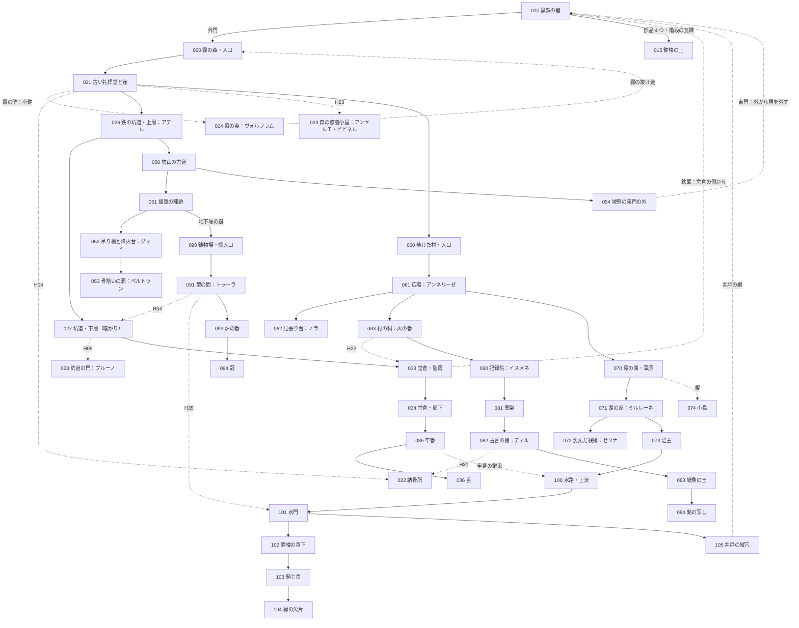

# 世界設計書 — 最後の鐘（仮題、D10）

W・P・V レーンがこのファイルを見て、新しい世界の拠点・ダンジョン・仲間・生き残り・集める物・結末を作るための設計書。
持ち主が世界観を**全部作り直す**と決めた（2026-10-12、#127）。前の世界「灰の王国」の設計は控えとして [docs/old/](old/) に移した。
マップの作り方は [docs/mapdesign.md](mapdesign.md)、ID の帯は [docs/ROADMAP.md](ROADMAP.md)、データの形は [docs/mz-data.md](mz-data.md)、文の書き方は [docs/knowhow.md](knowhow.md)（決まりはそのまま。例は前の世界のもの）。

- 世界の手触りは、持ち主の別の作品 Morsveld の世界観を**参考にしただけ**。国・町・使徒の名前と出来事は新しく作った。人物は Morsveld の人物を**スターシステム**で使う（性格・口調・癖だけを写し、経歴・立場・この世界での生き死には新しく作った。[5 章](#5-仲間)・[6 章](#6-生き残り)）。
- 手本（Fanastasis）の遊びの構造はそのまま。固有名詞・台詞・地名・人物は使っていない。
- 名前・題・主人公の扱いは推しで書いた。決定待ちは [9 章](#9-決定待ち) と `needs-decision` の issue。決まったら名前を置き換える（筋は変わらない）。
- 段階の印〔知〕〔噂〕〔進〕〔秘〕の意味は [knowhow.md 2.1](knowhow.md#21-設定の段階の印)。禁止語は [10 章](#10-禁止語の表)、口調は [11 章](#11-口調の表)。

### 持ち主が決めたこと（変えない）
| 項目 | 決めたこと |
|---|---|
| 雰囲気 | もの悲しいが温かい |
| 語り方 | 目的ははっきり、真相は断片。アイテムの配置と説明文・碑文・日記・墓標で少しずつ |
| 主人公 | 記憶を失った者。**案内役はいない** |
| 温かさの置き場所 | 仲間との関係、出会う人々、主人公が取り戻すもの |
| 世界 | 終わってしまった世界。約 200 年前、使徒によって終わった |
| 人物 | Morsveld の人物をスターシステムで使う |
| 骨組み | 拠点＋ダンジョン巡り・仲間を呼ぶ・集める物は一部変える。シンボル敵・隠し通路・施設・合成・来歴・召喚・ボスの仕組みは使い回す |

### 前の世界から変わらない前提
- 画面 1280×720、1 マス 48px（横 26.7 × 縦 15 マス）。壁の側面は 2 マスで、**部屋の縦は「床の行数＋2」**。部屋の大きさは床の広さで書く。
- マップは仕上げ後は JSON が正本。持ち主がエディタで仕上げたら、以後はイベントだけを直す。
- 敵の色（緑・黄・赤）、赤は必ず迂回路がある・持ち場から出ない、入口から追い始める距離＋2 マス以上離す（[old/world.md 4.0](old/world.md#40-全体) の約束のまま）。

---

## 1. 世界と年表

### 1.1 骨子（10 行）
1. ここは**終わったあとの世界**。約 200 年前の「**二度目の夜**」に、使徒がいっせいに動き、三つの国は一夜で終わった。〔知〕
2. 残っているのは、灰と霧のあいだの小さな集落と、使徒の縄張りと、崩れた砦だけ。〔知〕
3. 昔、使徒は**鐘の聞こえる所へは入らなかった**。境の山に鐘の塔が並び、その親が**黒鉄の砦の大鐘**だった。〔知〕（鐘のこと）〔進：084〕（子鐘が大鐘に従うこと）
4. 二度目の夜の**三日前**、砦の大鐘は嵐で落ち、黙った。夜は鐘が黙ったあとに来た。〔噂〕
5. 主人公は砦の**鐘番**だった。大鐘が落ちた夜、鐘の下に一人が挟まれ、主人公は古い言葉（**古言**）で鐘に願いを言った。〔進：部品の場面〕
6. 願いは叶った。代償は主人公の**記憶**。そして鐘は、最後の一打ちで声を失った。〔進：104・015〕（声を失ったことと夜の関わりは〔秘〕）
7. 古言は短い一語で、聞いた者みなに少しずつ効いた。その夜に鐘を聞いた砦の人は、死んでも**魂が形見と遺骸に残った**。〔秘〕（理由）〔知〕（呼べば応えること）
8. 主人公は 200 年眠り、拾い屋の少年が石室の鈴を蹴った音で目を覚ます。拠点は崩れかけた**黒鉄の砦**。〔知〕
9. 目的は三つ：①生き残りを砦に集める、②昔の仲間の遺骸・形見を見つけて魂を呼ぶ、③散った**鐘の部品**を取り戻し、最後に鐘を鳴らす。〔知〕
10. 鐘を鳴らすと、黙った列が戻り、主人公の記憶も戻る。そして、留まっていた魂は去る。誰のための願いだったかは、そのとき分かる。〔進：015〕

### 1.2 昔の大陸（旧暦の時代）
旧暦は「一度目の夜」（使徒が初めて現れた夜）を元年に数えた暦。今の人は旧暦をほとんど使わない。

| 項目 | 中身 | 段階 |
|---|---|---|
| 三つの国 | 西の**アルメリア王国**（麦と川）、北の**グラーデン帝国**（雪と鉄）、東寄りの**エリンデ共和国**（森と湖。エルフが多い）。名は墓標・碑文・古い札で出る | 〔知〕国があったこと／〔噂〕名（読める者が少ない） |
| 種族 | 人間・エルフ・獣人。エルフは長命で、200 年前を覚えている者がまだいる | 〔知〕 |
| 使徒 | 人の言葉を解する化け物（1.4） | 〔知〕 |
| 境山（さかいやま） | 人の地の東の端の山並み。向こう側が使徒の地 | 〔知〕 |
| 鐘の列 | 境山の尾根に見張りの塔が並び、塔ごとに小さな鐘（**子鐘**）。夕べに鳴らす。鐘の聞こえる所へ使徒は入らなかった | 〔知〕鐘で使徒を遠ざけた／〔噂〕なぜ効いたか（「神さまの音」「鉄の音を嫌う」と人ごとに違う） |
| 黒鉄の砦 | 境山を越える唯一の道を塞ぐ、人の最前線。三国の兵が詰めた。鐘楼に**大鐘** | 〔知〕 |
| 大鐘の銘 | 大鐘の縁を一周する古言の銘。昔の人と使徒の取り決めの言葉 | 〔進：084〕銘が古言であること／〔秘〕取り決めの中身（書かない） |
| 親鐘と子鐘 | 子鐘は大鐘の声に合わせて鳴る。大鐘が黙れば、列の鐘はみな黙る | 〔進：084〕 |
| 古言（ふること） | 口にした通りに、物ごとを一つだけ動かす古い言葉。使うたびに、話した者から何かが欠ける（覚えていること、声、影、名）。教会は禁じ、書記と学者の一部だけが読めた。文には片仮名の短い音で出し、訳を付けない | 〔噂〕禁じられた言葉があった／〔進：084〕読み方と代償 |

### 1.3 年表
| いつ | できごと | どこで断片が分かるか | 段階 |
|---|---|---|---|
| 旧暦 元年 | 一度目の夜。使徒が現れ、古い国が潰れる。生き残りが鐘を鋳て、縄張りの外で暮らし始める | 礼拝堂の碑文（021）、記録院（080） | 〔知〕使徒が現れた夜があった／〔噂〕鐘のはじまり |
| 旧暦 数百年 | 三つの国ができる。境山に鐘の列、黒鉄の砦 | 記録院、境山の古道（050） | 〔知〕 |
| 約 210 年前 | 主人公が砦の兵になり、鐘番に回される。書記ディルに古言の読み方を習う | 銘の写し（084） | 〔進：084〕 |
| 約 200 年前・嵐の夜 | 大鐘の吊り手（冠）が割れ、大鐘が鐘楼の床を抜いて落ちる。調律に来ていたエルフの**ミルレーネ**が下に挟まれる。主人公が古言を一語、鐘に向かって言い、鐘を打つ。最後の一打ちはいつもと違う音だった | 舌（036）、冠（094）、縁の欠片（104）、鐘楼（015） | 〔噂〕最後の鐘は妙な音だった（仲間の目覚めの一言・思念）／〔進：094〕鐘の下に人がいた／〔進：104〕鐘番が何かを言った／〔進：015〕誰のためだったか |
| 同じ夜 | ミルレーネは傷がふさがって生きのびる。主人公は鐘の下で眠ったまま起きない。記憶がない | 湖の灯の帳面（071）、ミルレーネの話（071） | 〔進：071〕 |
| その翌日〜三日目 | 列の子鐘が鳴らない。騎士長が鐘の直しを割り振り、部品を運び出す（舌→営倉の牢番、銘の写し→記録院、冠→鋳物場、縁の欠片は鐘楼の下の水へ落ちて拾えず） | 大広間の割り振りの板（010）、配給の札 | 〔知〕割り振りの板／〔噂〕鐘は三日鳴らなかった |
| 三日目の夜 | **二度目の夜**。使徒がいっせいに境山を越える。門叩きが砦の門を三度叩く。部品を運んでいた者・砦の人の多くが、運んだ先で死ぬ | 各ダンジョンの思念と遺骸 | 〔知〕夜が来た／〔進〕各仲間の臨終 |
| 夜のあと | 三つの国は終わる。生き残りは灰と霧のあいだに散る。人々は「鐘喰い」が鐘を食べたと言う | 集落の人の話、鐘喰いの護符 | 〔知〕〔噂〕 |
| 夜から数えて約 200 年 | 今。砦は崩れかけ、誰も住まない。主人公は石室で目を覚ます | 目覚め（010） | 〔知〕 |

- 今の人の暦は「**夜から数えて**」。墓標や札の年はこの数え方（例：「夜から百十二年」）。旧暦の年は古い墓標だけに出る。
- 「二度目の夜」の呼び名は、一度目の夜の言い伝えから来た。〔知〕

### 1.4 使徒（この世界の型）
- **人の言葉を解する化け物**。誰もが「使徒」と呼び、土地の呼び名を添える。名（古い刻印の読み）は碑文と記録院の写しにだけ出る。〔知〕呼び名／〔進〕名
- 縄張りを持つ。互いに関わらない。話が通じても、話が合うとは限らない。人は正面からは勝てない（格三。[knowhow.md 2.3](knowhow.md#23-敵や大きな存在の格)）。〔知〕
- 自分から動く理由は、それぞれの性分だけ。筋のために動かさない。
- **使徒とは戦わない。** ボスは使徒の連れか、使徒ではない化け物か、留まった砦の人（[4.4](#44-ボスの一覧)）。

| 呼び名／名 | 姿と性分 | 縄張り・出る所 | 人との関わり | 段階 |
|---|---|---|---|---|
| **門叩き**／ハドラム | 背の高い、顔のない長衣の姿。夜、戸や門を**三度叩き**、人の声で「入れておくれ」と言う。答えた家にだけ入る | 門と戸のある所ならどこでも。二度目の夜に砦の門を叩いた | 今の人は夜の戸に答えない。戸板の内側に「こたえない」と書く家がある。砦の外門に拳ほどの凹みが三つ | 〔知〕夜の戸に答えない習い／〔噂〕砦の門の凹み／〔進：015〕結末の前に砦へ来る |
| **霧の羊飼い**／ウルメ | 霧そのもの。霧で迷った者を群れに入れて、連れて歩く。殺さないが帰さない | 森（020–022）と湖（070–073）の霧 | 霧の中の人影（敵「迷い人」）は群れの者。ヴォルフラムは群れの端で三日迷っていた | 〔知〕霧に入るな／〔噂〕霧の中の人影は昔の人 |
| **灰の母**／セナルカ | 境山の向こうに横たわる大きな女の形と言われる。息をすると灰が降る。見た者はいない | 境山の向こう。灰は東から来る | 灰が降る日は外に出ない。灰除けの頭巾 | 〔知〕灰は東から来る／〔噂〕女の形 |
| **骨拾い**／ネムト | 痩せた鳥の頭の長い姿。死者の骨を拾って塔に積む。生きている者には丁寧で、取り引きをする | 境山の古道（053 の洞） | ベルトランの遺骸を塔に積んでいる。形見と引き替えに返す（[5.3](#53-遺骸と形見の置き場所)） | 〔噂〕骨を返してくれる化け物がいる／〔進：053〕 |
| （**鐘喰い**） | 鐘を食べたと言われる使徒。**いない**（人が鐘の沈黙に付けた説明） | ― | 鐘喰いの護符、子守唄 | 〔噂〕いる／〔秘〕いない（「いない」とは書かない） |

- 敵（ふつうの化け物）：灰犬・灰鴉（灰の地の獣）、迷い人（霧の群れ）、坑道の獣、記録院の紙魚、そして**留まりすぎた魂**（砦の人の成れの果て。そうとは書かない。〔秘〕）。名前と色は W が決める。

### 1.5 「誰が悪いか」を決めない
- 主人公は一人を助けたかった。騎士長は鐘を直そうとした。運び手は運び、門番は門を閉め、酒保の娘は子どもを舟に乗せた。使徒はいつもどおり縄張りを広げた。〔秘〕（誰が悪いかは誰にも判定させない）
- 主人公の願いと二度目の夜の関わりを、**一文で言わない**。部品の場面・単語帳・配給の札・最後の日誌を並べたプレイヤーの頭の中にだけある。〔秘〕
- 断片は食い違わせる：「鐘喰いが食べた」「嵐で割れた」「鐘番が何かした」「夜は北から先に始まっていた」（北の塔の札の日付が一日早い。〔噂〕）。どれが本当かは書かない。

### 1.6 今の暮らし
- 集落は 20〜40 人ほど。井戸と畑と、夜に灯す灯。戸は夜に開けない。〔知〕
- 通貨は**鉄くず**（`Hai_Defeat` が落とす所持金。古い釘・蝶番・鎧の板。集落どうしで重さで量る）。〔知〕
- 祈りは「夕べの数」：夕べに指で鐘の形を切り、数を三つ数える。鐘を知らない子もする。〔知〕
- 今の人は使徒の名も、古言も、鐘の列の仕組みも知らない。知っているのは習いだけ（[knowhow.md 2.2](knowhow.md#22-説明役に語らせない)）。

---

## 2. 主人公

### 2.1 主人公
| 項目 | 内容 |
|---|---|
| 既定名 | **ルカ**（推し。性別を決めない名。名前の入力はさせない。仲間に呼ばれて初めて名前が分かる。[9 章](#9-決定待ち)） |
| 名前の欄 | 目覚めから最初の仲間を呼ぶまでは「？？？」。最初の仲間の目覚めの一言のあと、名前の変更（320）で「ルカ」にする |
| 性別 | 決めない（推し）。台詞で一人称を使わない。見た目は持ち主が素材から選ぶ |
| 肩書き | 鐘番（`Actors.json` の `nickname`。最初は空、ルカと同じ時に付ける） |
| Actors / Classes | Actors 1 番（持ち主の帯）。職業は今の Classes 10 を「鐘番」に読み替える（技は W・P の後の issue で入れ替える） |
| 戦い方の案 | 物理と古言の中間。古言の技は強いが、使うと**一時の状態「忘れ」**（数ターン、技が一つ使えない）が付く（代償の手触り。仕組みは P の後の issue） |
| 性格 | 口数が少ない。台詞は一行で、事実か問い。記憶が戻るほど、言うことがはっきりする。感想・教訓は言わせない |

### 2.2 何を払ったか
| 払ったもの | 今の姿 | 段階 |
|---|---|---|
| 記憶 | 自分の名前も、砦のことも、仲間の顔も覚えていない。体は覚えている（鐘の綱を見ると手が伸びる、剣の構えがベルトランの型） | 〔知〕記憶がない／〔進：104・015〕古言の代償だったこと |
| 時 | 200 年眠っていた。年を取っていない | 〔知〕 |
| 鐘の声 | 大鐘は割れたうえに、直しても鳴らない（部品が揃うまで） | 〔進：015〕声が戻ること／〔秘〕声を払ったこと |

### 2.3 目覚めと最初の数分（案内役なし・主人公の台詞なし）
**狙い**：誰にも説明されずに、最初の数分で「ここは崩れた砦」「大鐘が割れて部品が足りない」「部品の行き先が書いてある」「まず外の霧の森へ」が分かる。
すべて**調べると分かる物**と、最初の生き残りシャノの用事の一言で示す。

1. **鐘楼の下の石室**（010 の西。今の目覚めの独房）。画面は黒から始め、寝台の上で目を開ける。自動で 1 行だけ。
   ```
   床の小さな鈴が、まだ揺れている。
   ```
   扉は開いている。床の灰に、小さな足跡が外へ続く（調べると「灰に、裸足の小さな足跡。外へ駆けていった」）。
2. **大広間の落ちた大鐘**（010 の中央。今の「塞がった螺旋階段」の跡を、鐘が床を抜いて落ちた穴にする）。調べると：
   ```
   大きな鐘が、床を割って傾いている。
   舌が無い。吊るための冠も無い。縁が一か所、大きく欠けている。
   ```
   選択肢なし。以後、取り戻した部品の数で文が変わる（[7.1](#71-鐘の部品4-つ)）。
3. **炉**（大広間の北の壁）。調べると「炉は冷えている。脇に、乾いた薪が積んである」→「火を入れる／やめる」。入れると「炉に火が入った」。
   以後、炉は**回復と記録**（今の灰の泉＋記録の書見台）。`Hai_Defeat` の戻り先と `Hai_Warp` の拠点の結界もここ。
4. **割り振りの板**（炉の脇の壁）。調べると、鐘の直しの割り振り（騎士長の字）：
   ```
   鐘の直し　割り振り
   舌　　　　営倉の奥へ。牢番に預ける
   銘の写し　記録院へ
   冠　　　　鋳物場へ
   縁の欠片　（墨がにじんで読めない）
   ```
   読むと `Hai_Thoughts` のメモに 4 行が残る（「舌：営倉の奥（牢番）」…）。**これが部品の集め方の目印**。
5. **シャノ**（最初の生き残り）。炉に火を入れたあと、大鐘の陰から出てくる（スイッチ「目覚めた」の次の旗）。
   ```
   シャノ「……火、つけたの、あんた？」
   シャノ「おれ、鉄を拾いに来ただけ。鈴、蹴っちゃった。ごめん」
   シャノ「名前は？　……ないの。ふうん」
   シャノ「外の森でさ、炊き出しの爺さんが三日帰ってない。霧の中」
   シャノ「おれは霧、だめなんだ。濡れるから」
   シャノ「……ここ、あったかいな。ちょっと、いていい？」
   ```
   主人公は答えない（選択肢なし）。シャノは大広間に残り、**倉**が開く（[3.3](#33-部屋が開く順と条件)）。
6. **外門**（010 の北の階段 → 外の門の内側）。門の内側を調べると「門の板に、拳ほどの凹みが三つ。縦に並んでいる」。〔噂〕
   門の外が霧の森（020）。
7. **営倉への鉄扉**（010 の南。今の「開かない鉄の扉」）。調べると「錆びついて動かない。向こう側に閂があるようだ」。シャノに話すと「そこ、おれも試した。開かない」。
   → 森から坑道を抜けて営倉へ回り、内側から開けると拠点への近道になる（今の H11 のまま）。

- 目覚めの場面は**主人公の台詞なし・説明の語りなし**。名前・世界・目的を誰も言わない。
- 迷ったときの戻り道：炉の前で「休む」と、メモの最新の行（割り振りの板・シャノの頼み）がもう一度出る（`Hai_Notes` の画面を開くだけ。新しい仕組みは要らない）。

### 2.4 部品を取ったあとの主人公の一言
部品の場面（[7.2](#72-部品の場面)）のあと、主人公が一行だけ言う。事実か問い。一人称を使わない。
| 部品 | 一言 |
|---|---|
| 舌 | 「……三十。いつも、三十だった」 |
| 銘の写し | 「読める。……どうして読める」 |
| 冠 | 「下に、誰かいた」 |
| 縁の欠片 | 「……言った。鐘に、何か」 |

---

## 3. 拠点 黒鉄の砦（マップ 010–019）

### 3.1 砦の今の姿
- 境山の道を塞ぐ石の砦。外壁の半分は崩れ、中庭は灰に埋まり、鐘楼は上が抜けている。〔知〕
- 中に入ると、**大広間に大鐘が落ちている**（鐘楼の床を三つ抜いた）。鐘楼へ上る階段は瓦礫で塞がっている。〔知〕
- 200 年、誰も住まなかった。使徒の縄張りではない（門叩きは夜のあと去った）。だから生き残りが住める。〔知〕（住めること）〔秘〕（理由は書かない）
- 部屋を一つずつ**直していく**：生き残りが来るたびに一部屋が開き、炉の火・食堂の皿・寝台の数が増える。

### 3.2 マップの割り当て
| マップ | 新しい名前 | 今の名前（読み替え前） | 大きさ | タイルセット |
|---|---|---|---|---|
| 010 | 黒鉄の砦・内郭 | 牢獄の間（作り直す） | 50 × 40 前後 | 11 |
| 011 | 稽古場 | 魂の間 | 17 × 13 | 11 |
| 012 | 食堂 | 創作者の厨房 | 17 × 13 | 11 |
| 013 | 倉 | 保管ゲート | 17 × 13 | 11 |
| 014 | 書庫 | 理知の間 | 17 × 13 | 11 |
| 015 | 鐘楼の上 | 王都の門（W5 の枝） | 27 × 20 | 2 外観（W5 の枝のまま） |
| 016 | 療養所（新） | ― | 17 × 13 | 11 |
| 017 | 鍛冶場（新） | ― | 17 × 13 | 11 |
| 018 | 見張り台（新） | ― | 17 × 13 | 2 外観 |
| 019 | 城壁の上（新） | ― | 45 × 15 前後 | 2 外観 |

010 の部屋（010 は網に合わせて広げて作り直す。下の表は、前の世界の部屋が新しい何に当たるかの対応。大きさと形は [mapdesign.md 1 章](mapdesign.md#1-1-枚の大きさ)）：
| 今の部屋 | 新しい部屋 | 置くもの |
|---|---|---|
| 目覚めの独房（西） | 鐘楼の下の石室 | 寝台（開始位置）、小さな鈴、鐘番の外套掛け（空） |
| 中央の広間 | 大広間 | **落ちた大鐘**（中央）、**炉**（回復と記録）、**割り振りの板**、食卓（生き残りの数で人が増える） |
| 召喚陣の間（東） | 名の壁 | 砦の兵の名を刻んだ壁。足元に輪。**形見を置くと魂を呼べる**（`Hai_Companions` の `summonMenu`・`partyMenu`）。最初の遺骸を見つけると、壁の自分の名の所が読める（「鐘番　ルカ」。名前はまだ欄に入れない） |
| 出口の階段（北） | 外門への階段 | 門の内側に三つの凹み |
| 4 つの施設の扉 | 稽古場・食堂・倉・書庫の扉 | 叡智のオーブの台座の代わりに、**崩れた扉**。調べると「中は瓦礫で埋まっている」。生き残りが来ると片付いて開く |
| 開かない鉄の扉（南） | 営倉への鉄扉 | 今の H11 のまま（営倉の側から閂を外す） |
| 塞がった螺旋階段の跡 | 鐘楼への階段 | 瓦礫。部品が 4 つ揃うと、アンネリーゼがいれば鍛冶場で、いなければ生き残り総出で片付ける（[8 章](#8-結末の分岐)） |
| （新）療養所・鍛冶場・見張り台の扉 | 010 の空いた壁に足す | 同上（崩れた扉） |
| （新）城壁へ上る階段 | 019 城壁の上へ | 東門の閂は外から（054）外す近道 |
| （新）井戸 | 中庭の井戸 | 調べると「底は暗い。綱は切れている」。水路の側（105）から綱を下ろすと近道になる |

### 3.3 部屋が開く順と条件
**叡智のオーブはやめる**（Items 171 は使わない）。部屋は**生き残りが砦に来ると開く**。どの順で会ってもよい。
開けるのは `Hai_Facilities` のプラグインコマンド `open`（オーブなしで開く）。開いたら今の施設のスイッチ（121〜124）を ON。新しい 3 部屋は新しい仕組みが要る（P の後の issue）。

| 部屋 | マップ | 開く人（[6 章](#6-生き残り)） | 会う所 | できること（使い回す仕組み） | 段階 |
|---|---|---|---|---|---|
| 炉 | 010 | 主人公（最初に火を入れる） | ― | 回復・記録・全滅の戻り先（今の灰の泉・書見台・`Hai_Defeat`・`Hai_Warp`） | 第1段階 |
| 名の壁 | 010 | 最初の遺骸を見つける | ― | 魂を呼ぶ・並び替え（`Hai_Companions`） | 第1段階 |
| 倉 | 013 | シャノ | 010（目覚めの直後） | 倉庫（保管ゲート・`Hai_Items`） | 第1段階 |
| 食堂 | 012 | ヴォルフラム | 021 霧の森の礼拝堂 | 合成（創作者の厨房・`Hai_Craft`）。生き残りの数で食卓の人と、ヴォルフラムの鍋の一言が変わる | 第1段階 |
| 稽古場 | 011 | アデル | 026 鉄の坑道・上層 | 控えの仲間を育てる（魂の間・`Hai_Facilities` の「魂」を「稽古」と読み替え） | 第1段階 |
| 書庫 | 014 | イスメネ | 080 記録院 | 倒したボス・読んだ思念・古言の読み（理知の間） | 第2段階 |
| 療養所 | 016（新） | ピピネル | 023 森の療養小屋 | 案：状態異常を治す・消耗品の所持上限を 1 つ増やす（新しい仕組み） | 第2段階 |
| 見張り台 | 018（新） | グィド | 052 境山の古道・烽火台 | 案：オートマップの全図、転送の行き先に各ダンジョンの入口を足す（`Hai_AutoMap`・`Hai_Warp` に足す） | 第2段階 |
| 鍛冶場 | 017（新） | アンネリーゼ | 061 焼けた村 | 案：一点ものの装備を鍛え直す。終盤は大鐘の縁を継ぐ（結末 C の条件） | 第2段階 |

- **食堂がにぎやかになる**：変数「生き残りの数」（0〜7）で、大広間の食卓のイベントのページが替わる（座る人が増える）。7 人揃うと、ヴォルフラムが「皿が足りん」と言う。〔知〕
- 部屋の碑文（今の 4 つの扉の碑文）はやめる。代わりに、開いた部屋の入口に生き残りの一言（[6 章](#6-生き残り)）。

### 3.4 旗の読み替えの案
番号の帯は配り役が [ROADMAP.md](ROADMAP.md) で決める。ここは今の旗（[old/world.md 8 章](old/world.md#8-筋の旗の表スイッチ変数-101200)）をどう読み替えるかの案だけ。

| 今の旗 | 新しい意味 |
|---|---|
| スイッチ 101〜104（オーブ 4 つ） | 鐘の部品：舌・銘の写し・冠・縁の欠片 |
| スイッチ 105（四つ揃った）・変数 101（オーブの数） | 部品が揃った・部品の数（0〜4） |
| スイッチ 106・107 | 鐘楼への階段が開いた・ミルレーネに会った |
| スイッチ 111〜113 | 目覚めた・炉に火を入れた・名の壁を教わった（最初の遺骸） |
| スイッチ 114 | 営倉の鉄扉を開けた（H11） |
| スイッチ 115 | 鐘楼の上に着いた |
| スイッチ 121〜124 | 稽古場・食堂・倉・書庫が開いた |
| スイッチ 131〜145（遺骸・加入・完全体 ×5） | 仲間が 7 人になるので、帯を広げる（P6 の窓口も 7 人に。P の後の issue） |
| スイッチ 151〜155（ボス） | 牢番・紙魚の王・炉の番・騎士長ほか（[4.4](#44-ボスの一覧)） |
| スイッチ 181〜184（結末） | 結末 A・B・C、C の条件 |
| 変数 102（仲間の数） | そのまま（0〜7） |
| 変数 103（叡智のオーブの数） | 生き残りの数（0〜7） |

---

## 4. 地図と段階

### 4.0 全体
砦を真ん中に、北に霧の森、北東の山に鉄の坑道、砦の下に営倉。東の尾根に**境山の古道**、西の谷に**焼けた村**、南西の低地に**霧の湖**、北西の丘に**記録院**、山の根の下に**古い鋳物場**、砦の真下に**砦の下の水路**。
マップは**網の目**につなぎ、1 枚を広くし、近道と「後の物で開く道」で前の場所へ戻らせる。作り方の決まり（大きさ・網・近道・後の物・置く物の密度・置き物の層・敵と仕掛けの型）は [docs/mapdesign.md](mapdesign.md)。
前の世界のマップは**形をそのまま使う前提をやめ**、この網に合わせて作り直す。使い回すのは ID の帯と、遠い所がつながる 4 つ（H22・H31・H34・H35）の考え方、それに形の合う小部屋だけ（4.1）。

| 段階 | ダンジョン | 部品 | 仲間 | 生き残り | 遊ぶ時間 |
|---|---|---|---|---|---|
| 第1段階 | 霧の森（020–025）・鉄の坑道（026–032）・砦の営倉（033–049） | 舌 | ブルーノ | シャノ・ヴォルフラム・アデル | 45 分前後（本道だけなら 25 分） |
| 第2段階 | 境山の古道・焼けた村・森の療養小屋・霧の湖・記録院・古い鋳物場・砦の下の水路 | 銘の写し・冠・縁の欠片（好きな順） | ノラ・ディル・ゼリナ・アンセルモ・ベルトラン・トゥーラ | イスメネ・ピピネル・グィド・アンネリーゼ、ミルレーネ（生きて会う） | 4 時間前後 |
| 終盤 | 鐘楼の上（015） | ― | ― | ― | 結末 |

- 部品 2〜4 は**好きな順**で取れる：
  - 銘の写し：森 → 焼けた村 →（火の番）→ 記録院。
  - 冠：坑道 → 境山の古道 →（陣跡の地下壕の鍵）→ 古い鋳物場。
  - 縁の欠片：森 → 焼けた村 → 霧の湖 →（沼主）→ 砦の下の水路、**または** 営倉 →（牢番の鍵束）→ 水路。
- 本道で要る「後の物」は、牢番の鍵束・鐘番の角灯・見張り塔の小鐘の 3 つだけ。ほかの物と仲間で開く道は寄り道（[mapdesign.md 4 章](mapdesign.md#4-後の物で開く道)）。
- ボスの強さは取った部品の数で変えない。

### 4.1 使えるマップと作り直すマップ
「使える」＝前の世界のマップの**形（タイル層）をそのまま使い**、置く物・文・敵・色調・飾りを替える小部屋。「作り直す」＝ [mapdesign.md 1 章](mapdesign.md#1-1-枚の大きさ) の大きさで描き直す。「新」＝新しく作る。
番号は前の世界の帯のまま（[mapdesign.md 2.1](mapdesign.md#21-id-の帯前の世界の帯をそのまま使う)）。W5 の枝 `claude/w5-stage2e` のマップ（015・090–104）は main に入っていない。

**砦と第1段階**
| マップ | 前の世界 | 新しい名前 | 判定 | 中身 |
|---|---|---|---|---|
| 010 | 牢獄の間（33 × 27） | 黒鉄の砦・内郭 | 作り直す（50 × 40 前後） | 石室・大広間（落ちた大鐘・炉）・名の壁・部屋の扉 9・城壁へ上る階段・井戸・営倉への鉄扉・鐘楼への階段（3.2） |
| 011–014 | 魂の間・厨房・保管ゲート・理知の間 | 稽古場・食堂・倉・書庫 | 使える | 台座をやめ、生き残りの置き物に替える |
| 016–018 | ― | 療養所・鍛冶場・見張り台 | 新 | 3.3 |
| 019 | ― | 城壁の上 | 新 | 東門（古道の側から開く近道）、鐘楼の外壁 |
| 020 | 巡礼の森・入口 | 霧の森・入口 | 作り直す（70 × 50） | 倒れた見張り塔（小鐘）、森の墓地 |
| 021 | 巡礼の森・奥 | 古い礼拝堂と崖 | 作り直す（60 × 45） | 鐘を抱く女の像、霧の壁、崖の上の祠、北東の坑口 |
| 022 | 礼拝堂の地下納骨所 | 納骨所 | 使える | H04・H31 の裏、名札の棚 |
| 024 | ― | 霧の奥 | 新（40 × 30） | ヴォルフラム、入口へ抜ける霧の抜け道 |
| 026 | 廃坑・上層 | 鉄の坑道・上層 | 作り直す（60 × 45） | アデル、昇降機、鉄格子の奥（鉄切り鋏）、東の坑道→古道 |
| 027 | 廃坑・下層 | 鉄の坑道・下層 | 作り直す（50 × 40、暗がり） | 大扉（ブルーノ・トゥーラ）、掘り抜き→営倉 |
| 028 | 崩落の間 | 坑道の門 | 使える | ブルーノの遺骸 |
| 029 | ― | 坑夫の詰め所 | 新 | 鐘番の角灯 |
| 033 | 地下牢・監房区 | 営倉・監房 | 作り直す（60 × 45） | 施錠扉（鍵束）、鉄扉→砦（近道） |
| 034 | 地下牢・更生の廊下 | 営倉・廊下 | 作り直す | 往復の番の獣とレバー（mapdesign 8 章「見張りの読み」） |
| 035 | 拷問の間 | 牢番の詰め所 | 使える | ボス 牢番、西の扉→水路（鍵束） |
| 036 | オーブの間 | 預かり棚 | 使える | 部品「舌」、折れた楔 |
| 037 | ― | 井戸の底への通路 | 新 | 水路 105 へ（第2段階で開く） |

**第2段階**
| マップ | 前の世界 | 新しい名前 | 判定 | 中身 |
|---|---|---|---|---|
| 023 | 看取りの小屋 | 森の療養小屋 | 使える | アンセルモの遺骸、ピピネル |
| 050 | 崖道・下の道 | 境山の古道・尾根道 | 作り直す（80 × 60、段が 3 つ） | 倒れた子鐘の塔、上段（鉤綱） |
| 051 | 帝国の陣跡 | 援軍の陣跡 | 作り直す | 鉤綱、地下壕の鍵→鋳物場 |
| 052 | 巨人の吊り橋と門 | 吊り橋と烽火台 | 作り直す | グィド、岩背負い（任意） |
| 053 | 見張りの洞 | 骨拾いの洞 | 使える | 骨拾い、ベルトランの形見 |
| 054 | ― | 城壁の東門の外 | 新 | 東門の閂（019 への近道） |
| 060 | 焼け野の入口 | 焼けた村・入口 | 作り直す | 戸板の盾、配給札、盛り土（ノラ） |
| 061 | 廃集落・広場 | 焼けた村・広場 | 作り直す（70 × 50） | アンネリーゼ、倒れた梁（トゥーラ） |
| 062 | 焼けた見張り台 | 村の見張り台 | 使える | ノラの遺骸、屋根（鉤綱） |
| 063 | 焚刑の教会 | 村の祠 | 使える | ボス 火の番、裏口→記録院 |
| 064 | 地下の護送路 | 荷運びの抜け道 | 使える | H22（村→営倉） |
| 070 | 湿地・葦原 | 霧の湖・葦原 | 作り直す（80 × 60、舟） | 霧の道（小鐘）、向こう岸（櫂） |
| 071 | 水上集落の跡 | 湖の家 | 作り直す | ミルレーネ、湖の灯の帳面 |
| 072 | 沈んだ舞台 | 沈んだ桟橋 | 使える | ゼリナの遺骸、櫂、酒保のつけ帳 |
| 073 | 沼主の淵 | 湖の淵 | 使える | ボス 沼主、排水口→水路 |
| 074 | ― | 小島 | 新 | 赤い宝箱（舟で） |
| 080 | 古書院・前庭と閲覧室 | 記録院・前庭 | 作り直す | イスメネ、古言の碑の扉（ディル） |
| 081 | 書架の迷路 | 記録院・書架 | 作り直す（60 × 45） | 番号錠 |
| 082 | 禁書庫 | 古言の棚 | 作り直す（暗がり） | ディルの遺骸、古言の単語帳、H31 |
| 083 | 紙魚の王の間 | 紙魚の王の間 | 使える | ボス 紙魚の王 |
| 084 | オーブの間「聖灰」 | 銘の写しの間 | 使える | 部品「銘の写し」 |
| 090 | 研究所・搬入口（枝） | 鋳物場・搬入口 | 作り直す | トゥーラの記憶 3 |
| 091 | 実験棟（枝） | 鋳物場・型の間 | 作り直す（60 × 45） | トゥーラの遺骸、H34・H35、鉄格子（鋏） |
| 092 | 契約の写し室（枝） | 銘の型の部屋 | 使える | 親鐘と子鐘の型、古言の碑の扉（ディル） |
| 093 | 番人の間（枝） | 炉の間 | 使える | ボス 炉の番 |
| 094 | オーブの間「契約」（枝） | 冠の型 | 使える | 部品「冠」、調律師の音叉 |
| 100 | 下水道・上流（枝） | 水路・上流 | 作り直す | 舟で下る |
| 101 | 水門の間（枝） | 水路・水門 | 作り直す（60 × 45） | 二つの弁（水位の切り替え） |
| 102 | 結界の真下（枝） | 鐘楼の真下 | 作り直す（暗がり） | 騎士長の命令書 |
| 103 | 灰の騎士の間（枝） | 騎士長の間 | 使える | ボス 騎士長 |
| 104 | オーブの間「封印」（枝） | 水の底 | 使える | 部品「縁の欠片」、鐘番の日誌、音叉の先 |
| 105 | ― | 井戸の縦穴 | 新 | 綱を下ろす（010 の井戸への近道） |
| 015 | 王都の門（枝） | 鐘楼の上 | 作り直す | 結末の場（8 章） |

- 遠い所が実は隣（VISION 核 1）の 4 つ（H22・H31・H34・H35）は残す。意味だけ読み替える：村は営倉へ荷を運んだ／記録院の古い帳面は納骨所に移した／鋳物場の鉄は坑道から来た／鋳物場の水は砦の水路へ流れた。
- 砦へ戻る近道は 4 つ：営倉の鉄扉（033）・城壁の東門（054→019）・井戸の綱（105→010）・霧の抜け道（024→020）。

### 4.2 つながり図
網の全体は [mapdesign.md 2 章](mapdesign.md#2-網の目拠点からのつながり)。ここは人と部品の置き場所を足した図。点線は近道か隠しか、後の物で開く道。



### 4.3 生き残りと仲間の置き場所（まとめ）
| ダンジョン | 仲間の遺骸 | 生き残り | 生きて会う人 |
|---|---|---|---|
| 砦（010） | ― | シャノ | ― |
| 霧の森（020–022） | ― | ヴォルフラム | ― |
| 鉄の坑道（026–028） | ブルーノ（028） | アデル | ― |
| 砦の営倉（033–036） | ― | ― | ― |
| 森の療養小屋（023） | アンセルモ | ピピネル | ― |
| 境山の古道（050–053） | ベルトラン（053） | グィド（052） | （骨拾い） |
| 焼けた村（060–064） | ノラ（062） | アンネリーゼ（061） | ― |
| 霧の湖（070–073） | ゼリナ（072） | ― | ミルレーネ（071） |
| 記録院（080–084） | ディル（082） | イスメネ（080） | ― |
| 古い鋳物場（090–094） | トゥーラ（091） | ― | ― |
| 砦の下の水路（100–104） | ― | ― | ― |

### 4.4 ボスの一覧
ボスは「必須はボスだけ・ボスからも逃げられる」（`Hai_Boss`）。**使徒はボスにしない。**
砦の人の成れの果てのボスは、命令を守り続けているだけ。倒すと静かに崩れ、形見が一つ残る（〔秘〕：留まりすぎた魂。そうとは書かない）。

| ボス | マップ | 正体 | 受動の理由（なぜそこにいる） | 弱みの手がかり | 段階 |
|---|---|---|---|---|---|
| 牢番 | 035 | 砦の営倉の牢番 | 騎士長の割り振り「舌を牢番に預ける。鐘番のほかに渡すな」を守り続けている。目が見えず、主人公を鐘番だと分からない | 帳面の「火を嫌う。灯を持って来るな」 | 第1段階 |
| 岩背負い | 052 | 境山の大きな獣（任意の門番） | 橋のたもとを寝床にしている | 今のまま | 第2段階 |
| 火の番 | 063 | 焼けた村の夜番 | 鐘の代わりの火を絶やすなと言われ、まだ燃やしている | 祠の水瓶 | 第2段階 |
| 沼主 | 073 | 湖の主の化け物（霧の羊飼いの連れ） | 淵を寝床にしている | 今のまま | 第2段階 |
| 紙魚の王 | 083 | 記録院の紙を食う化け物 | 古い紙のある所に湧く | 今のまま | 第2段階 |
| 炉の番 | 093 | 鋳物場の親方 | 冠を鋳直す火を落とすなと言われ、空の炉を守っている | 型の間の冷えた水桶 | 第2段階 |
| 騎士長 | 103 | 砦の騎士長（割り振りの板を書いた人） | 縁の欠片を拾わせるため水路に降り、夜が来て上がれなかった。水の底を守っている | 割り振りの板の字と同じ字の命令書（102） | 第2段階 |

### 4.5 使い回す仕組み
| 仕組み（[docs/plugins/](plugins/)） | 新しい世界での使い方 | 足すもの |
|---|---|---|
| `Hai_SymbolEnemy` | 灰の獣・迷い人・留まった魂。色と迂回路の約束はそのまま | なし |
| `Hai_HiddenPassage` | 隠し通路・片側扉・隠し階段（H01〜H35 の形はそのまま） | なし |
| `Hai_Thoughts`・`Hai_Notes` | 残留思念（昔の砦の人・今の集落の人の書き付け）、割り振りの板のメモ | なし |
| `Hai_Companions` | 遺骸と形見・記憶 4 断片・名の壁（召喚陣）・完全体 | 7 人にする（今は 5 人） |
| `Hai_Facilities` | 稽古場・食堂・倉・書庫。生き残りが来たら `open` で開く。台座はやめる | 新しい 3 部屋（療養所・見張り台・鍛冶場） |
| `Hai_Craft`・`Hai_Items` | 食堂の合成、倉の出し入れ、赤い宝箱の一点もの | なし |
| `Hai_Lore` | 7.3 の来歴 | なし |
| `Hai_Boss`・`Hai_Battle` | 4.4 のボス。弱みは断片で察する | 鐘楼の「耐える戦い」（第3段階） |
| `Hai_Defeat` | 全滅で鉄くずを落とし、炉に戻る | 通貨の名（`System.json`、持ち主） |
| `Hai_Warp`・`Hai_AutoMap` | 転送の結界、地図 | 見張り台で入口を足す（案） |
| `Hai_MapTone`・`Hai_Comfort`・`Hai_TouchUI` | そのまま（霧の森は白く、湖は青く、水の底は暗く） | なし |

---

## 5. 仲間

### 5.1 仲間の決まり
- 仲間は**二度目の夜に死んだ砦の人**。魂が遺骸と形見に残っている。遺骸か形見を見つけ、砦の**名の壁**で呼ぶと加わる（`Hai_Companions`）。〔知〕
- **仲間はみな主人公を覚えている。覚えていないのは主人公だけ。** 仲間は主人公を名前で呼び、昔の続きの口をきく。〔知〕
- 仲間が知っているのは**自分が見たことだけ**。鐘番が鐘に何を言ったかは誰も知らない（ディルだけが察している。記憶 3）。仲間に真相を説明させない。
- 記憶は 4 断片（生い立ち・転機・罪か誇り・臨終）。4 つ揃うと完全体で強技（今の仕組みのまま）。〔進〕
- 人物は Morsveld の人物のスターシステム。**性格の芯・口調・癖・好き嫌い**を写し、経歴・家族・国・年はこの世界で新しく作った。絵は Morsveld の素材集の同じ人物のものを使える（人物の id が同じ）。

### 5.2 7 人の一覧（Actors 5–11）
今の Actors 5–9 の役割（タンク・ファイター・メイジ・サポート・ヒーラー）と固有の立ち回りをそのまま受け、10・11 を足す。

| Actor | 名前（スター） | 役割 | 生前（新しい立場） | 固有の立ち回り | 完全体の強技（案） | 主人公への態度 |
|---|---|---|---|---|---|---|
| 5 | **ブルーノ** | タンク | 砦の門番。巨漢の臆病者。夜は怖いのに、門の番だけは代わらなかった | かばう＋反撃（今の鉄の誓い） | 「閂」：3 ターン味方全員の盾になり、受けるたびに反撃 | 「ルカさん」と呼ぶ。鐘番の夕べの数を毎日一緒に数えた |
| 6 | **ノラ**（ノラミ） | ファイター | 砦の伝令。犬の獣人。足が速く、明るいあほ。弓は下手 | 2 回行動。HP が半分を切ると、勢いが上がって止まらない | 「伝令走り」：敵全体に 4 回のランダム攻撃 | 鐘番と駆けっこで勝ったことがない。勝つまで挑む |
| 7 | **ディル** | メイジ | 砦の書記。本好きで悪知恵。古言を読めた。主人公に読み方を教えた | 沈黙と即死。HP は低い | 「頁を伏せる」：敵全体に沈黙＋低い率の即死 | だるそうに「鐘番」と呼ぶ。教えたことを悔いているが言わない |
| 8 | **ゼリナ** | サポート | 砦の酒保の娘。関西言葉、金が好き、子どもが好き | 味方全体強化と回避盾。戦闘の後の鉄くずが増える（案） | 「勘定合わせ」：味方全体の HP と SP を少し回復し、状態異常を防ぐ壁 | 鐘番に「つけ」がある。200 年分の利子を言い出す |
| 9 | **アンセルモ** | ヒーラー | 砦の従軍司祭。墓掘り。下品で陽気。歌うと聞く者が泣く | 回復と SP の受け渡し。蘇生ができる唯一の仲間 | 「弔いの歌」：味方全体の戦闘不能を回復し HP を半分まで | 飲み仲間。「お前さん」と呼ぶ |
| 10 | **ベルトラン** | ファイター（受け流し） | 砦の剣の教官。だらしない絵描きのおじさん。抜くと桁が違う | 受け流しと反撃。挑発で狙いを引き、物理を返す | 「一筆」：敵 1 体に大きな一撃、確実に当たる | 主人公の剣の師。主人公の構えを見て、何も言わずに笑う |
| 11 | **トゥーラ** | ファイター（力） | 鐘楼の小間使い。熊の獣人の子（14）。口が悪く、世話焼き | 力が強い。味方へのアイテムの効き目を上げる（案） | 「担ぎ出し」：戦闘不能の味方 1 人を起こし、自分が狙われる | 「兄貴」と呼ぶ（主人公の性別によらず）。鐘番の飯と寝る時間にうるさい |

- 第1段階で実装するのは**ブルーノだけ**（遺骸と記憶 4「臨終」は 028）。
- 7 人の帯（スイッチ・アクター・強技）は今の P6 の帯（5 人分）を超える。帯は配り役が決め、P6 の窓口を 7 人にする P の issue が要る（[9 章](#9-決定待ち)）。

### 5.3 遺骸と形見の置き場所
仲間は**遺骸**か**形見**のどちらかで呼べる（今の遺骸の仕組みのまま。形見は遺骸と同じタグで、絵と文だけ違う）。

| 仲間 | 呼ぶもの | 置き場所 | 置き場所が語ること |
|---|---|---|---|
| ブルーノ | 遺骸 | 028 坑道の門（H09 の先） | 門の閂に両手を掛けたまま。門の向こうは崩れて、坑夫が逃げた跡がある |
| ノラ | 遺骸 | 062 村の見張り台 | 薪の山の前。火打ち石を握っている。鐘が鳴らないので、火で知らせた |
| ディル | 遺骸 | 082 記録院・古言の棚 | 銘の写しの棚の前で、本を一冊抱えて座っている |
| ゼリナ | 遺骸 | 072 沈んだ桟橋 | 桟橋の端。舟を出した綱が切ってある |
| アンセルモ | 遺骸 | 023 森の療養小屋 | 寝台の並ぶ部屋の真ん中の椅子。寝台はみな空 |
| ベルトラン | 形見（剣） | 053 骨拾いの洞 | 遺骸は骨拾いの塔に積まれている。骨拾いに砦の名札を三つ渡すと、剣を返してくれる（戦わない取り引き） |
| トゥーラ | 遺骸 | 091 鋳物場・型の間 | 背負子を背負ったまま、冠の型の前にうずくまっている |

### 5.4 記憶 4 断片
記憶の中身はすべて〔進〕（その断片を読んで初めて分かる）。ほかの人物の台詞や物の説明で先に言わない。場所は第2段階の案（ブルーノの「臨終」だけ第1段階）。

**ブルーノ（タンク）**
| 断片 | 内容 | 場所 |
|---|---|---|
| 生い立ち | 粉屋の大きな末っ子。体が大きいから、と兵に出された。何を見ても怖かった | 022 納骨所（家族の名の札の棚） |
| 転機 | 門番に回される。夜の番を誰も代わらず、自分だけが残った。門を閉める回数を数えると、怖さが少し減ると覚えた | 033 営倉・監房（門番の詰め所の写し） |
| 罪か誇り | 夜に門を叩く声に、一度だけ答えかけた。鐘番が横で首を振った（誇りとも罪とも言わない） | 050 古道（門番の交代の札） |
| 臨終 | 下の本文 | 028（遺骸と同じ所） |

ブルーノの記憶 4「臨終」（遺骸を調べたとき。5 行。顔なし）
```
門の向こうで、坑夫の足音が遠くなっていく。
こっちの門を叩く音は、三つ。また、三つ。
答えちゃだめだ。閂を押さえる。手が震える。
数える。いち、に、さん。……閉めました。
ルカさん。今夜の数、ちゃんと閉めましたよ。
```
（名前はイベントでは `\N[1]`。最後の行の数え方は、鐘番の夕べの数をまねたもの）

**ノラ（ファイター）**：生い立ち＝境山の麓の獣人の村で、狩りの追い込みだけ上手かった（060 焼けた村の家の跡）／転機＝伝令に取られる。鐘番と駆けっこをして負ける（050 古道の伝令の小屋）／
罪か誇り＝鐘が黙った日、騎士長の命令を待たずに村へ走って逃げろと触れ回った（誇り。061 広場の触れ書き）／臨終＝見張り台で火を上げ、村の灯が山の方へ動いていくのを見ていた（遺骸の場所）。

**ディル（メイジ）**：生い立ち＝字も勘定も捨てられた本で覚えた港の子（080 前庭の書見台）／転機＝砦の書記になり、古言の写しを読めることを隠した（081 書架）／
罪か誇り＝鐘番に古言の読み方を教えた。最後の頁の一語だけは教えなかった。教えなかったはずの語を、鐘番は知っていた（罪。主人公とつながる。084 の手前の写字台）／臨終＝銘の写しの続きを探して、古言の棚の前で夜を迎えた（遺骸の場所）。

**ゼリナ（サポート）**：生い立ち＝商いの家の娘。最初の商いで騙されて全部なくした（071 湖の家の帳場の跡）／転機＝砦の酒保を一人で回すようになり、兵に「つけ」を許した（012 食堂の古い勘定台。第2段階で置く）／
罪か誇り＝夜に、砦の子ども十四人を舟に乗せた。舟は一艘で、自分の乗る場所はなかった（誇り。070 葦原の舟着き）／臨終＝桟橋で舟の灯が見えなくなるまで数を数えていた（遺骸の場所）。

**アンセルモ（ヒーラー）**：生い立ち＝聖歌隊を酒で追い出された（022 納骨所の古い楽譜）／転機＝砦の従軍司祭になり、死者の物を生きている者に回した（033 営倉の没収品の棚）／
罪か誇り＝療養小屋で、助からない者に「楽になる」と言って酒を飲ませた（罪とも誇りとも言えない。本人も決めない。023 の奥の戸棚）／臨終＝最後の一人の手を握って歌い、歌の途中で止まった（遺骸の場所）。

**ベルトラン（受け流し）**：生い立ち＝絵描きになりたかったが、剣のほうが上手かった（051 陣跡の天幕）／転機＝砦の剣の教官になる。弟子に鐘番がいた（011 稽古場の壁の落書き。第2段階で置く）／
罪か誇り＝夜、鋳物場へ冠を運ぶ子を通すため、吊り橋に一人で残った（誇り。052 橋のたもと）／臨終＝橋の上で筆を出し、最後の一枚に何かを描こうとした。描けたのは線が一本（053 骨拾いの塔の、形見の剣の鞘の中）。

**トゥーラ（力）**：生い立ち＝坑夫の家の長女。弟妹のぶんまで働いた（027 坑道・下層の長屋）／転機＝鐘楼の小間使いになり、鐘番を「兄貴」と呼ぶ（010 石室の壁の背比べの刻み。第2段階で置く）／
罪か誇り＝冠を鋳物場まで背負って運んだ。大人の兵は途中で倒れたが、自分は着いた（誇り。090 搬入口）／臨終＝冠の型に冠を収めたところで夜が来た。「かえりは かるい」と背負子に彫った（遺骸の場所）。

### 5.5 目覚めの一言（`<hai_wake>`）
一行。死ぬ直前の続きか、主人公との縁。自己紹介しない。
| 仲間 | 一言 |
|---|---|
| ブルーノ | 「門は、閉めました。……あ、\N[1]さん。お、起きたんですね」 |
| ノラ | 「火、上げたよ！　……あれ。村の灯、どっち行った？」 |
| ディル | 「……あんたか。起きるのが遅いんだよ、鐘番」 |
| ゼリナ | 「舟は？　あの子ら、みんな向こう岸に着いたんか」 |
| アンセルモ | 「おう、お前さんか。歌の続き、どこまで歌ったかの」 |
| ベルトラン | 「よう。剣、ちゃんと振ってたか。……振ってねえな、その顔は」 |
| トゥーラ | 「兄貴！　冠、ちゃんと届けたからな！」 |

- 最初に呼んだ仲間の一言のあと、主人公の名前の欄を「ルカ」にする（2.1）。ブルーノ以外が最初でも、その仲間の 2 行目に名を呼ばせる（W が決める）。

### 5.6 仲間どうしの関係（掛け合いの種）
主人公抜きで話す場面（名の壁の前、食堂、ボスの控え）を作る（[knowhow.md 3.4](knowhow.md#34-掛け合いで深める)）。
| 組 | 関係 |
|---|---|
| ディル と ゼリナ | 書記と酒保。しょっちゅう喧嘩。ディルのつけは一番長い |
| トゥーラ と ブルーノ | 小さいトゥーラが大きいブルーノに飯と寝る時間を言いつける。ブルーノは逆らえない |
| ゼリナ と トゥーラ | ゼリナはトゥーラを甘やかす。トゥーラは「子ども扱いすんな」と怒る |
| ノラ と トゥーラ | どちらも獣人の「あたし」。鼻と力を張り合う |
| ベルトラン と アンセルモ | 飲み仲間。どちらが先に酔うかの賭けは 200 年まえから決着していない |
| ベルトラン と ディル | 剣を教えようとして諦めた。ディルは本を盾にする |
| ブルーノ と ノラ | 門番と伝令。門を開ける・閉めるで毎日顔を合わせた |

### 5.7 生きて会う人：ミルレーネ
| 項目 | 内容 | 段階 |
|---|---|---|
| スター | ミルレーネ（エルフ。おっとりして騙されやすいが、一度決めたら引かない） | ― |
| 昔 | エリンデの、鐘の銘の古い歌を守る家の者。黒鉄の砦に大鐘の調律に来ていた。鐘番と仲が良かった | 〔進：071〕 |
| 嵐の夜 | 鐘楼で調律の最中、冠が割れて大鐘の下に挟まれた。気がつくと傷はふさがり、鐘は割れ、鐘番は鐘の下で眠っていた | 〔進：071〕本人の話（自分に起きたことだけ）／〔秘〕なぜ助かったか |
| 今 | 霧の湖の水上の家で、湖の灯を毎晩灯している（ゼリナの舟が子どもを渡した道の灯）。200 年、一晩も欠かしていない | 〔知〕 |
| 主人公に | 名前で呼ぶ。会えたことを喜ぶが、泣かない。**知らないことは言わない**：鐘番が鐘に何をしたかは知らない。「鳴ったのは聞いた。いつもと違う音だった」まで | 〔噂〕 |
| 砦へは | 部品が 3 つ以上揃ってから湖の家で話すと「灯を誰かに頼めたら」と言う。グィドかシャノに灯を頼むと（選択肢）、砦に来る（結末 C の条件の一つ） | 〔知〕 |
| 案内役ではない | 部品の在りかも、使い方も教えない。湖の外のことは 200 年見ていない | ― |

---

## 6. 生き残り
砦に来る、今を生きている人。7 人。スターシステムで、性格・口調・癖を写し、今の暮らしを新しく作った。
**世界を説明しない。** 自分の暮らしと用事の途中で口にしたことだけが手がかりになる（[knowhow.md 1.3](knowhow.md#1-創作の原則)）。

| 名前（スター） | 今の暮らし | 好きなもの・癖 | 会う所と砦に来る条件 | 開く部屋 | 砦での一言（開いたとき） |
|---|---|---|---|---|---|
| **シャノ** | 廃墟の高い所に登って鉄くずを拾う拾い屋。猫の獣人。綱や梁の上では大胆、地面では猫背で人見知り。字が読めない | 高い所、乾いた寝床。水と霧が大嫌い。「見てた？」 | 010（炉に火を入れると出てくる） | 倉 | 「拾った物、ここに置いとく。数は数えてない」 |
| **ヴォルフラム** | 集落の炊き出し番の爺さん。大声で短い命令形。銭勘定ができず、道に迷う。いざとなると誰より早く決める | 大鍋、腹から笑うこと | 021 霧の森の礼拝堂の北（迷い人の群れの端で三日迷っている）。話すと砦までついて来る | 食堂 | 「鍋だ。水だ。火はあるな。よし、食え」 |
| **アデル** | 坑道の鉄を一人で掘っている自称「先輩」。教えることはだいたい間違い。槍は本物 | 「いい？」と前置きして教える。筆記の試しに七回落ちた話 | 026 坑道・上層の西の詰め所。話すと「後輩の面倒を見る」と言って砦に来る | 稽古場 | 「いい？　稽古は毎日。先輩の言うことは聞く」 |
| **イスメネ** | 記録院でただ一人、書庫番を続けているエルフ。知らないことを知るのが何より好き | 「記録します」「知りません。まだ」 | 080 記録院・前庭。紙魚の王を倒すと「ここの本は読み終えた」と言って砦に来る | 書庫 | 「書庫を開けます。記録の続きはここで」 |
| **ピピネル** | 森の療養小屋に住みついた、小さな女の子の姿のエルフ。自分を「婆」と呼ばせる。人の子の怪我と腹具合にうるさい | 薬草、昼寝 | 023 森の療養小屋。アンセルモの遺骸を見つけたあと話すと砦に来る（「あの坊主の続きは婆がやる」） | 療養所 | 「傷を見せい。腹はどうじゃ。ほれ、座れ」 |
| **グィド** | 境山の烽火台で灯を守る爺さん。何でも明日にするが、灯の油と山の数だけは間違えない | 「まあ、明日にしよう」「わからんよ」 | 052 吊り橋と烽火台。岩背負いを倒すか迂回して烽火台に着くと、「灯は孫に任せた」と言って砦に来る | 見張り台 | 「ここからなら、灯が全部見える。数えるのは明日だ」 |
| **アンネリーゼ** | 焼けた村の焼け残った鍛冶小屋で、昔の鉄を打ち直している兎の獣人。姉御肌で、足し算を間違える | べらんめえ。父の最後の剣の話 | 061 焼けた村・広場。火の番を倒すと「炉が要る。砦の炉、借りるよ」と砦に来る | 鍛冶場 | 「あたいの炉だ。後輩、鉄持ってきな」 |

- **会えないと困る人を作らない**：どの生き残りも、いなくても部品は取れ、結末 A まで行ける。
- 7 人の組で掛け合いの種：アデル と アンネリーゼ（どちらも主人公を「後輩」と呼び、どちらが先輩かで張り合う）／ピピネル と シャノ（婆さまが拾い屋の濡れた足を叱る）／ヴォルフラム と グィド（爺さん二人。どちらも道を間違える）／イスメネ と ディル（ディルが加わったあと：ディルの写しを読んで「この人の字は嘘をつきません」）。
- 生き残りは昔の砦を知らない（ミルレーネとピピネルのほかは 200 年前に生まれていない。ピピネルは森にいて砦を知らない）。

---

## 7. 集める物と真相の出し方

### 7.1 鐘の部品（4 つ）
今の「記憶のオーブ 4 つ」の代わり。**大事なもの**。取ると、その部品の場面（7.2）と主人公の一言（2.4）。帰りは炉への転送陣（今のオーブの間と同じ）。

| 部品 | 置き場所 | 守り | 場面が見せる過去 | 段階 |
|---|---|---|---|---|
| 舌 | 036 営倉の奥・預かり棚 | 牢番 | 夕べの鐘を鳴らす毎日（温かい場面） | 〔知〕部品の名／〔進：036〕場面 |
| 銘の写し | 084 銘の写しの間 | 紙魚の王 | 書記ディルに古言の読み方を習う | 〔知〕／〔進：084〕 |
| 冠 | 094 冠の型 | 炉の番 | 嵐の夜。冠が割れ、大鐘が落ちる。下に誰かいる | 〔知〕／〔進：094〕 |
| 縁の欠片 | 104 水の底 | 騎士長 | 鐘に向かって古言を一語言い、打つ。顔は見えない | 〔知〕／〔進：104〕 |

**部品の数で変わること**（大広間の大鐘の文、炉の前の生き残りの話）
| 数 | 変わること |
|---|---|
| 1 | 大鐘を調べると「舌を、大鐘の中に吊った。まだ鳴らない」 |
| 2 | 名の壁の自分の名の所が読める行が一つ増える（「鐘番　ルカ　夕べの数　三十」） |
| 3 | ミルレーネが砦に来られるようになる（5.7）。大鐘を調べると「縁の欠けた所から、風が鳴る」 |
| 4 | 鐘楼への階段の瓦礫を片付けられる → 鐘楼の上（015）→ 結末（8 章） |

### 7.2 部品の場面
画面を暗くし、文章だけ。7〜10 行。地の文の主語は「自分」、昔の主人公の台詞は一人称を使わない。どれも**それだけで完結する一場面**で、前後は年表の時だけで示す。最後に主人公の一言（2.4）。

7.2.1 舌（036）〔進：036〕（本文。第1段階で作る）
```
夕べ。鐘楼の床が、冷えている。
綱を握ると、手のひらの古い豆に、ちょうど収まる。
下の中庭で、子どもが指を立てて待っている。
一つ。二つ。子どもたちが声をそろえて数える。
門番が、門の前で一緒に口を動かしている。
三十。綱を放すと、鐘はしばらく唸っていた。
「今日も、来なかったね」と、隣の小さいのが言った。
```
（取ったあとの主人公の一言：「……三十。いつも、三十だった」）

7.2.2 銘の写し（084）（案）：記録院の写字台。ディルが写しを指でなぞり、「鐘」「境」「夕べ」と一つずつ読ませる。最後の頁の一語は、ディルが手で隠して「これはいい」と言う。
自分は、その語の形を覚えてしまう。〔進：084〕（この場面にだけ、最後の一語を「オルナ」と書いてよい。意味は書かない）

7.2.3 冠（094）（案）：嵐の夜の鐘楼。調律の音叉の音。梁が鳴り、冠が割れる音。大鐘が床を抜ける。下で誰かの手が、音叉を握ったまま動かない。顔は見えない。〔進：094〕

7.2.4 縁の欠片（104）（案）：割れた大鐘の前。自分は綱を握り、鐘に額をつけて、短い一語を言う。綱を引く。いつもと違う、低く長い一打ち。
そのあと、自分の名前が思い出せなくなる。〔進：104〕（「オルナ」と「記憶を払」の語はこの場面と 015 だけ。誰のためかは書かない）

### 7.3 真相の段とアイテム
前の世界の [old/lore.md](old/lore.md) の形のまま：**段ごとに 2〜4 品**、説明 2 行（1 行目は効果か何か、2 行目は来歴の一行）、来歴 3〜6 行（メモ欄 `<hai_lore>`）。1 行は全角 40 字まで。
アイテムはどのマップでも読めるので、**禁止語は全部使わない**（マップ限定の語も）。〔進〕を書いてよいのは、その分かる所で手に入る物だけ。ID は各 W の帯で決める。

| 段 | 分かること | 段階 | 品 |
|---|---|---|---|
| 1 | 世界は終わった。鐘の聞こえる所に使徒は来なかった | 〔知〕 | 見張り塔の小鐘・戸板の盾 |
| 2 | 砦の大鐘が先に黙った。夜は三日あとに来た | 〔噂〕 | 三日分の配給札・鐘喰いの護符 |
| 3 | 嵐の夜、大鐘は落ちた。下に誰かいた | 〔進：036・094〕 | 折れた楔・調律師の音叉 |
| 4 | 鐘番は鐘に何かを言った。最後の一打ちは違った | 〔進：084・104〕 | 古言の単語帳・鐘番の日誌 |
| 5 | 部品を運んだ人は、運んだ先で夜に遭った | 〔進：各仲間の臨終〕 | 運び手の背負子・酒保のつけ帳 |
| 6 | 誰が、200 年待っていたか | 〔進：071・104〕 | 湖の灯の帳面・音叉の先 |
| ― | 鐘の部品（4 つ） | 〔知〕名／〔進〕場面 | 舌・銘の写し・冠・縁の欠片 |

**並べると分かる組**（一つだけでは答えにならない）
| 組 | 並べると分かること |
|---|---|
| 調律師の音叉（094）＋音叉の先（104） | 曲がった股と、折れた先。嵐の夜に鐘の下にいたのは調律師 |
| 折れた楔（036）＋鐘番の日誌（104） | 楔の刻みは月ごと、日誌は日ごと。最後の月の刻みが浅く、最後の日の数が一 |
| 三日分の配給札（060）＋湖の灯の帳面（071） | 鐘が黙って三日。灯は夜のあと、一晩も欠けていない |
| 古言の単語帳（082）＋縁の欠片（104） | 単語帳の最後の頁の一語と、欠片の内側の引っかき傷の最初の一字が同じ形 |

#### 段 1〔知〕
**見張り塔の小鐘**（装飾品・020 の倒れた塔の根元）
- 説明：「眠りを防ぐ。」／「境山の見張り塔に吊ってあった、手のひらほどの鐘。」
- 来歴：
  ```
  塔の梁に、同じ形の鉤が七つ並んでいた。
  鐘が残っていたのは、この一つだけ。
  内側に煤で数が書いてある。夕べの数らしい。
  最後の数は千と九十一。その次の行は無い。
  ```

**戸板の盾**（防具・060 焼けた村の入口の家）
- 説明：「物理の傷を少し減らす。」／「村の戸を外して、取っ手を付けた盾。」
- 来歴：
  ```
  表に、拳ほどの凹みが三つ縦に並ぶ。
  裏には子どもの字で「こたえない」。
  取っ手の革は新しい。戸のほうは古い。
  ```

#### 段 2〔噂〕
**三日分の配給札**（大事なもの・060 焼けた村の倉の跡）
- 説明：「黒鉄の砦の配給の札。三枚で一束。」／「裏に日付と、短い書き付け。」
- 来歴：
  ```
  一枚目の裏「鐘、鳴らず。今夜は灯を倍に」。
  二枚目の裏「鐘、鳴らず。粥を薄く」。
  三枚目の裏には、日付だけがある。
  束ねた紐は、四枚目の穴まで通してあった。
  ```

**鐘喰いの護符**（装飾品・ヴォルフラムに話すと一つくれる）
- 説明：「沈黙を防ぐ。」／「鐘の形に削った骨。紐に結び目が三つ。」
- 来歴：
  ```
  夜のあとに生まれた子に、親が持たせた。
  鐘の形をしているが、振っても鳴らない。
  骨は牛のもの。削り跡は大人の手。
  子の名の焼き印が、裏で二度押し直してある。
  ```

#### 段 3〔進：036・094〕
**折れた楔**（大事なもの・036 預かり棚の舌の隣）
- 説明：「鐘楼の梁を留めていた鉄の楔。」／「真ん中で、斜めに折れている。」
- 来歴：
  ```
  折れ口は錆びていない。古い傷ではない。
  楔の頭に、鐘番の刻みが十二並ぶ。
  刻みは月ごと。最後の一つだけ浅い。
  ```

**調律師の音叉**（装飾品・094 冠の型の脇の棚）
- 説明：「混乱を防ぐ。」／「二股の鉄。叩くと、細く長く鳴る。」
- 来歴：
  ```
  柄に巻いた布は、片側だけ黒く固まっている。
  二股の片方が、わずかに外へ曲がる。
  それでも叩けば、大鐘の低いほうの音が出る。
  鋳物場の棚で、冠の型と並べて置いてあった。
  ```

#### 段 4〔進：084・104〕
**古言の単語帳**（大事なもの・082 ディルの遺骸の膝の上）
- 説明：「書記の字で、古い言葉が並んだ帳面。」／「読み方が、横に小さく書き添えてある。」
- 来歴：
  ```
  一枚目は「鐘」「境」「夕べ」。どれも短い音。
  綴じ糸の近くの頁だけ、指の跡で黒い。
  最後の頁は一語だけ。意味の欄が空いている。
  欄の下に、別の字で「教えるな」。
  ```

**鐘番の日誌**（大事なもの・104 水の底、縁の欠片の手前）
- 説明：「鐘番の当番の日誌。」／「最後の行だけ、墨が濃い。」
- 来歴：
  ```
  毎日、夕べの数と天気が一行ずつ。
  ほかの日の数は、どれも三十。
  嵐の日の行は「晴れ」と書いて、消してある。
  その日の数の欄は、一。
  ```

#### 段 5〔進：各仲間の臨終〕
**運び手の背負子**（防具・091 トゥーラの遺骸のそば。遺骸を調べたあと拾える）
- 説明：「力を少し上げる。」／「子どもの背丈に合わせて、肩紐を詰めた背負子。」
- 来歴：
  ```
  枠に、丸い跡がくっきり残っている。重い物の跡。
  肩紐の結び目は、大人の結び方。
  背の板に、釘で「かえりは かるい」。
  ```

**酒保のつけ帳**（大事なもの・072 沈んだ桟橋の小屋）
- 説明：「砦の酒保の帳面。」／「最後の頁に、子どもの名が並ぶ。」
- 来歴：
  ```
  つけの欄に、鐘番の名で銀三枚。消していない。
  最後の頁はつけではない。名前だけが十四。
  横に舟の絵。名前の数だけ、丸が描いてある。
  丸には、全部に線で印が付いている。
  ```

#### 段 6〔進：071・104〕
**湖の灯の帳面**（大事なもの・071 ミルレーネの家。話したあと、灯の台の脇で拾える）
- 説明：「湖の家の、灯の帳面。」／「一晩に一つ、点が打ってある。」
- 来歴：
  ```
  点は十ずつ束ね、千で頁を替えてある。
  頁の数は七十三。
  どの頁の端にも、同じ鐘の絵。舌が描いてない。
  ```

**音叉の先**（大事なもの・104 水の底）
- 説明：「鉄の小さな棒。片方の端が折れている。」／「鐘楼の真下の水の底にあった。」
- 来歴：
  ```
  折れ口は斜め。磨いたように光っている。
  水の底で、錆が一つも付いていない。
  拾い上げると、低い音が一つ鳴った。
  ```

#### 鐘の部品
| 部品 | 説明（2 行） | 来歴 |
|---|---|---|
| 舌 | 「大鐘を打つ鉄の舌。」／「営倉の奥、牢番の机の後ろの棚にあった。」 | 先は平らに潰れている。何万回も打った跡。／持ち手の輪に、新しい布が巻いてある。／布の下の鉄に、当番の刻み。 |
| 銘の写し | 「大鐘の銘を写した銅の板。」／「記録院の奥の部屋にあった。」 | 文字は古い言葉。鐘の縁を一周する長さ。／終わりの一語だけ、写し手の字が違う。／その一語の上に、指で何度もなぞった跡。 |
| 冠 | 「大鐘を吊る鉄の冠。」／「鋳物場の型の中に収まっていた。」 | 冠の輪の一本だけ、新しく鋳直してある。／鋳直した所だけ、色が明るい。／型の外の灰に、小さな手形が一つ。 |
| 縁の欠片 | 「大鐘の縁の欠片。」／「鐘楼の真下の水の底にあった。」 | 外側の銘は、割れ目で途切れている。／内側に、刃物で引っかいた字。／字は二つ。どちらも、まだ読めない。 |

---

## 8. 結末の分岐
結末は**鐘楼の上**（015）で、部品が 4 つ揃い、鐘を吊り直してから選ぶ。第2段階は A を作り、第3段階で B と C を足す（推し。[9 章](#9-決定待ち)）。

### 8.1 鐘楼の上へ
- 部品 4 つ（変数「部品の数」が 4）で、大広間の鐘楼への階段の瓦礫を調べると「片付ける／やめる」。
  - アンネリーゼがいれば鍛冶場で縁を継ぎ、生き残り総出で大鐘を鐘楼へ吊り上げる。いなければ、縁は綱で縛るだけ。
- 吊り上げた夜、外門を**三度叩く音**がする（門叩き〔進：015〕）。答えない（選択肢を出さない）。
  - 鐘楼の上で戦う案（第3段階）：門叩きとは**戦わない**。門叩きの連れ（影）が鐘楼を登ってくるのを、鐘を鳴らすまで食い止める（決まった数のターンを耐える戦い。格三の存在に勝たせない）。
- 鐘楼の上で、仲間が一人ずつ一言（記憶が揃っている仲間ほど長い）。ここで初めて、仲間は「鳴らせば別れ」だと**自分で気づいて**口にする（誰かに説明させない）。

### 8.2 結末
| 結末 | 名前 | 条件 | 中身 | 段階 |
|---|---|---|---|---|
| A | 最後の鐘 | 鐘楼の上で「鳴らす」 | 鐘が鳴る。三十打つ。境山の尾根で、残っていた子鐘が一つ、また一つ応える。灰が止む。主人公の記憶が戻る（大鐘の下の顔が見える＝誰のための願いか分かる）。仲間は一人ずつ去る。最後は、食堂の空いた皿と、炉の火 | 〔進：015〕 |
| B | 吊るしたまま | 鐘楼の上で「まだ鳴らさない」を三度選ぶ（第3段階） | 鐘は吊られたまま。仲間は砦に残り、生き残りと暮らす。記憶は戻らない。灰は降りつづける。最後は、夕べに綱に手を掛けて離す主人公 | 〔進：015〕 |
| C | 二度目の朝（真） | 仲間 7 人が完全体＋生き残り 7 人＋ミルレーネが砦にいる＋アンネリーゼが縁を継いだ（条件は〔秘〕） | 綱を主人公とミルレーネが一緒に引く。鐘の声が戻り、列が戻る。仲間は去る前に、名の壁の自分の名を大鐘の内側に写す。朝が来る。最後は、大鐘の内側に並んだ名前と、その横の引っかき傷の二字 | 〔秘〕（条件と「二度目の朝」の名は、結末のあとまで書かない） |

- 誰のための願いだったか（ミルレーネ）は、**A と C の結末の中でだけ**分かる。言葉で言わず、記憶の場面で大鐘の下の顔を見せる。〔進：015〕
- 鳴らしたあと、二度目の夜が「主人公の願いのせいだったか」は、どの結末でも言わない。〔秘〕

---

## 9. 決定待ち
推しで書いた。どれも後から名前・文の置き換えで済み、W・P を止めない。`needs-decision` の issue にまとめる。

| 何を | 案 | 推し | 決まらないと困る時期 |
|---|---|---|---|
| 題 | A「最後の鐘」／B「黒鉄の鐘」／C「夕べの数」 | A（目的と結末がそのまま題になる） | 配布の前 |
| 主人公の性別 | A 決めない（一人称を使わない台詞）／B 男（一人称「俺」）／C 女 | A（台詞は一行なので一人称なしで書ける。プレイヤーが想像する余地） | 最初の W の前（目覚めと部品の一言） |
| 主人公の名前 | A「ルカ」固定、最初の仲間に呼ばれて欄に入る／B 名前の入力あり／C 別の名前 | A（名前は仲間が覚えているもの。取り戻すものの一つにする） | 最初の W の前 |
| 昔の国と使徒の名前 | A 新しい名（このファイル）／B Morsveld の名をそのまま使う | A（参考にするだけ、という決めに合う） | 最初の W の前（碑文・墓標） |
| 仲間の人選 | ブルーノ・ノラ・ディル・ゼリナ・アンセルモ・ベルトラン・トゥーラ（7 人）／入れ替え | 推しのまま（役割が重ならない。taste.md の「ギャップ」「不憫」「決めるところは決める」を混ぜた） | P6 の 7 人化と最初の W の前 |
| 仲間の数 | A 7 人／B 6 人（トゥーラを外す）／C 8 人（ソレンヌかナタリアを足す） | A | P6 の 7 人化の前 |
| 生き残りの人選 | シャノ・ヴォルフラム・アデル・イスメネ・ピピネル・グィド・アンネリーゼ（7 人） | 推しのまま | 最初の W の前（第1段階の 3 人） |
| 誰のための願いか | A ミルレーネ（このファイル）／B 砦の子どもたち（今の生き残りの祖先）／C 決めない | A（生きて会える人が答えになる。温かさとつらさが同じ所に来る） | 第2段階の W の前 |
| 結末の数 | A 3 つ（最後の鐘・吊るしたまま・二度目の朝）／B 2 つ（A と C）／C 1 つ | A（第2段階は A だけ作る） | 第2段階の W の前 |
| 新しい 3 部屋 | 療養所・見張り台・鍛冶場を作る／作らず 4 部屋のまま | 作る（ただし P の issue が要る。後回しでよい） | 第2段階の P の前 |
| 通貨 | A 鉄くず／B 魔石のまま | A（拾い屋の世界に合う） | 最初の W の前（`System.json` の通貨の名は持ち主の欄） |
| 暗さ | 前の世界の「暗いが直接の描写は避ける」のまま | このまま | ― |

---

## 10. 禁止語の表
〔秘〕の真相と、〔進〕の真相を分かる所より前に**直接示す語**。プレイヤーに見える文（Map の「文章の表示」401・選択肢 102、`Actors.json` の `nickname`・`profile`・`<hai_wake>`、アイテム・スキル・敵の名前と説明・来歴、メモの一行）に書かない。
段階の印の決まりは [docs/knowhow.md](knowhow.md) 2.1。T7（`tests/t_words.mjs`）がこの表を読んでテストにする。

- 1 行 1 語。「語」は部分一致で数える（前後に何が付いても当たる）。
- 「使ってよい所」はマップ番号（3 桁、`,` で区切る）か `なし`。`なし` の語はどこにも書かない。アイテムの文は、マップ限定の語も使わない。
- 設計書（`docs/`）とイベントの名前・注釈（エディタだけに出る所）は対象外。
- 語を足すときは、この表に行を足してから文を書く。この章には、この表のほかに表を置かない（T7 が章の中の表を全部読むため）。

| 語 | 段階 | 使ってよい所 | 理由 |
|---|---|---|---|
| 世界を終わらせ | 〔秘〕 | なし | 主人公の願いと二度目の夜の関わりを一語でまとめてしまう。断片をつないだプレイヤーの頭の中にだけ置く（1.5） |
| 夜を招いた | 〔秘〕 | なし | 同上 |
| 願いのせい | 〔秘〕 | なし | 同上（8.2：どの結末でも言わない） |
| 使徒を呼んだ | 〔秘〕 | なし | 同上 |
| 鐘の声を払 | 〔秘〕 | なし | 代償が鐘の声でもあったこと（声が去って列が黙った）。因果の要なので言葉にしない（2.2） |
| 鐘喰いはいない | 〔秘〕 | なし | 鐘喰いは人が付けた説明。「いない」と書かない（1.4） |
| 留まれ | 〔秘〕 | なし | 願いの古言の意味。古言は訳さない |
| 魂を留め | 〔秘〕 | なし | 仲間の魂が残っている理由（1.1 の 7） |
| 留まりすぎ | 〔秘〕 | なし | ボスが砦の人の成れの果てであること（4.4）。物と命令で見せ、一語で言わない |
| オルナ | 〔進〕 | 084,104,015 | 願いの古言。銘の写しの場面（084）、水の底の場面（104）、鐘楼（015）だけ |
| 記憶を払 | 〔進〕 | 104,015 | 代償が記憶だったこと。縁の欠片の場面（104）と鐘楼 |
| 親鐘 | 〔進〕 | 084,092,015 | 子鐘が大鐘に従うこと。銘の写し（084）、鋳物場の型（092）、鐘楼 |
| 鳴らせば別れ | 〔進〕 | 015 | 鐘を鳴らすと仲間が去ること。鐘楼の上で仲間が自分で気づく（8.1） |
| 鳴らせば去る | 〔進〕 | 015 | 同上 |
| 鐘の下にいた | 〔進〕 | 094,104,015 | 嵐の夜、大鐘の下に人がいたこと。冠の場面（094）から |
| ミルレーネのため | 〔進〕 | 015 | 誰のための願いか。結末の中だけ（8.2） |
| 調律師のため | 〔進〕 | 015 | 同上 |
| 二度目の朝 | 〔秘〕 | なし | 結末 C の名。結末のあとまで書かない（エンディングの画面は第3段階で決め直す） |

---

## 11. 口調の表
名のある人物の一人称・相手の呼び方・語尾を固定する。**全員でこの表を守る**（[docs/knowhow.md](knowhow.md) 3.2）。
スターの人物は、Morsveld の口調表（一人称・呼び方・語尾）を写した。主人公の呼び方は、この世界の昔の縁に合わせて決めた（※は推し）。

### 11.1 名のある人物
| 人物 | 立場 | 一人称 | 主人公の呼び方 | ほかの人の呼び方 | 語尾・話し方 | くだけ方 |
|---|---|---|---|---|---|---|
| ルカ（主人公） | 鐘番 | 使わない（※） | ― | 仲間・生き残り→名前の呼び捨て（※） | 一行。事実か問い。「……」はためらいにだけ | 記憶が戻るほど「……」が減る |
| ブルーノ | 仲間・門番 | 僕 | 「\N[1]さん」 | 仲間→さん付け／子ども→「〜ちゃん」（※） | 丁寧語「すみません」。怖いと声が裏返る | 仲間が倒れると、震えながら短く言い切る |
| ノラ | 仲間・伝令 | あたし | 「あんた」 | 呼び捨て | 明るく短い、「！」が多い | 沈むときは急に短くなる |
| ディル | 仲間・書記 | 俺 | 「あんた」「鐘番」 | 呼び捨て | だるそうな「〜だろ」「〜だよ」 | 褒められると居心地が悪い。からかいには乗る |
| ゼリナ | 仲間・酒保の娘 | うち | 「あんた」 | 呼び捨て。子ども→名前に「ちゃん」（※） | 関西言葉「〜や」「〜へん」「〜で」 | 子どもの前では声がやわらかい |
| アンセルモ | 仲間・従軍司祭 | わし | 「お前さん」 | 呼び捨て | 陽気で下品な酒場言葉。祈りの文句を冗談に使う | 弔いのときだけ、冗談を言わない |
| ベルトラン | 仲間・剣の教官 | 俺 | 「お前」 | 呼び捨て | 間延びしたおじさん「〜だ」「〜な」「〜じゃねえ」 | 剣を抜くと口数が減る |
| トゥーラ | 仲間・鐘楼の小間使い | あたし | 「兄貴」（主人公の性別によらず） | 年上→「兄貴」「姉貴」 | 「〜だろ」「〜じゃねえ」「馬鹿」。飯と寝る時間には母親の小言 | 怒りながら世話を焼く |
| ミルレーネ | 生きて会う・調律師 | わたし | 「\N[1]」（名前） | さん付け | おっとりした丁寧語「〜の」「〜わ」「〜かしら」（「〜ですわ」は使わない） | 一度決めたことは、同じ調子のまま引かない |
| シャノ | 生き残り・拾い屋 | おれ | 「あんた」 | 呼び捨て | 「〜だろ？」「〜じゃん」「見てた？」 | 高い所では大胆、地面では言葉が減る |
| ヴォルフラム | 生き残り・炊き出し番 | わし | 「お前」 | 呼び捨て | 大声で短い命令形。腹から笑う | 迷ったときも、言い方は命令形のまま |
| アデル | 生き残り・坑道の先輩 | 私 | 「後輩」 | 年上も後輩あつかい | 「いい？」と前置き | 間違いを指摘されると「……今のは試し」 |
| イスメネ | 生き残り・書庫番 | わたし | 「あなた」 | 呼び捨て | 丁寧語「〜です」「記録します」「知りません。まだ」 | くだけない。知らないことを聞くと速くなる |
| ピピネル | 生き残り・森の婆さま | 婆 | 「おぬし」「人の子」 | 若い男→「坊」、若い女→「嬢」 | 「〜じゃ」「〜のう」 | 怒ると短くなる |
| グィド | 生き残り・灯守 | わし | 「あんた」 | 呼び捨て | 「〜だな」「まあ、明日にしよう」「わからんよ」 | 灯と山の数の話だけ、明日にしない |
| アンネリーゼ | 生き残り・鍛冶 | あたい | 「あんた」「後輩」 | 後輩あつかい | べらんめえ調 | 計算の話になると声が小さくなる |
| 牢番 | ボス | 私（※） | 「誰だ」（※） | ― | 命令を読み上げる体言止め（「預かり物。渡せぬ。」）。同じ文をくり返す | くり返しが止まるときだけ崩れる |
| 騎士長 | ボス | ※名乗らない | ※「当番は誰だ」 | ― | ※割り振りの板と同じ硬い書き言葉 | なし |
| 骨拾い | 使徒 | ※わたくし | ※「生きておられる方」 | ― | ※ひどく丁寧。数を正確に言う | なし |
| 門叩き | 使徒 | ― | ― | ― | 「入れておくれ」だけ | なし |

### 11.2 名の無い思念の声の型
| 立場 | 一人称 | 語尾・話し方 | 例の場所 |
|---|---|---|---|
| 砦の兵（昔） | 俺／自分 | 短い報告。命令の言い回しが残る | 営倉・古道・水路 |
| 騎士長の書き付け（昔） | ― | 硬い書き言葉、体言止め（「舌、営倉へ。」） | 010・102 |
| 坑夫（昔） | 俺 | 荒い言葉。数と重さで話す | 坑道 |
| 子ども（昔・今） | ぼく／あたし | ひらがなが多い。「〜って」「〜んだよ」 | 礼拝堂・湖・焼けた村 |
| 集落の人（今） | わし／あたし | 用事の途中の一言。夜の戸の習いが口癖に出る | 霧の森・焼けた村 |
| 記録院の写字生（昔） | 私 | 丁寧な書き言葉。言い訳が混ざる | 記録院 |

### 11.3 似すぎの点検
| 組 | 似ている所 | 分け方 |
|---|---|---|
| ノラ と トゥーラ | どちらも獣人の「あたし」 | ノラは明るく短い「！」、主人公は「あんた」。トゥーラは口が悪く「兄貴」「馬鹿」、母親の小言 |
| ディル と ベルトラン | どちらも「俺」でだるそう | ディルは若く皮肉「〜だろ」、本の話。ベルトランは間延びしたおじさん「〜じゃねえ」、剣と絵の話 |
| アンセルモ・ヴォルフラム・グィド | 三人とも「わし」の年寄り | アンセルモは下品な冗談と祈り、ヴォルフラムは大声の命令形、グィドは「明日にしよう」 |
| アデル と アンネリーゼ | どちらも主人公を「後輩」 | 張り合いを掛け合いにする。アデルは「私」「いい？」、アンネリーゼは「あたい」べらんめえ |
| ミルレーネ と イスメネ | どちらもエルフの丁寧な女 | ミルレーネは「〜の」「〜かしら」、名前で呼ぶ。イスメネは「〜です」「記録します」、「あなた」 |
| ピピネル と ミルレーネ | どちらも長命のエルフ | ピピネルは小さな女の子の姿の「婆」、「〜じゃ」。ミルレーネは大人の姿、丁寧語 |
