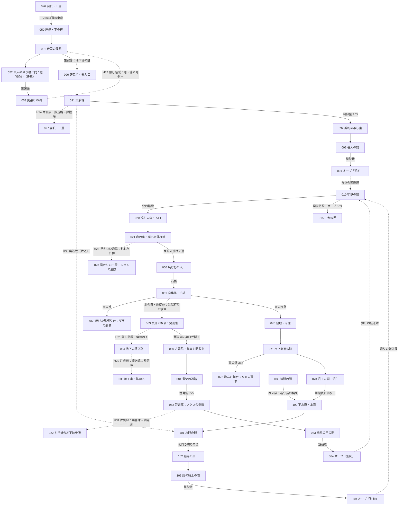

# 世界設計書 第2段階 — 灰の王国（D3）

W3〜W5 がこのファイルを見て、第2段階の 6 ダンジョン・仲間 4 人・オーブ 2〜4 個目・結末 B を作るための設計書。
[docs/world.md](world.md)（D1）の 4 章が第1段階に対してしていることを、第2段階に対してする。世界・年表・真相・仲間の役割は world.md のまま（1・5・6・7 章）。
ID の帯は [docs/ROADMAP.md](ROADMAP.md)、データの形は [docs/mz-data.md](mz-data.md)、隠し通路の文字は [docs/plugins/Hai_HiddenPassage.md](plugins/Hai_HiddenPassage.md)、
遺骸と記憶のタグは `docs/plugins/Hai_Companions.md`（P6）、第1段階の実際の入口と出口は `docs/maps.md`（W1）。

- 手本（Fanastasis）の固有名詞・台詞・地名・地図は使っていない。ここに出る名前と文章はすべて自作。
- 書き方の決まりは world.md と同じ：部屋の大きさは**床の広さ**（壁の 2 行は含まない）、位置はおおよそで W が文字マップで整えてよい。
  残留思念の本文は 1 ページ 4 行まで、行の頭に「」を付けず地の文として出す。`\N[1]` は主人公の名前。
- 番号（マップ・敵グループ・アイテム・旗）は**推し**。配り役が W3〜W5 の帯を割り当てたら読み替える（筋とつながりは変わらない）。
- 決定待ちは [18 章](#18-決定待ち) と `needs-decision` の issue。どれも推しで進められ、W を止めない。

---

## 1. 第2段階の全体

### 1.1 ダンジョンの一覧
第1段階の 3 つ（巡礼の森・廃坑・地下牢）に 6 つを足して **9 ダンジョン**。うち 3 つにオーブがある（古書院・研究所・下水道）。
王都を真ん中に置くと、北に森、北東の山に廃坑、東の崖に**巨人の崖道**、西の谷に**異端者の廃集落**、南西の低地に**魚人の湿地**、北西の丘に**古書院**、
山の根の下に**蘇生師の研究所**、王都の真下に**王都の下水道**。

| ダンジョン | マップ | 入口（第1段階のどこから） | オーブ | 仲間 | ボス | 遊ぶ時間 |
|---|---|---|---|---|---|---|
| 巨人の崖道 | 050–053 | 廃坑・上層 026 の中央の坑道の東端 | — | オルドの記憶 2 | 岩背負い（**門番・任意**） | 15 分 |
| 異端者の廃集落 | 060–064 | 巡礼の森・奥 021 の西端 | — | **ザザ**（遺骸と記憶 4 つ） | 焚刑官ハルト | 20 分 |
| 森の追加：看取りの小屋 | 023 | 巡礼の森・奥 021 の東の隠し（H23） | — | **シオン**（遺骸・記憶 2 つ） | — | 5 分 |
| 魚人の湿地 | 070–073 | 廃集落・広場 061 の南の水路 | — | **ルメ**（遺骸と記憶 4 つ） | 沼主 | 20 分 |
| 古書院 | 080–084 | 廃集落の焚刑の教会 063 の裏口（焚刑官を倒すと開く） | **聖灰** | **ノクス**（遺骸と記憶 4 つ）、シオンの記憶 1 | 紙魚の王 | 25 分 |
| 蘇生師の研究所 | 090–094 | 崖道の帝国の陣跡 051 の地下壕 | **契約** | — | 契約の番人 | 25 分 |
| 王都の下水道 | 100–104 | 湿地の沼主の淵 073 の排水口（沼主を倒すと開く）／地下牢の拷問の間 035 の西の扉（看守長の鍵束） | **封印** | — | 灰の騎士 | 25 分 |
| 王都の門 | 015（world.md 3.1） | 牢獄の間 010 の塞がった螺旋階段（オーブ 3 つで上れる） | — | — | — | 結末 |

- 第1段階の 30 分と合わせて、隠し要素を半分見つけて **3 時間前後**（VISION の第2段階「3〜5 時間」の下の方。隠しを全部探すと 4 時間）。
- **オーブ 2〜4 個目は好きな順で取れる**：3 つのオーブのダンジョンは、どれもほかのオーブのボスを倒さずに入れる（道の途中のボス＝焚刑官・沼主・看守長は、オーブの守りではない）。
  - 聖灰：森 → 廃集落 → （焚刑官）→ 古書院。
  - 契約：廃坑 → 崖道 → （地下壕の鍵）→ 研究所。
  - 封印：森 → 廃集落 → 湿地 → （沼主）→ 下水道、**または** 地下牢 → （看守長）→ 鍵束の扉 → 下水道。
- ボスの強さは**取った数で変えない**。3 つのオーブのボスは同じ帯（[9 章](#9-ボスの一覧)）。
- 敵の色は world.md 4.0 のまま（緑・黄・赤。赤は必ず迂回路がある）。

### 1.2 マップの割り当て
| マップ | 名前 | 大きさ | タイルセット（look.md 2.3 の予約） | 色調（推し） | 暗がり | 凡例（W が `legend.json` に追記） |
|---|---|---|---|---|---|---|
| 023 | 看取りの小屋 | 27 × 15 | 12 森 | 森と同じ `34,34,51,153` | なし | `forest` |
| 050 | 崖道・下の道 | 46 × 30 | 20 巨人の崖道 | `-17,-17,-17,85`（乾いた灰色）、遠景 `Mountains1` | なし | `cliff` |
| 051 | 帝国の陣跡 | 40 × 28 | 20 | 同上 | なし | `cliff` |
| 052 | 巨人の吊り橋と門 | 36 × 22 | 20 | 同上 | なし | `cliff` |
| 053 | 見張りの洞 | 20 × 15 | 13 廃坑 | `-68,-68,-51,68` | `4` | `dungeon` |
| 054–059 | 予備（崖道） | | | | | |
| 060 | 焼け野の入口 | 40 × 30 | 19 異端者の廃集落 | `-34,-34,-34,136`（焼け跡の灰色） | なし | `village` |
| 061 | 廃集落・広場 | 44 × 34 | 19 | 同上 | なし | `village` |
| 062 | 焼けた見張り台 | 27 × 17 | 19 | 同上（少し赤く `-17,-34,-34,119`） | なし | `village` |
| 063 | 焚刑の教会 | 27 × 19 | 14 地下牢 | `-34,-51,-51,85` | なし | `dungeon` |
| 064 | 地下の護送路 | 44 × 15 | 14 | `-68,-68,-51,85` | `4` | `dungeon` |
| 065–069 | 予備（廃集落） | | | | | |
| 070 | 湿地・葦原 | 46 × 34 | 15 魚人の湿地 | `-17,0,-17,102`（緑がかった霧） | なし | `marsh` |
| 071 | 水上集落の跡 | 44 × 32 | 15 | 同上 | なし | `marsh` |
| 072 | 沈んだ舞台 | 27 × 20 | 15 | `-34,-17,0,68`（青く静か） | なし | `marsh` |
| 073 | 沼主の淵 | 27 × 17 | 15 | `-51,-34,-51,85` | なし | `marsh` |
| 074–079 | 予備（湿地） | | | | | |
| 080 | 古書院・前庭と閲覧室 | 40 × 30 | 16 古書院 | `17,0,-34,68`（埃っぽい黄色） | なし | `library` |
| 081 | 書架の迷路 | 44 × 34 | 16 | 同上 | なし | `library` |
| 082 | 禁書庫 | 36 × 26 | 16 | `-34,-34,-51,68` | `4` | `library` |
| 083 | 紙魚の王の間 | 27 × 17 | 16 | `-17,-17,-34,68` | なし | `library` |
| 084 | オーブの間「聖灰」 | 17 × 13 | 16 | `-68,-68,-34,68`（036 と同じ） | なし | `library` |
| 085–089 | 予備（古書院） | | | | | |
| 090 | 研究所・搬入口 | 40 × 28 | 17 研究所 | `-17,-51,-17,68`（赤紫） | なし | `lab` |
| 091 | 実験棟 | 44 × 34 | 17 | 同上 | `5` | `lab` |
| 092 | 契約の写し室 | 30 × 20 | 17 | `0,-51,-17,51` | なし | `lab` |
| 093 | 番人の間 | 27 × 19 | 17 | `17,-51,-34,68` | なし | `lab` |
| 094 | オーブの間「契約」 | 17 × 13 | 17 | `-68,-68,-34,68` | なし | `lab` |
| 095–099 | 予備（研究所） | | | | | |
| 100 | 下水道・上流 | 44 × 30 | 18 下水道 | `-51,-34,-51,68`（緑灰） | `5` | `sewer` |
| 101 | 水門の間 | 40 × 30 | 18 | 同上 | `5` | `sewer` |
| 102 | 結界の真下 | 40 × 28 | 18 | `17,17,34,102`（白く滲む） | なし | `sewer` |
| 103 | 灰の騎士の間 | 27 × 19 | 18 | `34,34,51,119` | なし | `sewer` |
| 104 | オーブの間「封印」 | 17 × 13 | 18 | `51,51,68,136`（真っ白に近い） | なし | `sewer` |
| 105–109 | 予備（下水道） | | | | | |

- タイルセット 15–20 は look.md 2.3 で**予約だけ**されていて、まだ無い。W が着く前に V で作る（[17 章](#17-w3w5-への分け方の案)）。
  作られるまでは、外は 12（森）、中は 14（地下牢）で仮に作ってよい（凡例は `forest`・`dungeon`）。
- 外のマップ（崖道・廃集落・湿地）の「壁」は森と同じく、崖・焼けた柵・葦の列で作る。P2 の手がかりの規則（植生＝z=1 の A2、影なし＝`shadow: false`、くぼみ＝別の A4 の kind）は凡例ごとに同じ考え方で文字を足す。
- 暗がりが `4` のマップは、手がかりを部屋の入口から 4 マス以内か、光の輪に入る所に置く（look.md 4 章の約束）。

### 1.3 つながり図
実線＝ふつうの道、点線＝隠し要素（番号は [10 章](#10-隠し要素の一覧)）、`-.->` は片道。太字の四角は第1段階のマップ。



**遠い場所が実は隣**（VISION 核 1）の発見は 4 つ：
1. H22 廃集落の教会の地下から、地下牢の監房区へ出る（異端者は更生牢へ送られていた）。
2. H31 古書院の禁書庫から、森の礼拝堂の地下納骨所へ出る（教会は焚書の本を納骨所へ運んでいた）。
3. H34 研究所から、廃坑・下層の採掘場へ出る（研究所の魔石は廃坑から運ばれていた）。
4. H35 研究所の廃液管を滑り落ちると、王都の下水道に出る（研究所は王都の真下の隣だった）。

### 1.4 第1段階のマップに足すもの
W1 のマップの JSON を書き換える（行き先のマップを作る W が行う。行き先が無いうちに場所移動を置くと T2 の検査が落ちるため）。持ち主が仕上げ済み（`docs/maps.md`）なら、タイル層を作り直さず**イベントだけ**で足す（出口は既存の道の行き止まりに置く）。

| マップ | 何を | 中身 | W |
|---|---|---|---|
| 010 牢獄の間 | 塞がった螺旋階段（広間の真ん中） | 変数 101 が 3 以上なら調べると「白い光が薄れている。上れそうだ。」→ 015 の南の階段の上へ。3 未満は今の文章のまま | W5 |
| 021 森の奥 | 西端の焼けた道 | H03 の茂みの小道の北の端（(11,8) あたり）から西端へ道を延ばし、踏むと 060 の東の入口へ。道の口に焼けた道標（「この先、西の集落。立ち入りを禁ず　聖灰教会」） | W3 |
| 021 森の奥 | 東の白樺の列（H23） | 坑口の前の空き地（(27..36,3..6)）の東の木の列に見えない通路。手がかりは一本だけ枯れた白樺 | W3 |
| 021 森の奥 | シオンの記憶 2「転機」 | 崩れた礼拝堂の告解室（礼拝堂の西の隅。小さな仕切り） | W3 |
| 022 納骨所 | H31 の表 | 聖女の棺の部屋の西の壁。スイッチ 164 が OFF の間は壁（調べても何もない）。ON なら触れると 082 の西の片側扉の前へ | W4 |
| 026 廃坑・上層 | 東の出口 | 中央の坑道の東の端。踏むと 050 の西の坑口へ | W3 |
| 026 廃坑・上層 | オルドの記憶 1「生い立ち」 | 西の詰め所の奥の箱（world.md 6.1） | W3 |
| 027 廃坑・下層 | オルドの記憶 3「罪か誇り」 | 魔石の採掘場の奥の支柱 | W3 |
| 027 廃坑・下層 | H34 の表 | 採掘場の東の壁。スイッチ 163 が OFF の間は壁。ON なら触れると 091 の搬送路の扉の前へ | W5 |
| 033 監房区 | H22 の表 | 西の監房の列の北の端の壁。スイッチ 165 が OFF の間は壁。ON なら触れると 064 の東の端へ | W3 |
| 035 拷問の間 | 西の扉 | 鍵の扉（看守長の鍵束 203）。開けたらスイッチ 160 を ON、触れると 100 の東の鍵束の扉の前へ（world.md 4.7 の「037 以降の扉」をここに決めた） | W5 |

---

## 2. 巨人の崖道（050–053）
**見どころ**：山の東の崖に沿った細い道。巨人の末裔が刻んだ大きな石段、帝国軍の陣跡（崩れた天幕、錆びた攻城弩、指揮所）、谷に架かる巨人の吊り橋。乾いた灰色の空。
約 40 年前に帝国が攻め込んだ道で、帝国兵の残留思念が「赤い目の女が王の横にいた」と語る（セレスの正体の手がかり、world.md 2.3）。〔噂〕
灰化しない巨人の末裔は、帝国にも王国にもつかず、門を守り続けて石になりかけている。

**仕掛け**
- **飛び降りの段差**：巨人の石段の途中に、下の段へ飛び降りられる所（一方通行。プレイヤー接触のイベントで移動ルート 205「ジャンプ」で 2 マス下へ）。上りは石段を回る。帰り道の近道。
- **地下壕の鍵**（大事なもの、221）：050 の見張り小屋の箱。051 の地下壕の施錠扉（→ 研究所 090）を開ける。R18 が在りかを言う。
- **巨人の吊り橋**：052 の谷の吊り橋は上がっていて渡れない。向こう岸の取っ手を回すと下りる（スイッチ 161。橋のイベントの 2 ページ目が通れる橋の絵）。
  向こう岸へは H16 の見えない通路（谷の西の崖）で渡る。橋を下ろすと以後は近道。
- 門番の岩背負いは**任意**。倒すと 053 見張りの洞に入れる（叡智のオーブ・赤い宝箱・研究所への隠し階段 H17）。倒さなくても研究所へは地下壕の鍵で行ける。

**Map050 崖道・下の道（46×30）**
| 区画 | 床の広さ | 中身 |
|---|---|---|
| 西の坑口 | 4 × 4 | ← 026 の中央の坑道の東端 |
| 崖沿いの道（東へ、崖の縁をうねる） | 幅 2〜3、長さ 40 前後 | 緑の敵 3 体。崖の外は遠景（山）。転落はしない（通れないタイル） |
| 見張り小屋（崖の窪み） | 6 × 4 | 箱（地下壕の鍵）、帝国の伝令の遺体 R18 |
| 落石の谷（中ほど） | 10 × 6 | **赤「崖喰い」**。北の巨人の石段へ最短。H14 の見えない通路で谷の北の岩壁を抜けて迂回 |
| 巨人の石段（北へ上る） | 幅 3、長さ 10 | 途中に飛び降りの段差（上の段 → 落石の谷の手前へ） |
| 北の出口 | 幅 3 | → 051 の南の入口 |

**Map051 帝国の陣跡（40×28）**
| 区画 | 床の広さ | 中身 |
|---|---|---|
| 南の入口 | 幅 3 | ← 050 |
| 崩れた天幕の並び | 14 × 8 | 黄の敵 2 体。若い帝国兵の遺体 R19、**オルドの記憶 2「転機」**（天幕の中の工兵の道具箱） |
| 指揮所の天幕（北西） | 7 × 5 | 将校の日誌 R20（2 ページ。赤い目の女）。灰の泉の湧き水（全回復）と記録の書見台（セーブ）は天幕の外の焚き火の跡 |
| 攻城弩の台（北東） | 6 × 4 | 錆びた攻城弩（飾り）。台の裏の壁に H15 の隠し扉 → 赤い宝箱 |
| 地下壕の入口（中央の北） | 3 × 3 | 施錠扉（地下壕の鍵 221）→ 090 研究所・搬入口の北。扉の内側の床に H17 の着地点（053 から降りてくる） |
| 東の吊り橋のたもとへ | 幅 3 | → 052 の西 |

**Map052 巨人の吊り橋と門（36×22）**
| 区画 | 床の広さ | 中身 |
|---|---|---|
| 西のたもと | 6 × 5 | ← 051。巨人の子どもの石 R21（H16 の手がかり） |
| 吊り橋（東西） | 幅 2、長さ 12 | 上がっている（スイッチ 161 で下りる）。下は谷（通れない） |
| 谷の西の崖 | 幅 1、長さ 14 | H16 の見えない通路。崖の縁に一マスだけ苔。谷を回り込んで東のたもとへ |
| 東のたもと | 6 × 5 | 橋の取っ手（スイッチ 161 ON）。緑 1 体、黄 1 体 |
| 巨人の門（東） | 9 × 6 | **岩背負い**（門番・任意。話しかけると戦闘。逃走可、`<hai_enemy_once>`）。撃破でスイッチ 158 ON、門が開く |
| 門の奥 | 幅 2 | → 053 |

**Map053 見張りの洞（20×15）**
| 区画 | 床の広さ | 中身 |
|---|---|---|
| 洞の広間 | 10 × 6 | 最後の見張りの石像 R22、**叡智のオーブ**（P8 が入るまでは置かない）、赤い宝箱「巨人の腕輪」 |
| 洞の奥の床 | 1 マス | H17 の隠し階段（ひび割れの床）→ 051 の地下壕の扉の内側（鍵なしで研究所へ） |

**敵（崖道）** 敵グループは W3 の帯（推し 301–）
| 色 | 名前 | 敵グループ（推し） | 数 | 特徴 |
|---|---|---|---|---|
| 緑 | 灰つばめ | 301 | 050 に 2、052 に 1 | 速いが弱い。巡回が広い |
| 緑 | 岩這い | 302 | 050 に 1、051 に 1 | 動かない。物理に強く、雷に弱い（岩背負いの弱点を教える） |
| 黄 | 帝国の亡兵 | 303（2 体組） | 051 に 2、052 に 1 | 元帝国兵の槍兵。防御が固い |
| 赤 | 崖喰い | 304 | 050 の落石の谷に 1 | 岩の大蛇。全体の岩落とし。雷に弱い |
| ボス | 岩背負い（門番・任意） | 305 | 052 に 1 | [9 章](#9-ボスの一覧) |

---

## 3. 異端者の廃集落（060–064）
**見どころ**：森の西の谷にあった獣人と異種族の集落。約 25〜10 年前、教会の異端狩りに焼かれた。焦げた柵、崩れた家、川に架かる石橋（ザザが一人で守った橋）、
西の丘の焼けた見張り台（ザザが死んだ所）、集落を見下ろす小さな教会（異端狩りが本営にした「焚刑の教会」）。
灰化は異種族の呪いだという教会の嘘と、その嘘で焼かれた者の暮らしを読む。〔知〕教会の説と焼き討ち／〔噂〕それが嘘であること。教会の祭壇の下には、異端者を王都の更生牢へ送った地下の護送路がある。

**仕掛け**
- **異端狩りの紋章**（大事なもの、222）：060 の兵の野営跡の箱。焚刑の教会の大扉（061 の北の坂の上）を開ける。R23 が在りかを言う。
- **焚刑の教会**：焚刑官ハルト（ボス）を倒すと裏口が開き、丘の上の古書院（080）へ行ける。祭壇の下に H21 の隠し階段（護送路 064）。
- **地下の護送路**（064）：一本道の長い地下道。焦げた影（黄）が 2 体往復する。東の端の片側扉 H22 を開けると地下牢の監房区（033）へ出る（スイッチ 165）。
- ザザの遺骸は**ふつうの道**（西の丘の上）。丘の道に赤「火刑の亡者」がいて、H20 で迂回できる。

**Map060 焼け野の入口（40×30）**
| 区画 | 床の広さ | 中身 |
|---|---|---|
| 東の入口 | 幅 3 | ← 021 の西端の焼けた道 |
| 焼けた畑 | 14 × 8 | 緑の敵 3 体 |
| 墓標の丘（北） | 8 × 5 | 異端狩りの兵の墓が並ぶ。**ザザの記憶 3「罪か誇り」**（一番端の小さな墓標）。南の柵の向こうに H18 |
| 兵の野営跡（南） | 6 × 4 | 箱（異端狩りの紋章）、異端狩りの兵の遺体 R23。黄の敵 1 体 |
| 隠しの柵囲い | 4 × 3 | H18 の先。赤い宝箱「獣人の革鎧」 |
| 石橋（西） | 幅 2、長さ 8（川の上） | 橋のたもとに**ザザの記憶 2「転機」** |
| 西の出口（橋の向こう） | 幅 3 | → 061 の東の入口 |

**Map061 廃集落・広場（44×34）**
| 区画 | 床の広さ | 中身 |
|---|---|---|
| 東の入口 | 幅 3 | ← 060 の石橋 |
| 焼けた家々 | 家 5 × 4 が 6 軒（中を歩ける） | 獣人の母の思念 R24（2 軒目）。**ザザの父の家**（5 軒目）に**ザザの記憶 1「生い立ち」**と H19 の隠し階段（床下の隠れ部屋 4 × 3、同じマップの北東の隅に置く） |
| 中央の広場 | 12 × 8 | 焼けた柱（焚刑の柱）に R25。黄の敵 2 体。灰の泉の湧き水と記録の書見台（村の井戸の跡） |
| 西の丘への道 | 幅 2、長さ 12 | **赤「火刑の亡者」**。H20 の見えない通路（焼けた生け垣の中）で迂回 → 062 |
| 北の坂 | 幅 3、長さ 8 | 上に焚刑の教会の大扉（施錠扉：異端狩りの紋章 222）→ 063 |
| 南の水路 | 幅 2 | 水路沿いの小道 → 070 の北の入口。水路の口の柵（調べると「子どもが通れるほどの穴が開いている」。押し広げて通れる） |

**Map062 焼けた見張り台（27×17）**
| 区画 | 床の広さ | 中身 |
|---|---|---|
| 丘の道 | 幅 2 | ← 061 |
| 見張り台の焼け跡 | 9 × 7 | 焼け落ちた梯子と台。**ザザの遺骸**（記憶 4「臨終」を同じイベントに。`<hai_remains:6><hai_memory:6,4>`） |

**Map063 焚刑の教会（27×19）**
| 区画 | 床の広さ | 中身 |
|---|---|---|
| 大扉（南） | 2 マス | ← 061 の北の坂 |
| 礼拝堂 | 15 × 9 | 長椅子、副官の遺体 R27（ボスの弱点）。説教台に書記の記録 R26。祭壇の前に**焚刑官ハルト**（ボス。話しかけると戦闘。逃走可）。撃破でスイッチ 156 ON、**叡智のオーブ**が祭壇に現れる（P8） |
| 祭壇の下 | 1 マス | H21 の隠し階段 → 064 の西の端 |
| 裏口（北） | 1 マス | スイッチ 156 で開く → 080 の南の坂 |
| 逃げたら | — | 061 の北の坂の下に戻される。ボスは全快して残る |

**Map064 地下の護送路（44×15）**
| 区画 | 床の広さ | 中身 |
|---|---|---|
| 西の端（階段の下） | 4 × 3 | ← 063 の祭壇の下 |
| 護送路（東西） | 幅 2、長さ 36 | 焦げた影（黄）2 体が往復。途中の壁の窪みに送られた異端者の思念 R28 |
| 東の端 | 4 × 3 | H22 の片側扉（裏はこちら）。開けるとスイッチ 165 ON、033 の西の監房の列の北の端へ |

**敵（廃集落）** 敵グループは W3 の帯（推し 306–）
| 色 | 名前 | 敵グループ（推し） | 数 | 特徴 |
|---|---|---|---|---|
| 緑 | 火の粉 | 306 | 060 に 2、061 に 2 | 火の小さな霊。火の攻撃。氷に弱い |
| 緑 | 焼け犬 | 307（2 匹で 1 組） | 060 に 2 | 群れる |
| 黄 | 異端狩りの兵 | 308 | 060 に 1、061 に 2 | 盾と「祈り」（味方の回復）。沈黙が効く |
| 黄 | 焦げた影 | 309 | 061 に 1、064 に 2 | 焼け死んだ村人の影。**狂乱**を撒く（ザザの狂乱の予告） |
| 赤 | 火刑の亡者 | 310 | 061 の西の丘への道に 1 | 火の全体攻撃。氷に弱い |
| ボス | 焚刑官ハルト | 311 | 063 に 1 | [9 章](#9-ボスの一覧) |

---

## 4. 看取りの小屋（023。巡礼の森の追加）
**見どころ**：巡礼の森の東の外れ、白樺の林の中の小屋。灰化した民を看取った少年修道士シオンの小屋で、寝台が並び、薬棚に聖灰の壺。
森の側からは見えない通路 H23 を抜けないと着けない（隠し要素の見返りになる遺骸の 1 人目）。手がかりは廃集落の教会の書記 R26（ダンジョンをまたぐ手がかり）。

**Map023 看取りの小屋（27×15）**
| 区画 | 床の広さ | 中身 |
|---|---|---|
| 西の白樺の林 | 幅 3 | ← 021 の東の白樺の列（H23 の見えない通路の先） |
| 小屋の前の畑 | 8 × 5 | 薬草の畑の跡（飾り）。灰の泉の小さな湧き水 |
| 小屋の中 | 7 × 5 | 寝台が 4 つ。薬棚に**シオンの記憶 3「罪か誇り」**。奥の寝台の横に**シオンの遺骸**（記憶 4「臨終」を同じイベントに。`<hai_remains:9><hai_memory:9,4>`） |

敵はいない。

---

## 5. 魚人の湿地（070–073）
**見どころ**：王国の南西の低地。葦と浅い水、杭の上の家々（魚人の水上集落の跡）、水に半ば沈んだ円形の舞台。緑がかった霧。
灰化の濡れ衣で人間に追われた魚人たちの暮らしと、廃集落から逃げてきた獣人の子どもを匿った話を読む。魚人も獣人も灰にならないこと、人間だけが灰になることの意味に近づく。〔噂〕

**仕掛け**
- **水門**：070 の水門小屋の取っ手を回すとスイッチ 159 が ON になり、071 の浅瀬の水が引いて歩ける。
  作り方：071 の浅瀬の床は**通れる地面**で作り、その上に「水」のイベント（タイルの絵＝水、プライオリティ「通常キャラと同じ」）を並べる。イベントの 2 ページ目（スイッチ 159）を画像なし・「通常キャラの下」にすると水が引いて見える。
- **歌の錠**（番号錠）：071 の歌の杭。調べると「杭に、魚の形の刻みが三つ並んでいる。数え歌を歌いますか？」→ 数値入力 103 で 3 桁を変数 104 に入れ、111 で **312** と比べる。
  正しければスイッチではなくそのイベントのセルフスイッチ A を ON、072 への板の道（同じイベントの 2 ページ目の絵）が浮かぶ。間違えると「霧が濃くなった。……違う歌のようだ」。何度でもやり直せる。手がかりは R31。
- **沼主の淵**：073 の沼主（ボス）を倒すと淵の水が引き、底の排水口が開く（スイッチ 157）→ 100 下水道・上流。逃げても何度でも挑める。

**Map070 湿地・葦原（46×34）**
| 区画 | 床の広さ | 中身 |
|---|---|---|
| 北の入口 | 幅 2 | ← 061 の南の水路。入口の脇に人間の村への道標と**ルメの記憶 2「転機」** |
| 葦の迷い道 | 幅 2、長さ 40 前後（葦の壁で迷路） | 緑の敵 3 体 |
| 葦原の中ほど | 10 × 8 | **赤「大顎」**。南の水上集落へ最短。H24 の見えない通路（葦の壁の中）で迂回 |
| 水門小屋（東） | 6 × 4 | 取っ手（スイッチ 159 ON）。水門番の思念 R29 |
| 網小屋（西） | 5 × 4 | 魚人の漁師の思念 R30。黄の敵 1 体 |
| 沈んだ荷車（南西） | 4 × 3 | H25 の先。赤い宝箱「漁師の銛」 |
| 南の出口 | 幅 2 | → 071 の北 |

**Map071 水上集落の跡（44×32）**
| 区画 | 床の広さ | 中身 |
|---|---|---|
| 北の入口 | 幅 2 | ← 070 |
| 杭の上の家々 | 家 4 × 3 が 5 軒、板の道（幅 1）でつながる | 2 軒目が歌い手の家：**ルメの記憶 1「生い立ち」**。黄の敵 2 体 |
| 浅瀬（中央） | 14 × 8 | スイッチ 159 で水が引いて歩ける。引く前は板の道を遠回り |
| 集会所（北東） | 8 × 6 | 魚人の長老の思念 R32（2 ページ）。灰の泉と記録の書見台。北の壁に H26 の隠し扉 → 隠し部屋 4 × 3（**叡智のオーブ**、P8） |
| 歌の杭（南東） | 3 × 3 | 歌の錠（312）。杭のそばに魚人の子どもの思念 R31 と**ルメの記憶 3「罪か誇り」**。錠を開けると板の道 → 072 |
| 南西の淵への道 | 幅 2 | → 073 |

**Map072 沈んだ舞台（27×20）**
| 区画 | 床の広さ | 中身 |
|---|---|---|
| 板の道（北） | 幅 1 | ← 071 の歌の杭 |
| 客席の段 | 半円、幅 13 × 奥行き 4 | 誰もいない石の客席。緑の敵 1 体 |
| 円形の舞台 | 9 × 7（半ば水没。水のマスは通れない） | **ルメの遺骸**（記憶 4「臨終」を同じイベントに。`<hai_remains:8><hai_memory:8,4>`） |
| 舞台袖（東） | 3 × 3 | 壁に H27 の隠し扉 → 赤い宝箱「歌い手の首飾り」 |

**Map073 沼主の淵（27×17）**
| 区画 | 床の広さ | 中身 |
|---|---|---|
| 淵の岸 | 15 × 9 | 岸の石に老いた歌い手の思念 R33（ボスの弱点）。淵の真ん中に**沼主**（ボス。岸の端で調べると戦闘。逃走可） |
| 淵の底の排水口 | 2 × 2 | スイッチ 157 で現れる（水のイベントが消える）→ 100 の西の排水口の下。下水道の側からは梯子で上れる（両方向） |
| 逃げたら | — | 071 の南西の淵への道に戻される |

**敵（湿地）** 敵グループは W4 の帯（推し 401–）
| 色 | 名前 | 敵グループ（推し） | 数 | 特徴 |
|---|---|---|---|---|
| 緑 | 葦蛭 | 401 | 070 に 3 | 毒 |
| 緑 | 泥蛙 | 402 | 070 に 1、071 に 1、072 に 1 | 動かない。眠りの舌 |
| 黄 | 沈み人 | 403 | 071 に 2 | 溺れた元人間。HP が高い。眠り |
| 黄 | 霧の鷺 | 404 | 070 に 1、071 に 1 | 混乱 |
| 赤 | 大顎 | 405 | 070 の葦原の中ほどに 1 | 2 回攻撃。雷に弱い |
| ボス | 沼主 | 406 | 073 に 1 | [9 章](#9-ボスの一覧) |

---

## 6. 古書院（080–084）
**見どころ**：北西の丘の上の古い書院。教会の命で焚書が行われ、半分が焼けた。埃と黄ばんだ光。書架が迷路のように並び、焼けた区画は黒い。地下の禁書庫は暗い。
聖女の記録の嘘、悪魔の契約の作法を書いた写本、それを若いユエルに読ませた盲目の司書ノクス。〔進：ノクス 3〕オーブ「聖灰」はユエルの少年時代（孤児院）を見せる。

**仕掛け**
- **禁書庫の番号錠**：081 の下り階段の前の鉄の扉。数値入力 103 → 変数 104 → **725** と比べる（地下牢の 413 と同じ作り）。手がかりは R34（同じダンジョン）と R41（研究所。どちらかを読めば分かる）。
- **書架の迷路**（081）：幅 1 の通路が迷路状。**赤「書架の番人」**が中央の通路を往復する。H29 で迂回。
- **禁書庫の暗がり**（082、半径 4）：ノクスの遺骸は北の書架の裏の隠し扉 H30 の先（隠し要素の見返りになる遺骸の 2 人目）。手がかりは R37。
- **禁書庫の抜け道**：082 の西の片側扉 H31 を開けると、森の礼拝堂の地下納骨所（022）へ出る（スイッチ 164）。帰りの近道。

**Map080 古書院・前庭と閲覧室（40×30）**
| 区画 | 床の広さ | 中身 |
|---|---|---|
| 南の坂 | 幅 3 | ← 063 の裏口 |
| 前庭 | 12 × 6 | 焼けた本の山（飾り）。緑の敵 2 体 |
| 閲覧室 | 14 × 8 | 長机。写字生の思念 R35。点の字の石板に**ノクスの記憶 1「生い立ち」**。孤児院の子らの習字の帳面に**シオンの記憶 1「生い立ち」**。緑の敵 1 体 |
| 目録の部屋（西） | 6 × 4 | 目録の札の棚。目録係の思念 R34（番号錠 725）。西の書架の一つの裏に H28 の隠し扉 → 赤い宝箱「灰樫の杖」 |
| 北の扉 | 1 マス | → 081 の南 |

**Map081 書架の迷路（44×34）**
| 区画 | 床の広さ | 中身 |
|---|---|---|
| 南の入口 | 4 × 3 | ← 080 |
| 書架の迷路 | 30 × 20 の中に幅 1 の通路 | 黄の敵 3 体。中央の通路に**赤「書架の番人」**。東の列の書架の裏に H29 の見えない通路（迷路の南東から北へ抜ける） |
| 写字室（西） | 7 × 5 | 机と羽根ペン。灰の泉と記録の書見台 |
| 焼けた区画（北東） | 10 × 6 | 黒く焼けた書架。焚書を命じた司祭の思念 R36。焼け残りの書架に**ノクスの記憶 2「転機」** |
| 下り階段（北） | 3 × 3 | 番号錠の鉄の扉（725）→ 082 の南 |

**Map082 禁書庫（36×26、暗がり 4）**
| 区画 | 床の広さ | 中身 |
|---|---|---|
| 階段の下（南西） | 4 × 3 | ← 081 |
| 書架の列 | 24 × 12 | 黄の敵 2 体、緑の敵 1 体。写しの棚に**ノクスの記憶 3「罪か誇り」**。弟子の思念 R37（H30 の手がかり） |
| 北の書架の裏 | 4 × 3 | H30 の隠し扉の先。**ノクスの遺骸**（記憶 4「臨終」を同じイベントに。`<hai_remains:7><hai_memory:7,4>`） |
| 禁書庫の奥（北東） | 5 × 4 | 鉄の書見台の上に**叡智のオーブ**（P8） |
| 西の壁 | 1 マス | H31 の片側扉（裏はこちら）。開けるとスイッチ 164 ON、022 の聖女の棺の部屋へ |
| 南東の大扉 | 2 マス | 扉の前に書庫番の思念 R38（ボスの弱点）→ 083 |

**Map083 紙魚の王の間（27×17）**
| 区画 | 床の広さ | 中身 |
|---|---|---|
| 円形の閲覧台 | 15 × 9 | 頁の山の上に**紙魚の王**（ボス。話しかけると戦闘。逃走可）。撃破でスイッチ 152 ON、北の扉が開く |
| 北の扉 | 1 マス | → 084 |
| 逃げたら | — | 082 の大扉の前に戻される |

**Map084 オーブの間「聖灰」（17×13）**
| 区画 | 床の広さ | 中身 |
|---|---|---|
| 小さな書斎 | 7 × 5 | 台座の上に**オーブ「聖灰」**（[11.1](#111-オーブ聖灰古書院)）。帰りの転送陣（牢獄の間の広間へ） |

**敵（古書院）** 敵グループは W4 の帯（推し 407–）
| 色 | 名前 | 敵グループ（推し） | 数 | 特徴 |
|---|---|---|---|---|
| 緑 | 紙魚 | 407（2 匹で 1 組） | 080 に 2、081 に 1 | 弱い。群れる |
| 緑 | インク溜まり | 408 | 080 に 1、082 に 1 | 動かない。毒 |
| 黄 | 写字の亡霊 | 409 | 081 に 2 | 沈黙 |
| 黄 | 焚書の灰 | 410 | 081 に 1、082 に 2 | 燃える頁の霊。火。氷に弱い |
| 赤 | 書架の番人 | 411 | 081 の中央の通路に 1 | 動く鎧。物理に強い、雷に弱い |
| ボス | 紙魚の王 | 412（呼び出しで紙魚 407 が増える） | 083 に 1 | [9 章](#9-ボスの一覧) |

---

## 7. 蘇生師の研究所（090–094）
**見どころ**：崖道の帝国の陣跡の地下壕を掘り進めた先、山の根の下に、王の命で作られた蘇生師の研究所。魔石の灯、ガラスの容器、檻、床一面の陣。最深部に契約の陣の写し。赤紫。
主人公の研究所であることが、所長室の机の字に見覚えがあることで分かる。〔進：091 の机〕死者の兵が帝国を押し返したこと、その代価が民の魂の灰であることに近づき、オーブ「契約」でセレスの正体が決定的になる。〔進：094〕

**仕掛け**
- **制御盤 3 つ**：091 の 3 つの実験室（檻・硝子・陣）にレバー。倒すとそのイベントのセルフスイッチ A を ON にし、変数 106「研究所の制御盤」に 1 を足す。
  中央の封印扉は変数 106 が 3 以上で開く（111 の変数の分岐）。手がかりは R42。
- **蘇生師の印章**（大事なもの、223）：091 の所長室の机の引き出し。092 契約の写し室の扉を開ける。机を調べると「……この字には、見覚えがある。」（残留思念ではない。ふつうの文章）。
- **搬送路の扉**（H34）：091 の東の搬送路の突き当たり。研究所の側から閂を外すとスイッチ 163 ON、廃坑・下層 027 の採掘場とつながる（H11 と同じ作り）。
- **廃液管**（H35）：091 の廃液槽の裏の見えない通路の先に管の口。踏むと「足を滑らせた！」で 101 水門の間の西の排水溝へ（片道。下水道の側からは管が高くて上れない）。

**Map090 研究所・搬入口（40×28）**
| 区画 | 床の広さ | 中身 |
|---|---|---|
| 北の地下壕 | 3 × 3 | ← 051 の地下壕の施錠扉 |
| 搬入路（南へ） | 幅 3、長さ 18 | トロッコの線路と魔石の箱（飾り）。緑の敵 2 体、黄の敵 1 体 |
| 守衛室（西） | 6 × 4 | 守衛の思念 R39。南の壁に H32 の隠し扉 → 赤い宝箱「白衣」 |
| 荷揚げ場（東） | 10 × 6 | 灰の泉と記録の書見台（研究員の休憩所の跡） |
| 南の扉 | 2 マス | → 091 の北 |

**Map091 実験棟（44×34、暗がり 5）**
| 区画 | 床の広さ | 中身 |
|---|---|---|
| 北の入口 | 4 × 3 | ← 090 |
| 中央の廊下（南北） | 幅 3、長さ 24 | **赤「継ぎ接ぎ」**が往復。西の壁に H33 の見えない通路（影の無い壁の列。廊下の北から南の封印扉の前へ） |
| 檻の部屋（西） | 7 × 5 | 制御盤 1。起こされた囚人の思念 R40。緑の敵 1 体 |
| 硝子の部屋（東） | 7 × 5 | 制御盤 2。研究員の思念 R41。緑の敵 2 体 |
| 陣の部屋（南西） | 7 × 5 | 制御盤 3。助手の思念 R42。黄の敵 1 体 |
| 所長室（北東） | 6 × 4 | ユエルの机（蘇生師の印章）。黄の敵 1 体 |
| 廃液槽（南東） | 5 × 4 | 裏に H35 の見えない通路 → 管の口（101 へ片道） |
| 搬送路（東） | 幅 2、長さ 10 | 突き当たりが H34 の片側扉（裏はこちら）→ 027 |
| 中央の封印扉（南） | 2 マス | 変数 106 が 3 以上で開く → 092 |

**Map092 契約の写し室（30×20）**
| 区画 | 床の広さ | 中身 |
|---|---|---|
| 北の扉 | 2 マス | ← 091。施錠扉（蘇生師の印章 223） |
| 写し室 | 14 × 8 | 床に契約の陣の写し（飾り。調べると「赤い線が、まだかすかに脈打っている」）。王の侍従の思念 R43。黄の敵 1 体 |
| 控えの小部屋（東） | 5 × 4 | 灰の泉と記録の書見台。最後の研究員の思念 R44（ボスの弱点） |
| 南の扉 | 2 マス | → 093 |

**Map093 番人の間（27×19）**
| 区画 | 床の広さ | 中身 |
|---|---|---|
| 陣の広間 | 15 × 11 | 床一面の陣。**契約の番人**（ボス。話しかけると戦闘。逃走可）。撃破でスイッチ 154 ON、南の扉が開く |
| 南の扉 | 1 マス | → 094 |
| 逃げたら | — | 092 の控えの小部屋に戻される |

**Map094 オーブの間「契約」（17×13）**
| 区画 | 床の広さ | 中身 |
|---|---|---|
| 小さな陣の間 | 7 × 5 | 台座の上に**オーブ「契約」**（[11.2](#112-オーブ契約研究所)）。帰りの転送陣 |

**敵（研究所）** 敵グループは W5 の帯（推し 501–）
| 色 | 名前 | 敵グループ（推し） | 数 | 特徴 |
|---|---|---|---|---|
| 緑 | 試験体の鼠 | 501（2 匹で 1 組） | 090 に 2、091 に 1 | 毒 |
| 緑 | 瓶詰めの目 | 502 | 091 に 2 | 動かない。眠りの視線 |
| 黄 | 白衣の亡者 | 503 | 090 に 1、091 に 2 | 元研究員。毒の針と仲間の回復 |
| 黄 | 魔石の欠片 | 504 | 091 に 1、092 に 1 | 雷に弱い。HP が減ると自爆（全体） |
| 赤 | 継ぎ接ぎ | 505 | 091 の中央の廊下に 1 | 死体を継いだもの。2 回行動。火に弱い |
| ボス | 契約の番人 | 506 | 093 に 1 | [9 章](#9-ボスの一覧) |

---

## 8. 王都の下水道（100–104）
**見どころ**：王都の真下を流れる石造りの下水道。天井の格子から白い結界の光が漏れる。灰が水に溶けて白く濁って流れる。結界の真下に近づくほど白く明るくなる。
蘇生師が王都を封じ、自分を錠にした場所。〔進：R49・104〕結界は錠である主人公を拒むので、光の差す床を踏むと押し戻される。

**仕掛け**
- **入口は 2 つ**：湿地の沼主の淵 073 の排水口（沼主を倒すと開く）と、地下牢の拷問の間 035 の西の扉（看守長の鍵束 203。開けるとスイッチ 160）。どちらからでも 100 に出る。
- **水門の切り替え**：101 の水門の取っ手で東西の水路を切り替える（スイッチ 162。OFF＝西の水路が歩ける・東は水、ON＝東が歩ける・西は水）。作りは湿地の水門と同じ（水のイベントの出し消し）。
  西の水路の先に結界の真下 102 への階段、東の水路の先に赤い宝箱と H37。手がかりは R45。
- **結界の光**（102）：天井から光が差す床（区画で決める）にプレイヤー接触のイベント。踏むと画面が白く光り、「白い光に押し戻された」で 1 マス戻される（移動ルート 205、向きそのまま後退）。
  光の無い床をたどる迷路にする。主人公が錠だから結界が拒む（world.md 1.4）。
- **廃液管の出口**：101 の西の排水溝の上に管の口（研究所 091 から滑り落ちて来る所。下からは上れない）。

**Map100 下水道・上流（44×30、暗がり 5）**
| 区画 | 床の広さ | 中身 |
|---|---|---|
| 西の排水口の下 | 4 × 3 | ← 073 の排水口（梯子。上ると 073 へ戻れる） |
| 本流（東西） | 水路 幅 3 の両側に歩道 幅 2、長さ 36 | 緑の敵 2 体、黄の敵 1 体。北の歩道の壁に H36 の隠し扉 → 赤い宝箱「水除けの長靴」 |
| 下水番の小屋（南） | 6 × 4 | 下水番の思念 R45。灰の泉と記録の書見台 |
| 東の鍵束の扉 | 1 マス | ← 035 の西の扉（看守長の鍵束。こちらからは閂を外せば開く：スイッチ 160 を ON） |
| 南東の出口 | 幅 2 | → 101 の北 |

**Map101 水門の間（40×30、暗がり 5）**
| 区画 | 床の広さ | 中身 |
|---|---|---|
| 北の入口 | 4 × 3 | ← 100 |
| 水門の踊り場（中央） | 10 × 6 | 水門の取っ手（スイッチ 162 の切り替え）。逃げてきた女の思念 R46。黄の敵 1 体 |
| 西の水路 | 幅 3、長さ 16 | スイッチ 162 が OFF で歩ける。西の排水溝の上に廃液管の出口（H35 の着地点）。突き当たりに下り階段 → 102 の北 |
| 東の水路 | 幅 3、長さ 16 | スイッチ 162 が ON で歩ける。**赤「下水の大蛇」**。突き当たりの壁に H37 の見えない通路 → 102 の北東（大蛇を避けて西の水路を使わずに抜ける道） |

**Map102 結界の真下（40×28）**
| 区画 | 床の広さ | 中身 |
|---|---|---|
| 北の階段の下 | 4 × 3 | ← 101 の西の水路の階段。北東の隅に H37 の出口 |
| 光の迷路 | 24 × 14 | 天井の格子から光が差す床（押し戻される）と光の無い床。黄の敵 2 体（白い蛾）。入口に子どもの思念 R48。光の当たらない床の 1 マスに H38 の隠し階段 → 南西の隅の小部屋 4 × 3（赤い宝箱「近衛の盾」） |
| 控え室（南） | 6 × 4 | 灰の泉と記録の書見台。近衛の思念 R47（ボスの弱点）、壁にユエルの刻み R49 |
| 南の扉 | 2 マス | → 103 |

**Map103 灰の騎士の間（27×19）**
| 区画 | 床の広さ | 中身 |
|---|---|---|
| 錠の間の前室 | 15 × 11 | 天井が白く光る。**灰の騎士**（ボス。話しかけると戦闘。逃走可）。撃破でスイッチ 155 ON、南の扉が開く |
| 南の扉 | 1 マス | → 104 |
| 逃げたら | — | 102 の控え室に戻される |

**Map104 オーブの間「封印」（17×13）**
| 区画 | 床の広さ | 中身 |
|---|---|---|
| 結界の真下の小部屋 | 7 × 5 | 天井が真っ白に光る。床に古い血の跡（飾り。「ここで誰かが倒れたようだ」）。台座の上に**オーブ「封印」**（[11.3](#113-オーブ封印下水道)）。帰りの転送陣 |

**敵（下水道）** 敵グループは W5 の帯（推し 507–）
| 色 | 名前 | 敵グループ（推し） | 数 | 特徴 |
|---|---|---|---|---|
| 緑 | 溝鼠の群れ | 507（3 匹で 1 組） | 100 に 2 | 群れる。弱い |
| 緑 | 灰の澱 | 508 | 100 に 1、101 に 1 | 灰の溶けた泥。動かない。毒 |
| 黄 | 近衛の亡霊 | 509 | 100 に 1、101 に 1 | 盾。かばい合う（2 体のとき）。灰の騎士が呼ぶのもこれ |
| 黄 | 白い蛾 | 510 | 102 に 2 | 結界の光に集まる。眠りの鱗粉 |
| 赤 | 下水の大蛇 | 511 | 101 の東の水路に 1 | 毒と締め付け（1 人を行動不能）。氷に弱い |
| ボス | 灰の騎士 | 512（近衛の亡霊 509 を呼ぶ） | 103 に 1 | [9 章](#9-ボスの一覧) |

---

## 9. ボスの一覧
数値は**帯だけ**（看守長グラウ＝HP 2000 を 1 とした倍率）。細かい数値・行動の確率は P7 の作りと P4 の規則（`docs/plugins/Hai_Battle.md`）で W が決める。
耐性の穴は「仲間か拾える装備で突ける」ことを必ず守る（レベルを上げずに勝つ道。world.md 4.4 の看守長と同じ考え方）。
どのボスも**逃走可**、逃げたら直前の控えの場所に戻され、ボスは全快して残る。固定ドロップのほか魔石を多めに落とす。

| ボス | 場所 | HP の帯 | 想定 | 耐性 | **耐性の穴** | 行動の型 | 形態変化 | 固定ドロップ |
|---|---|---|---|---|---|---|---|---|
| **岩背負い**（門番・任意） | 052 | 1.5〜1.8 | 仲間 1〜2 人、Lv 8 前後 | 物理 50% 減、火 50% 減、毒 無効 | **雷 200%**、**混乱が効く** | ① 毎ターン「岩投げ」（単体の大きな物理）か「地鳴らし」（全体の物理）<br>② 3 ターンごとに「門を閉ざす」（2 ターン防御が大きく上がる。その間は攻めずに回復するのが手）<br>③ HP 50% で「誓いの石化」：物理を無効にし、代わりに魔法に弱くなる（物理と魔法の手を切り替えさせる） | なし（②③は状態の切り替え） | 「岩背負いの石帯」（防具。物理 15% 減） |
| **焚刑官ハルト** | 063 | 1.8〜2.2 | 仲間 2 人、Lv 10 前後 | 火 無効、毒 無効、物理 25% 減 | **氷 200%**、**沈黙が効く**（祈りを封じると③の炎が弱まる） | ① 毎ターン「焚刑の槍」（単体の物理＋火）か「浄化の炎」（全体の火）<br>② 2 ターンごとに「告発」（1 人に**狂乱**。ザザが入っていると狙われやすい）<br>③ HP 50% で形態変化 | **あり**：HP 50% で「聖火の法」。鎧が燃え上がり、物理で殴ると火の反撃を受ける。沈黙中は反撃しない | 「耐火の外套」（防具。火 50% 減）、大事なもの「焚刑官の祈祷書」（理知の間で読める。P8） |
| **沼主** | 073 | 2.2〜2.6 | 仲間 2〜3 人、Lv 12 前後 | 水 無効、物理 25% 減 | **雷 200%**、**眠りが効く**（歌で眠った主。ルメの歌が効きやすい） | ① 毎ターン「尾の一撃」（単体）か「泥吐き」（全体＋毒）<br>② 3 ターンごとに「呑み込み」（1 人を 2 ターン行動不能にし、毎ターン少しずつ削る。主を叩くと吐き出す）<br>③ HP 30% で形態変化 | **あり**：HP 30% で「淵に潜る」（1 ターン攻撃が当たらない）→ 次のターンに「大波」（全体の大きな水）。以後は潜る・浮かぶを繰り返す | 「水鏡の護符」（装飾。水と氷 50% 減）、素材「沼主の髭」（P9 の合成） |
| **紙魚の王**（オーブ「聖灰」） | 083 | 2.6〜3.0 | 仲間 2〜3 人、Lv 13 前後 | 物理 25% 減、沈黙 無効、眠り 無効 | **火 200%**（紙は火を恐れる。ユエルの灰火） | ① 毎ターン「沈黙の頁」（全体に**沈黙**）か「読み上げ」（喰った頁の呪文：火・氷・雷の全体のどれか）<br>② 2 ターンごとに「頁を喰う」（1 人の SP を奪って回復）<br>③ HP 50% で 1 回だけ「分裂」：紙魚を 2 体呼ぶ（紙魚は放っておいてよい） | なし（③は呼び出し） | 「司書の眼鏡」（装飾。沈黙と混乱を防ぐ）、大事なもの「焼け残りの頁」（P8） |
| **契約の番人**（オーブ「契約」） | 093 | 2.6〜3.0（二つの形の合計） | 仲間 2〜3 人、Lv 13 前後 | 第一形態「秤の顔」：物理と魔法 50% 減。第二形態「獣の顔」：魔法 無効 | 第一：**火 200%**／第二：**物理 150%**、**眠りが効く** | 第一：① 毎ターン「取り立て」（いちばん HP の多い者の HP を 3 割奪う）か「契約の鎖」（1 人を 2 ターン行動不能）<br>第二：① 2 回行動。「爪」（単体）と「咆哮」（全体に**狂乱**）<br>② 3 ターンごとに「呪文を食う」（次の 1 ターン、魔法を吸って回復） | **あり**：HP 50% で秤が割れて第二形態（見た目と耐性が入れ替わる） | 「契約者の指輪」（装飾。SP の消費を 2 割減らす）、大事なもの「割れた秤」（第3段階の伏線。結末 C） |
| **灰の騎士**（オーブ「封印」） | 103 | 2.6〜3.0 | 仲間 2〜3 人、Lv 13 前後 | 物理 50% 減、闇 無効、毒・眠り 無効 | **氷 200%**（灰の鎧は冷えると脆い）、**混乱が効く**（誰を守っているか分からなくなる） | ① 毎ターン「近衛の剣」（単体の大きな物理）<br>② 3 ターンごとに「王命」（全体＋**沈黙**）<br>③ 開幕と HP 70% で「近衛を呼ぶ」：近衛の亡霊（509）を 1 体。亡霊は騎士を**かばう**（先に倒すか、混乱させると騎士が亡霊を斬る）<br>④ HP 50% で形態変化 | **あり**：HP 50% で鎧が崩れて「灰の嵐」。毎ターン全体に小さなダメージ、攻撃が 2 回になる。防御は下がる | 「近衛の誓剣」（武器。ユエル用、氷の属性） |

- **ボスに即死は効かない**（ノクスの即死の呪文。ボスの「ステート無効化（戦闘不能）」を W が付ける。P6 のメモ）。
- 3 つのオーブのボスは同じ帯（好きな順で挑めるので）。オーブを取るたびに仲間と装備が増える分だけ、後のボスほど楽になる。
- 耐性の穴を突ける手立て（推し）：雷＝ノクス（メイジ）と赤い宝箱「灰樫の杖」／氷＝ノクスと「漁師の銛」（氷の属性）／火＝ユエルの灰火／眠り＝第1段階の眠り香、ルメ／混乱＝霧の鷺の羽根（消耗品。P9 が作るなら）／沈黙＝ノクス。

---

## 10. 隠し要素の一覧
リージョンと文字は P2（`docs/plugins/Hai_HiddenPassage.md`）のまま：251 見えない通路、252 隠し扉、253 片側扉、254 隠し階段。
手がかりは P2 の 4 つ（**植生**＝一マスだけ違う床、**影なし**＝側面に影が無い壁、**くぼみ**＝別の A4 の壁、**逆側**＝裏から来て初めて開く）から必ず 1 つ以上。
**思念**（残留思念の示唆）と**見える**（隣が見えるのに行けない）は添えるだけ。番号は world.md 4.5 の続き（H14 から）。

マップをまたぐ片側扉（H22・H31・H34）は H11 と同じ作り：裏の側のマップで調べて閂を外すとスイッチを ON にし、表の側のマップは「スイッチが OFF の間は壁、ON なら触れると移動」のイベントにする（1.4 の表）。

| 番号 | マップ | 場所 | 種類 | 手がかり | 見返り |
|---|---|---|---|---|---|
| H14 | 050 | 落石の谷の北の岩壁 | 251 見えない通路 | 影なし（谷の北の壁の側面に影が無い列） | **赤「崖喰い」の迂回**（谷の手前から巨人の石段へ） |
| H15 | 051 | 攻城弩の台の裏の壁 | 252 隠し扉 | くぼみ | 赤い宝箱「工兵の手袋」（装飾。攻撃と防御が少し上がる。オルド向け） |
| H16 | 052 | 谷の西の崖（吊り橋の下を回り込む） | 251 見えない通路 | 植生（崖の縁に一マスだけ苔）＋思念（R21） | 吊り橋の向こう岸へ（取っ手を回すと吊り橋が下りる。スイッチ 161） |
| H17 | 053→051 | 見張りの洞の奥の床 | 254 隠し階段 | 植生（ひび割れの床） | 051 の地下壕の扉の内側へ：**地下壕の鍵なしで研究所へ** |
| H18 | 060 | 墓標の丘の南の焼けた柵 | 251 見えない通路 | 植生（柵の根元に一マスだけ焼けていない草）＋見える（柵越しに宝箱） | 赤い宝箱「獣人の革鎧」（防具。回避が上がる。ザザ向け） |
| H19 | 061 | ザザの父の家の床 | 254 隠し階段 | 植生（ひび割れの床）＋思念（ザザの記憶 1「床下にしまった」） | 床下の隠れ部屋：赤い宝箱「ザザの父の剣」（武器。ザザだけが装備できる） |
| H20 | 061 | 西の丘への道の脇の焼けた生け垣 | 251 見えない通路 | 影なし（生け垣の側面に影が無い列） | **赤「火刑の亡者」の迂回**（広場から見張り台へ） |
| H21 | 063 | 礼拝堂の祭壇の下の床 | 254 隠し階段 | 植生（祭壇の前だけ床石の色が違う）＋思念（R26） | 064 地下の護送路へ |
| H22 | 064→033 | 護送路の東の端（裏）／監房区の西の列の北の端の壁（表） | 253 片側扉 | 逆側（護送路の側からだけ開く） | **廃集落と地下牢の近道**（以後、地下牢から廃集落の教会へ直行）。スイッチ 165 |
| H23 | 021→023 | 森の奥の東の白樺の列 | 251 見えない通路 | 植生（一本だけ枯れた白樺の根元に白い灰）＋思念（R26） | 023 看取りの小屋：**シオンの遺骸**（隠し要素の見返りになる遺骸の 1 人目） |
| H24 | 070 | 葦原の中ほどの西の葦の壁 | 251 見えない通路 | 植生（一マスだけ折れた葦） | **赤「大顎」の迂回**（迷い道から水上集落へ） |
| H25 | 070 | 沈んだ荷車の東の葦の壁 | 251 見えない通路 | 影なし＋見える（葦の隙間から荷車の宝箱） | 赤い宝箱「漁師の銛」（武器。氷の属性） |
| H26 | 071 | 集会所の北の壁 | 252 隠し扉 | くぼみ＋思念（R32 の 2 ページ目） | 隠し部屋：**叡智のオーブ**（P8）、魔石 |
| H27 | 072 | 舞台袖の東の壁 | 252 隠し扉 | くぼみ | 赤い宝箱「歌い手の首飾り」（装飾。眠りを防ぐ） |
| H28 | 080 | 目録の部屋の西の書架 | 252 隠し扉 | くぼみ（書架の一つだけ色が違う。凡例 `library` で別の A4 の書架の壁） | 赤い宝箱「灰樫の杖」（武器。雷の属性。ノクス向け） |
| H29 | 081 | 書架の迷路の東の列 | 251 見えない通路 | 影なし（書架の列の側面に影が無い所） | **赤「書架の番人」の迂回**（迷路の南東から下り階段の前へ） |
| H30 | 082 | 禁書庫の北の書架 | 252 隠し扉 | くぼみ（書架の背が一つだけ奥にずれている）＋思念（R37） | 書架の裏の小部屋：**ノクスの遺骸**（隠し要素の見返りになる遺骸の 2 人目） |
| H31 | 082→022 | 禁書庫の西の壁（裏）／納骨所の聖女の棺の部屋の西の壁（表） | 253 片側扉 | 逆側（禁書庫の側からだけ開く） | **古書院と森の近道**（以後、納骨所から禁書庫へ直行）。スイッチ 164 |
| H32 | 090 | 守衛室の南の壁 | 252 隠し扉 | くぼみ | 赤い宝箱「白衣」（防具。毒を防ぐ） |
| H33 | 091 | 中央の廊下の西の壁の中（南北 20 マス） | 251 見えない通路 | 影なし（西の壁の側面だけ影が無い列）＋思念（R42） | **赤「継ぎ接ぎ」の迂回**（廊下の北から封印扉の前へ） |
| H34 | 091→027 | 搬送路の突き当たり（裏）／廃坑・下層の採掘場の東の壁（表） | 253 片側扉 | 逆側（研究所の側からだけ開く） | **研究所と廃坑の近道**（以後、廃坑から研究所の奥へ直行）。スイッチ 163 |
| H35 | 091→101 | 廃液槽の裏 | 251 見えない通路 | 植生（廃液の染みた床が一マス） | 管の口から 101 水門の間へ滑り落ちる（片道）：**研究所から下水道へ** |
| H36 | 100 | 本流の北の歩道の壁 | 252 隠し扉 | くぼみ | 赤い宝箱「水除けの長靴」（装飾。毒を防ぎ、水の床でも足が鈍らない） |
| H37 | 101 | 東の水路の突き当たりの壁 | 251 見えない通路 | 影なし | **赤「下水の大蛇」の迂回**（水門の間から結界の真下へ） |
| H38 | 102 | 光の迷路の中の、光の当たらない床 | 254 隠し階段 | 植生（ひび割れの床）＋思念（R48） | 下の小部屋（同じマップの南西の隅）：赤い宝箱「近衛の盾」 |

- 赤い宝箱は 11 個（H15・H18・H19・H25・H27・H28・H32・H36・H38 の先、053 の「巨人の腕輪」、それと第1段階の 5 個で計 16）。中身は一点もの（P9）。数値は W が決める。
- 叡智のオーブは 4 個（053・063・071 の H26・082）。施設が開く順は world.md 3.3 のまま。P8 が入るまでは置かない（置き場所だけ空けておく）。

---

## 11. オーブ 2〜4 個目
world.md 5 章のとおり、**どの場面もそれだけで完結**し、前後は年表だけで示す。筋は取った数（変数 101）で進み、セレスの一言は world.md 2.4 のまま。
段階：場面の中身はそのオーブの〔進〕だけ。ほかのオーブの中身（契約の相手、錠、民の魂の行き先）を先取りしない（禁止語は world.md 10 章）。
取ったときの手順はオーブ「鎖」（world.md 4.8）と同じ：台座を調べる → そのオーブのスイッチ（102〜104）を ON → 変数 101 に 1 を足す → 画面を暗くして場面の文章 → 主人公の一言 →
変数 101 が 4 ならスイッチ 105 を ON（そのあと真の姿、スイッチ 106。[11.4](#114-四つ揃ったとき)）→ 帰りの転送陣が光る。

| オーブ | 置き場所 | たどり着く道筋 | 守り | スイッチ | 段階 |
|---|---|---|---|---|---|
| 聖灰 | 084 オーブの間「聖灰」 | 森 021 の西 → 廃集落 060・061 → 異端狩りの紋章で教会 063 → 焚刑官を倒して裏口 → 古書院 080・081 → 番号錠 725 → 禁書庫 082 → 083 | 紙魚の王 | 102 | 〔進：084〕 |
| 契約 | 094 オーブの間「契約」 | 廃坑・上層 026 の東 → 崖道 050・051 → 地下壕の鍵（または岩背負いを倒して H17）→ 研究所 090・091 → 制御盤 3 つ → 印章で 092 → 093 | 契約の番人 | 103 | 〔進：094〕 |
| 封印 | 104 オーブの間「封印」 | 廃集落 061 の南 → 湿地 070・071 → 沼主を倒して排水口 → 下水道 100、**または** 地下牢 035 の西の扉（看守長の鍵束）→ 100 → 水門 101 → 結界の真下 102 → 103 | 灰の騎士 | 104 | 〔進：104〕 |

### 11.1 オーブ「聖灰」（古書院）
少年時代：教会の孤児院で、聖女の奇跡が嘘だと知る。死をなかったことにする術を求め始める動機（world.md 5.2）。
```
……孤児院の寝床。藁の匂い。隣で、友だちが熱にうなされている。
司祭さまが来て、白い粉を匙ですくう。「聖女さまの灰だよ。これで治る」
友だちは粉を飲んで、むせて、笑った。
夜中、その手が冷たくなった。自分は朝まで握っていた。
朝、司祭さまは言った。「聖女さまは見ておられる。この子は召されたのだ」
窓の外は灰色の空だった。鳥も飛んでいない。
誰も、見ていない。
その日から字を覚えた。灯の油をくすねて、司祭さまの本を夜通し読んだ。
```
（8 行。取ったあとのユエルの一言：「……あの匙を、覚えている」）

### 11.2 オーブ「契約」（研究所）
約 25 年前：燃える王都の玉座の間で、王の前で悪魔と契約する。その悪魔がセレスだと分かる（world.md 5.3）。見終えたらスイッチ 107「セレスの正体を知った」を ON。
```
……燃える王都。玉座の間の窓が赤い。
王が玉座から降りて、自分の肩をつかむ。「何を払ってもよい。国を守れ」
自分は床に陣を描く。古い写本の作法どおりに。手は震えていない。
陣の中に、女が立っている。赤い目。黒い髪。
「呼んだのはあなた？　若いのね」女は笑う。「望みは」
「死者を兵に。帝国を押し返す力を」
「いいわ。代価は、この国の民の魂の灰。少しずつ、全部」
王が頷く。自分も、頷く。
女は自分の耳元でささやく。「契約は、あなたが完全な魂でここに立つとき、果たされる」
……その女の名を、自分は知っている。セレス。
```
（10 行。取ったあとのユエルの一言：「……セレス。お前だったのか」）

### 11.3 オーブ「封印」（下水道）
約 10 年前：灰化が契約の取り立てだと知ったユエルが、王都を結界で封じ、結界の真下で自分の魂を錠にして死ぬ（world.md 5.4）。
world.md 5.4 の「門の内側で陣を描く」に、**死んだ場所は下水道の果て（結界の真下）**を足した。体が結界の外にあったので、セレスが拾って牢獄の間で蘇らせられた（world.md 1.2「今」とつながる）。
```
……白い線が、門の内側から空へ伸びていく。自分が描いた陣だ。
「外へ。早く」逃げ遅れた女を、下水の口へ押しやる。
門が閉じる。王都の民は、皆、家の中で眠りについた。取り立ては、ここで止まる。
自分も下水へ降りる。暗い方へ。結界の真下へ。
胸に刃を当てる。錠の印を刻む。痛みは思ったより少ない。
足音。振り向くと、赤い目がこちらを見ている。
「何をしたの」声がかすれている。
「すまない。契約は果たさせない」
「……あなたが死んだら、魂はばらばらになるわよ。誰があなたを拾うの」
「次に目を覚ましたら、俺はたぶん何も覚えていない。それでいい」
白い光が下りてくる。自分の名前が、もう思い出せない。
```
（11 行。取ったあとのユエルの一言：「……門を、開けてはいけない。そう決めたはずだった」）

### 11.4 四つ揃ったとき
4 つ目の場面のあと（どのオーブが 4 つ目でも同じ）：スイッチ 105・106 を ON、主人公の顔画像・歩行画像を差し替える（画像の選定は持ち主。決まるまでは差し替えない）。
ユエルの一言：「……全部、思い出した。セレスが門で待っている」。セレスの一言は world.md 2.4 の「4」。

---

## 12. 仲間 4 人（ザザ・ノクス・ルメ・シオン）とオルドの残り
役割・固有の立ち回り・完全体の強技は world.md 6 章と P6 のデータ（Skills 191–195）のまま。ここでは遺骸と記憶の**場所と本文**を決める。
置き方は `docs/plugins/Hai_Companions.md`：遺骸は `<hai_remains:アクター ID>`（名前に「遺骸」）、記憶は `<hai_memory:アクター ID,番号>`（1 生い立ち・2 転機・3 罪か誇り・4 臨終）。
臨終は遺骸と同じイベントにまとめる（オルドの R12 と同じ）。記憶の本文は 1 ページ 4 行まで（5 行以上は 2 ページ）。

### 12.1 遺骸と記憶の場所
| Actor | 名前 | 遺骸 | 隠しの見返りか | 記憶 1 生い立ち | 記憶 2 転機 | 記憶 3 罪か誇り | 記憶 4 臨終 |
|---|---|---|---|---|---|---|---|
| 5 | オルド | 028（第1段階） | ○（H09） | 026 西の詰め所の奥の箱 | 051 崩れた天幕の工兵の道具箱 | 027 採掘場の奥の支柱 | 028（R12、第1段階） |
| 6 | ザザ | 062 焼けた見張り台 | — （赤「火刑の亡者」の先。H20 で迂回） | 061 ザザの父の家 | 060 石橋のたもと | 060 墓標の丘の一番端の墓標 | 062（遺骸と同じ） |
| 7 | ノクス | 082 北の書架の裏 | **○（H30）** | 080 閲覧室の点の字の石板 | 081 焼けた区画の焼け残りの書架 | 082 写しの棚 | 082（遺骸と同じ） |
| 8 | ルメ | 072 沈んだ舞台 | — （歌の錠 312 の先） | 071 歌い手の家 | 070 北の入口の道標 | 071 歌の杭 | 072（遺骸と同じ） |
| 9 | シオン | 023 看取りの小屋 | **○（H23）** | 080 閲覧室の習字の帳面 | 021 崩れた礼拝堂の告解室 | 023 薬棚 | 023（遺骸と同じ） |

- world.md 6 章の案から変えた所：ザザの「罪か誇り」を崖道の墓標から**廃集落の墓標の丘**へ（ザザの話を一つのダンジョンにまとめる）。シオンの遺骸の「第2段階で開く」を**隠し通路 H23** で開くことにした。
- 記憶は仲間が加わっていなくても読める（P6）。4 つ揃うと完全体（スイッチ 141〜145）。
- 段階：記憶の中身はすべて〔進〕（その断片を読んで初めて分かる）。ほかの人物の台詞や思念で先に言わない。

### 12.2 完全体の強技（world.md 6 章・P6 のまま。効果の案を足す）
| Actor | 強技 | 効果の案（P6 のデータ） |
|---|---|---|
| 5 オルド | 鉄の誓い | 3 ターン、味方全員への物理を身代わりに受け、受けるたびに反撃（ステート 191） |
| 6 ザザ | 千の牙 | 敵にランダムで 4 回の物理。狂乱中は 6 回（狂乱を味方にする技。P4 の狂乱と組む） |
| 7 ノクス | 頁を閉じる | 敵全体に即死 15%（ボスには効かない）＋沈黙 80% |
| 8 ルメ | 潮騒の歌 | 味方全体の HP 20% と SP 少し回復、3 ターン状態異常を防ぐ（ステート 192） |
| 9 シオン | 最後の祈り | 味方全体の戦闘不能を回復し HP を半分まで |

（ザザの「狂乱中は 6 回」は案。P7 か W が入れるときに決める。入れないなら 4 回のまま）

### 12.3 記憶の本文

**オルド（タンク）の残り 3 断片**（臨終は world.md の R12）

オルド 1「生い立ち」（026 西の詰め所の奥の箱）
```
石工の家の三男には、継ぐ物が何もなかった。
兵になれば家に麦が配られると、村に触れが来た。
母さんは泣いた。父さんは黙って、俺に石の割り方を最後にもう一度教えた。
「石は目に沿って割れ。人も同じだ」。意味が分かったのは、ずっと後だ。
```

オルド 2「転機」（051 崩れた天幕の工兵の道具箱）
```
砦を落とした翌朝、捕まえた王国の村人を前に並べて進めと命じられた。
盾にしろということだ。俺は「できません」と言った。
その日のうちに肩章を剥がされ、前線の穴掘りに回された。
悔いはない。ただ、俺の代わりに誰がその命令を受けたのかは、今も考える。
```

オルド 3「罪か誇り」（027 採掘場の奥の支柱）
```
捕虜になっても、穴は掘る。どうせ掘るなら、崩れない穴を掘る。
支柱は三本で一組。斜めに入れて、楔で締める。
同じ牢の連中に、毎晩それを教えた。帝国の工兵の技を、王国の囚人に。
この坑道は、俺がいた間、一度も人を潰さなかった。
```

**ザザ（ファイター）**

ザザ 1「生い立ち」（061 ザザの父の家）— H19 の手がかり
```
父さんの剣は重かった。持ち上げられるようになるまで、三年かかった。
「剣は守るためにある。斬った数を数えるな。守った数を数えろ」
父さんはそう言って、自分の剣を床下にしまった。
わたしの剣は、まだ家の外の木の枝だった。
```
メモ（P6 の一行のほかに P3 の手がかり）：「ザザの父の家の床下に、剣がしまってある（廃集落）」

ザザ 2「転機」（060 石橋のたもと）
```
異端狩りの松明が、谷の向こうに並んでいた。
村の者は南の水路へ。子どもと年寄りが先。
橋は一人なら守れる幅だ。わたしは橋の真ん中に立った。
振り返らなかった。振り返ったら、走って逃げたくなるから。
```

ザザ 3「罪か誇り」（060 墓標の丘の一番端の墓標）
```
何人斬ったか、数えなかった。父さんの言いつけどおりに。
でも、一人だけ覚えている。兜が脱げて、顔が見えた。
わたしより年下だった。母さんを呼んでいた。
守った数を数えろと、父さんは言った。……あの子は、どちらに数えればいい。
```

ザザ 4「臨終」（062 遺骸）
```
見張り台の梯子に火がついた。もう下りられない。
南の空を見た。水路の方に煙は上がっていない。みんな逃げ切った。
熱い。息が苦しい。剣を握る手だけは、まだ放さない。
狂ってしまえたら楽なのに。最後まで、わたしは正気だった。
```

**ノクス（メイジ）**

ノクス 1「生い立ち」（080 閲覧室の点の字の石板）
```
生まれたときから、世界は音と手触りだった。
石の板に刻まれた古い点の字を、指でなぞるのが好きだった。
書院の老司書が、それを読める子を探していた。
「目の見える者には読めぬ字だ」と老司書は笑った。私の居場所は、そこになった。
```

ノクス 2「転機」（081 焼けた区画の焼け残りの書架）
```
焚書の命令が来た。聖女の記録と、古い契約の写本。
私は三晩かけて、点の字で写しを作った。目の見えぬ者にしか読めぬ写しを。
燃やされたのは元の本だけだ。火の匂いを、私は書架の陰で嗅いでいた。
```

ノクス 3「罪か誇り」（082 写しの棚）— 2 ページ。主人公とつながる
```
孤児院出の若者が、毎晩書院に来ていた。死をなかったことにする方法を探していた。
私は禁書庫の鍵を開け、点の字の読み方をその子に教えた。
あの子は契約の作法の写しを、一晩で読み終えた。
```
```
「ありがとうございます、先生」。あの声を、私は今も覚えている。
扉の番号は、あの子に教えたままにした。変えようとは思わなかった。
```

ノクス 4「臨終」（082 遺骸）
```
焚書の火が、禁書庫まで回ってきた。
書架の裏の小部屋で、写しを胸に抱いた。紙は熱いが、まだ燃えていない。
煙で息ができない。それでも指は、表紙の点の字をなぞっている。
本は残る。誰かが、いつか読む。
```

**ルメ（サポート）**

ルメ 1「生い立ち」（071 歌い手の家）
```
母さんは、湿地の道をすべて歌で覚えていた。
右の杭を二つ、左の葦を一つ。霧の日も、夜も、歌えば迷わない。
わたしは母さんの膝の上で、道の歌を百も覚えた。
歌は、帰り道のことだった。
```

ルメ 2「転機」（070 北の入口の道標）
```
人間の村の祭りに呼ばれた。魚人の歌を聞きたいと。
わたしは一番いい歌を歌った。たくさんの拍手をもらった。
その夜、村で子どもが一人、灰になった。
朝には、魚人の歌が呪いを呼んだと、村中が言っていた。
```

ルメ 3「罪か誇り」（071 歌の杭）
```
追われながら、子どもたちに歌を教えた。舟の上で、葦の陰で。
怖がる子には、一番短い歌から。
「歌えば帰れる。歌えなくなっても、誰かが歌ってくれる」
舟が岸に着くたびに、子どもの数を数えた。七人。毎晩、七人。
```

ルメ 4「臨終」（072 遺骸）
```
舞台が沈んでいく。客席には、もう誰もいない。
それでも最後まで歌う。歌い手は、幕が下りるまで舞台を降りない。
水が胸まで来た。声はまだ出る。
……ありがとう。聞いてくれて。
```

**シオン（ヒーラー）**

シオン 1「生い立ち」（080 閲覧室の習字の帳面）
```
（帳面の隅に、子どもの字で）
にいさんに字をおそわった。にいさんはやさしい。でも、あまりわらわない。
にいさんは夜、ずっと本をよんでいる。しなない方法をさがしてるんだって。
ぼくも大きくなったら、にいさんのてつだいをする。
```

シオン 2「転機」（021 崩れた礼拝堂の告解室）
```
兄さんが宮廷に上がってから、孤児院には手紙も来なくなった。
その年、王都で灰の病が出た。看取る者が足りないと、司祭さまが言った。
僕は手を挙げた。兄さんが死なない方法を見つけるまで、
誰かが、死んでいく人の手を握っていなければならないと思った。
```

シオン 3「罪か誇り」（023 薬棚）
```
聖灰は効かない。司祭さまも僕も、本当は知っていた。
それでも「これで楽になります」と言って、一匙ずつ飲ませた。
飲んだ人は、笑って眠った。
あれが嘘だったのかどうか、僕はまだ決められない。
```

シオン 4「臨終」（023 遺骸）
```
最後の患者は、獣人のおばあさんだった。灰にはならない人だった。
「あんたの方が先に灰になるね」と、おばあさんは笑った。
本当だった。指の先から、白くなっていく。
手は放さない。……兄さん。兄さんは、間に合った？
```

---

## 13. 残留思念の一覧
P3 の既読・自動メモに乗る。「手がかり」欄が ○ のものは自動メモに残す（メモの一行も書いた）。番号は world.md 4.6 の続き（R18 から）。
各ダンジョンの中で、**world.md 1.4 の真相に少しずつ近づく順**に並べた（番号の若い方が入口に近い）。どの順で回っても、ダンジョンごとに一段ずつ近づく。
「段階」の列は、その思念が言ってよい真相の深さ（[docs/knowhow.md](knowhow.md) 2.1）。〔噂〕の思念は伝聞・推測の形で書く。

| 真相の段 | 中身 | 主に出る所 | 段階 |
|---|---|---|---|
| 1 | 灰化は人間だけ。異種族はかからない（呪いではない） | R19・R25・R32 | 〔噂〕 |
| 2 | 赤い目の女が王と蘇生師の横にいた | R20・R39 | 〔噂〕 |
| 3 | 死者の兵が帝国を押し返した | R18・R20・R40 | 〔知〕 |
| 4 | 蘇生師は古い写本から契約の作法を見つけた | R36・R41・ノクス 3 | 〔進〕 |
| 5 | 代価は民の魂の灰 | R25（予感）・R43 | 〔噂〕R25／〔進〕R43 |
| 6 | 蘇生師が王都を封じ、自分を錠にした。門を開けてはいけない | R46・R49 | 〔進〕 |

| 番号 | マップ | 場所 | 見た目 | 誰の思念か | 手がかり | 段階 |
|---|---|---|---|---|---|---|
| R18 | 050 | 見張り小屋 | 帝国兵の遺体 | 帝国の伝令 | ○ 地下壕の鍵 | 〔知〕 |
| R19 | 051 | 崩れた天幕 | 若い兵の遺体 | 若い帝国兵 | — | 〔噂〕 |
| R20 | 051 | 指揮所の天幕 | 将校の日誌（2 ページ） | 帝国の将校 | — | 〔噂〕 |
| R21 | 052 | 西のたもと | 小さな石の印 | 巨人の末裔の子ども | ○ H16 | 〔知〕 |
| R22 | 053 | 洞の広間 | 石になりかけた像 | 巨人の最後の見張り | — | 〔噂〕 |
| R23 | 060 | 兵の野営跡 | 異端狩りの兵の遺体 | 紋章を返した異端狩りの兵 | ○ 異端狩りの紋章 | 〔知〕 |
| R24 | 061 | 焼けた家の 2 軒目 | 焦げた鍋 | 獣人の母 | — | 〔知〕 |
| R25 | 061 | 中央の広場の焚刑の柱 | 焼けた柱 | 焼かれた獣人の長老 | — | 〔噂〕 |
| R26 | 063 | 説教台 | 記録の帳面 | 教会の書記 | ○ H21、H23 | 〔知〕 |
| R27 | 063 | 長椅子 | 副官の遺体 | 焚刑官の副官 | ○ ボスの弱点 | 〔知〕 |
| R28 | 064 | 護送路の壁の窪み | 壁の刻み | 送られた異端者 | — | 〔知〕 |
| R29 | 070 | 水門小屋 | 日誌 | 人間の水門番 | ○ 水門 | 〔知〕 |
| R30 | 070 | 網小屋 | 切られた網 | 魚人の漁師 | — | 〔知〕 |
| R31 | 071 | 歌の杭のそば | 杭の刻み | 魚人の子ども | ○ 歌の錠 312 | 〔知〕 |
| R32 | 071 | 集会所 | 長老の杖（2 ページ） | 魚人の長老 | ○ H26 | 〔噂〕 |
| R33 | 073 | 淵の岸の石 | 石の刻み | 老いた歌い手 | ○ ボスの弱点 | 〔知〕 |
| R34 | 080 | 目録の部屋 | 目録の札 | 目録係 | ○ 番号錠 725 | 〔知〕 |
| R35 | 080 | 閲覧室 | 写字生の遺体 | 書院の写字生 | — | 〔進〕 |
| R36 | 081 | 焼けた区画 | 司祭の遺体 | 焚書を命じた司祭 | — | 〔進〕 |
| R37 | 082 | 書架の列 | 弟子の遺体 | ノクスの弟子 | ○ H30 | 〔知〕 |
| R38 | 082 | 南東の大扉の前 | 書庫番の日誌 | 書庫番 | ○ ボスの弱点 | 〔知〕 |
| R39 | 090 | 守衛室 | 守衛の遺体 | 研究所の守衛 | — | 〔噂〕 |
| R40 | 091 | 檻の部屋 | 檻の中の骨 | 起こされた囚人 | — | 〔進〕 |
| R41 | 091 | 硝子の部屋 | 研究日誌 | 研究員 | ○ 番号錠 725（古書院） | 〔進〕 |
| R42 | 091 | 陣の部屋 | 助手の遺体 | 研究所の助手 | ○ 制御盤、H33 | 〔知〕 |
| R43 | 092 | 写し室 | 侍従の遺体 | 王の侍従 | — | 〔進〕 |
| R44 | 092 | 控えの小部屋 | 書き付け | 最後の研究員 | ○ ボスの弱点 | 〔知〕 |
| R45 | 100 | 下水番の小屋 | 下水番の日誌 | 下水番 | ○ 水門の切り替え | 〔知〕 |
| R46 | 101 | 水門の間の踊り場 | 女の遺体 | 王都から逃げてきた女 | — | 〔進〕 |
| R47 | 102 | 控え室 | 近衛の遺体 | 王の近衛 | ○ ボスの弱点 | 〔知〕 |
| R48 | 102 | 光の迷路の入口 | 小さな靴 | 結界を見上げていた子ども | ○ H38 | 〔知〕 |
| R49 | 102 | 控え室の壁 | 壁の刻み（見覚えのある字） | ユエル自身 | — | 〔進〕 |

**本文**

**R18** 帝国兵の遺体（帝国の伝令）
```
本隊への伝令、三度目。返事はない。
王国の兵は、斬っても起き上がる。目が白い。痛がらない。
地下壕の鍵は、この小屋の箱に入れておく。後の誰かが使えるように。
……俺は、走れるうちに走る。
```
メモ：「帝国の陣跡の地下壕の鍵は、崖道の見張り小屋の箱にある」

**R19** 若い兵の遺体（若い帝国兵）
```
今日も巨人の村を通った。荷を担がされている巨人たちは、灰の病にかからないらしい。
王国の人間は、村ごと灰になっていくのに。
軍医殿は「呪いは人を選ぶ」と言った。
選ぶのなら、選んでいる誰かがいるはずだ。
```

**R20** 将校の日誌（帝国の将校）— 2 ページ
```
王都の城壁の上に、王が立っているのを遠眼鏡で見た。
王の横には、外套の若い男と、赤い目の女がいた。
女が笑うたび、我らの陣の死者が起き上がり、王国の側へ歩いていった。
```
```
撤退を進言する。我らは人と戦っているのではない。
あの女とあの若い男が、何かと取引をしたのだ。
```

**R21** 小さな石の印（巨人の末裔の子ども）
```
父さんは吊り橋を上げて、向こう岸の門を守りに行った。
橋を下ろすには、向こうの取っ手を回すんだって。
ぼくは知ってる。谷の西の崖は、苔の生えた所だけ足がかかる。
帰ってこないなら、ぼくが迎えに行く。
```
メモ：「巨人の吊り橋の谷の西の崖は、苔の所だけ足がかかる（崖道）」

**R22** 石になりかけた像（巨人の最後の見張り）
```
帝国が来て、去った。王国の死者が来て、去った。
我らは誰の味方もしなかった。門を守れと言われたから守った。
灰は我らを避ける。だから我らだけが残り、だから我らは憎まれた。
石になるまで、ここにいる。それが巨人の礼儀だ。
```

**R23** 異端狩りの兵の遺体（紋章を返した兵）
```
隊長は言った。灰の病は異種族の呪いだ、村を焼けば病は止む、と。
三つ焼いた。病は止まない。王都ではまだ人が灰になっている。
紋章は野営の箱に返した。もう、これを付けて歩けない。
四つ目の村へは、行かない。
```
メモ：「異端狩りの紋章は、焼け野の野営跡の箱にある（廃集落）」

**R24** 焦げた鍋（獣人の母）
```
子どもたちは南の水路から湿地へ逃がした。魚人たちが匿ってくれる。
あの人たちも追われているのに、黙って舟を出してくれた。
わたしは残る。家に火がつくまで、ここで鍋をかき混ぜている。
煙が上がっていれば、追っ手は家の中に誰かいると思うから。
```

**R25** 焼けた柱（焼かれた獣人の長老）
```
灰の病は、わしらには移らぬ。四十年見てきたが、一人もかからなんだ。
そう言うたら、それが呪いの証だと言われた。
……王都の方角の空が、夜でも赤い。あれは火ではない。
何かが、人の魂を数えておる。
```

**R26** 記録の帳面（教会の書記）
```
記録係として、焼いた村の数と、送った異端者の数を書く。
送った者は、祭壇の下の護送路から王都の更生牢へ。
……巡礼の森の東、枯れた白樺の向こうに看取りの小屋がある。
あそこの少年修道士だけは、異種族も人も同じように看取っていた。
```
メモ：「焚刑の教会の祭壇の下に、護送路への階段がある（廃集落）」「巡礼の森の東、枯れた白樺の向こうに看取りの小屋がある」

**R27** 副官の遺体（焚刑官の副官）
```
隊長はもう祈りの言葉しか口にしない。燃える鎧を脱がない。
祈りを唱えるたびに、炎が強くなる。口を塞げば、炎も弱まるだろう。
水では消えなかった。あの炎を消せるのは、冬の山の氷くらいだ。
```
メモ：「焚刑官は祈りを封じると炎が弱まる。氷に弱い（廃集落）」

**R28** 壁の刻み（送られた異端者）
```
目隠しをされて、長い長い地下道を歩かされた。
前の男が歩数を数えていた。千九百、二千。
着いた先で「更生」させると言われた。
……向こうで、先に送られた妹に会えるだろうか。
```

**R29** 日誌（人間の水門番）
```
魚人どもを追い出せと、村の者は言った。
おれは水門を閉じて、集落の道を沈めた。追っ手は渡れず、魚人たちは舟で逃げた。
村の者には、水門が壊れたと言ってある。
取っ手は小屋の中だ。回せば、また水は引く。
```
メモ：「湿地の水門小屋の取っ手を回すと、水上集落の水が引く」

**R30** 切られた網（魚人の漁師）
```
人間の村で灰の病が出るたびに、おれたちの網が切られた。
魚人の歌が病を呼ぶんだと。
歌で病が呼べるなら、とっくに帝国の兵を呼んで沈めている。
……ルメの歌は、病じゃない。道しるべだ。
```

**R31** 杭の刻み（魚人の子ども）
```
ルメ姉さんの歌は数え歌なの。でも、順番があべこべ。
いち、に、さん、じゃなくて、さん、いち、に。
杭の前でそう歌えば、沈んだ舞台への板が浮かぶんだよ。
わたし、ちゃんと覚えてる。忘れたら、誰も帰れないから。
```
メモ：「湿地の歌の杭の数え歌は、3・1・2」

**R32** 長老の杖（魚人の長老）— 2 ページ
```
人間は、わしらが灰にならぬのを妬んだ。だが、わしらも知らなんだ。
なぜ人間だけが灰になるのか。
王都に行った若い衆が言うておった。王が何かと取引をした。払いは人間持ちだと。
```
```
集会所の北の壁の向こうに、古い賢者の珠を隠してある。
壁を叩けば分かる。わしらにはもう、使い道がない。
```
メモ：「水上集落の集会所の北の壁を叩け（湿地）」

**R33** 石の刻み（老いた歌い手）
```
沼の主は、歌を聞くと眠る。歌う者がいなくなってから、主は眠れなくなった。
眠れぬ主は腹を空かせて、淵に近づく者を呑む。
主の髭は雷を嫌う。雨の夜には、淵の底から出てこない。
```
メモ：「沼主は眠りが効き、雷に弱い（湿地）」

**R34** 目録の札（目録係）
```
禁書庫の扉の番号は、目録の札と同じにしてある。
棚の七、段の二、五冊目。
司書さまは目が見えないのに、札の場所を全部指で覚えていた。
```
メモ：「古書院の禁書庫の扉の番号は 7・2・5」

**R35** 写字生の遺体（書院の写字生）
```
聖女の奇跡の記録を、二百年分さかのぼって写した。
病が鎮まった年に、聖女はもう生きていなかった。年が合わない。
写した帳面は、翌朝すべて教会に持っていかれた。
記録は嘘だった。私は、覚えていることにした。
```

**R36** 司祭の遺体（焚書を命じた司祭）
```
焚書は私が命じた。教会の上から命じられたからだ。
聖女の記録と、それから、悪魔の契約の作法を書いた古い写本。
燃やす前に、司書が写しを取っていたのを、私は見ていた。
見なかったことにした。私が守れた本は、それだけだ。
```

**R37** 弟子の遺体（ノクスの弟子）
```
先生は最後に、北の書架の裏へ入っていかれた。写しを抱いて。
「ここは私の場所だから」と。
書架の一つだけ、背が少し奥にずれている。そこが入口です。
私は火を消しに戻ります。戻れなかったら、誰か先生を。
```
メモ：「禁書庫の北の書架、背が奥にずれた所が入口（古書院）」

**R38** 書庫番の日誌（書庫番）
```
紙魚が増えた。焼け残りの頁ばかり喰っている。
喰った頁の呪文を、あいつらは真似る。喰えば喰うほど賢くなる。
紙は紙だ。火を恐れる。焚書の火の中でだけ、あいつらは静かだった。
```
メモ：「紙魚の王は火を恐れる（古書院）」

**R39** 守衛の遺体（研究所の守衛）
```
ここで何を作っているのか、誰も教えてくれない。
所長は若い。教会の孤児院の出だという。口数が少なく、夜も灯を消さない。
王が自ら視察に来られた。女を一人連れていた。
女は守衛の俺に「ご苦労さま」と言った。目が赤かった。
```

**R40** 檻の中の骨（起こされた囚人）
```
一度死んで、起こされた。体は動く。腹は減らない。
所長は毎朝、俺の名前を呼んで、帳面に書く。
今日、戦場に送られる。帝国の兵を押し返すのだという。
死人の兵は、もう一度死ぬまで止まらない。俺は、止まり方を知らない。
```

**R41** 研究日誌（研究員）— 2 ページ
```
蘇生は一刻しかもたない。一刻を一年に延ばすには、何かを払わねばならない。
所長は古書院の禁書庫から、作法の写しを見つけてきた。誰に、何を払うのかが書いてあった。
禁書庫の扉の番号を、所長はよく口ずさんでいた。七、二、五。
```
```
所長は三日、写しを閉じたまま机に置いていた。
四日目に、王が来た。
```
メモ：「古書院の禁書庫の扉の番号は 7・2・5（研究所の日誌）」

**R42** 助手の遺体（研究所の助手）
```
制御盤は三つ。檻と、硝子と、陣の部屋に一つずつ。
三つとも倒せば、中央の封印扉が開く。所長が決めた手順だ。
廊下の継ぎ接ぎに見つかったら終わりだ。西の壁の、影の無い所を抜けろ。
```
メモ：「研究所の封印扉は、三つの制御盤を倒すと開く」「実験棟の廊下の西の壁、影の無い所を抜けられる」

**R43** 侍従の遺体（王の侍従）
```
陛下は「何を払ってもよい」と仰せになった。私はその場にいた。
赤い目の女は、陣の中で指を折って数えた。そして何かを言い、所長は頷いた。陛下も頷いた。
その夜から、城下で人が灰になり始めた。
誰も、私に尋ねはしなかった。私の魂も、払われる分に入っていたのだが。
```

**R44** 書き付け（最後の研究員）
```
陣の番人は、二つの顔を持つ。秤の顔のうちは、刃も呪文も半分しか通らない。
だが秤は火に弱い。所長の灰火で、何度も秤を焦がしたのを見た。
秤が割れたら獣になる。獣は呪文を食うが、刃はよく通る。
```
メモ：「契約の番人：秤の顔は火に弱い。獣の顔には刃が通る（研究所）」

**R45** 下水番の日誌（下水番）
```
王都に白い膜が張られた日から、上から人が降りてこなくなった。
水は今も流れてくる。灰が混じって、白く濁っている。
水門の間の取っ手で、東と西の水路を切り替えられる。片方を閉じれば、もう片方は歩ける。
```
メモ：「下水道の水門の間の取っ手で、東西の水路を切り替えられる」

**R46** 女の遺体（王都から逃げてきた女）
```
蘇生師さまが、門の内側で何かを描いていた。白い線が空まで伸びた。
「外へ。早く」と、あの方はわたしを下水の口へ押した。
しばらくして、あの方も下水へ降りてきた。暗い方へ、結界の真下へ歩いていった。
胸に、何かを刻むつもりだと言っていた。
```

**R47** 近衛の遺体（王の近衛）
```
隊長は、門に誰も近づけるなと命じられた。王の最後の命令だ。
王が灰になっても、隊長は命令を解かれていない。
隊長の鎧は灰でできている。冷えると脆くなる。
それに隊長は、自分が誰を守っているのか、ときどき分からなくなる。
```
メモ：「灰の騎士は氷に弱く、混乱が効く（下水道）」

**R48** 小さな靴（結界を見上げていた子ども）
```
天井の白い光、きれいだね。でも近づくと、押し返されるの。
光の当たらない床に、割れた石が一つあるよ。下にお部屋があるの。
お父さんは門の上にいる。光の向こう。
わたし、ここで待ってる。光が消えたら、すぐ会えるから。
```
メモ：「結界の真下の光の当たらない床に、割れた石。下に部屋がある（下水道）」

**R49** 壁の刻み（ユエル自身）
```
（壁に、爪で刻んだような字がある。見覚えのある字だ）
門は閉じた。錠は俺だ。中の者は眠ったまま、取り立てを免れる。
外の灰は止まらない。遅くなるだけだ。すまない。
次に誰かが俺を起こしても、門を開けてはいけない。
```
（主人公自身の残留思念。読んだあとのユエルの一言：「……俺の字だ」。結末 A・C の伏線）

---

## 14. 鍵と施錠扉・番号錠
world.md 4.7 の続き。鍵の Items 番号は W の帯の**仮**の番号（W1 が 201–204 を使い、W2 の分として 205–220 を空けた）。配り役が W3〜W5 の帯を割り当てたら、そちらへ移してよい。
施錠扉は「鍵を持っていれば開く。開いたらセルフスイッチ A」、鍵がなければ「鍵がかかっている。」。番号錠は数値入力 103 → 変数 104「番号錠の入力」→ 111 で比べる（地下牢の 413 と同じ）。

| 鍵・錠 | Items（仮） | 置き場所 | 開ける扉 | 手がかり |
|---|---|---|---|---|
| 地下壕の鍵 | 221 | 050 見張り小屋の箱 | 051 地下壕の入口の扉（→ 090 研究所）。H17 で内側から入れば要らない | R18 |
| 異端狩りの紋章 | 222 | 060 兵の野営跡の箱 | 061 北の坂の上、焚刑の教会の大扉（→ 063） | R23 |
| 蘇生師の印章 | 223 | 091 所長室の机 | 092 契約の写し室の北の扉 | （机の文章） |
| 看守長の鍵束 | 203（W1） | 看守長のドロップ（第1段階） | 035 拷問の間の西の扉（→ 100 下水道） | — |
| 歌の錠 | — | 071 歌の杭（番号錠 **312**） | 072 沈んだ舞台への板の道 | R31 |
| 禁書庫の扉 | — | 081 下り階段の前（番号錠 **725**） | 082 禁書庫 | R34、R41 |
| 研究所の封印扉 | — | 091 中央の南（制御盤 3 つ。変数 106 ≥ 3） | 092 への通路 | R42 |
| 巨人の吊り橋 | — | 052 東のたもとの取っ手（スイッチ 161） | 052 の吊り橋（近道） | R21 |
| 湿地の水門 | — | 070 水門小屋の取っ手（スイッチ 159） | 071 の浅瀬 | R29 |
| 下水道の水門 | — | 101 水門の踊り場の取っ手（スイッチ 162） | 101 の東西の水路 | R45 |

---

## 15. 王都の門と結末 B「灰の履行」
結末は world.md 7 章のとおり王都の門（Map015）で選ぶ。第2段階で作るのは **B「灰の履行」だけ**。A「錠のまま」と C「契約の破棄」は第3段階（D2）に残す（選択肢を足す所だけ空けておく）。

### 15.1 王都の門へ行く条件
- 牢獄の間 010 の広間の**塞がった螺旋階段**：変数 101（オーブの数）が **3 以上**なら上れる → 015 の南の階段の上（1.4 の表）。world.md 5 章「3 で王都の門へ行ける」のとおり。
- 015 で門に近づいたとき：オーブ 3 つなら「押し返される場面」（15.3）、4 つ（スイッチ 105）なら「門の前の場面」（15.4）→ 選択肢。
- 4 つ揃っていれば、ほかの条件（仲間・ボス）は要らない。

### 15.2 Map015 王都の門（結界の前）（27×20、2 外観。色調 `-34,-51,-34,102`、遠景 `DarkClouds`。look.md 3 章）
| 区画 | 床の広さ | 中身 |
|---|---|---|
| 南の螺旋階段の出口 | 3 × 3 | ← 010 の螺旋階段。下り階段で 010 へ戻る |
| 門前の広場 | 15 × 9 | 崩れた噴水、灰をかぶった石畳。灰の泉の湧き水と記録の書見台（結末の前のセーブ） |
| 白い結界の門（北の真ん中） | 3 マス | 白く光る大門。近づくと 15.3 か 15.4 |
| セレス | 門の前 | オーブ 3 つ以上で門の前に立つ（牢獄の間のセレスとは別のイベント。world.md 2.4 の「門で待ってる」） |

### 15.3 門の前（オーブ 3 つ。初めてのときだけ。スイッチ 115「王都の門に着いた」を ON）〔知〕（オーブ「封印」をまだ取っていないことがあるので、錠・取り立ての語は使わない）
```
（門に近づくと、白い光が強くなる。体が押し戻される）
ユエル「……入れない」
セレス「まだ、ね。足りないものがあるの、分かってるでしょう」
セレス「あと一つ。持って帰ってきたら、ここで待ってる」
```
2 回目からは「白い光に押し戻された。」だけ。

### 15.4 門の前の場面（オーブ 4 つ）〔進〕（契約の中身と民の魂の行き先を、ここで初めてセレスが自分で言う）
門の前のセレスに話しかける（か門に近づく）と始まる。初めてのときは全部、2 回目からは最後の 2 行と選択肢だけ（セルフスイッチ A）。
```
セレス「おかえりなさい、\N[1]。……全部、思い出した？」
ユエル「ああ。お前が誰なのかも」
セレス「そう。じゃあ、もう隠すことはないわね」
セレス「門を開ければ、契約は果たされる。中の民の魂は、灰としていただく」
セレス「その代わり、取り立てはそこで終わり。外に残った者は、もう灰にならない」
セレス「そして私は自由になる。何百年ぶりかしら」
ユエル「……俺は」
セレス「あなたも灰に還る。完全な魂で門をくぐるのだもの。契約した者の分も、払ってもらうわ」
セレス「選んで。開けるか、開けないか」
```
選択肢（102）：「門を開ける」／「まだ開けない」（キャンセル＝まだ開けない）。
- 「まだ開けない」：`セレス「いいわ。待つのは慣れてる」` → 何も起きない（何度でも戻ってこられる）。
- 「門を開ける」：確かめの選択肢「本当に開けますか？（もう戻れません）」「はい」「いいえ」→ はいで 15.5。
- 第3段階で「記憶を手放す」（A）と、条件つきの「契約を破る」（C）をこの選択肢に足す。

### 15.5 結末 B「灰の履行」の場面〔進〕
スイッチ 182「結末:灰の履行」を ON。画面の色調を少しずつ白く（223）。（）の行は地の文の文章として出し、最後は黒い背景に文字だけ（101 の背景 2 透明＋フェードアウト 221 のあと）。
```
（ユエルが門に手を当てる。胸の錠の印が、熱を持つ）
ユエル「……開けるぞ」
（白い光がほどけ、門が内側へ開く。灰色の街並みが、眠ったように静かに続いている）
セレス「……ありがとう、\N[1]」
（家々の窓から、白い灰が立ちのぼる。音もなく、空へ吸われていく）
ユエル「これが、俺の払うものか」
セレス「あなたが払うのは、最後の一粒だけ。残りは、あの日あなたと王が払ったの」
（ユエルの指の先が、白くなっていく）
ユエル「セレス。外の灰は、本当に止まるのか」
セレス「契約は嘘をつかない。……私と違ってね」
ユエル「……そうか。なら、いい」
（画面が白くなる）
```
```
──灰が、降りやんだ。
湿地の舟の上で、魚人の子どもが空に手をかざした。指に何も積もらない。
焼けた谷で、獣人の女が畑の灰を払い、種を蒔いた。
牢獄の間の灰の泉は、今日も湧いている。汲む者はいない。
王都の門は開いたまま。中には、もう誰もいない。
```
（場面 12 行＋結びの 5 行。最後に中央に「灰の履行」と出し、ウェイトのあと **タイトルに戻す**（354）。結末のあとのセーブはしない（推し。[18 章](#18-決定待ち)））

---

## 16. 筋の旗の追加（スイッチ・変数 101–200 の続き）
world.md 8 章の**未使用の番号**から取った。W が `System.json` の `switches`・`variables` に名前を写す（名前の頭の番号は付けない）。
既に world.md 8 章にある旗（オーブ 102–105、真の姿 106、セレスの正体 107、王都の門 115、ボス 152・154・155、遺骸・加入・完全体 132–145、結末 182、変数 101–105・131–135）はそのまま使う。

### スイッチ
| 番号 | 名前 | 意味 | ON にする所 | 使う W | 段階 |
|---|---|---|---|---|---|
| 156 | ボス:焚刑官 | 焚刑官ハルトを倒した（教会の裏口が開く） | 063 | W3 | 〔知〕 |
| 157 | ボス:沼主 | 沼主を倒した（淵の排水口が開く） | 073 | W4 | 〔知〕 |
| 158 | ボス:岩背負い | 岩背負いを倒した（巨人の門が開く） | 052 | W3 | 〔知〕 |
| 159 | 湿地の水門 | 水門の取っ手を回した（071 の浅瀬の水が引く） | 070 | W4 | 〔知〕 |
| 160 | 鍵束の扉:開 | 035 の西の扉を開けた（地下牢と下水道がつながる） | 035 か 100 | W5 | 〔知〕 |
| 161 | 巨人の吊り橋 | 吊り橋を下ろした | 052 | W3 | 〔知〕 |
| 162 | 下水の水門:東 | ON＝東の水路が歩ける（西は水）、OFF＝西が歩ける | 101 | W5 | 〔知〕 |
| 163 | 搬送路の扉:開 | 研究所から廃坑への片側扉を開けた（H34） | 091 | W5 | 〔知〕 |
| 164 | 禁書庫の抜け道:開 | 禁書庫から納骨所への片側扉を開けた（H31） | 082 | W4 | 〔知〕 |
| 165 | 護送路の扉:開 | 護送路から監房区への片側扉を開けた（H22） | 064 | W3 | 〔知〕 |
| 166–180 | （予備:ダンジョン） | | | | |

### 変数
| 番号 | 名前 | 意味 | 使う W | 段階 |
|---|---|---|---|---|
| 104 | 番号錠の入力 | 既存（world.md 8 章）。歌の錠 312・禁書庫 725 でも受け皿にする | W4 | 〔知〕 |
| 106 | 研究所の制御盤 | 倒した制御盤の数（0〜3。3 で封印扉が開く） | W5 | 〔知〕 |
| 107–130 | （予備） | | | |

`docs/world.md` 8 章の表は変えない（末尾に「続きは world2.md」の 1 行だけ）。

---

## 17. W3〜W5 への分け方の案
ダンジョンの入口の順に 3 つに分ける。各 W は文字マップ・イベント・自分の帯の敵と宝箱・`docs/maps.md` への追記まで。

| W | 中身 | マップ | 前提 | 規模 |
|---|---|---|---|---|
| **W3** | 巨人の崖道・異端者の廃集落・看取りの小屋、**第1段階のマップへの追加**（1.4 の表の「W3」の行）、仲間ザザ（遺骸と記憶 4 つ）・シオン（遺骸と記憶 2〜4）・オルドの記憶 1〜3、ボス 2 体（岩背負い・焚刑官） | 023、050–053、060–064、021・026・027・033 への追加 | W2（第1段階の完成）、P6（#45）、P7（ボスの作り）、V の新しいタイルセット 19・20（無ければ 12・14 で仮） | マップ 10 ＋追加 4 |
| **W4** | 魚人の湿地・古書院、オーブ「聖灰」、仲間ルメ・ノクス・シオンの記憶 1、ボス 2 体（沼主・紙魚の王） | 070–073、080–084、022 への追加 | W3（061 の南の水路と 063 の裏口の座標）、V のタイルセット 15・16 | マップ 9 |
| **W5** | 蘇生師の研究所・王都の下水道・王都の門、オーブ「契約」「封印」、結末 B、010 の螺旋階段、ボス 2 体（契約の番人・灰の騎士） | 090–094、100–104、015、010・027・035 への追加 | W3（051 の地下壕の座標）、W4（073 の排水口の座標）、V のタイルセット 17・18 | マップ 11 ＋結末 |

- **並べる順**：W3 → W4 → W5（入口の座標を前の W が `docs/maps.md` に書き、後の W がそれに合わせる）。
  急ぐなら W4 と W5 は同時に進められる（ぶつかるのは 073 の排水口と 100 の着地点だけ。座標を先に W4 の PR の説明で決め、W5 は仮の座標で進めて後から合わせる）。
- **帯**（推し）：W3＝スイッチ・変数 301–400、データベース 301–400（敵グループ 301–311）／W4＝401–500（401–412）／W5＝501–600（501–512）。マップは各 W に上の表の番号。
  筋の旗（101–200）は 16 章の表の「使う W」の列の分だけ書く。鍵の Items 221–223 は 14 章（仮）。
- **V を先に**：look.md 2.3 で予約だけされているタイルセット 15–20 を作る V の issue（仮に V2）を W3 の前に。W3 が仮のタイルセットで進め、V2 のあとで差し替えてもよい。
- **P8・P9 との関係**：叡智のオーブ（P8）と赤い宝箱の一点もの・合成の素材（P9）は、W は置き場所と名前だけ入れ、仕組みは P8・P9 を待つ（置き場所は空けておく）。

---

## 18. 決定待ち
推しの案で書いた。どれも後から文章・番号の置き換えで済み、W3〜W5 を止めない。まとめた issue：#54（`needs-decision`）。

| 何を | 案 | 推し | 決まらないと困る時期 |
|---|---|---|---|
| ダンジョンの数 | A 6 つ（崖道を含む）／B 5 つ（崖道を削り、研究所の入口を廃坑・下層にする） | A（look.md 2.3 の 6 つのタイルセットに合う。帝国とセレスの手がかりの場所になる） | W3 の前 |
| 新しい固有名詞 | 岩背負い・焚刑官ハルト・沼主・紙魚の王・契約の番人・灰の騎士、ダンジョン名 6 つ | 推しのまま | W3〜W5 の各前（置き換えだけ） |
| 王都の門への道 | A 牢獄の間の螺旋階段（オーブ 3 つ）／B 下水道の果てから上る | A（world.md 3.2 で最初に見せた「塞がった階段」を回収する） | W5 の前 |
| 結末 B のあと | A タイトルに戻す（セーブしない）／B 結末の後にセーブして、門の前から続けられる | A（第3段階で周回・ほかの結末を足すときに決め直す） | W5 の前 |
| 門の前の「まだ開けない」 | A 出す（何度でも戻れる）／B 出さない（4 つ揃えて門に来たら開けるしかない） | A（第3段階で A・C の選択肢を足す場所になる） | W5 の前 |
| 看守長の鍵束の扉の行き先 | A 035 の西の扉 → 下水道（このファイル）／B world.md の「037 以降の地下牢の奥」を新しく作る | A（下水道への 2 つ目の入口にして、オーブ「封印」の順番の自由を増やす） | W3 の前 |
| ザザの「罪か誇り」の場所 | A 廃集落の墓標の丘（このファイル）／B world.md 6 章のまま崖道の墓標 | A（ザザの話を一つのダンジョンにまとめる） | W3 の前 |
| 結末 B の暗さ | world.md 9 章の「A 暗いが直接の描写は避ける」のまま、王都の民が灰になるのは「白い灰が立ちのぼる」だけで示す | このまま | W5 の前 |
